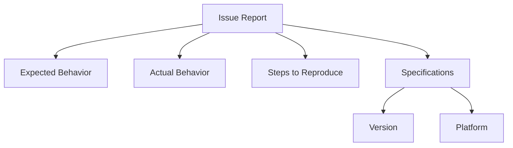
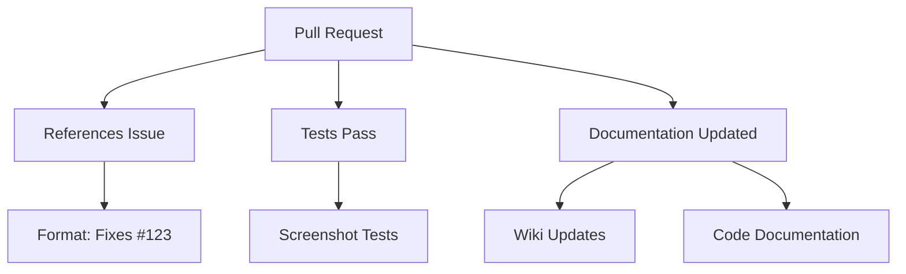
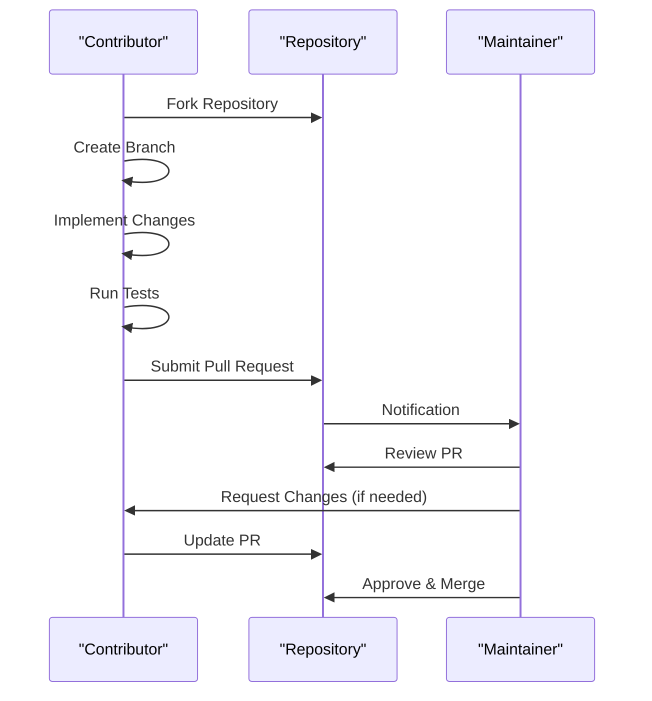
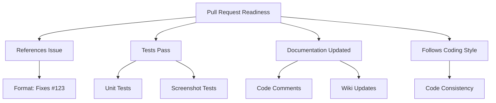
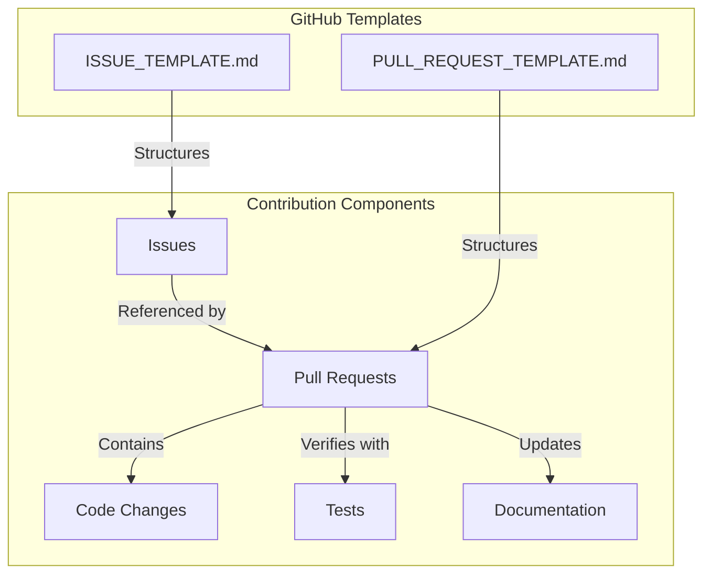

<!-- source: DeepWiki mcp.deepwiki.com · repo android/xr-samples · page 6 Contributing · fetched 2026-10-23 -->

# Contributing

Relevant source files

The following files were used as context for generating this wiki page:

- [.github/ISSUE_TEMPLATE.md](.github/ISSUE_TEMPLATE.md)
- [.github/PULL_REQUEST_TEMPLATE.md](.github/PULL_REQUEST_TEMPLATE.md)

This page outlines the process and guidelines for contributing to the Android XR Samples repository. It provides information on how to report issues, submit pull requests, and follow the project's contribution workflow. For information on setting up and running the sample application, see [Getting Started](#2).

## Contribution Process Overview

The following diagram illustrates the general contribution workflow for the Android XR Samples repository:

```mermaid
flowchart LR
    A["Discover Issue"] --> B["File Issue Report"]
    B --> C["Discuss Solution"]
    C --> D["Fork Repository"]
    D --> E["Implement Changes"]
    E --> F["Run Tests"]
    F --> G["Submit PR"]
    G --> H["Code Review"]
    H --> I["Address Feedback"]
    I --> J["Merge"]
    
    style A stroke-width:2px
    style J stroke-width:2px
```

Sources: [.github/ISSUE_TEMPLATE.md](), [.github/PULL_REQUEST_TEMPLATE.md]()

## Issue Reporting

Before submitting code contributions, it's recommended to first open an issue to discuss the proposed changes. This helps ensure your work aligns with the project's goals and prevents duplicate efforts.

The issue template includes sections for the following information:

When reporting issues, please provide:

- **Expected Behavior**: What you expected to happen
- **Actual Behavior**: What actually happened
- **Steps to Reproduce**: Clear numbered steps to reproduce the issue
- **Specifications**: Version and platform information

The issue template can be found in the repository at [.github/ISSUE_TEMPLATE.md]().

Sources: [.github/ISSUE_TEMPLATE.md]()

## Pull Request Submission

After discussing your proposed changes in an issue, you can submit code contributions via pull requests. The Android XR Samples repository uses a standard GitHub pull request process.

### Pull Request Requirements

Each pull request should:

1. Reference the issue it addresses using the format: `Fixes #<issue_number>`
2. Ensure all tests pass
3. Include appropriate documentation updates

The pull request template can be found in the repository at [.github/PULL_REQUEST_TEMPLATE.md]().

Sources: [.github/PULL_REQUEST_TEMPLATE.md]()

## Contribution Workflow

Follow these steps to contribute to the Android XR Samples repository:

1. **Fork the Repository**: Create your own fork of the repository
2. **Create a Branch**: Make a new branch for your feature or bug fix
3. **Implement Changes**: Make your code changes following the project's coding standards
4. **Test Your Changes**: Ensure all tests pass, including screenshot tests
5. **Submit a Pull Request**: Open a pull request with a clear description of your changes

Sources: [.github/PULL_REQUEST_TEMPLATE.md]()

## Code Contribution Guidelines

When contributing code to the Android XR Samples repository, please adhere to the following guidelines:

### Testing Requirements

All code contributions should include appropriate tests to verify the functionality. The repository uses screenshot testing for UI components, which helps ensure visual consistency.

### Documentation Requirements

Code changes should be accompanied by appropriate documentation updates. This may include:

- In-code documentation (comments)
- Updates to wiki pages
- README changes, if applicable

### Pull Request Checklist

Before submitting your pull request, ensure:

1. You've referenced the issue your PR addresses
2. All tests pass successfully
3. Documentation is updated as needed
4. Your changes align with the project's coding style

Sources: [.github/PULL_REQUEST_TEMPLATE.md]()

## GitHub Templates

The repository includes templates to standardize issue reporting and pull request submissions. These templates help ensure that contributions include all necessary information.

### Issue Template Structure

The issue template is structured to collect specific information about bugs and feature requests:

| Section | Purpose |
|---------|---------|
| Expected Behavior | What should happen |
| Actual Behavior | What actually happens |
| Steps to Reproduce | How to reproduce the issue |
| Specifications | Version and platform details |

Source: [.github/ISSUE_TEMPLATE.md]()

### Pull Request Template Structure

The pull request template includes:

| Element | Purpose |
|---------|---------|
| Issue Reference | Links the PR to the issue it resolves |
| Discussion Note | Encourages opening an issue before PR |
| Tests Checklist | Ensures tests are passing |
| Documentation Checklist | Ensures documentation is updated |

Source: [.github/PULL_REQUEST_TEMPLATE.md]()

## Relationship Between Contribution Components

The following diagram shows the relationship between the different components of the contribution process:

Sources: [.github/ISSUE_TEMPLATE.md](), [.github/PULL_REQUEST_TEMPLATE.md]()

## Conclusion

Contributing to the Android XR Samples repository involves following standard GitHub workflows and ensuring your contributions meet the project's quality standards. By following the guidelines outlined in this document, you can help improve the repository and ensure your contributions are successfully integrated.

For more information on specific XR features of the project, refer to the [XR Features Overview](#3.2).

---

