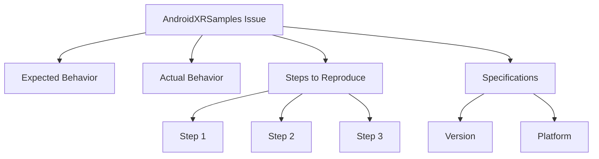
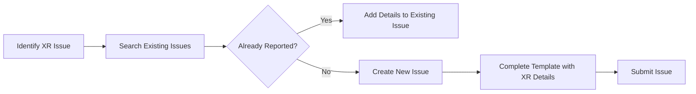
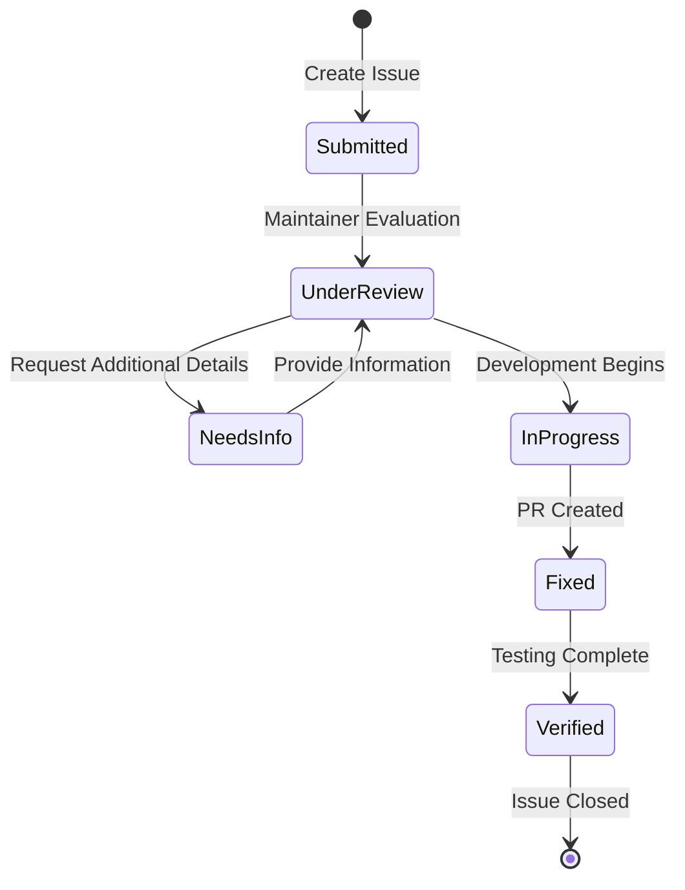

<!-- source: DeepWiki mcp.deepwiki.com · repo android/xr-samples · page 6.1 Reporting Issues · fetched 2026-10-23 -->

# Reporting Issues

<details>
<summary>Relevant source files</summary>

The following files were used as context for generating this wiki page:

- [.github/ISSUE_TEMPLATE.md](.github/ISSUE_TEMPLATE.md)

</details>


This document outlines the technical process for reporting issues with the Android XR Samples repository. Effective issue reporting helps maintainers identify, reproduce, and fix problems efficiently.

## Issue Template Structure

When reporting issues, use the template provided in the repository. The Android XR Samples issue template contains four key sections:



Sources: [.github/ISSUE_TEMPLATE.md:1-16]()

## Completing the Issue Template

### Expected Behavior

Describe the correct functionality you expected from the Android XR feature or component.

Example for an XR feature issue:
```
The Spatial Panel should maintain its position relative to the AR anchor when the device moves around it.
```

### Actual Behavior

Document the actual behavior you observed that differs from expectations. Include error messages, visual artifacts, or functionality issues.

Example:
```
The Spatial Panel drifts approximately 10cm upward when circling around it with the device. 
LogCat shows: "W/SceneCore: Anchor position adjustment applied (delta=0.1m)"
```

### Steps to Reproduce

Provide a sequential list of actions that can reproduce the issue consistently:

Example:
```
1. Open HelloAndroidXR app
2. Navigate to the Spatial Panels demo
3. Place a panel on a horizontal surface with good texture
4. Walk in a full circle around the panel while keeping it in view
5. Observe the panel's vertical position relative to its original placement
```

### Specifications

List the technical environment details:

Example:
```
- Version: Android XR Samples v1.1.0
- Platform: Samsung Galaxy S22, Android 13, ARCore v1.36.0
```

Sources: [.github/ISSUE_TEMPLATE.md:1-16]()

## Issue Reporting Process

The following diagram illustrates the recommended workflow for reporting issues:



Sources: [.github/ISSUE_TEMPLATE.md]()

## XR-Specific Reporting Guidelines

For effective reporting of Android XR issues, include these additional details based on the component:

| XR Component | Additional Information to Include |
|--------------|----------------------------------|
| AR Tracking | Lighting conditions, surface textures, device movement patterns |
| Spatial Panels | Surface type, viewing distance, interaction methods |
| Orbiters | Configuration parameters, target objects, motion patterns |
| Environments | Environment type, room size, feature points density |
| SceneCore | Render mode, anchor types, tracking confidence values |

## Issue Lifecycle

After submission, your issue will progress through the following states:



## Related Documentation

- For information on submitting code changes, see [Submitting Pull Requests](#6.2)
- For general contribution guidelines, see [Contributing](#6)

Sources: [.github/ISSUE_TEMPLATE.md]()

---

