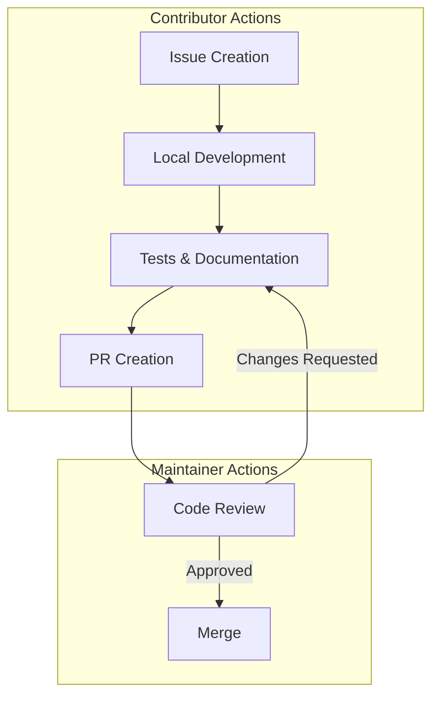
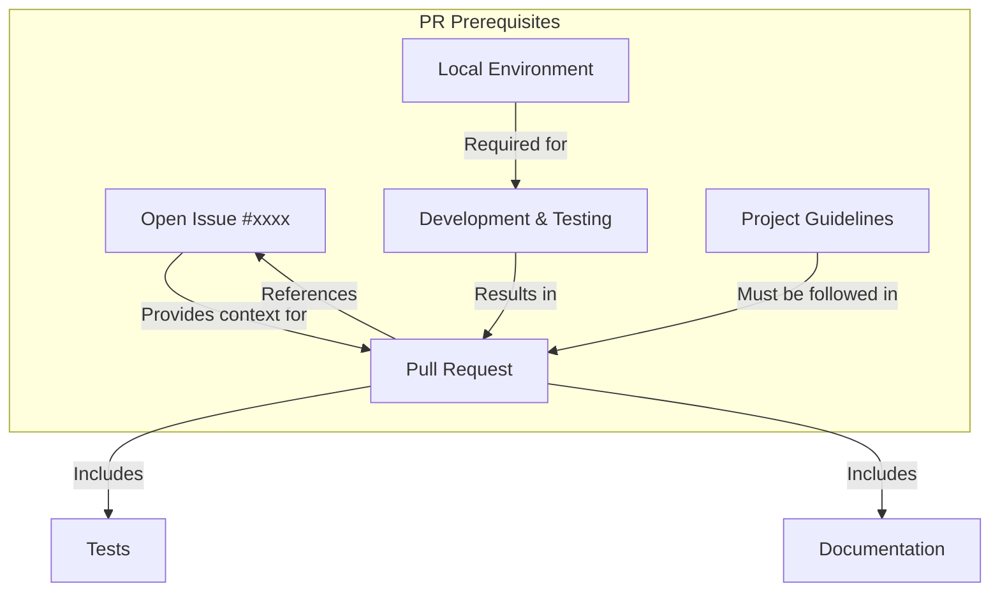
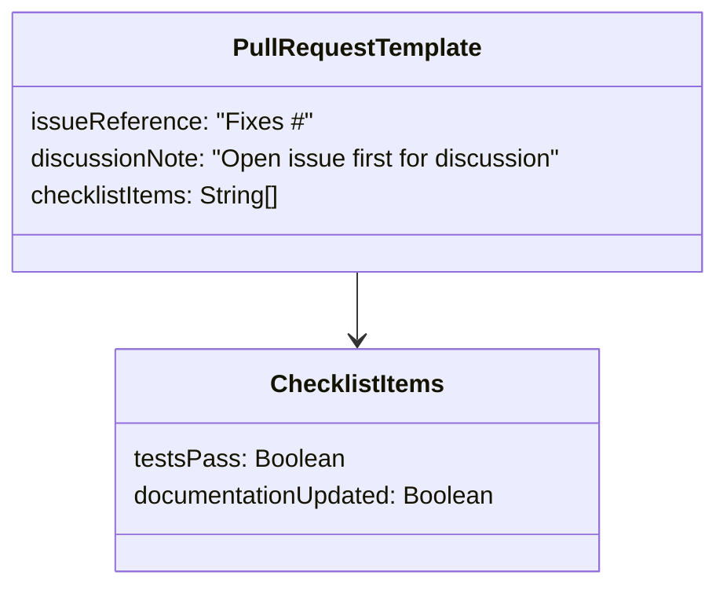
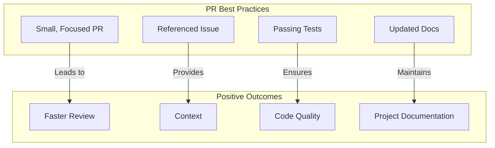

<!-- source: DeepWiki mcp.deepwiki.com · repo android/xr-samples · page 6.2 Submitting Pull Requests · fetched 2026-10-23 -->

# Submitting Pull Requests

<details>
<summary>Relevant source files</summary>

The following files were used as context for generating this wiki page:

- [.github/PULL_REQUEST_TEMPLATE.md](.github/PULL_REQUEST_TEMPLATE.md)

</details>


This document outlines the process and requirements for submitting pull requests (PRs) to the Android XR Samples repository. It provides detailed guidance on how to prepare, create, and submit changes for inclusion in the codebase. For information about reporting issues before creating a pull request, see [Reporting Issues](#6.1).

## Pull Request Process Overview

The Android XR Samples repository uses pull requests to manage code contributions. This process ensures that all changes are reviewed and tested before being merged into the main codebase.



Sources: `.github/PULL_REQUEST_TEMPLATE.md`

## Prerequisites

Before submitting a pull request, ensure you have:

1. An open issue describing the problem or feature (recommended)
2. A local development environment set up
3. Familiarity with git and GitHub workflows

The PR template explicitly states: "It's a good idea to open an issue first for discussion." This ensures alignment with project goals before significant development work.



Sources: `.github/PULL_REQUEST_TEMPLATE.md:1-3`

## Creating a Pull Request

### 1. Fork and Clone

Start by forking the repository and cloning it to your local machine.

### 2. Create a Feature Branch

Create a new branch for your changes with a descriptive name related to the issue you're addressing:

```
git checkout -b fix-issue-123
```

### 3. Make Your Changes

Implement your changes, ensuring they adhere to the project's coding standards.

### 4. Run Tests

Verify that all tests pass before submitting your pull request. The PR template contains a checklist item "Tests pass" that must be confirmed.

### 5. Update Documentation

Update any relevant documentation to reflect your changes. This is explicitly required in the PR template as "Appropriate changes to documentation are included in the PR".

### 6. Commit and Push

Commit your changes with a clear commit message that references the issue number:

```
git commit -m "Fix rendering issue in spatial panels, fixes #123"
```

Push your branch to your forked repository:

```
git push origin fix-issue-123
```

### 7. Submit the Pull Request

Submit your pull request through the GitHub interface, making sure to fill out the pull request template completely.

Sources: `.github/PULL_REQUEST_TEMPLATE.md:5-6`

## Pull Request Template

The repository includes a standard pull request template that must be filled out when submitting a PR. The template helps maintainers understand the purpose and scope of your changes.



The template requires:
1. A reference to the issue being fixed
2. Confirmation that tests pass
3. Confirmation that appropriate documentation changes are included

Sources: `.github/PULL_REQUEST_TEMPLATE.md`

## PR Requirements Checklist

Before submitting your pull request, ensure it meets these requirements:

| Requirement | Description | Template Reference |
|-------------|-------------|-------------------|
| Issue Link | PR should reference an existing issue | "Fixes #<issue_number_goes_here>" |
| Tests | All tests must pass | "- [ ] Tests pass" |
| Documentation | Update documentation as needed | "- [ ] Appropriate changes to documentation are included in the PR" |
| Code Quality | Code follows project standards | Implied requirement |
| Scope | PR addresses a single concern | Best practice |

Sources: `.github/PULL_REQUEST_TEMPLATE.md:1-6`

## Review Process

After submitting your pull request:

1. Maintainers will review your code
2. Automated checks will run to verify code quality and test passing
3. You may be asked to make changes based on feedback
4. Once approved, a maintainer will merge your pull request

## Best Practices

1. **Keep PRs Small**: Focus on a single issue or feature to make review easier
2. **Descriptive Titles**: Use clear, concise titles that describe what the PR does
3. **Reference Issues**: Always reference the issue your PR addresses
4. **Respond to Feedback**: Address review comments promptly
5. **Update PR**: If master changes, rebase your branch to avoid conflicts



Sources: `.github/PULL_REQUEST_TEMPLATE.md`

## Troubleshooting

If you encounter issues during the PR process:

1. **PR Template Not Appearing**: Ensure you're using GitHub's pull request interface correctly
2. **Tests Failing**: Debug locally before pushing changes
3. **Review Feedback**: Ask for clarification if review comments aren't clear

## Conclusion

Following these guidelines will help ensure your contributions to the Android XR Samples repository are processed efficiently. Remember that the main purpose of the pull request process is to maintain code quality and project coherence while incorporating valuable contributions.

---

