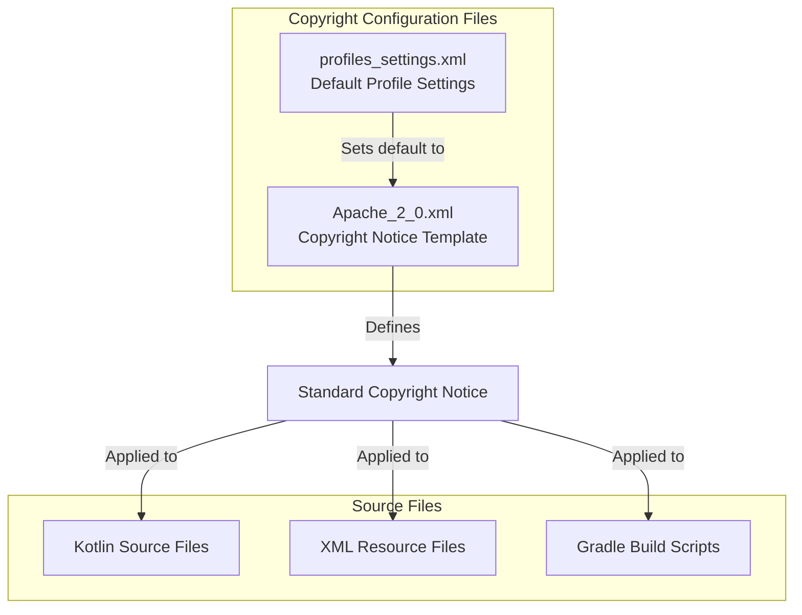
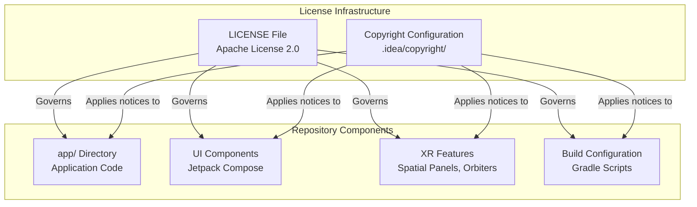
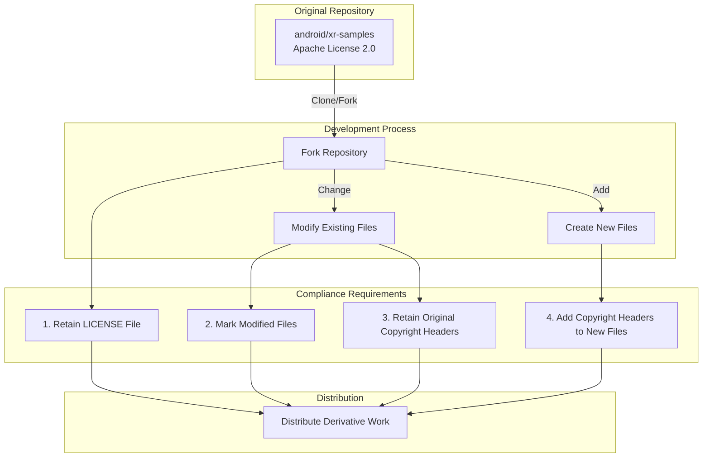

<!-- source: DeepWiki mcp.deepwiki.com · repo android/xr-samples · page 7 License Information · fetched 2026-10-23 -->

# License Information

<details>
<summary>Relevant source files</summary>

The following files were used as context for generating this wiki page:

- [.idea/copyright/Apache_2_0.xml](.idea/copyright/Apache_2_0.xml)
- [.idea/copyright/profiles_settings.xml](.idea/copyright/profiles_settings.xml)
- [LICENSE](LICENSE)

</details>


This document provides detailed information about the licensing terms that govern the Android XR Samples repository. It explains how the Apache License 2.0 is applied throughout the codebase and outlines the implications for users and contributors.

## License Overview

The Android XR Samples repository is licensed under the Apache License, Version 2.0. This permissive open-source license grants users the freedom to use, modify, distribute, and sublicense the code, subject to certain conditions specified in the license.

Sources: [LICENSE]()

## Apache License 2.0 Key Provisions

The complete text of the Apache License 2.0 can be found in the [LICENSE]() file at the root of the repository. The following table summarizes its key provisions:

| Provision | Description | License Section |
|-----------|-------------|----------------|
| Copyright License | Grants a perpetual, worldwide, non-exclusive, no-charge, royalty-free, irrevocable copyright license | Section 2 |
| Patent License | Grants a patent license with termination clause for patent litigation | Section 3 |
| Redistribution Requirements | Requires providing license copy, marking modified files, retaining notices | Section 4 |
| Contribution Terms | Contributions are under the same license terms unless explicitly stated otherwise | Section 5 |
| Trademark Usage | No permission to use trademarks except for reasonable and customary use | Section 6 |
| Warranty Disclaimer | Code provided "AS IS" without warranties | Section 7 |
| Liability Limitation | Limited liability for contributors | Section 8 |

Sources: [LICENSE:67-175]()

## Copyright Management in the Repository

The copyright for the Android XR Samples repository is held by "The Android Open Source Project." Copyright management is implemented through IntelliJ IDEA's copyright system, which ensures consistent copyright notices across all files in the codebase.

### Copyright Configuration Structure

The following diagram illustrates how copyright notices are configured and applied in the repository:



Sources: [.idea/copyright/Apache_2_0.xml](), [.idea/copyright/profiles_settings.xml]()

### Standard Copyright Notice

The standard copyright notice applied to files in the repository has the following format:

```
Copyright 2024 The Android Open Source Project

Licensed under the Apache License, Version 2.0 (the "License");
you may not use this file except in compliance with the License.
You may obtain a copy of the License at

    https://www.apache.org/licenses/LICENSE-2.0

Unless required by applicable law or agreed to in writing, software
distributed under the License is distributed on an "AS IS" BASIS,
WITHOUT WARRANTIES OR CONDITIONS OF ANY KIND, either express or implied.
See the License for the specific language governing permissions and
limitations under the License.
```

Sources: [.idea/copyright/Apache_2_0.xml:3](), [.idea/copyright/profiles_settings.xml:1-15]()

## License Application to Repository Components

The following diagram shows how the license applies to different components of the Android XR Samples repository:



Sources: [LICENSE](), [.idea/copyright/Apache_2_0.xml](), [.idea/copyright/profiles_settings.xml]()

## License Compliance Workflow

When creating derivative works based on the Android XR Samples repository, following the proper license compliance workflow is essential. The diagram below illustrates this process:



Sources: [LICENSE:90-129]()

## Rights and Responsibilities

### User Rights

Under the Apache License 2.0, users of the Android XR Samples repository have the following rights:

- Use the code for any purpose, including commercial applications
- Modify the code to meet specific requirements
- Distribute the original or modified code
- Sublicense the code under different terms (while still complying with Apache 2.0)

### User Responsibilities

When redistributing the code, users must:

1. Include a copy of the Apache License 2.0
2. Clearly mark any files that have been modified
3. Retain all copyright, patent, trademark, and attribution notices
4. Include any NOTICE file with attributions (if applicable)

### Contributor Information

For contributors to the Android XR Samples repository:

- All contributions are automatically subject to the Apache License 2.0 unless explicitly stated otherwise
- Contributors retain copyright ownership of their contributions
- Patent claims that would be infringed by contributions are subject to the patent license grant
- The license does not grant permission to use trademarks except for attribution purposes

Sources: [LICENSE:131-137](), [LICENSE:139-142]()

## Summary

The Android XR Samples repository is governed by the Apache License 2.0, which provides users with significant freedom to use, modify, and distribute the code while protecting contributors through specific requirements for redistribution and contribution terms. Copyright notices are systematically applied to all files through the repository's copyright configuration to ensure consistency and proper attribution.

For more information about contributing to the repository, see [Contributing](#6).