# Page: Overview

# Overview

<details>
<summary>Relevant source files</summary>

The following files were used as context for generating this wiki page:

- [README.md](README.md)
- [app/build.gradle.kts](app/build.gradle.kts)

</details>


This document provides an introduction to the Android XR Samples repository, which serves as a reference implementation demonstrating fundamental XR (Extended Reality) capabilities available to Android applications in the Android XR environment. The repository contains sample code showcasing key XR features and patterns for building immersive applications.

For information about specific XR features implementation details, see [XR Features Overview](#3.2).

## Purpose and Scope

The Hello Android XR sample repository is designed to:

1. Demonstrate practical implementations of core Android XR features
2. Provide developers with working examples of XR functionality
3. Illustrate best practices for Android XR application development
4. Serve as a starting point for building XR applications

The sample application shows how to incorporate spatial computing concepts into Android applications using official Android XR APIs and libraries.

Sources: [README.md:1-15]()

## Repository Architecture

The sample application demonstrates a typical Android XR application structure, integrating AR/XR capabilities with modern Android development practices.

### High-Level Architecture

**Android XR Application Architecture**
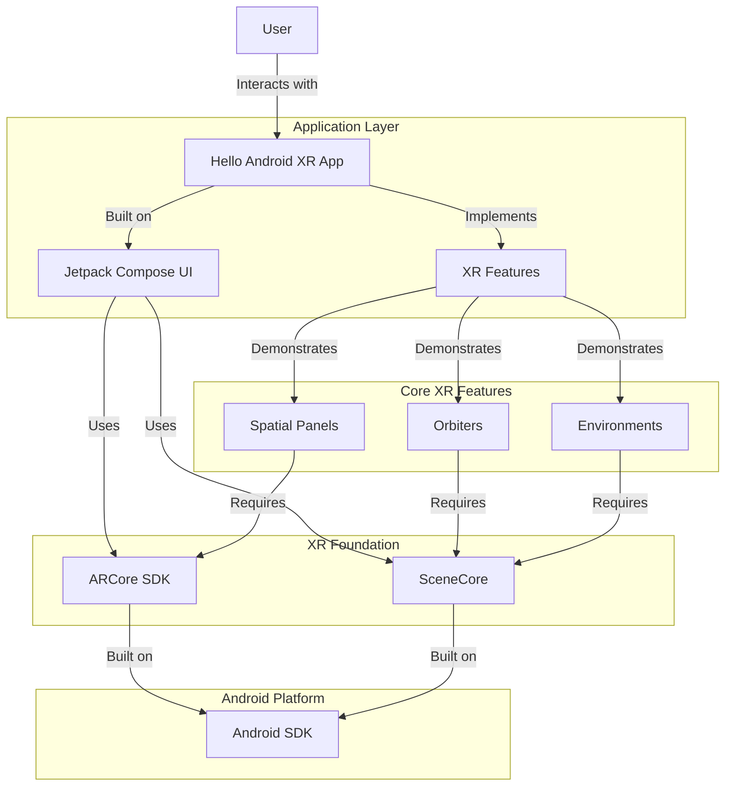

The application follows a layered architecture where Jetpack Compose provides the UI framework, while ARCore and SceneCore form the XR foundation. The sample demonstrates three key XR features: Spatial Panels, Orbiters, and Environments.

Sources: [README.md:8-15](), [app/build.gradle.kts:67-69]()

## Technology Stack

The Hello Android XR application leverages several key technologies and libraries to implement XR functionality.

**Technology Dependencies**
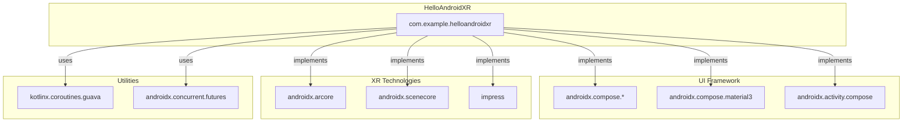

The application is built using:

- **Jetpack Compose**: Modern declarative UI toolkit for Android
- **ARCore**: Google's platform for building augmented reality experiences
- **SceneCore**: Library for 3D scene management and rendering
- **Impress**: (Likely a library related to XR interactions or rendering)
- **Material Design Components**: For consistent UI elements
- **Kotlin Coroutines**: For asynchronous programming

Sources: [app/build.gradle.kts:63-82]()

## Key XR Features

The sample application demonstrates three primary XR features:

| Feature | Description | Implementation |
|---------|-------------|----------------|
| **Spatial Panels** | UI surfaces that exist in 3D space | Implemented using ARCore and Compose |
| **Orbiters** | Objects that orbit or follow the user in XR space | Built on SceneCore functionality |
| **Environments** | XR environment configuration and manipulation | Leverages SceneCore capabilities |

These features showcase fundamental XR interaction patterns and implementation techniques that developers can adapt for their own applications.

Sources: [README.md:8-15]()

## Project Configuration

The application is configured with the following specifications:

- **Application ID**: `com.example.helloandroidxr`
- **Minimum SDK**: 23
- **Target SDK**: 35
- **Kotlin Compiler Version**: Uses Kotlin compiler extension version 1.5.4
- **Build Features**: Enables Compose and screenshot testing

The project uses the Gradle build system and can be imported directly into Android Studio.

Sources: [app/build.gradle.kts:24-61](), [README.md:17-21]()

## Development Environment

The Hello Android XR sample is designed to be used with:

- Latest stable version of Android Studio
- Gradle build system
- Android SDK with ARCore support

The repository includes screenshot testing capabilities to ensure UI consistency across different devices and screen configurations.

Sources: [README.md:17-21](), [app/build.gradle.kts:60-61]()

## Additional Resources

The Android team provides comprehensive documentation on XR development:

- Android XR platform overviews
- Development guides for XR applications
- UI design guidelines for XR interfaces
- XR Developer Bootcamp resources

For more in-depth information about building and running the sample application, see [Getting Started](#2).

Sources: [README.md:23-28]()

## License

The Hello Android XR sample is distributed under the terms of the Apache License (Version 2.0).

Sources: [README.md:30-33](), [app/build.gradle.kts:1-15]()

---

# Page: Repository Structure

# Repository Structure

<details>
<summary>Relevant source files</summary>

The following files were used as context for generating this wiki page:

- [.gitignore](.gitignore)
- [README.md](README.md)
- [app/.gitignore](app/.gitignore)

</details>


This document provides a comprehensive overview of the Android XR Samples repository organization and its key files. It serves as a map to help developers navigate the codebase efficiently. For information about building and running the application, see [Getting Started](#2), and for details about the application architecture, see [Application Architecture](#3).

## Repository Overview

The Android XR Samples repository follows a standard Android project structure, with specific organization for XR-related features. Below is a high-level visualization of the repository structure:

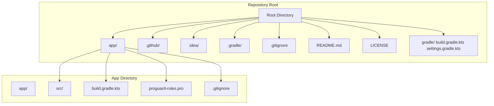

Sources: [.gitignore](), [README.md](), [app/.gitignore]()

## Main Directory Structure

The repository follows a standard Android project organization with the following key directories:

| Directory | Purpose |
|-----------|---------|
| `app/` | Contains the main application code and resources |
| `.github/` | GitHub-specific files for issues and pull requests |
| `.idea/` | IntelliJ IDEA/Android Studio configuration files |
| `gradle/` | Gradle wrapper files and configurations |

Sources: [.gitignore](), [README.md]()

## App Directory Organization

The `app/` directory contains the core application code and follows the standard Android application structure:

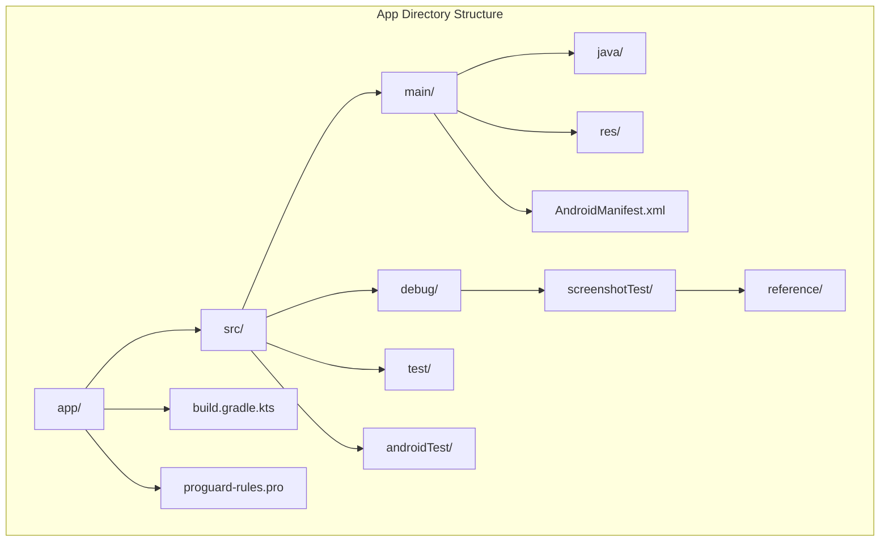

Sources: [app/.gitignore]()

## Key Files and Their Purposes

The repository contains several important files that configure and define the application:

| File | Purpose |
|------|---------|
| `app/build.gradle.kts` | Configures application build settings, dependencies, and SDK versions |
| `app/proguard-rules.pro` | Defines code shrinking and obfuscation rules for release builds |
| `README.md` | Provides an overview of the project, features, and development environment |
| `LICENSE` | Contains the Apache License (Version 2.0) terms for the project |
| `.gitignore` | Specifies files and directories to be excluded from version control |

Sources: [.gitignore](), [README.md]()

## Source Code Organization

The source code is organized to separate different aspects of the XR application. The main features demonstrated in the code include:

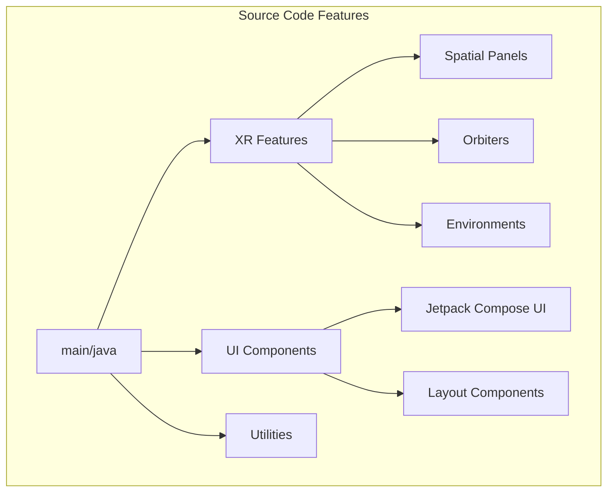

Sources: [README.md]()

## Build Configuration

The application uses Gradle for its build system, with the main configuration in `app/build.gradle.kts`. This file defines:

- Application ID
- Target and minimum SDK versions
- Dependencies on ARCore, SceneCore, and Jetpack Compose
- Build variants and types
- Signing configurations
- Test configurations

The project also includes ProGuard rules for code optimization during release builds.

Sources: [README.md]()

## Testing Resources

The repository includes support for screenshot testing, which helps maintain UI consistency:

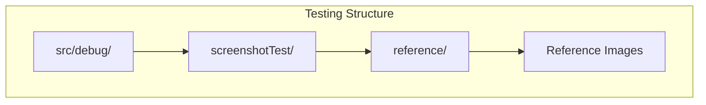

The screenshot test infrastructure is contained in the debug build variant, with reference images stored in the reference directory. This allows developers to compare UI changes against baseline images.

Sources: [app/.gitignore]()

## Version Control Configuration

The repository uses Git for version control, with specific exclusion patterns defined in `.gitignore` files:

| Excluded Items | Reason |
|----------------|--------|
| Build outputs (*.apk, *.dex, *.class) | Generated files, not part of source code |
| Build directories (bin/, gen/, out/, build/) | Generated during build process |
| Local configuration (local.properties) | Contains developer-specific settings |
| IDE files (*.iml, most .idea/ content) | IDE-specific, not relevant to all developers |
| Gradle cache (.gradle/) | Local cache, regenerated as needed |
| System files (.DS_Store) | OS-specific files |
| Kotlin compiler files (.kotlin/) | Generated during compilation |

This configuration ensures only relevant source code and configuration files are tracked in version control.

Sources: [.gitignore](), [app/.gitignore]()

## Documentation Resources

The repository includes documentation resources that provide context and usage information:

- `README.md`: Provides an overview of features, development environment, and additional resources
- URL references to Android XR documentation on developer.android.com
- License information

These documentation resources help developers understand the purpose and usage of the sample code.

Sources: [README.md]()

## GitHub Configuration

The `.github/` directory likely contains templates for issues and pull requests to standardize contributions to the repository. This includes:

- Issue templates that guide users in reporting bugs or requesting features
- Pull request templates that ensure proper documentation and testing of changes

These templates help maintain code quality and consistency across contributions.

Sources: [.gitignore]()

---

# Page: Getting Started

# Getting Started

<details>
<summary>Relevant source files</summary>

The following files were used as context for generating this wiki page:

- [README.md](README.md)
- [app/build.gradle.kts](app/build.gradle.kts)

</details>


This guide walks you through the initial setup and running of the Android XR Samples application. It covers environment setup, project import, build configuration, and running the sample. For details about the application architecture, please see [Application Architecture](#3), and for specific XR features, refer to [XR Features Overview](#3.2).

## Prerequisites

Before getting started with the Android XR Samples, ensure you have the following prerequisites:

- Android Studio (latest stable version)
- Android SDK with API level 35 installed
- A compatible Android device supporting ARCore or an emulator configured for XR development
- Basic knowledge of Android development and Kotlin

Sources: [app/build.gradle.kts:25-31](), [README.md:18-21]()

## Development Environment Setup

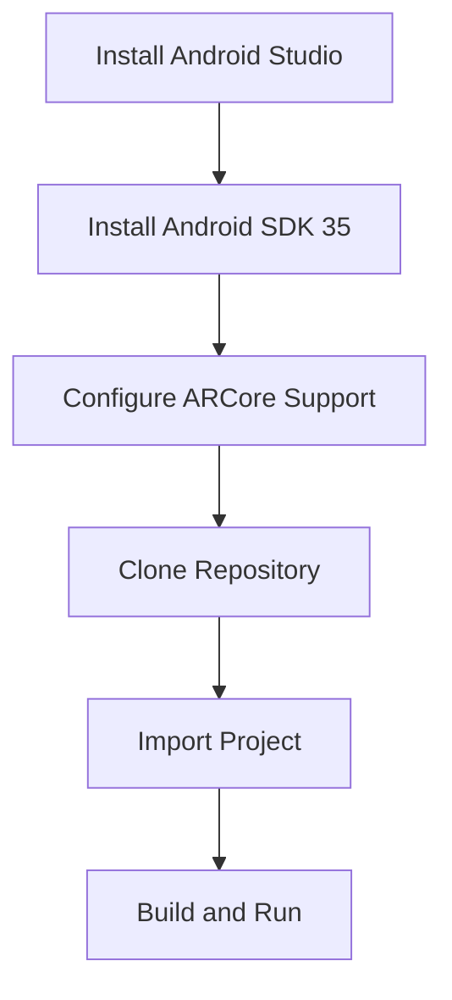

1. **Install Android Studio**
   - Download and install the latest stable version of Android Studio from the [official Android developer website](https://developer.android.com/studio)

2. **Configure SDK**
   - Launch Android Studio
   - Go to Tools > SDK Manager
   - Ensure Android SDK Platform 35 is installed (as specified in the build configuration)
   - Install Android SDK Build-Tools version compatible with SDK 35

3. **Enable ARCore Support**
   - In SDK Manager, go to the SDK Tools tab
   - Check "Google Play Services for AR" (ARCore)
   - Apply changes and wait for installation to complete

Sources: [app/build.gradle.kts:26](), [README.md:18-21]()

## Importing the Project

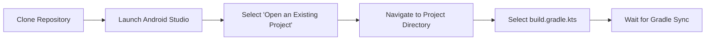

1. **Clone the Repository**
   - Clone the repository using Git:
     ```
     git clone https://github.com/android/xr-samples
     ```
   - Alternatively, download the ZIP file from GitHub and extract it

2. **Import into Android Studio**
   - Launch Android Studio
   - Select "Open an Existing Project"
   - Navigate to the cloned or extracted project directory
   - Select the root build.gradle.kts file
   - Click "OK" and wait for the Gradle sync to complete

Sources: [README.md:19-21]()

## Project Structure Overview

Below is a simplified view of the project structure showing the key files and directories relevant for getting started:

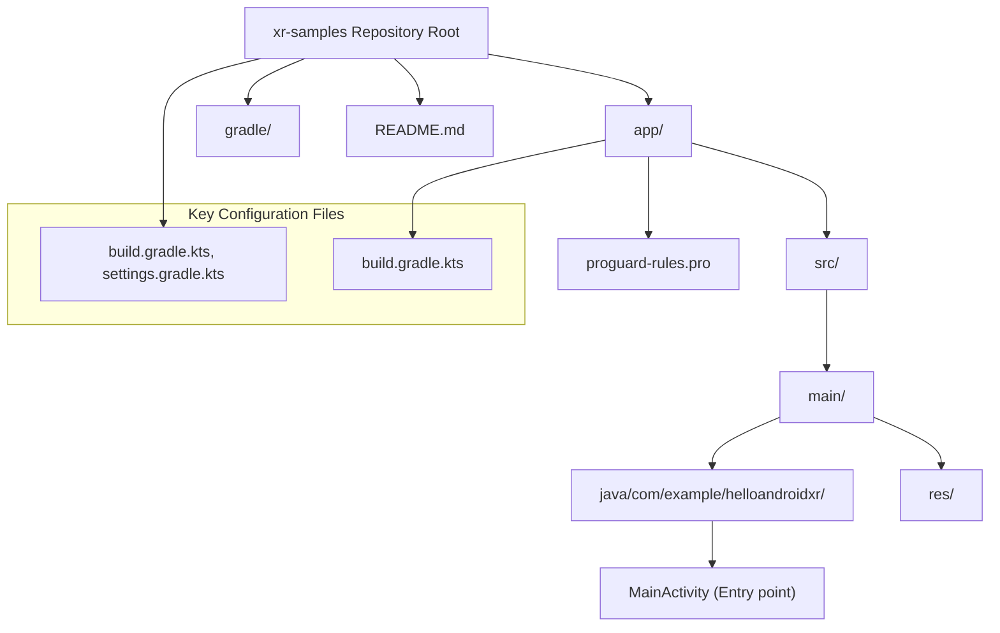

The entry point of the application is the MainActivity class, and the main configuration is defined in the `app/build.gradle.kts` file.

Sources: [app/build.gradle.kts](), [README.md]()

## Build Configuration

The sample app uses the Gradle build system with Kotlin DSL. Key aspects of the build configuration include:

| Configuration | Value | Description |
|---------------|-------|-------------|
| Namespace     | `com.example.helloandroidxr` | Application package name |
| Compile SDK   | 35    | Android SDK version to compile against |
| Min SDK       | 23    | Minimum supported Android version |
| Target SDK    | 35    | Target Android version |
| Kotlin        | JVM Target 1.8 | Kotlin compilation target |
| Compose       | Enabled | Jetpack Compose UI toolkit |

### Key Dependencies

The application depends on several important libraries:

1. **XR-specific libraries**:
   - ARCore: `androidx.arcore`
   - SceneCore: `androidx.scenecore`
   - Impress (Android XR library): `impress`

2. **UI and Compose**:
   - Jetpack Compose BOM
   - Material Design
   - Material3
   - Compose Runtime
   - Activity Compose

3. **Asynchronous Programming**:
   - Kotlin Coroutines with Guava support
   - Android Concurrent Futures

Sources: [app/build.gradle.kts:24-61](), [app/build.gradle.kts:63-82]()

## Running the Sample Application

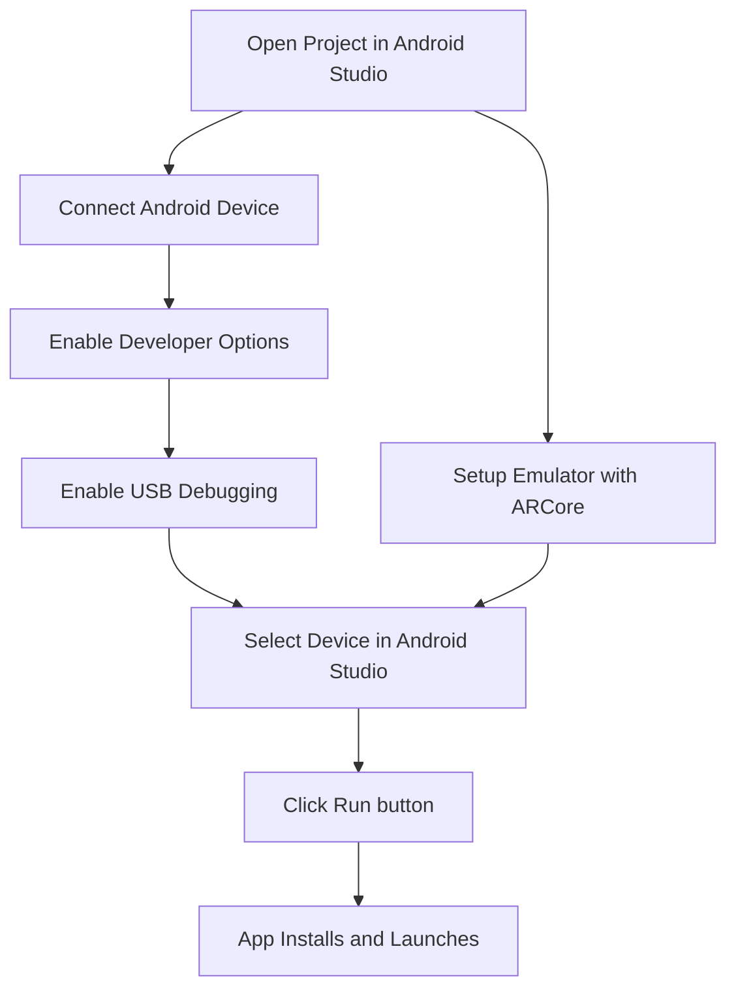

1. **Prepare your device**:
   - If using a physical device:
     - Enable Developer Options on your Android device
     - Enable USB Debugging
     - Connect your device to your computer
     - Ensure your device supports ARCore
   - If using an emulator:
     - Create an emulator with Google Play Services
     - Ensure ARCore is supported on the emulator image

2. **Build and Run**:
   - In Android Studio, select your device from the dropdown menu in the toolbar
   - Click the "Run" button (green triangle)
   - Android Studio will build the app and install it on your device
   - The app will launch automatically

3. **Verify Installation**:
   - Once launched, the Hello Android XR app should display the initial XR environment
   - Follow the on-screen instructions to interact with the XR features

Sources: [app/build.gradle.kts:28-35](), [README.md:9-15]()

## Troubleshooting Common Issues

| Issue | Solution |
|-------|----------|
| Gradle sync fails | Check if you have the latest Android Studio version and update Gradle plugin if needed |
| Missing SDK components | Open SDK Manager and install any missing components, particularly Android SDK 35 |
| ARCore not working | Ensure your device supports ARCore and Google Play Services for AR is installed |
| Build errors | Check that you have all required dependencies and correct SDK versions configured |
| App crashes at startup | Check logcat for specific error messages and ensure device supports the minimum required API level (23) |

## Next Steps

After successfully setting up and running the Android XR Samples application, you might want to explore:

1. The implementation of specific XR features (see [XR Features Overview](#3.2))
2. The application architecture (see [Application Architecture](#3))
3. UI components used in the sample (see [UI Components](#4))
4. How to contribute to the project (see [Contributing](#6))

For more information on Android XR development, refer to the official documentation referenced in the [README.md:23-28]().

Sources: [README.md:8-15](), [README.md:23-28]()

---

# Page: Build Configuration

# Build Configuration

<details>
<summary>Relevant source files</summary>

The following files were used as context for generating this wiki page:

- [app/build.gradle.kts](app/build.gradle.kts)
- [app/proguard-rules.pro](app/proguard-rules.pro)

</details>


This document explains the Gradle build configuration for the Android XR Samples application. It covers the build files, plugin structure, application settings, and dependencies that comprise the build system. For information about running the application, see [Getting Started](#2).

## Overview

The Android XR Samples application uses the Gradle build system with Kotlin DSL. The build configuration defines the application's properties, dependencies, and build processes necessary for compiling and packaging the XR sample application.

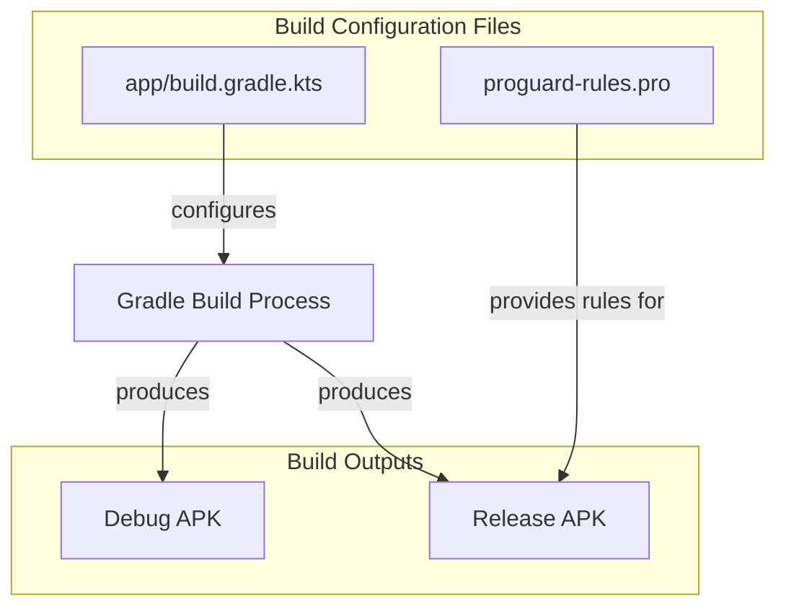

Sources: [app/build.gradle.kts:1-62](). [app/proguard-rules.pro:1-21]().

## Gradle Plugins

The application uses several Gradle plugins to enable specific functionality:

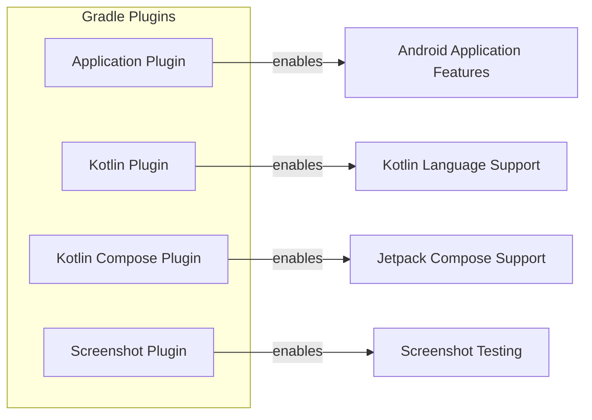

Sources: [app/build.gradle.kts:17-22]().

The primary plugins used include:
- `android.application` - Provides core Android application build functionality
- `kotlin.android` - Adds Kotlin language support for Android
- `kotlin.compose` - Enables Kotlin compiler extensions for Compose
- `screenshot` - Enables screenshot testing capabilities

## Android Configuration

The Android configuration section defines essential application properties:

| Property | Value | Description |
|----------|-------|-------------|
| Namespace | `com.example.helloandroidxr` | Application's package namespace |
| Application ID | `com.example.helloandroidxr` | Unique identifier for the app |
| Compile SDK | 35 | Android SDK version used for compilation |
| Min SDK | 23 | Minimum supported Android SDK version |
| Target SDK | 35 | Target Android SDK version |
| Version Code | 1 | Internal version number |
| Version Name | "1.0" | User-visible version name |

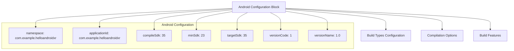

Sources: [app/build.gradle.kts:24-36]().

## Build Types

The build configuration defines different build types with specific settings:

### Release Build
- `isMinifyEnabled = false` - Code shrinking is disabled
- References ProGuard rules from:
  - Default Android ProGuard rules
  - Project-specific rules in `proguard-rules.pro`

Sources: [app/build.gradle.kts:38-46](). [app/proguard-rules.pro:1-21]().

## Compilation Options

The build system specifies Java and Kotlin compilation options:

- Java compatibility: Java 1.8 for both source and target
- Kotlin JVM target: 1.8
- Kotlin Compose compiler extension version: 1.5.4

Sources: [app/build.gradle.kts:47-59]().

## Build Features

The configuration enables specific build features:

- Jetpack Compose: `compose = true`
- Screenshot testing: enabled via experimental properties

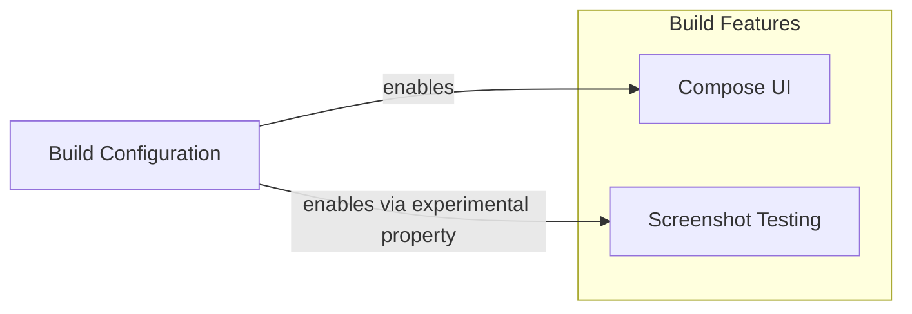

Sources: [app/build.gradle.kts:54-60]().

## Dependencies

The build configuration defines the application's dependencies, which can be categorized as follows:

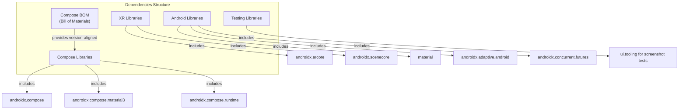

Sources: [app/build.gradle.kts:63-82]().

### Key Dependencies

1. **XR Dependencies**
   - `impress` - XR composable UI library
   - `androidx.arcore` - ARCore framework support
   - `androidx.scenecore` - 3D scene rendering framework

2. **Compose Dependencies**
   - Compose BOM (Bill of Materials) - Ensures compatible Compose library versions
   - `androidx.compose` - Core Compose framework
   - `androidx.compose.material3` - Material Design 3 components
   - `androidx.compose.runtime` - Compose runtime
   - `androidx.activity.compose` - Activity integration for Compose

3. **Kotlin Dependencies**
   - `kotlinx.coroutines.guava` - Coroutines integration with Guava

4. **Testing Dependencies**
   - `androidx.compose.ui.tooling` - UI tooling for screenshot tests

Sources: [app/build.gradle.kts:63-82]().

## Build Process Flow

The following diagram illustrates the build process flow:

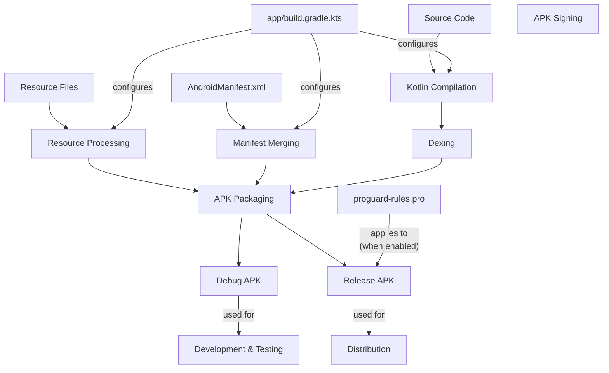

Sources: [app/build.gradle.kts:1-82](). [app/proguard-rules.pro:1-21]().

## ProGuard Configuration

The project includes a ProGuard configuration file that defines code shrinking, obfuscation, and optimization rules for release builds. Currently, most rules are commented out in the template, providing guidance for:

- JavaScript interface preservation for WebView
- Preserving line number information for debugging
- Source file name obfuscation

Note that code shrinking is currently disabled in the release build configuration (`isMinifyEnabled = false`).

Sources: [app/proguard-rules.pro:1-21](). [app/build.gradle.kts:38-46]().

---

# Page: Application Architecture

# Application Architecture

<details>
<summary>Relevant source files</summary>

The following files were used as context for generating this wiki page:

- [README.md](README.md)
- [app/build.gradle.kts](app/build.gradle.kts)

</details>


This document describes the high-level architecture of the Android XR Samples application. It outlines the key components, their interactions, and how the XR features are integrated into the application structure. For specific details about individual XR features, see [XR Features Overview](#3.2).

## Core Architecture

The Android XR Samples application follows a modular architecture centered around demonstrating XR capabilities. The application is structured to showcase how various XR features can be integrated into a standard Android application.

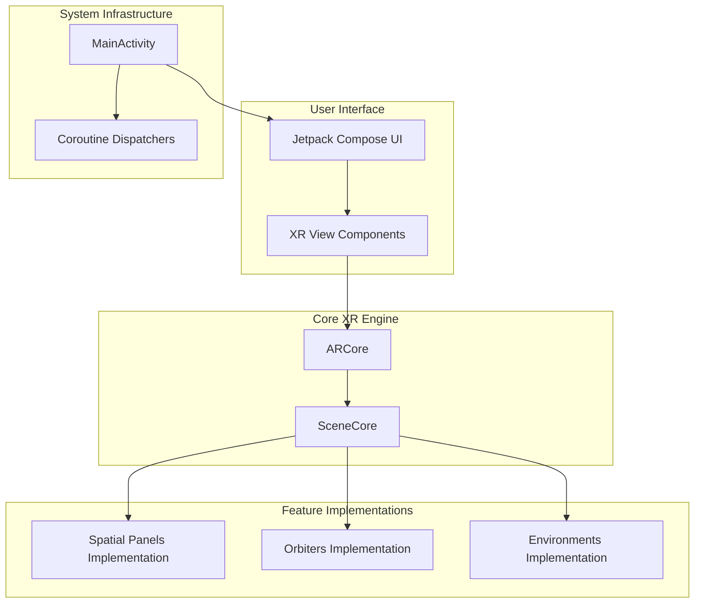

**Core Component Relationships Diagram**

Sources: [app/build.gradle.kts:63-81](), [README.md:9-15]()

The architecture is built upon several key technologies:

1. **Core XR Engines**:
   - ARCore: Provides fundamental AR capabilities
   - SceneCore: Manages 3D scene representation and rendering

2. **UI Layer**:
   - Jetpack Compose: Handles UI composition and traditional Android UI elements
   - XR View Components: Bridge between traditional UI and XR content

3. **Feature Implementations**:
   - Dedicated implementations for Spatial Panels, Orbiters, and Environments

4. **Infrastructure**:
   - Activity components managing application lifecycle
   - Coroutine-based asynchronous operations

## Dependency Structure

The application leverages several key dependencies to enable XR functionality:

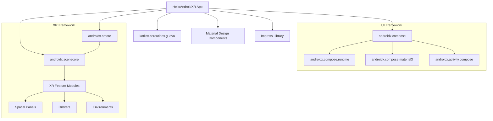

**Dependency Structure Diagram**

Sources: [app/build.gradle.kts:63-81](), [README.md:9-15]()

The application dependencies highlight the integration of modern Android UI frameworks with specialized XR libraries:

| Dependency Category | Key Components | Purpose |
|-------------------|----------------|---------|
| XR Core | androidx.arcore, androidx.scenecore | Provide fundamental XR capabilities |
| UI Framework | Jetpack Compose, Material3 | Handle UI composition and styling |
| Asynchronous | Kotlin Coroutines | Manage asynchronous operations |
| Utilities | Impress, Adaptive components | Support additional functionality |

Sources: [app/build.gradle.kts:63-81]()

## XR Feature Integration

The application architecture is designed to integrate three primary XR features as demonstration points:

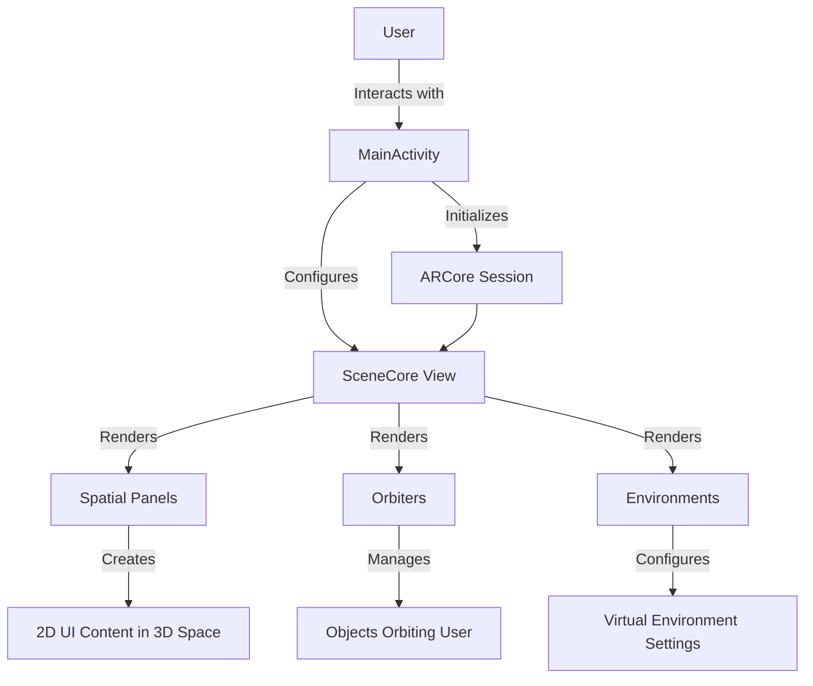

**XR Feature Integration Diagram**

Sources: [app/build.gradle.kts:67-68](), [README.md:9-15]()

### Feature Implementation Details

Each of the three key XR features is implemented using a combination of ARCore and SceneCore:

1. **Spatial Panels**:
   - 2D UI content placed in 3D space
   - Integrated with Jetpack Compose for content rendering
   - Managed through SceneCore's spatial management capabilities

2. **Orbiters**:
   - Objects that maintain position relative to the user
   - Leverage ARCore tracking and SceneCore object management
   - Demonstrate spatial awareness and positioning

3. **Environments**:
   - Virtual environment configuration and rendering
   - Background and lighting settings for XR experiences
   - SceneCore-driven environment management

For more detailed information about each feature's implementation, see the respective wiki pages: [Spatial Panels](#3.2.1), [Orbiters](#3.2.2), and [Environments](#3.2.3).

Sources: [README.md:9-15]()

## UI Architecture

The application employs Jetpack Compose as its primary UI framework, which is integrated with XR components.

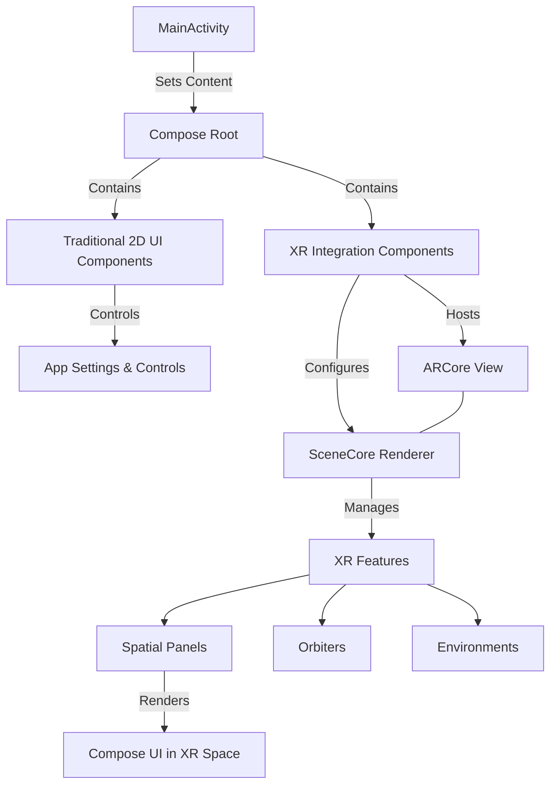

**UI Architecture Diagram**

Sources: [app/build.gradle.kts:54-59](), [app/build.gradle.kts:69-77]()

The UI architecture demonstrates the integration between traditional Android UI components and XR capabilities:

1. **Composition Approach**:
   - Compose-driven UI design for both 2D and XR elements
   - Shared component model across traditional and XR interfaces

2. **Integration Points**:
   - ARCore view components embedded in Compose hierarchy
   - SceneCore rendering integrated through Compose UI
   - Spatial panels demonstrating Compose content in 3D space

3. **UI-XR Communication**:
   - Bi-directional data flow between traditional UI and XR components
   - Event handling coordinated across UI paradigms

Sources: [app/build.gradle.kts:54-59](), [app/build.gradle.kts:69-77]()

## Build Configuration

The application is configured to target modern Android devices with XR capabilities while maintaining compatibility with a broader range of devices.

Key build configuration details:

- **Target Android SDK**: 35
- **Minimum SDK**: 23
- **Compose Compiler Version**: 1.5.4
- **Experimental Features**: Screenshot testing enabled

The build configuration demonstrates how XR features can be integrated into a standard Android application while maintaining modern development practices and tooling.

Sources: [app/build.gradle.kts:24-61]()

## Application Entry Point and Flow

The application follows a standard Android lifecycle with specialized initialization for XR components:

1. **Application Launch**:
   - MainActivity initialization
   - Permission handling for camera and sensors
   
2. **XR Session Setup**:
   - ARCore session configuration
   - SceneCore initialization
   - Environment configuration
   
3. **Feature Loading**:
   - Spatial panel creation
   - Orbiter initialization
   - Environment application
   
4. **User Interaction Flow**:
   - Input handling through traditional and XR interfaces
   - Feature demonstration and interaction
   - State management across XR components

Sources: [app/build.gradle.kts:65-81](), [README.md:9-15]()

## Technology Stack Summary

The application architecture leverages the following key technologies:

| Technology | Component | Purpose |
|------------|-----------|---------|
| Jetpack Compose | UI Framework | Modern declarative UI development |
| ARCore | XR Foundation | AR capabilities and device integration |
| SceneCore | 3D Framework | 3D scene management and rendering |
| Kotlin Coroutines | Async Framework | Asynchronous operations and threading |
| Material3 | Design System | Consistent design language |

Sources: [app/build.gradle.kts:63-81]()

This architecture provides a foundation for demonstrating XR capabilities on Android while providing developers with examples of best practices for integrating XR features into their applications.

---

# Page: Dependencies and Technologies

# Dependencies and Technologies

<details>
<summary>Relevant source files</summary>

The following files were used as context for generating this wiki page:

- [app/build.gradle.kts](app/build.gradle.kts)

</details>


This document outlines the core libraries, frameworks, and technologies used in the Android XR Samples project. It focuses on explaining the technical stack that powers the XR functionality and application architecture. For information about specific XR features implemented with these technologies, see [XR Features Overview](#3.2).

## Technology Stack Overview

The Android XR Samples project is built on a modern Android technology stack, combining XR-specific libraries with standard Android development frameworks. The following diagram illustrates the main technological components:

```mermaid
flowchart TD
    subgraph "Application Layer"
        App["HelloAndroidXR Application"]
    end

    subgraph "UI Framework"
        Compose["Jetpack Compose"]
        Material3["Material3 Components"]
        AdaptiveUI["Adaptive Android"]
    end

    subgraph "XR Technologies"
        ARCore["ARCore SDK"]
        SceneCore["SceneCore Library"]
        Impress["Impress Library"]
    end

    subgraph "Foundation"
        Kotlin["Kotlin Language"]
        Coroutines["Kotlin Coroutines"]
        ConcurrentFutures["Concurrent Futures"]
    end

    App -->|built with| Compose
    App -->|uses| XRTechnologies
    Compose -->|styled with| Material3
    Compose -->|enhanced by| AdaptiveUI
    XRTechnologies -->|runs on| Foundation
    UI Framework -->|runs on| Foundation
```

Sources: [app/build.gradle.kts:63-78]()

## Core Dependencies

The project's dependencies can be categorized into several functional groups:

### XR and 3D Rendering Libraries

These libraries provide the core XR functionality:

| Library | Purpose | Implementation |
|---------|---------|----------------|
| ARCore | Google's augmented reality platform that provides fundamental AR capabilities | `implementation(libs.androidx.arcore)` |
| SceneCore | 3D scene rendering and management | `implementation(libs.androidx.scenecore)` |
| Impress | XR-specific library for enhanced functionality | `implementation(libs.impress)` |

Sources: [app/build.gradle.kts:66-68]()

### UI and Composition Framework

The application's user interface is built with modern declarative UI libraries:

```mermaid
graph TD
    subgraph "Compose Framework"
        ComposeRuntime["androidx.compose.runtime"]
        ComposeUI["androidx.compose"]
        ActivityCompose["androidx.activity.compose"]
        UITooling["androidx.compose.ui.tooling"]
    end

    subgraph "UI Components"
        Material3["androidx.compose.material3"]
        Material["material"]
        AdaptiveAndroid["androidx.adaptive.android"]
    end

    ComposeUI -->|depends on| ComposeRuntime
    ActivityCompose -->|integrates| ComposeUI
    UITooling -->|enhances| ComposeUI
    Material3 -->|provides| UIComponents["UI Components"]
    Material -->|provides| StyleComponents["Styling Components"]
    AdaptiveAndroid -->|enables| ResponsiveUI["Responsive UI"]
```

Sources: [app/build.gradle.kts:69-80]()

### Asynchronous Programming Support

The following libraries facilitate asynchronous operations, which are critical for responsive XR applications:

| Library | Purpose | Implementation |
|---------|---------|----------------|
| Kotlin Coroutines | Asynchronous programming framework | `implementation(libs.kotlinx.coroutines.guava)` |
| Concurrent Futures | Promise-based concurrency utilities | `implementation(libs.androidx.concurrent.futures)` |

Sources: [app/build.gradle.kts:70-75]()

## Build System and Configuration

The Android XR Samples application leverages the Gradle build system with Kotlin DSL for configuration. The build script defines several important aspects of the application:

### Key Plugins

The project uses the following Gradle plugins to enable various features:

```mermaid
graph TD
    subgraph "Build Plugins"
        AndroidApp["android.application"]
        KotlinAndroid["kotlin.android"]
        KotlinCompose["kotlin.compose"]
        Screenshot["screenshot"]
    end

    AndroidApp -->|enables| AndroidFeatures["Android Platform Features"]
    KotlinAndroid -->|enables| KotlinSupport["Kotlin Language Support"]
    KotlinCompose -->|configures| ComposeCompiler["Compose Compiler"]
    Screenshot -->|enables| ScreenshotTesting["Screenshot Testing"]
```

Sources: [app/build.gradle.kts:17-22]()

### Build Configuration

The application is configured with the following specifications:

| Configuration | Value | Description |
|---------------|-------|-------------|
| Application ID | `com.example.helloandroidxr` | Unique identifier for the application |
| Minimum SDK | 23 | Android 6.0 (Marshmallow) |
| Target SDK | 35 | Latest Android version support |
| Compose Compiler Version | 1.5.4 | Kotlin Compiler Extension for Compose |
| Java Compatibility | 1.8 | Java version compatibility level |

Sources: [app/build.gradle.kts:24-61]()

## Technology Dependencies Hierarchy

The following diagram illustrates the hierarchical relationship between the various dependencies:

```mermaid
graph TD
    App["HelloAndroidXR Application"]
    
    subgraph "Level 1: UI Layer"
        Compose["Jetpack Compose"]
        Material3["Material3"]
        AdaptiveUI["Adaptive UI"]
    end
    
    subgraph "Level 2: XR Technologies"
        ARCore["ARCore"]
        SceneCore["SceneCore"]
        Impress["Impress"]
    end
    
    subgraph "Level 3: Foundation"
        Kotlin["Kotlin Language"]
        Coroutines["Coroutines"]
        ConcurrentFutures["Concurrent Futures"]
    end

    App -->|uses| Level1
    App -->|uses| Level2
    Level1 -->|built on| Level3
    Level2 -->|built on| Level3
```

Sources: [app/build.gradle.kts:63-82]()

## Experimental Features

The application enables experimental screenshot testing through a specific configuration:

```kotlin
experimentalProperties["android.experimental.enableScreenshotTest"] = true
```

This allows for visual testing of UI components and screens, which is particularly important for XR applications where the visual representation is critical.

Sources: [app/build.gradle.kts:60]()

## Conclusion

The Android XR Samples project leverages a comprehensive set of modern Android technologies, with special emphasis on XR-specific libraries (ARCore, SceneCore, Impress) and UI composition through Jetpack Compose. The asynchronous programming capabilities provided by Kotlin Coroutines and Concurrent Futures help ensure smooth performance in resource-intensive XR applications.

Understanding these dependencies and technologies is essential for working with the codebase, extending its functionality, or using it as a reference for other XR development projects.

---

# Page: XR Features Overview

# XR Features Overview

<details>
<summary>Relevant source files</summary>

The following files were used as context for generating this wiki page:

- [README.md](README.md)
- [app/build.gradle.kts](app/build.gradle.kts)

</details>


This document provides a comprehensive overview of the XR (Extended Reality) features demonstrated in the Hello Android XR sample application. It covers the primary XR capabilities, their relationships, and how they enhance spatial computing experiences. For detailed implementation specifics of individual features, see the respective sub-pages: [Spatial Panels](#3.2.1), [Orbiters](#3.2.2), and [Environments](#3.2.3).

## Core XR Features

The Hello Android XR sample application showcases three primary XR features that demonstrate essential spatial computing capabilities for Android applications:

1. **Spatial Panels** - Placeable 2D content surfaces in 3D space
2. **Orbiters** - UI elements that follow and orbit around the user
3. **Environments** - Customizable spatial backgrounds that provide context

These features work together to create an immersive and functional XR experience while demonstrating implementation patterns for Android developers.

Sources: [README.md:10-15]()

## XR Features Architecture

The following diagram illustrates how the primary XR features relate to each other and integrate with the underlying Android XR framework:

```mermaid
graph TD
    subgraph "Android XR Foundation"
        ARCore["ARCore Library"]
        SceneCore["SceneCore Library"]
    end
    
    subgraph "XR Features"
        SpatialPanels["Spatial Panels"]
        Orbiters["Orbiters"]
        Environments["Environments"]
    end
    
    subgraph "Application Layer"
        ComposeUI["Jetpack Compose UI"]
        UserInteraction["User Interaction Handling"]
    end
    
    ARCore --> SceneCore
    SceneCore --> SpatialPanels
    SceneCore --> Orbiters
    SceneCore --> Environments
    
    SpatialPanels --> ComposeUI
    Orbiters --> ComposeUI
    Environments --> ComposeUI
    
    ComposeUI --> UserInteraction
    UserInteraction --> SpatialPanels
    UserInteraction --> Orbiters
    UserInteraction --> Environments
```

The XR features are built on the foundation of ARCore and SceneCore libraries, with Jetpack Compose providing the UI framework for rendering and interaction. Each feature represents a distinct capability that can be used independently or in combination with others.

Sources: [app/build.gradle.kts:67-69](), [README.md:10-15]()

## Feature Implementation Relationships

The following diagram shows how the XR features map to specific code dependencies and implementation components:

```mermaid
flowchart LR
    subgraph "External Dependencies"
        ARCoreLib["androidx.arcore"]
        SceneCoreLib["androidx.scenecore"]
        ComposeLib["androidx.compose"]
        ImpressLib["impress"]
    end
    
    subgraph "XR Features Implementation"
        SpatialPanelsImpl["Spatial Panels Implementation"]
        OrbitersImpl["Orbiters Implementation"]
        EnvironmentsImpl["Environments Implementation"]
    end
    
    ARCoreLib --> SceneCoreLib
    SceneCoreLib --> SpatialPanelsImpl
    SceneCoreLib --> OrbitersImpl
    SceneCoreLib --> EnvironmentsImpl
    
    ComposeLib --> SpatialPanelsImpl
    ComposeLib --> OrbitersImpl
    
    ImpressLib --> SpatialPanelsImpl
    ImpressLib --> OrbitersImpl
    ImpressLib --> EnvironmentsImpl
```

This demonstrates how the key libraries from the build configuration support the implementation of each XR feature. The `androidx.arcore` and `androidx.scenecore` libraries provide the critical AR functionality, while Compose and Impress libraries facilitate the UI rendering and interaction components.

Sources: [app/build.gradle.kts:63-82]()

## Feature Summary Table

| Feature | Primary Purpose | Key Dependencies | Related Pages |
|---------|----------------|------------------|---------------|
| **Spatial Panels** | Displays 2D content (Compose UIs) on surfaces in 3D space | androidx.scenecore, androidx.compose | [Spatial Panels](#3.2.1) |
| **Orbiters** | Creates UI elements that follow and orbit the user as they move | androidx.scenecore, androidx.compose | [Orbiters](#3.2.2) |
| **Environments** | Provides customizable spatial backgrounds for context | androidx.scenecore | [Environments](#3.2.3) |

Sources: [README.md:10-15](), [app/build.gradle.kts:66-69]()

## Technical Integration

The XR features in the Hello Android XR sample are implemented using a combination of Android's latest XR libraries:

1. **ARCore** (`androidx.arcore`) - Provides the foundational AR capabilities including tracking, environmental understanding, and light estimation.

2. **SceneCore** (`androidx.scenecore`) - Builds on ARCore to provide higher-level abstractions for creating and managing 3D scenes.

3. **Impress** (`impress`) - Enables integration with the Android UI toolkit for creating immersive experiences.

4. **Jetpack Compose** - Provides the modern declarative UI framework that integrates with the XR features.

The integration of these libraries allows developers to implement immersive XR experiences while maintaining the familiar Android development patterns.

Sources: [app/build.gradle.kts:66-69]()

## Feature Relationships

```mermaid
graph TD
    subgraph "User Experience"
        User["User"]
    end
    
    subgraph "XR Features"
        SpatialPanels["Spatial Panels"]
        Orbiters["Orbiters"]
        Environments["Environments"]
    end
    
    User -->|"Interacts with"| SpatialPanels
    User -->|"Navigates using"| Orbiters
    User -->|"Exists within"| Environments
    
    SpatialPanels -->|"Displayed in context of"| Environments
    Orbiters -->|"Provides navigation to"| SpatialPanels
    Environments -->|"Provides spatial context for"| SpatialPanels
    Environments -->|"Provides spatial context for"| Orbiters
```

This diagram illustrates the relationships between the XR features from a user experience perspective. Environments provide the spatial context in which both Spatial Panels and Orbiters exist. Users interact directly with Spatial Panels, navigate using Orbiters, and experience the overall XR application within the context of an Environment.

Sources: [README.md:10-15]()

## Build Configuration

The XR features rely on specific dependencies defined in the application's build configuration:

```
dependencies {
    implementation(libs.impress)
    implementation(libs.androidx.arcore)
    implementation(libs.androidx.scenecore)
    implementation(libs.androidx.compose)
    // Other dependencies
}
```

These dependencies provide the necessary libraries to implement the XR features demonstrated in the sample application.

Sources: [app/build.gradle.kts:63-82]()

## Cross-Feature Considerations

When implementing multiple XR features, developers should consider:

1. **Performance** - Managing render complexity across features
2. **User Experience** - Ensuring intuitive interaction between features
3. **Content Management** - Coordinating content display across Spatial Panels and Orbiters
4. **Environmental Awareness** - Making features responsive to changes in the Environment

Detailed implementation specifics for each feature are covered in their respective sub-pages.

Sources: [README.md:10-15]()

---

# Page: Spatial Panels

# Spatial Panels

<details>
<summary>Relevant source files</summary>

The following files were used as context for generating this wiki page:

- [README.md](README.md)
- [app/build.gradle.kts](app/build.gradle.kts)

</details>


## Purpose and Scope

Spatial Panels in the Android XR Samples repository demonstrate how to integrate 2D user interface elements within 3D augmented reality space. These panels allow developers to create interactive UI surfaces that can be positioned and manipulated in the physical world using AR capabilities.

For information about related XR features in this sample, see [Orbiters](#3.2.2) and [Environments](#3.2.3).

Sources: [README.md:10-15]()

## Architecture Overview

Spatial Panels are a core XR feature of the Hello Android XR application. They showcase the integration between AR positioning systems and modern UI frameworks:

```mermaid
graph TD
    subgraph "Hello Android XR App"
        App["Main Application"]
        App -->|Uses| ARCore["ARCore"]
        App -->|Uses| SceneCore["SceneCore"]
        App -->|Uses| JetpackCompose["Jetpack Compose"]
    
        subgraph "Core XR Features"
            SpatialPanels["Spatial Panels"]
            Orbiters["Orbiters"]
            Environments["Environments"]
        end
    
        App -->|Implements| CoreXRFeatures
        SpatialPanels -->|Positioned using| ARCore
        SpatialPanels -->|Rendered using| SceneCore
        SpatialPanels -->|UI content created with| JetpackCompose
    end
```

The diagram illustrates how Spatial Panels rely on three fundamental technologies:
- ARCore provides spatial awareness and tracking
- SceneCore handles 3D scene management
- Jetpack Compose creates the 2D UI components displayed within the panels

Sources: [README.md:10-15](), [app/build.gradle.kts:63-71]()

## Technical Foundations

The implementation of Spatial Panels relies on several key dependencies declared in the build configuration:

| Dependency | Purpose in Spatial Panels |
|------------|---------|
| `androidx.arcore` | Enables AR functionality for positioning panels in real space |
| `androidx.scenecore` | Manages rendering and 3D scene composition |
| `androidx.compose` | Creates the UI content displayed on panels |
| `androidx.compose.material3` | Provides Material Design components for panel content |
| `kotlinx.coroutines.guava` | Handles asynchronous operations between UI and AR systems |

These dependencies work together to create a cohesive system where 2D UI elements can exist and be interacted with in 3D space.

Sources: [app/build.gradle.kts:63-82]()

## Implementation Model

While specific implementation details aren't fully visible in the provided files, we can model the likely structure of Spatial Panels based on the dependencies and typical XR architecture patterns:

```mermaid
graph TD
    subgraph "Spatial Panel System"
        SpatialPanel["SpatialPanel"] -->|Anchored via| ARCoreAnchor["ARCore Anchor"]
        SpatialPanel -->|Rendered as| SceneEntity["SceneCore Entity"]
        SpatialPanel -->|Displays| ComposeUI["Compose UI Content"]
        
        SpatialPanelManager["SpatialPanelManager"] -->|Creates & Controls| SpatialPanel
        SpatialPanelManager -->|Tracks through| ARSession["AR Session"]
        
        User["User"] -->|Interacts with| SpatialPanel
        InteractionSystem["Input Handler System"] -->|Processes| UserInteraction["Touch/Gesture Input"]
        InteractionSystem -->|Updates| SpatialPanel
        
        SpatialPanel -->|Can be| AttachedToSurface["Attached to Surface"]
        SpatialPanel -->|Can be| FloatingInSpace["Floating in Space"]
        SpatialPanel -->|Can be| FollowingUser["Following User"]
    end
```

This diagram represents the probable component architecture of the Spatial Panels feature, showing how user interactions flow through the system and how panels can exist in different states within AR space.

Sources: [app/build.gradle.kts:67-71]()

## Integration with ARCore

Spatial Panels likely integrate with ARCore for key functionalities:

- Anchoring panels to real-world surfaces or positions
- Maintaining stable positioning as the user moves
- Handling occlusion with real-world objects
- Managing panel visibility based on spatial awareness

The application uses `androidx.arcore` as specified in the build configuration, which provides the foundation for these AR capabilities.

Sources: [app/build.gradle.kts:67]()

## UI Implementation with Jetpack Compose

The UI content displayed on Spatial Panels is implemented using Jetpack Compose, as indicated by multiple Compose-related dependencies:

- `androidx.compose`
- `androidx.compose.material3`
- `androidx.compose.ui.tooling`
- `androidx.compose.runtime`
- `androidx.activity.compose`

This modern declarative UI toolkit allows developers to create rich, interactive interfaces that can be rendered within 3D space on the Spatial Panels.

Sources: [app/build.gradle.kts:69-80]()

## Common Use Cases

Spatial Panels in XR applications typically serve several key purposes:

1. Information display - showing contextual data in 3D space
2. Control interfaces - providing interactive UI elements
3. Content browsing - displaying media, documents or web content
4. Spatial menus - organizing application functions in 3D
5. Collaborative workspaces - shared panels for multi-user experiences

The Android XR Samples repository demonstrates these capabilities to provide developers with implementation patterns they can adopt in their own applications.

Sources: [README.md:10-15]()

## Conclusion

Spatial Panels exemplify how traditional 2D UI components can be seamlessly integrated into augmented reality experiences. By combining ARCore's spatial awareness, SceneCore's rendering capabilities, and Jetpack Compose's modern UI toolkit, developers can create intuitive interfaces that bridge the digital and physical worlds.

For more information about Android XR development, refer to the official documentation references in the README:
- Android XR Overview
- Developing for Android XR
- UI Design for Android XR

Sources: [README.md:23-28]()

---

# Page: Orbiters

# Orbiters

<details>
<summary>Relevant source files</summary>

The following files were used as context for generating this wiki page:

- [README.md](README.md)
- [app/build.gradle.kts](app/build.gradle.kts)

</details>


## Purpose and Scope

This document provides a technical overview of the Orbiters system in the Android XR Samples repository. Orbiters are UI components that orbit around a central point or object in 3D space, providing an interactive and spatially-aware menu system for XR applications. For information about other XR features like Spatial Panels, see [Spatial Panels](#3.2.1), and for Environments, see [Environments](#3.2.3).

## What are Orbiters?

Orbiters are interactive UI elements that revolve around a central point in 3D space, typically around the user or a specified object. They provide a circular or orbital menu system that allows users to access functions and controls in an XR environment with intuitive spatial interaction.

### Orbiter Concept Diagram

```mermaid
graph TD
    subgraph "Orbiter System"
        User(("User"))
        CentralPoint(("Central Point"))
        
        OrbiterA["Orbiter A"]
        OrbiterB["Orbiter B"]
        OrbiterC["Orbiter C"]
        OrbiterD["Orbiter D"]
        
        User --- CentralPoint
        CentralPoint --- OrbiterA
        CentralPoint --- OrbiterB
        CentralPoint --- OrbiterC
        CentralPoint --- OrbiterD
    end
    
    OrbiterA --> ActionA["Perform Action A"]
    OrbiterB --> ActionB["Perform Action B"]
    OrbiterC --> ActionC["Perform Action C"]
    OrbiterD --> ActionD["Perform Action D"]
```

Sources: [README.md:10-15]()

## Orbiter System Architecture

The Orbiters system in the Android XR Samples is built on several key dependencies and frameworks. The implementation leverages ARCore and SceneCore for 3D positioning and rendering, while using Jetpack Compose for the UI components.

### Technical Architecture

```mermaid
flowchart TD
    subgraph "Orbiter Implementation"
        ARCore["ARCore SDK"]
        SceneCore["SceneCore"]
        Compose["Jetpack Compose"]
        
        XRApp["Android XR Application"]
        OrbiterSystem["Orbiter System"]
        InteractionHandlers["Interaction Handlers"]
        
        XRApp -->|"Uses"| OrbiterSystem
        OrbiterSystem -->|"Built on"| ARCore
        OrbiterSystem -->|"Renders with"| SceneCore
        OrbiterSystem -->|"UI Components"| Compose
        OrbiterSystem -->|"Processes"| InteractionHandlers
    end
    
    InteractionHandlers -->|"Handles"| Gesture["User Gestures"]
    InteractionHandlers -->|"Manages"| Selection["Selection Events"]
    InteractionHandlers -->|"Controls"| Animation["Orbital Animation"]
```

Sources: [app/build.gradle.kts:63-82]()

## Key Components

The Orbiter system likely consists of the following key components:

1. **Orbiter Container**: The central controller that manages the orbital positioning and interaction with multiple orbiters
2. **Individual Orbiters**: The UI elements that orbit around the central point
3. **Interaction System**: Handles user input for selecting and interacting with orbiters
4. **Animation System**: Controls the orbital movement and transition animations

### Component Relationship

| Component | Responsibility | Technical Implementation |
|-----------|----------------|--------------------------|
| Orbiter Container | Manages the spatial arrangement of orbiters | Likely uses SceneCore positioning APIs |
| Individual Orbiters | Represent interactive menu items | Implemented as Compose UI components within 3D space |
| Interaction System | Processes user input and selection | Utilizes ARCore input detection and raycasting |
| Animation System | Controls orbital movement | Uses SceneCore's animation capabilities |

Sources: [app/build.gradle.kts:67-69](), [README.md:10-15]()

## Orbiter Positioning and Movement

Orbiters are positioned in 3D space relative to a central point. They typically follow spherical or circular paths around this point, maintaining equidistant spacing or specific angular positions.

### Orbital Positioning Model

```mermaid
graph TD
    subgraph "Orbital Positioning"
        CP(("Central Point"))
        
        O1["Orbiter at 0°"]
        O2["Orbiter at 90°"]
        O3["Orbiter at 180°"]
        O4["Orbiter at 270°"]
        
        CP --- O1
        CP --- O2
        CP --- O3
        CP --- O4
        
        R1["Radius"]
        CP -.- R1
        R1 -.- O1
    end
    
    subgraph "Properties"
        Radius["Orbital Radius"]
        AngularPosition["Angular Position"]
        RotationSpeed["Rotation Speed"]
    end
```

Sources: [app/build.gradle.kts:67-68]()

## Interaction Model

Users interact with orbiters through gaze, controller pointing, or hand tracking. When an orbiter is selected, it can:

1. Trigger an action directly
2. Expand into sub-orbiters
3. Open a detailed interface
4. Transform into another UI component

### Interaction Flow

```mermaid
sequenceDiagram
    participant User
    participant OrbiterSystem as "Orbiter System"
    participant SelectedOrbiter as "Selected Orbiter"
    participant Action as "Action Handler"
    
    User->>OrbiterSystem: Points at/Focuses on Orbiter
    OrbiterSystem->>SelectedOrbiter: Highlight/Expand
    User->>SelectedOrbiter: Selects (tap/click)
    SelectedOrbiter->>Action: Triggers associated action
    Action->>User: Provides feedback/result
    
    alt Orbital Menu Navigation
        User->>OrbiterSystem: Swipe gesture
        OrbiterSystem->>OrbiterSystem: Rotate orbiter positions
    end
```

Sources: [app/build.gradle.kts:67-69]()

## Integration with Other XR Features

Orbiters work in conjunction with other XR features in the sample application:

1. **Spatial Panels**: Orbiters can launch or control Spatial Panels
2. **Environments**: Orbiters can be used to switch or modify Environments

### Feature Integration Diagram

```mermaid
graph TD
    subgraph "XR Features Integration"
        OrbiterSystem["Orbiter System"]
        SpatialPanels["Spatial Panels"]
        Environments["Environments"]
        
        OrbiterSystem -->|"Launches"| SpatialPanels
        OrbiterSystem -->|"Controls"| Environments
        SpatialPanels -->|"Can contain"| OrbiterSystem
    end
```

Sources: [README.md:10-15]()

## Implementation Considerations

When working with the Orbiters system in the Android XR Samples, developers should consider the following aspects:

1. **Performance**: Orbiters involve 3D positioning and animation, which can impact performance
2. **Accessibility**: Ensuring orbiters are easy to select and interact with
3. **Visual Design**: Orbiters should be clearly visible against varying backgrounds
4. **Input Methods**: Supporting multiple input methods (gaze, controller, hand tracking)

### Technical Requirements

To implement orbiters, the application requires:

- ARCore for spatial tracking and positioning
- SceneCore for 3D rendering and animation
- Jetpack Compose for UI components
- Coroutines for asynchronous operations

Sources: [app/build.gradle.kts:63-82]()

## Best Practices

When implementing or extending the Orbiters system:

1. Maintain appropriate distance between orbiters to prevent overlap
2. Use clear visual indicators for selection state
3. Implement smooth transitions and animations
4. Provide alternative UI navigation for accessibility
5. Consider user comfort with element placement and movement speed

## Summary

The Orbiters system in the Android XR Samples provides a spatially-aware menu system for XR applications. It leverages ARCore and SceneCore for 3D positioning and rendering, with Jetpack Compose for UI components. Orbiters offer an intuitive way for users to interact with functions and controls in 3D space, enhancing the overall XR experience.

Sources: [README.md:10-15](), [app/build.gradle.kts:63-82]()

---

# Page: Environments

# Environments

<details>
<summary>Relevant source files</summary>

The following files were used as context for generating this wiki page:

- [README.md](README.md)
- [app/build.gradle.kts](app/build.gradle.kts)

</details>


This document provides an overview of the Environments feature in the Android XR Samples application. It explains the implementation, usage, and relationship of Environments with other XR features in the sample code. For information about other XR features, see [Spatial Panels](#3.2.1) and [Orbiters](#3.2.2).

## What Are Environments in Android XR?

Environments in Android XR applications provide the spatial context in which extended reality experiences take place. They define the virtual space surrounding the user and establish the foundation for rendering and anchoring XR content.

The Android XR Samples repository demonstrates implementation of Environments using ARCore and SceneCore libraries to create immersive spatial contexts for XR interactions.

Sources: [README.md:10-14](), [app/build.gradle.kts:67-68]()

## Environment System Architecture

Environments in the Android XR Samples function as a foundational layer for XR experiences, providing spatial awareness and rendering capabilities for other XR elements.

### Environment Architecture Diagram

```mermaid
graph TD
    subgraph "User Interaction Layer"
        User["User"]
    end
    
    subgraph "XR Feature Layer"
        Env["Environment System"]
        SpatialPanels["Spatial Panels"]
        Orbiters["Orbiters"]
    end
    
    subgraph "Technical Implementation"
        ARCore["ARCore"]
        SceneCore["SceneCore"]
        ComposeUI["Jetpack Compose UI"]
    end
    
    User -->|"interacts with"| Env
    Env -->|"contains"| SpatialPanels
    Env -->|"supports"| Orbiters
    
    Env -->|"implemented via"| SceneCore
    SceneCore -->|"built on"| ARCore
    SpatialPanels -->|"rendered with"| ComposeUI
```

Sources: [app/build.gradle.kts:67-69](), [README.md:10-14]()

## Technical Implementation

The Environment system in the Android XR Samples application is implemented through a combination of ARCore for spatial tracking and SceneCore for 3D scene rendering. The build configuration shows these as primary dependencies for enabling XR functionality.

### Implementation Stack

```mermaid
graph TD
    subgraph "Environment Implementation"
        AppEnv["Environment Component"]
        EnvConfig["Environment Configuration"]
        EnvRenderer["Environment Renderer"]
    end
    
    subgraph "Supporting Libraries"
        ARCore["androidx.arcore"]
        SceneCore["androidx.scenecore"]
        Compose["androidx.compose"]
    end
    
    AppEnv -->|"configures"| EnvConfig
    EnvConfig -->|"informs"| EnvRenderer
    EnvRenderer -->|"uses"| SceneCore
    SceneCore -->|"integrates with"| ARCore
    AppEnv -->|"UI components"| Compose
```

Sources: [app/build.gradle.kts:67-69]()

## Environment Types and Capabilities

Android XR environments typically support several implementation variants to accommodate different XR use cases:

| Environment Type | Description | Typical Use Cases |
|------------------|-------------|-------------------|
| Passthrough      | Overlays virtual content on camera feed of the real world | AR applications, spatial computing |
| Virtual          | Fully rendered 3D environment replacing real world view | VR experiences, immersive simulations |
| Mixed            | Combination of real-world elements and virtual content | Mixed reality workspaces, enhanced training |

## Environment Integration with Other XR Features

Environments in the Android XR Samples provide the spatial foundation that enables other XR features to function correctly.

### Feature Integration Diagram

```mermaid
flowchart TD
    subgraph "Android XR Application"
        Env["Environment System"]
        
        subgraph "XR Features"
            SP["Spatial Panels"]
            Orb["Orbiters"]
        end
        
        subgraph "Spatial Anchoring"
            Anchors["Anchor Points"]
            Tracking["Spatial Tracking"]
        end
    end
    
    Env -->|"provides context for"| SP
    Env -->|"enables"| Orb
    Env -->|"manages"| Anchors
    Anchors -->|"positioned via"| Tracking
    SP -->|"anchored to"| Anchors
    Orb -->|"revolve around"| Anchors
```

Sources: [README.md:10-14]()

## Best Practices for Android XR Environments

When working with Environments in Android XR applications:

1. **Initialization**: Initialize Environment components early in the application lifecycle
2. **Spatial Awareness**: Ensure proper tracking of the real-world space before placing XR content
3. **Performance**: Optimize environment complexity based on target device capabilities
4. **User Experience**: Provide clear spatial cues to help users understand environment boundaries
5. **Fallback Mechanisms**: Implement graceful degradation when optimal tracking is unavailable

## Technical Considerations

The Android XR Samples application leverages several key technologies for Environment implementation:

- **ARCore**: Provides fundamental AR capabilities including tracking, light estimation, and depth sensing
- **SceneCore**: Offers high-level abstractions for 3D scene management and rendering
- **Jetpack Compose**: Enables the creation of modern UI components that can be integrated into XR spaces

Sources: [app/build.gradle.kts:67-69]()

## Summary

The Environments feature in Android XR Samples demonstrates how to create spatial contexts for XR experiences. Built on ARCore and SceneCore technologies, it provides the foundation for other XR features like Spatial Panels and Orbiters. Understanding Environment implementation is essential for creating cohesive and immersive XR applications.

---

# Page: UI Components

# UI Components

<details>
<summary>Relevant source files</summary>

The following files were used as context for generating this wiki page:

- [app/build.gradle.kts](app/build.gradle.kts)
- [app/src/debug/screenshotTest/reference/com/example/helloandroidxr/ui/AppPreviewScreenshots/AppLayoutPreview_b6cdeb17_0.png](app/src/debug/screenshotTest/reference/com/example/helloandroidxr/ui/AppPreviewScreenshots/AppLayoutPreview_b6cdeb17_0.png)

</details>


This document provides a technical overview of the UI components used in the Android XR Samples application. It focuses specifically on the user interface elements, their implementation using Jetpack Compose, and their integration with the XR framework. For information about specific XR features like Spatial Panels, Orbiters, and Environments, please refer to their respective sections at [XR Features Overview](#3.2), [Spatial Panels](#3.2.1), [Orbiters](#3.2.2), and [Environments](#3.2.3).

## UI Architecture Overview

The Android XR Samples application uses Jetpack Compose as its primary UI toolkit. Compose is a modern declarative UI framework for Android that simplifies UI development by allowing developers to describe what the UI should look like for a given state, rather than how to construct it.

### UI Framework Diagram

```mermaid
flowchart TD
    subgraph "UI Layer"
        JC["Jetpack Compose"]
        M3["Material 3 Components"]
        AC["Adaptive Components"]
        CT["Compose Tooling"]
    end
    
    subgraph "XR Integration Layer"
        XR["XR UI Integration"]
        SP["Spatial Panel Rendering"]
        OR["Orbiter UI"]
        ENV["Environment UI"]
    end
    
    subgraph "Core Systems"
        AR["ARCore"]
        SC["SceneCore"]
    end
    
    JC --> M3
    JC --> AC
    JC --> CT
    
    JC --> XR
    XR --> SP
    XR --> OR
    XR --> ENV
    
    XR --> AR
    XR --> SC
```

Sources: [app/build.gradle.kts:63-79]()

## UI Dependencies

The application includes several key UI-related dependencies that form the foundation of its interface:

| Dependency | Description | Purpose in Android XR Samples |
|------------|-------------|-------------------------------|
| `androidx.compose.bom` | Bill of Materials for Compose | Ensures consistent versions across Compose dependencies |
| `androidx.compose` | Core Compose library | Provides the fundamental Compose functionality |
| `androidx.compose.material3` | Material 3 design components | Implements Material Design 3 components in Compose |
| `androidx.adaptive.android` | Adaptive UI components | Supports adaptable layouts for different form factors |
| `androidx.compose.runtime` | Compose runtime | Manages state and composition |
| `androidx.activity.compose` | Activity integration | Enables using Compose in an Activity |
| `androidx.compose.ui.tooling` | Design and preview tools | Supports UI design and preview capabilities |

Sources: [app/build.gradle.kts:63-79]()

## Compose Integration with XR

The Android XR Samples application demonstrates how to integrate traditional 2D UI components created with Jetpack Compose with immersive XR experiences. This integration allows for familiar UI patterns to be used alongside spatial interfaces.

### UI to XR Integration Architecture

```mermaid
graph TD
    subgraph "UI Components"
        CP["Compose UI"]
        M3C["Material 3 Components"]
        CLY["Compose Layout System"]
    end
    
    subgraph "XR Framework"
        ARC["ARCore"]
        SCC["SceneCore"]
    end
    
    subgraph "Bridging Components"
        SPC["Spatial Panels"]
        ORB["Orbiters"]
        XRI["XR Input Handling"]
    end
    
    CP --> M3C
    CP --> CLY
    
    CLY --> SPC
    M3C --> ORB
    CP --> XRI
    
    SPC --> SCC
    ORB --> SCC
    XRI --> ARC
    
    SCC --> ARC
```

Sources: [app/build.gradle.kts:65-78]()

## Key UI Components

The Android XR Samples application leverages several types of UI components:

1. **Standard Compose Components**: Basic UI elements like buttons, text fields, and layouts from the Jetpack Compose framework.

2. **Material 3 Components**: Enhanced UI elements following the Material Design 3 guidelines, providing a consistent and modern look and feel.

3. **Adaptive Components**: Components that adjust to different screen sizes and form factors, crucial for XR applications that may be displayed across various devices.

4. **XR-Specific UI Components**: Custom UI elements designed specifically for XR interaction, such as:
   - Spatial UI panels that exist in 3D space
   - Orbiter controls that follow the user's view
   - Environment selection interfaces

## UI Component Flow

When developing UI for XR applications, components go through a specific flow from definition to rendering in 3D space:

### UI Rendering Pipeline

```mermaid
flowchart LR
    subgraph "UI Definition"
        C["Compose Definitions"]
        S["UI State"]
    end
    
    subgraph "Composition"
        L["Layout Calculation"]
        R["Composition Result"]
    end
    
    subgraph "XR Integration"
        T["Texture Generation"]
        P["Panel Placement"]
        I["Interaction Handling"]
    end
    
    C --> S
    S --> L
    L --> R
    R --> T
    T --> P
    P --> I
    I --> S
```

Sources: [app/build.gradle.kts:65-78]()

## Best Practices for XR UI Development

When developing UI components for XR applications using the Android XR Samples framework, consider the following best practices:

1. **Separate UI Logic from XR Positioning**: Keep the UI component definitions independent from their spatial positioning to maintain code clarity.

2. **Use Reactive UI Patterns**: Leverage Jetpack Compose's reactive programming model to handle state changes efficiently.

3. **Consider Depth and Distance**: Design UI components with awareness of how they'll appear at different distances in 3D space.

4. **Optimize for Performance**: Minimize UI recomposition and texture generation, as these operations can be costly in XR environments.

5. **Accessible Input Handling**: Design UI interactions that work well with both traditional input methods and XR-specific interactions like gaze and gesture.

## Integration with Native Android Components

The Android XR Samples application demonstrates how to bridge between traditional Android UI components and XR experiences:

```mermaid
graph TD
    subgraph "Native Android"
        A["Android Activity"]
        V["View System"]
    end
    
    subgraph "Compose Framework"
        CA["ComposeActivity"]
        CR["Compose Runtime"]
        CU["Compose UI"]
    end
    
    subgraph "XR Integration"
        XS["XR Session"]
        XR["XR Renderer"]
        XU["XR UI Manager"]
    end
    
    A --> CA
    V --> CR
    CR --> CU
    CA --> XS
    CU --> XU
    XU --> XR
    XS --> XR
```

Sources: [app/build.gradle.kts:65-78]()

## Screenshot Testing

The Android XR Samples application includes support for screenshot testing of UI components, ensuring visual consistency across different builds and environments. This is particularly important for XR applications where visual presentation is critical to the user experience.

The build configuration enables screenshot testing via:

```
experimentalProperties["android.experimental.enableScreenshotTest"] = true
```

And includes the necessary testing dependencies:

```
screenshotTestImplementation(libs.androidx.compose.ui.tooling)
```

This allows developers to validate UI components both in standard 2D contexts and within XR environments.

Sources: [app/build.gradle.kts:60-81]()

## Summary

The UI Components in the Android XR Samples application demonstrate how to effectively bridge the gap between traditional 2D Android interfaces and immersive XR experiences. By leveraging Jetpack Compose, Material 3, and adaptive design principles, the application provides a foundation for building compelling and consistent user interfaces for XR applications.

The integration between Compose UI components and XR-specific features like Spatial Panels and Orbiters showcases best practices for developing interfaces that work well in both 2D and 3D contexts, providing a seamless experience for users across different interaction modes.

---

# Page: Testing Framework

# Testing Framework

<details>
<summary>Relevant source files</summary>

The following files were used as context for generating this wiki page:

- [app/build.gradle.kts](app/build.gradle.kts)
- [app/src/debug/screenshotTest/reference/com/example/helloandroidxr/ui/AppPreviewScreenshots/AppLayoutPreview_b6cdeb17_0.png](app/src/debug/screenshotTest/reference/com/example/helloandroidxr/ui/AppPreviewScreenshots/AppLayoutPreview_b6cdeb17_0.png)

</details>


This page documents the testing approach used in the Android XR Samples repository, with particular focus on the screenshot testing framework. This framework is essential for ensuring UI consistency and detecting visual regressions across the sample applications.

## Overview

The Android XR Samples project employs screenshot testing as its primary testing methodology. This approach is particularly valuable for XR applications where visual correctness is critical for user experience. The testing framework captures snapshots of the UI under specific conditions and compares them against reference images to detect visual regressions.

```mermaid
flowchart TD
    subgraph "Testing Framework Components"
        ST["Screenshot Testing"]
        RI["Reference Images"]
        TC["Test Configurations"]
        TS["Test Suites"]
    end

    ST --> RI
    ST --> TC
    ST --> TS
    
    subgraph "Integration Points"
        BD["Build System"]
        CI["Continuous Integration"]
        DEV["Development Workflow"]
    end
    
    ST --> BD
    ST --> CI
    ST --> DEV
```

Sources: [app/build.gradle.kts:21-22](), [app/build.gradle.kts:60-61]()

## Screenshot Testing Configuration

The testing framework is configured in the project's Gradle build files. Screenshot testing is enabled through an experimental property and requires specific plugin and dependency configurations.

```mermaid
flowchart LR
    subgraph "Gradle Configuration"
        P["plugins"]
        EP["experimentalProperties"]
        D["dependencies"]
    end
    
    P -->|"includes"| SP["screenshot plugin"]
    EP -->|"enables"| ST["android.experimental.enableScreenshotTest"]
    D -->|"includes"| STI["screenshotTestImplementation"]
    
    subgraph "Testing Infrastructure"
        STF["Screenshot Testing Framework"]
        RE["Reference Images Repository"]
        COMP["Image Comparison Engine"]
    end
    
    SP --> STF
    ST --> STF
    STI --> STF
    STF --> RE
    STF --> COMP
```

Sources: [app/build.gradle.kts:21-22](), [app/build.gradle.kts:60-61](), [app/build.gradle.kts:81-82]()

### Key Configuration Elements

The screenshot testing framework is configured with the following key elements in the build.gradle.kts file:

| Element | Description | Location |
|---------|-------------|----------|
| Screenshot Plugin | Enables screenshot testing capabilities | Line 21 |
| Experimental Property | Explicitly enables the screenshot test feature | Line 60 |
| Test Dependencies | Includes necessary libraries for screenshot tests | Line 81 |

Sources: [app/build.gradle.kts:21-22](), [app/build.gradle.kts:60-61](), [app/build.gradle.kts:81-82]()

## Reference Images

Reference images serve as the expected output for UI components and layouts. These images are stored in the debug build directory and are used for comparison during test execution.

The reference images are organized by test class and method name, making it straightforward to identify which component each reference image corresponds to:

```
app/src/debug/screenshotTest/reference/[package path]/[test class name]/[test method name]_[hash]_[index].png
```

For example, the repository contains a reference image:

```
app/src/debug/screenshotTest/reference/com/example/helloandroidxr/ui/AppPreviewScreenshots/AppLayoutPreview_b6cdeb17_0.png
```

This file is used to verify the layout of the main application UI.

Sources: [app/src/debug/screenshotTest/reference/com/example/helloandroidxr/ui/AppPreviewScreenshots/AppLayoutPreview_b6cdeb17_0.png]()

## Test Structure

Screenshot tests in the Android XR Samples project follow a structured approach to ensure consistency and maintainability.

```mermaid
flowchart TD
    subgraph "Screenshot Test Execution Flow"
        ST["Setup Test Environment"]
        CC["Create Component/UI"]
        CI["Capture Image"]
        CMP["Compare with Reference"]
        RPT["Report Results"]
    end
    
    ST --> CC
    CC --> CI
    CI --> CMP
    CMP --> RPT
    
    subgraph "Screenshot Test Components"
        TC["Test Class"]
        TM["Test Methods"]
        RI["Reference Images"]
        DI["Diff Images"]
    end
    
    TC --> TM
    TM --> RI
    TM --> DI
```

### Test Organization

Screenshot tests are typically organized around UI components or specific user interactions:

1. **Component Tests**: Verify the appearance of individual UI components
2. **Layout Tests**: Ensure proper arrangement of components within layouts
3. **Interaction Tests**: Capture UI state changes resulting from user interactions
4. **XR-Specific Tests**: Test spatial interfaces and XR-specific UI elements

Sources: [app/build.gradle.kts:81-82]()

## Running Tests

Screenshot tests can be executed as part of the regular Android test suite. The framework integrates with the standard Android test runner while providing additional functionality for image comparison and failure reporting.

### Basic Test Execution

Tests can be run using the Android Studio test runner or via Gradle commands:

```
./gradlew screenshotTest
```

### Viewing Test Results

When tests fail, the framework generates detailed reports showing:

1. The expected reference image
2. The actual captured image
3. A difference visualization highlighting discrepancies

These reports help developers quickly identify visual regressions and their causes.

Sources: [app/build.gradle.kts:21-22](), [app/build.gradle.kts:60-61]()

## Best Practices

When working with the screenshot testing framework, consider the following best practices:

### 1. Test Isolation

Ensure each test focuses on a single UI component or interaction to maintain clarity and make it easier to identify issues when tests fail.

### 2. Reference Image Management

Carefully review and update reference images when intentional UI changes are made. Commit these changes alongside the corresponding code changes.

### 3. Device-Specific Considerations

Be mindful of device-specific variations. Consider parameterizing tests for different screen sizes and resolutions when necessary.

### 4. XR-Specific Guidance

When testing XR components:
- Test components in both 2D (preview) and 3D (immersive) contexts
- Verify spatial placement and scale of elements
- Test interaction with both traditional input (touch) and XR input methods

## Integration with Development Workflow

The screenshot testing framework is designed to integrate seamlessly with the development workflow, providing developers with immediate feedback on UI changes.

```mermaid
flowchart LR
    subgraph "Development Process"
        CD["Code Changes"]
        LT["Local Testing"]
        PR["Pull Request"]
        CI["CI Verification"]
        MRG["Merge"]
    end
    
    CD --> LT
    LT --> PR
    PR --> CI
    CI --> MRG
    
    subgraph "Screenshot Testing Points"
        CT["Component Tests"]
        IT["Integration Tests"]
        RT["Regression Tests"]
    end
    
    LT --- CT
    CI --- IT
    CI --- RT
```

### Continuous Integration

The screenshot testing framework is integrated with the project's CI pipeline, ensuring that all UI changes are automatically verified before being merged.

Sources: [app/build.gradle.kts:21-22](), [app/build.gradle.kts:60-61]()

## Benefits for XR Development

Screenshot testing provides particular benefits for XR application development:

1. **Visual Consistency**: Ensures consistent visual appearance across different devices and platforms
2. **Spatial UI Verification**: Validates correct spatial positioning of UI elements in 3D space
3. **Interaction Validation**: Verifies that interactions with spatial UI elements work as expected
4. **Regression Detection**: Quickly identifies visual regressions introduced by code changes

## Summary

The screenshot testing framework in the Android XR Samples repository provides a robust mechanism for verifying the visual correctness of UI components. By comparing captured images against reference images, the framework helps maintain UI consistency and quickly detect visual regressions. This is particularly valuable for XR applications where visual correctness is critical for user experience.

The framework is integrated into the build system, making it easy to run tests during development and as part of continuous integration. By following the best practices outlined in this document, developers can effectively utilize the screenshot testing framework to ensure the quality of the Android XR Samples.

---

# Page: Contributing

# Contributing

<details>
<summary>Relevant source files</summary>

The following files were used as context for generating this wiki page:

- [.github/ISSUE_TEMPLATE.md](.github/ISSUE_TEMPLATE.md)
- [.github/PULL_REQUEST_TEMPLATE.md](.github/PULL_REQUEST_TEMPLATE.md)

</details>


This page outlines the process and guidelines for contributing to the Android XR Samples repository. It provides information on how to report issues, submit pull requests, and follow the project's contribution workflow. For information on setting up and running the sample application, see [Getting Started](#2).

## Contribution Process Overview

The following diagram illustrates the general contribution workflow for the Android XR Samples repository:

```mermaid
flowchart LR
    A["Discover Issue"] --> B["File Issue Report"]
    B --> C["Discuss Solution"]
    C --> D["Fork Repository"]
    D --> E["Implement Changes"]
    E --> F["Run Tests"]
    F --> G["Submit PR"]
    G --> H["Code Review"]
    H --> I["Address Feedback"]
    I --> J["Merge"]
    
    style A stroke-width:2px
    style J stroke-width:2px
```

Sources: [.github/ISSUE_TEMPLATE.md](), [.github/PULL_REQUEST_TEMPLATE.md]()

## Issue Reporting

Before submitting code contributions, it's recommended to first open an issue to discuss the proposed changes. This helps ensure your work aligns with the project's goals and prevents duplicate efforts.

The issue template includes sections for the following information:

```mermaid
graph TD
    Issue["Issue Report"] --> Expected["Expected Behavior"]
    Issue --> Actual["Actual Behavior"]
    Issue --> Steps["Steps to Reproduce"]
    Issue --> Specs["Specifications"]
    Specs --> Version["Version"]
    Specs --> Platform["Platform"]
```

When reporting issues, please provide:

- **Expected Behavior**: What you expected to happen
- **Actual Behavior**: What actually happened
- **Steps to Reproduce**: Clear numbered steps to reproduce the issue
- **Specifications**: Version and platform information

The issue template can be found in the repository at [.github/ISSUE_TEMPLATE.md]().

Sources: [.github/ISSUE_TEMPLATE.md]()

## Pull Request Submission

After discussing your proposed changes in an issue, you can submit code contributions via pull requests. The Android XR Samples repository uses a standard GitHub pull request process.

### Pull Request Requirements

Each pull request should:

1. Reference the issue it addresses using the format: `Fixes #<issue_number>`
2. Ensure all tests pass
3. Include appropriate documentation updates

```mermaid
graph TD
    PR["Pull Request"] --> Issue["References Issue"]
    PR --> Tests["Tests Pass"]
    PR --> Docs["Documentation Updated"]
    
    Issue --> IssueRef["Format: Fixes #123"]
    Tests --> TestSuite["Screenshot Tests"]
    Docs --> WikiUpdates["Wiki Updates"]
    Docs --> CodeDocs["Code Documentation"]
```

The pull request template can be found in the repository at [.github/PULL_REQUEST_TEMPLATE.md]().

Sources: [.github/PULL_REQUEST_TEMPLATE.md]()

## Contribution Workflow

Follow these steps to contribute to the Android XR Samples repository:

1. **Fork the Repository**: Create your own fork of the repository
2. **Create a Branch**: Make a new branch for your feature or bug fix
3. **Implement Changes**: Make your code changes following the project's coding standards
4. **Test Your Changes**: Ensure all tests pass, including screenshot tests
5. **Submit a Pull Request**: Open a pull request with a clear description of your changes

```mermaid
sequenceDiagram
    participant C as "Contributor"
    participant R as "Repository"
    participant M as "Maintainer"
    
    C->>R: Fork Repository
    C->>C: Create Branch
    C->>C: Implement Changes
    C->>C: Run Tests
    C->>R: Submit Pull Request
    R->>M: Notification
    M->>R: Review PR
    M->>C: Request Changes (if needed)
    C->>R: Update PR
    M->>R: Approve & Merge
```

Sources: [.github/PULL_REQUEST_TEMPLATE.md]()

## Code Contribution Guidelines

When contributing code to the Android XR Samples repository, please adhere to the following guidelines:

### Testing Requirements

All code contributions should include appropriate tests to verify the functionality. The repository uses screenshot testing for UI components, which helps ensure visual consistency.

### Documentation Requirements

Code changes should be accompanied by appropriate documentation updates. This may include:

- In-code documentation (comments)
- Updates to wiki pages
- README changes, if applicable

### Pull Request Checklist

Before submitting your pull request, ensure:

1. You've referenced the issue your PR addresses
2. All tests pass successfully
3. Documentation is updated as needed
4. Your changes align with the project's coding style

```mermaid
graph TD
    PR["Pull Request Readiness"] --> IssueRef["References Issue"]
    PR --> Tests["Tests Pass"]
    PR --> Docs["Documentation Updated"]
    PR --> Style["Follows Coding Style"]
    
    IssueRef --> Format["Format: Fixes #123"]
    Tests --> UnitTests["Unit Tests"]
    Tests --> ScreenshotTests["Screenshot Tests"]
    Docs --> InlineComments["Code Comments"]
    Docs --> WikiUpdates["Wiki Updates"]
    Style --> Consistency["Code Consistency"]
```

Sources: [.github/PULL_REQUEST_TEMPLATE.md]()

## GitHub Templates

The repository includes templates to standardize issue reporting and pull request submissions. These templates help ensure that contributions include all necessary information.

### Issue Template Structure

The issue template is structured to collect specific information about bugs and feature requests:

| Section | Purpose |
|---------|---------|
| Expected Behavior | What should happen |
| Actual Behavior | What actually happens |
| Steps to Reproduce | How to reproduce the issue |
| Specifications | Version and platform details |

Source: [.github/ISSUE_TEMPLATE.md]()

### Pull Request Template Structure

The pull request template includes:

| Element | Purpose |
|---------|---------|
| Issue Reference | Links the PR to the issue it resolves |
| Discussion Note | Encourages opening an issue before PR |
| Tests Checklist | Ensures tests are passing |
| Documentation Checklist | Ensures documentation is updated |

Source: [.github/PULL_REQUEST_TEMPLATE.md]()

## Relationship Between Contribution Components

The following diagram shows the relationship between the different components of the contribution process:

```mermaid
graph TD
    subgraph "Contribution Components"
        Issues["Issues"]
        PRs["Pull Requests"]
        Code["Code Changes"]
        Tests["Tests"]
        Docs["Documentation"]
    end
    
    Issues -->|"Referenced by"| PRs
    PRs -->|"Contains"| Code
    PRs -->|"Verifies with"| Tests
    PRs -->|"Updates"| Docs
    
    subgraph "GitHub Templates"
        IssueTemplate["ISSUE_TEMPLATE.md"]
        PRTemplate["PULL_REQUEST_TEMPLATE.md"]
    end
    
    IssueTemplate -->|"Structures"| Issues
    PRTemplate -->|"Structures"| PRs
```

Sources: [.github/ISSUE_TEMPLATE.md](), [.github/PULL_REQUEST_TEMPLATE.md]()

## Conclusion

Contributing to the Android XR Samples repository involves following standard GitHub workflows and ensuring your contributions meet the project's quality standards. By following the guidelines outlined in this document, you can help improve the repository and ensure your contributions are successfully integrated.

For more information on specific XR features of the project, refer to the [XR Features Overview](#3.2).

---

# Page: Reporting Issues

# Reporting Issues

<details>
<summary>Relevant source files</summary>

The following files were used as context for generating this wiki page:

- [.github/ISSUE_TEMPLATE.md](.github/ISSUE_TEMPLATE.md)

</details>


This document outlines the technical process for reporting issues with the Android XR Samples repository. Effective issue reporting helps maintainers identify, reproduce, and fix problems efficiently.

## Issue Template Structure

When reporting issues, use the template provided in the repository. The Android XR Samples issue template contains four key sections:

```mermaid
graph TD
    A["AndroidXRSamples Issue"] --> B["Expected Behavior"]
    A --> C["Actual Behavior"]
    A --> D["Steps to Reproduce"]
    A --> E["Specifications"]
    
    D --> D1["Step 1"]
    D --> D2["Step 2"]
    D --> D3["Step 3"]
    
    E --> E1["Version"]
    E --> E2["Platform"]
```

Sources: [.github/ISSUE_TEMPLATE.md:1-16]()

## Completing the Issue Template

### Expected Behavior

Describe the correct functionality you expected from the Android XR feature or component.

Example for an XR feature issue:
```
The Spatial Panel should maintain its position relative to the AR anchor when the device moves around it.
```

### Actual Behavior

Document the actual behavior you observed that differs from expectations. Include error messages, visual artifacts, or functionality issues.

Example:
```
The Spatial Panel drifts approximately 10cm upward when circling around it with the device. 
LogCat shows: "W/SceneCore: Anchor position adjustment applied (delta=0.1m)"
```

### Steps to Reproduce

Provide a sequential list of actions that can reproduce the issue consistently:

Example:
```
1. Open HelloAndroidXR app
2. Navigate to the Spatial Panels demo
3. Place a panel on a horizontal surface with good texture
4. Walk in a full circle around the panel while keeping it in view
5. Observe the panel's vertical position relative to its original placement
```

### Specifications

List the technical environment details:

Example:
```
- Version: Android XR Samples v1.1.0
- Platform: Samsung Galaxy S22, Android 13, ARCore v1.36.0
```

Sources: [.github/ISSUE_TEMPLATE.md:1-16]()

## Issue Reporting Process

The following diagram illustrates the recommended workflow for reporting issues:

```mermaid
flowchart LR
    A["Identify XR Issue"] --> B["Search Existing Issues"]
    B --> C{"Already Reported?"}
    C -->|"Yes"| D["Add Details to Existing Issue"]
    C -->|"No"| E["Create New Issue"]
    E --> F["Complete Template with XR Details"]
    F --> G["Submit Issue"]
```

Sources: [.github/ISSUE_TEMPLATE.md]()

## XR-Specific Reporting Guidelines

For effective reporting of Android XR issues, include these additional details based on the component:

| XR Component | Additional Information to Include |
|--------------|----------------------------------|
| AR Tracking | Lighting conditions, surface textures, device movement patterns |
| Spatial Panels | Surface type, viewing distance, interaction methods |
| Orbiters | Configuration parameters, target objects, motion patterns |
| Environments | Environment type, room size, feature points density |
| SceneCore | Render mode, anchor types, tracking confidence values |

## Issue Lifecycle

After submission, your issue will progress through the following states:

```mermaid
stateDiagram-v2
    [*] --> Submitted: Create Issue
    Submitted --> UnderReview: Maintainer Evaluation
    UnderReview --> NeedsInfo: Request Additional Details
    NeedsInfo --> UnderReview: Provide Information
    UnderReview --> InProgress: Development Begins
    InProgress --> Fixed: PR Created
    Fixed --> Verified: Testing Complete
    Verified --> [*]: Issue Closed
```

## Related Documentation

- For information on submitting code changes, see [Submitting Pull Requests](#6.2)
- For general contribution guidelines, see [Contributing](#6)

Sources: [.github/ISSUE_TEMPLATE.md]()

---

# Page: Submitting Pull Requests

# Submitting Pull Requests

<details>
<summary>Relevant source files</summary>

The following files were used as context for generating this wiki page:

- [.github/PULL_REQUEST_TEMPLATE.md](.github/PULL_REQUEST_TEMPLATE.md)

</details>


This document outlines the process and requirements for submitting pull requests (PRs) to the Android XR Samples repository. It provides detailed guidance on how to prepare, create, and submit changes for inclusion in the codebase. For information about reporting issues before creating a pull request, see [Reporting Issues](#6.1).

## Pull Request Process Overview

The Android XR Samples repository uses pull requests to manage code contributions. This process ensures that all changes are reviewed and tested before being merged into the main codebase.

```mermaid
flowchart TD
    A["Issue Creation"] --> B["Local Development"]
    B --> C["Tests & Documentation"]
    C --> D["PR Creation"]
    D --> E["Code Review"]
    E --> |"Changes Requested"| C
    E --> |"Approved"| F["Merge"]
    
    subgraph "Contributor Actions"
        A
        B
        C
        D
    end
    
    subgraph "Maintainer Actions"
        E
        F
    end
```

Sources: `.github/PULL_REQUEST_TEMPLATE.md`

## Prerequisites

Before submitting a pull request, ensure you have:

1. An open issue describing the problem or feature (recommended)
2. A local development environment set up
3. Familiarity with git and GitHub workflows

The PR template explicitly states: "It's a good idea to open an issue first for discussion." This ensures alignment with project goals before significant development work.

```mermaid
graph TD
    subgraph "PR Prerequisites"
        A["Open Issue #xxxx"] -->|"Provides context for"| B["Pull Request"]
        C["Local Environment"] -->|"Required for"| D["Development & Testing"]
        D -->|"Results in"| B
        E["Project Guidelines"] -->|"Must be followed in"| B
    end
    
    B -->|"References"| A
    B -->|"Includes"| F["Tests"]
    B -->|"Includes"| G["Documentation"]
```

Sources: `.github/PULL_REQUEST_TEMPLATE.md:1-3`

## Creating a Pull Request

### 1. Fork and Clone

Start by forking the repository and cloning it to your local machine.

### 2. Create a Feature Branch

Create a new branch for your changes with a descriptive name related to the issue you're addressing:

```
git checkout -b fix-issue-123
```

### 3. Make Your Changes

Implement your changes, ensuring they adhere to the project's coding standards.

### 4. Run Tests

Verify that all tests pass before submitting your pull request. The PR template contains a checklist item "Tests pass" that must be confirmed.

### 5. Update Documentation

Update any relevant documentation to reflect your changes. This is explicitly required in the PR template as "Appropriate changes to documentation are included in the PR".

### 6. Commit and Push

Commit your changes with a clear commit message that references the issue number:

```
git commit -m "Fix rendering issue in spatial panels, fixes #123"
```

Push your branch to your forked repository:

```
git push origin fix-issue-123
```

### 7. Submit the Pull Request

Submit your pull request through the GitHub interface, making sure to fill out the pull request template completely.

Sources: `.github/PULL_REQUEST_TEMPLATE.md:5-6`

## Pull Request Template

The repository includes a standard pull request template that must be filled out when submitting a PR. The template helps maintainers understand the purpose and scope of your changes.

```mermaid
classDiagram
    class PullRequestTemplate {
        issueReference: "Fixes #<issue_number>"
        discussionNote: "Open issue first for discussion"
        checklistItems: String[]
    }
    
    class ChecklistItems {
        testsPass: Boolean
        documentationUpdated: Boolean
    }
    
    PullRequestTemplate --> ChecklistItems
```

The template requires:
1. A reference to the issue being fixed
2. Confirmation that tests pass
3. Confirmation that appropriate documentation changes are included

Sources: `.github/PULL_REQUEST_TEMPLATE.md`

## PR Requirements Checklist

Before submitting your pull request, ensure it meets these requirements:

| Requirement | Description | Template Reference |
|-------------|-------------|-------------------|
| Issue Link | PR should reference an existing issue | "Fixes #<issue_number_goes_here>" |
| Tests | All tests must pass | "- [ ] Tests pass" |
| Documentation | Update documentation as needed | "- [ ] Appropriate changes to documentation are included in the PR" |
| Code Quality | Code follows project standards | Implied requirement |
| Scope | PR addresses a single concern | Best practice |

Sources: `.github/PULL_REQUEST_TEMPLATE.md:1-6`

## Review Process

After submitting your pull request:

1. Maintainers will review your code
2. Automated checks will run to verify code quality and test passing
3. You may be asked to make changes based on feedback
4. Once approved, a maintainer will merge your pull request

## Best Practices

1. **Keep PRs Small**: Focus on a single issue or feature to make review easier
2. **Descriptive Titles**: Use clear, concise titles that describe what the PR does
3. **Reference Issues**: Always reference the issue your PR addresses
4. **Respond to Feedback**: Address review comments promptly
5. **Update PR**: If master changes, rebase your branch to avoid conflicts

```mermaid
graph TD
    A["Small, Focused PR"] -->|"Leads to"| E["Faster Review"]
    B["Referenced Issue"] -->|"Provides"| F["Context"]
    C["Passing Tests"] -->|"Ensures"| G["Code Quality"]
    D["Updated Docs"] -->|"Maintains"| H["Project Documentation"]
    
    subgraph "PR Best Practices"
        A
        B
        C
        D
    end
    
    subgraph "Positive Outcomes"
        E
        F
        G
        H
    end
```

Sources: `.github/PULL_REQUEST_TEMPLATE.md`

## Troubleshooting

If you encounter issues during the PR process:

1. **PR Template Not Appearing**: Ensure you're using GitHub's pull request interface correctly
2. **Tests Failing**: Debug locally before pushing changes
3. **Review Feedback**: Ask for clarification if review comments aren't clear

## Conclusion

Following these guidelines will help ensure your contributions to the Android XR Samples repository are processed efficiently. Remember that the main purpose of the pull request process is to maintain code quality and project coherence while incorporating valuable contributions.

---

# Page: License Information

# License Information

<details>
<summary>Relevant source files</summary>

The following files were used as context for generating this wiki page:

- [.idea/copyright/Apache_2_0.xml](.idea/copyright/Apache_2_0.xml)
- [.idea/copyright/profiles_settings.xml](.idea/copyright/profiles_settings.xml)
- [LICENSE](LICENSE)

</details>


This document provides detailed information about the licensing terms that govern the Android XR Samples repository. It explains how the Apache License 2.0 is applied throughout the codebase and outlines the implications for users and contributors.

## License Overview

The Android XR Samples repository is licensed under the Apache License, Version 2.0. This permissive open-source license grants users the freedom to use, modify, distribute, and sublicense the code, subject to certain conditions specified in the license.

Sources: [LICENSE]()

## Apache License 2.0 Key Provisions

The complete text of the Apache License 2.0 can be found in the [LICENSE]() file at the root of the repository. The following table summarizes its key provisions:

| Provision | Description | License Section |
|-----------|-------------|----------------|
| Copyright License | Grants a perpetual, worldwide, non-exclusive, no-charge, royalty-free, irrevocable copyright license | Section 2 |
| Patent License | Grants a patent license with termination clause for patent litigation | Section 3 |
| Redistribution Requirements | Requires providing license copy, marking modified files, retaining notices | Section 4 |
| Contribution Terms | Contributions are under the same license terms unless explicitly stated otherwise | Section 5 |
| Trademark Usage | No permission to use trademarks except for reasonable and customary use | Section 6 |
| Warranty Disclaimer | Code provided "AS IS" without warranties | Section 7 |
| Liability Limitation | Limited liability for contributors | Section 8 |

Sources: [LICENSE:67-175]()

## Copyright Management in the Repository

The copyright for the Android XR Samples repository is held by "The Android Open Source Project." Copyright management is implemented through IntelliJ IDEA's copyright system, which ensures consistent copyright notices across all files in the codebase.

### Copyright Configuration Structure

The following diagram illustrates how copyright notices are configured and applied in the repository:

```mermaid
graph TD
    subgraph "Copyright Configuration Files"
        Apache2["Apache_2_0.xml<br/>Copyright Notice Template"]
        Profiles["profiles_settings.xml<br/>Default Profile Settings"]
    end

    subgraph "Source Files"
        KotlinSource["Kotlin Source Files"]
        XmlResources["XML Resource Files"]
        GradleScripts["Gradle Build Scripts"]
    end

    Apache2 -->|"Defines"| NoticeText["Standard Copyright Notice"]
    Profiles -->|"Sets default to"| Apache2
    
    NoticeText -->|"Applied to"| KotlinSource
    NoticeText -->|"Applied to"| XmlResources
    NoticeText -->|"Applied to"| GradleScripts
```

Sources: [.idea/copyright/Apache_2_0.xml](), [.idea/copyright/profiles_settings.xml]()

### Standard Copyright Notice

The standard copyright notice applied to files in the repository has the following format:

```
Copyright 2024 The Android Open Source Project

Licensed under the Apache License, Version 2.0 (the "License");
you may not use this file except in compliance with the License.
You may obtain a copy of the License at

    https://www.apache.org/licenses/LICENSE-2.0

Unless required by applicable law or agreed to in writing, software
distributed under the License is distributed on an "AS IS" BASIS,
WITHOUT WARRANTIES OR CONDITIONS OF ANY KIND, either express or implied.
See the License for the specific language governing permissions and
limitations under the License.
```

Sources: [.idea/copyright/Apache_2_0.xml:3](), [.idea/copyright/profiles_settings.xml:1-15]()

## License Application to Repository Components

The following diagram shows how the license applies to different components of the Android XR Samples repository:

```mermaid
flowchart TD
    subgraph "License Infrastructure"
        LICENSE["LICENSE File<br/>Apache License 2.0"]
        COPYRIGHT_CONFIG["Copyright Configuration<br/>.idea/copyright/"]
    end
    
    subgraph "Repository Components"
        APP["app/ Directory<br/>Application Code"]
        UI["UI Components<br/>Jetpack Compose"]
        XR_FEATURES["XR Features<br/>Spatial Panels, Orbiters"]
        BUILD_FILES["Build Configuration<br/>Gradle Scripts"]
    end
    
    LICENSE -->|"Governs"| APP
    LICENSE -->|"Governs"| UI
    LICENSE -->|"Governs"| XR_FEATURES
    LICENSE -->|"Governs"| BUILD_FILES
    
    COPYRIGHT_CONFIG -->|"Applies notices to"| APP
    COPYRIGHT_CONFIG -->|"Applies notices to"| UI
    COPYRIGHT_CONFIG -->|"Applies notices to"| XR_FEATURES
    COPYRIGHT_CONFIG -->|"Applies notices to"| BUILD_FILES
```

Sources: [LICENSE](), [.idea/copyright/Apache_2_0.xml](), [.idea/copyright/profiles_settings.xml]()

## License Compliance Workflow

When creating derivative works based on the Android XR Samples repository, following the proper license compliance workflow is essential. The diagram below illustrates this process:

```mermaid
flowchart TD
    subgraph "Original Repository"
        ORIGINAL["android/xr-samples<br/>Apache License 2.0"]
    end
    
    subgraph "Development Process"
        FORK["Fork Repository"]
        MODIFY["Modify Existing Files"]
        CREATE["Create New Files"]
    end
    
    subgraph "Compliance Requirements"
        KEEP_LICENSE["1. Retain LICENSE File"]
        MARK_MODIFIED["2. Mark Modified Files"]
        KEEP_HEADERS["3. Retain Original Copyright Headers"]
        ADD_HEADERS["4. Add Copyright Headers to New Files"]
    end
    
    subgraph "Distribution"
        DISTRIBUTE["Distribute Derivative Work"]
    end
    
    ORIGINAL -->|"Clone/Fork"| FORK
    FORK -->|"Change"| MODIFY
    FORK -->|"Add"| CREATE
    
    MODIFY --> MARK_MODIFIED
    MODIFY --> KEEP_HEADERS
    CREATE --> ADD_HEADERS
    FORK --> KEEP_LICENSE
    
    KEEP_LICENSE --> DISTRIBUTE
    MARK_MODIFIED --> DISTRIBUTE
    KEEP_HEADERS --> DISTRIBUTE
    ADD_HEADERS --> DISTRIBUTE
```

Sources: [LICENSE:90-129]()

## Rights and Responsibilities

### User Rights

Under the Apache License 2.0, users of the Android XR Samples repository have the following rights:

- Use the code for any purpose, including commercial applications
- Modify the code to meet specific requirements
- Distribute the original or modified code
- Sublicense the code under different terms (while still complying with Apache 2.0)

### User Responsibilities

When redistributing the code, users must:

1. Include a copy of the Apache License 2.0
2. Clearly mark any files that have been modified
3. Retain all copyright, patent, trademark, and attribution notices
4. Include any NOTICE file with attributions (if applicable)

### Contributor Information

For contributors to the Android XR Samples repository:

- All contributions are automatically subject to the Apache License 2.0 unless explicitly stated otherwise
- Contributors retain copyright ownership of their contributions
- Patent claims that would be infringed by contributions are subject to the patent license grant
- The license does not grant permission to use trademarks except for attribution purposes

Sources: [LICENSE:131-137](), [LICENSE:139-142]()

## Summary

The Android XR Samples repository is governed by the Apache License 2.0, which provides users with significant freedom to use, modify, and distribute the code while protecting contributors through specific requirements for redistribution and contribution terms. Copyright notices are systematically applied to all files through the repository's copyright configuration to ensure consistency and proper attribution.

For more information about contributing to the repository, see [Contributing](#6).