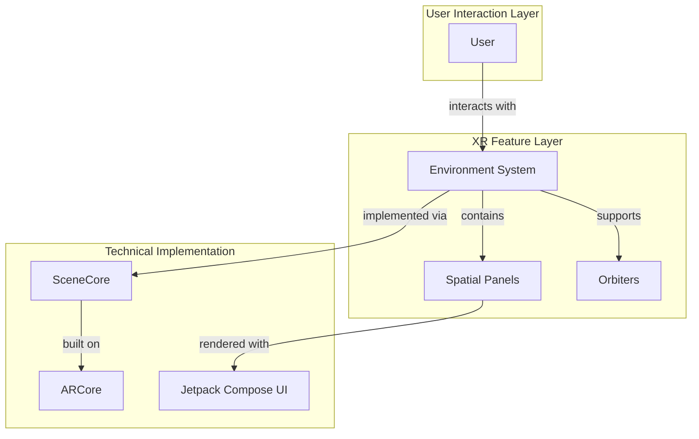
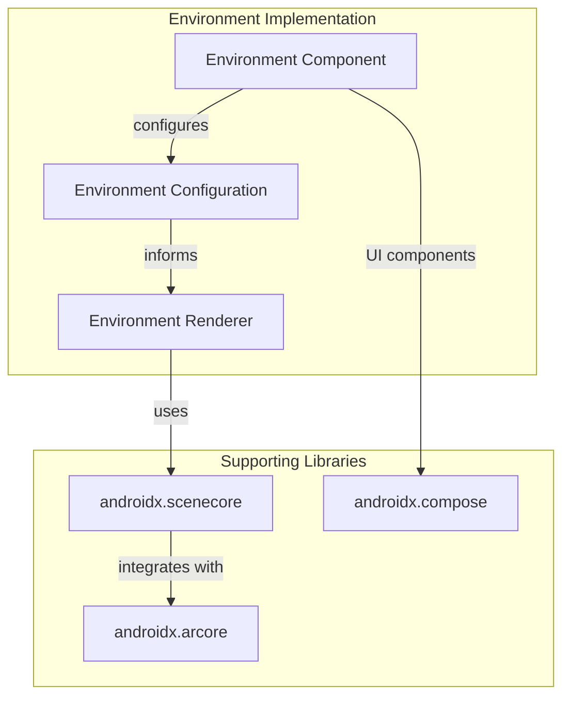
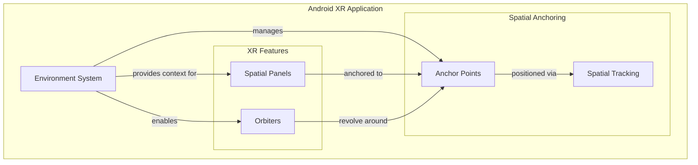

<!-- source: DeepWiki mcp.deepwiki.com · repo android/xr-samples · extra page Environments · fetched 2026-10-23 -->

# Environments

Relevant source files

The following files were used as context for generating this wiki page:

- [README.md](README.md)
- [app/build.gradle.kts](app/build.gradle.kts)

This document provides an overview of the Environments feature in the Android XR Samples application. It explains the implementation, usage, and relationship of Environments with other XR features in the sample code. For information about other XR features, see [Spatial Panels](#3.2.1) and [Orbiters](#3.2.2).

## What Are Environments in Android XR?

Environments in Android XR applications provide the spatial context in which extended reality experiences take place. They define the virtual space surrounding the user and establish the foundation for rendering and anchoring XR content.

The Android XR Samples repository demonstrates implementation of Environments using ARCore and SceneCore libraries to create immersive spatial contexts for XR interactions.

Sources: [README.md:10-14](), [app/build.gradle.kts:67-68]()

## Environment System Architecture

Environments in the Android XR Samples function as a foundational layer for XR experiences, providing spatial awareness and rendering capabilities for other XR elements.

### Environment Architecture Diagram

Sources: [app/build.gradle.kts:67-69](), [README.md:10-14]()

## Technical Implementation

The Environment system in the Android XR Samples application is implemented through a combination of ARCore for spatial tracking and SceneCore for 3D scene rendering. The build configuration shows these as primary dependencies for enabling XR functionality.

### Implementation Stack

Sources: [app/build.gradle.kts:67-69]()

## Environment Types and Capabilities

Android XR environments typically support several implementation variants to accommodate different XR use cases:

| Environment Type | Description | Typical Use Cases |
|------------------|-------------|-------------------|
| Passthrough      | Overlays virtual content on camera feed of the real world | AR applications, spatial computing |
| Virtual          | Fully rendered 3D environment replacing real world view | VR experiences, immersive simulations |
| Mixed            | Combination of real-world elements and virtual content | Mixed reality workspaces, enhanced training |

## Environment Integration with Other XR Features

Environments in the Android XR Samples provide the spatial foundation that enables other XR features to function correctly.

### Feature Integration Diagram

Sources: [README.md:10-14]()

## Best Practices for Android XR Environments

When working with Environments in Android XR applications:

1. **Initialization**: Initialize Environment components early in the application lifecycle
2. **Spatial Awareness**: Ensure proper tracking of the real-world space before placing XR content
3. **Performance**: Optimize environment complexity based on target device capabilities
4. **User Experience**: Provide clear spatial cues to help users understand environment boundaries
5. **Fallback Mechanisms**: Implement graceful degradation when optimal tracking is unavailable

## Technical Considerations

The Android XR Samples application leverages several key technologies for Environment implementation:

- **ARCore**: Provides fundamental AR capabilities including tracking, light estimation, and depth sensing
- **SceneCore**: Offers high-level abstractions for 3D scene management and rendering
- **Jetpack Compose**: Enables the creation of modern UI components that can be integrated into XR spaces

Sources: [app/build.gradle.kts:67-69]()

## Summary

The Environments feature in Android XR Samples demonstrates how to create spatial contexts for XR experiences. Built on ARCore and SceneCore technologies, it provides the foundation for other XR features like Spatial Panels and Orbiters. Understanding Environment implementation is essential for creating cohesive and immersive XR applications.

---

