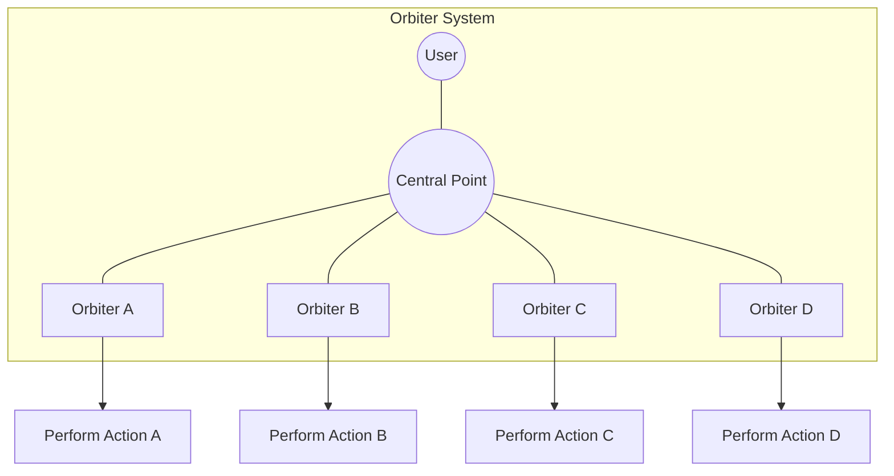
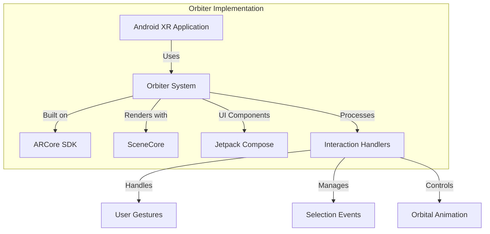
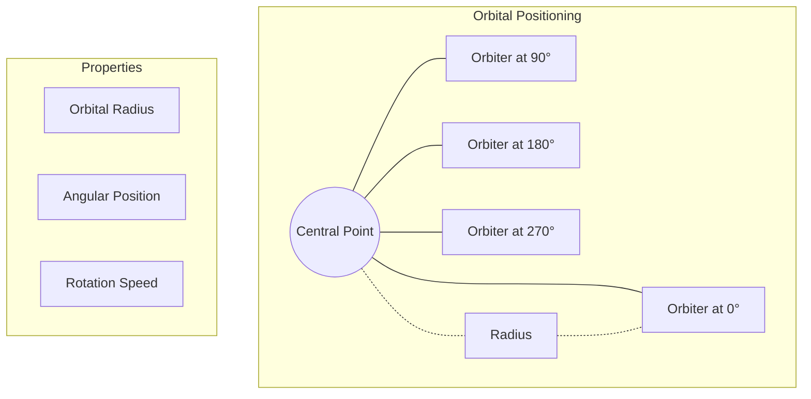
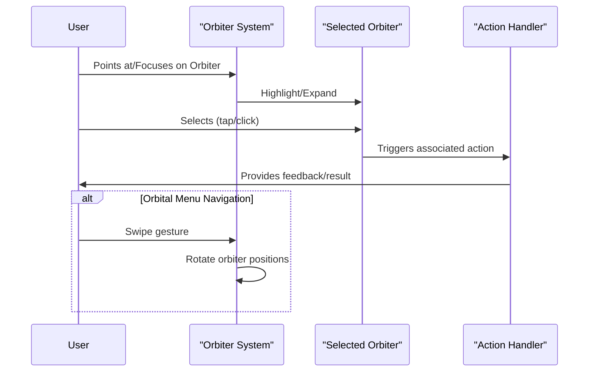
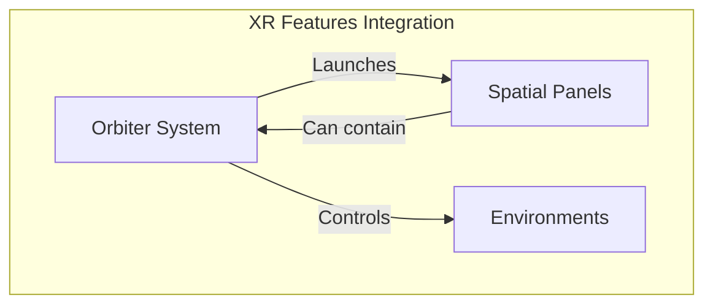

<!-- source: DeepWiki mcp.deepwiki.com · repo android/xr-samples · extra page Orbiters · fetched 2026-10-23 -->

# Orbiters

Relevant source files

The following files were used as context for generating this wiki page:

- [README.md](README.md)
- [app/build.gradle.kts](app/build.gradle.kts)

## Purpose and Scope

This document provides a technical overview of the Orbiters system in the Android XR Samples repository. Orbiters are UI components that orbit around a central point or object in 3D space, providing an interactive and spatially-aware menu system for XR applications. For information about other XR features like Spatial Panels, see [Spatial Panels](#3.2.1), and for Environments, see [Environments](#3.2.3).

## What are Orbiters?

Orbiters are interactive UI elements that revolve around a central point in 3D space, typically around the user or a specified object. They provide a circular or orbital menu system that allows users to access functions and controls in an XR environment with intuitive spatial interaction.

### Orbiter Concept Diagram

Sources: [README.md:10-15]()

## Orbiter System Architecture

The Orbiters system in the Android XR Samples is built on several key dependencies and frameworks. The implementation leverages ARCore and SceneCore for 3D positioning and rendering, while using Jetpack Compose for the UI components.

### Technical Architecture

Sources: [app/build.gradle.kts:63-82]()

## Key Components

The Orbiter system likely consists of the following key components:

1. **Orbiter Container**: The central controller that manages the orbital positioning and interaction with multiple orbiters
2. **Individual Orbiters**: The UI elements that orbit around the central point
3. **Interaction System**: Handles user input for selecting and interacting with orbiters
4. **Animation System**: Controls the orbital movement and transition animations

### Component Relationship

| Component | Responsibility | Technical Implementation |
|-----------|----------------|--------------------------|
| Orbiter Container | Manages the spatial arrangement of orbiters | Likely uses SceneCore positioning APIs |
| Individual Orbiters | Represent interactive menu items | Implemented as Compose UI components within 3D space |
| Interaction System | Processes user input and selection | Utilizes ARCore input detection and raycasting |
| Animation System | Controls orbital movement | Uses SceneCore's animation capabilities |

Sources: [app/build.gradle.kts:67-69](), [README.md:10-15]()

## Orbiter Positioning and Movement

Orbiters are positioned in 3D space relative to a central point. They typically follow spherical or circular paths around this point, maintaining equidistant spacing or specific angular positions.

### Orbital Positioning Model

Sources: [app/build.gradle.kts:67-68]()

## Interaction Model

Users interact with orbiters through gaze, controller pointing, or hand tracking. When an orbiter is selected, it can:

1. Trigger an action directly
2. Expand into sub-orbiters
3. Open a detailed interface
4. Transform into another UI component

### Interaction Flow

Sources: [app/build.gradle.kts:67-69]()

## Integration with Other XR Features

Orbiters work in conjunction with other XR features in the sample application:

1. **Spatial Panels**: Orbiters can launch or control Spatial Panels
2. **Environments**: Orbiters can be used to switch or modify Environments

### Feature Integration Diagram

Sources: [README.md:10-15]()

## Implementation Considerations

When working with the Orbiters system in the Android XR Samples, developers should consider the following aspects:

1. **Performance**: Orbiters involve 3D positioning and animation, which can impact performance
2. **Accessibility**: Ensuring orbiters are easy to select and interact with
3. **Visual Design**: Orbiters should be clearly visible against varying backgrounds
4. **Input Methods**: Supporting multiple input methods (gaze, controller, hand tracking)

### Technical Requirements

To implement orbiters, the application requires:

- ARCore for spatial tracking and positioning
- SceneCore for 3D rendering and animation
- Jetpack Compose for UI components
- Coroutines for asynchronous operations

Sources: [app/build.gradle.kts:63-82]()

## Best Practices

When implementing or extending the Orbiters system:

1. Maintain appropriate distance between orbiters to prevent overlap
2. Use clear visual indicators for selection state
3. Implement smooth transitions and animations
4. Provide alternative UI navigation for accessibility
5. Consider user comfort with element placement and movement speed

## Summary

The Orbiters system in the Android XR Samples provides a spatially-aware menu system for XR applications. It leverages ARCore and SceneCore for 3D positioning and rendering, with Jetpack Compose for UI components. Orbiters offer an intuitive way for users to interact with functions and controls in 3D space, enhancing the overall XR experience.

Sources: [README.md:10-15](), [app/build.gradle.kts:63-82]()

---

