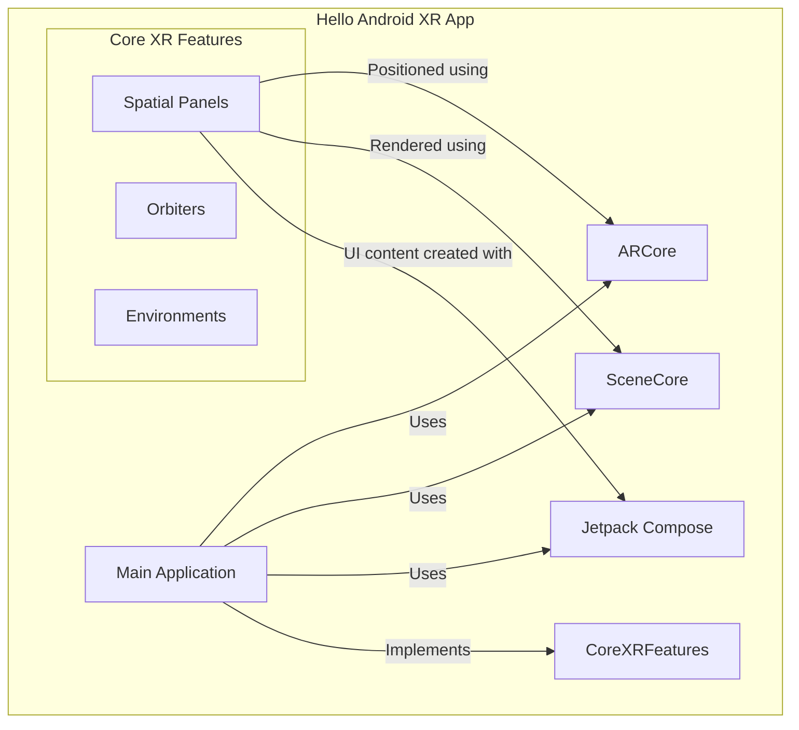
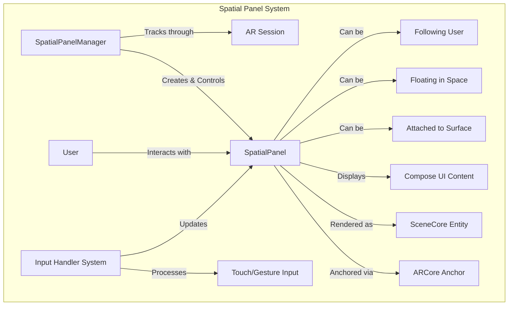

<!-- source: DeepWiki mcp.deepwiki.com · repo android/xr-samples · extra page Spatial Panels · fetched 2026-10-23 -->

# Spatial Panels

Relevant source files

The following files were used as context for generating this wiki page:

- [README.md](README.md)
- [app/build.gradle.kts](app/build.gradle.kts)

## Purpose and Scope

Spatial Panels in the Android XR Samples repository demonstrate how to integrate 2D user interface elements within 3D augmented reality space. These panels allow developers to create interactive UI surfaces that can be positioned and manipulated in the physical world using AR capabilities.

For information about related XR features in this sample, see [Orbiters](#3.2.2) and [Environments](#3.2.3).

Sources: [README.md:10-15]()

## Architecture Overview

Spatial Panels are a core XR feature of the Hello Android XR application. They showcase the integration between AR positioning systems and modern UI frameworks:

The diagram illustrates how Spatial Panels rely on three fundamental technologies:
- ARCore provides spatial awareness and tracking
- SceneCore handles 3D scene management
- Jetpack Compose creates the 2D UI components displayed within the panels

Sources: [README.md:10-15](), [app/build.gradle.kts:63-71]()

## Technical Foundations

The implementation of Spatial Panels relies on several key dependencies declared in the build configuration:

| Dependency | Purpose in Spatial Panels |
|------------|---------|
| `androidx.arcore` | Enables AR functionality for positioning panels in real space |
| `androidx.scenecore` | Manages rendering and 3D scene composition |
| `androidx.compose` | Creates the UI content displayed on panels |
| `androidx.compose.material3` | Provides Material Design components for panel content |
| `kotlinx.coroutines.guava` | Handles asynchronous operations between UI and AR systems |

These dependencies work together to create a cohesive system where 2D UI elements can exist and be interacted with in 3D space.

Sources: [app/build.gradle.kts:63-82]()

## Implementation Model

While specific implementation details aren't fully visible in the provided files, we can model the likely structure of Spatial Panels based on the dependencies and typical XR architecture patterns:

This diagram represents the probable component architecture of the Spatial Panels feature, showing how user interactions flow through the system and how panels can exist in different states within AR space.

Sources: [app/build.gradle.kts:67-71]()

## Integration with ARCore

Spatial Panels likely integrate with ARCore for key functionalities:

- Anchoring panels to real-world surfaces or positions
- Maintaining stable positioning as the user moves
- Handling occlusion with real-world objects
- Managing panel visibility based on spatial awareness

The application uses `androidx.arcore` as specified in the build configuration, which provides the foundation for these AR capabilities.

Sources: [app/build.gradle.kts:67]()

## UI Implementation with Jetpack Compose

The UI content displayed on Spatial Panels is implemented using Jetpack Compose, as indicated by multiple Compose-related dependencies:

- `androidx.compose`
- `androidx.compose.material3`
- `androidx.compose.ui.tooling`
- `androidx.compose.runtime`
- `androidx.activity.compose`

This modern declarative UI toolkit allows developers to create rich, interactive interfaces that can be rendered within 3D space on the Spatial Panels.

Sources: [app/build.gradle.kts:69-80]()

## Common Use Cases

Spatial Panels in XR applications typically serve several key purposes:

1. Information display - showing contextual data in 3D space
2. Control interfaces - providing interactive UI elements
3. Content browsing - displaying media, documents or web content
4. Spatial menus - organizing application functions in 3D
5. Collaborative workspaces - shared panels for multi-user experiences

The Android XR Samples repository demonstrates these capabilities to provide developers with implementation patterns they can adopt in their own applications.

Sources: [README.md:10-15]()

## Conclusion

Spatial Panels exemplify how traditional 2D UI components can be seamlessly integrated into augmented reality experiences. By combining ARCore's spatial awareness, SceneCore's rendering capabilities, and Jetpack Compose's modern UI toolkit, developers can create intuitive interfaces that bridge the digital and physical worlds.

For more information about Android XR development, refer to the official documentation references in the README:
- Android XR Overview
- Developing for Android XR
- UI Design for Android XR

Sources: [README.md:23-28]()

---

