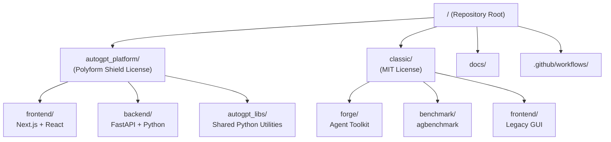
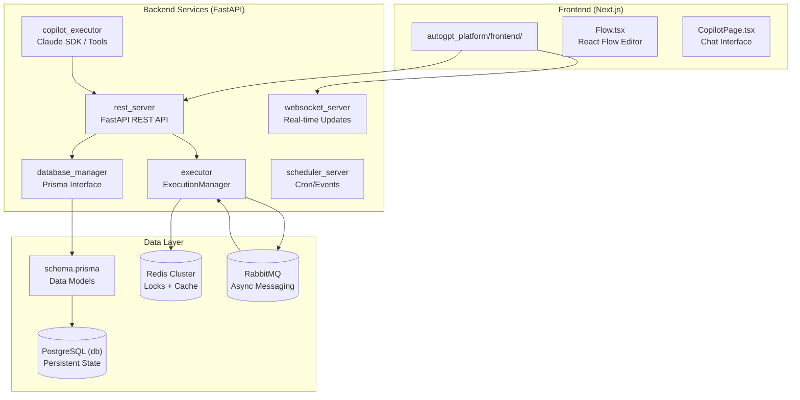
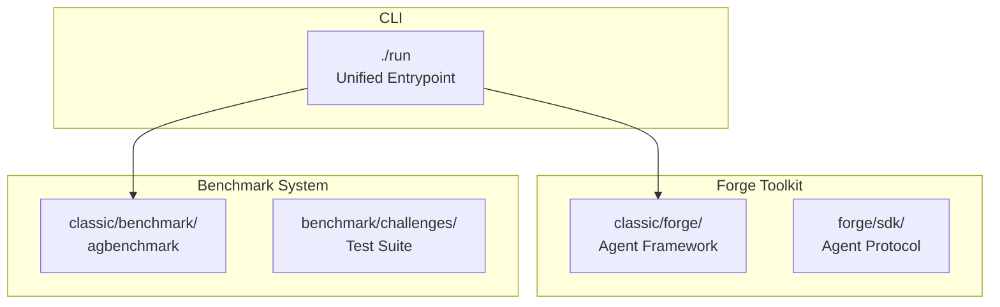

<!-- source: DeepWiki mcp.deepwiki.com · repo Significant-Gravitas/AutoGPT · page 1 Overview · fetched 2026-10-26 -->

# Overview

Relevant source files

The following files were used as context for generating this wiki page:

- [.dockerignore](.dockerignore)
- [.github/ISSUE_TEMPLATE/1.bug.yml](.github/ISSUE_TEMPLATE/1.bug.yml)
- [.github/ISSUE_TEMPLATE/2.feature.yml](.github/ISSUE_TEMPLATE/2.feature.yml)
- [.github/PULL_REQUEST_TEMPLATE.md](.github/PULL_REQUEST_TEMPLATE.md)
- [.github/workflows/platform-backend-ci.yml](.github/workflows/platform-backend-ci.yml)
- [.github/workflows/platform-frontend-ci.yml](.github/workflows/platform-frontend-ci.yml)
- [.github/workflows/platform-fullstack-ci.yml](.github/workflows/platform-fullstack-ci.yml)
- [.gitignore](.gitignore)
- [CODE_OF_CONDUCT.md](CODE_OF_CONDUCT.md)
- [CONTRIBUTING.md](CONTRIBUTING.md)
- [LICENSE](LICENSE)
- [README.md](README.md)
- [autogpt_platform/README.md](autogpt_platform/README.md)
- [autogpt_platform/backend/.env.default](autogpt_platform/backend/.env.default)
- [autogpt_platform/backend/Dockerfile](autogpt_platform/backend/Dockerfile)
- [autogpt_platform/backend/README.advanced.md](autogpt_platform/backend/README.advanced.md)
- [autogpt_platform/backend/README.md](autogpt_platform/backend/README.md)
- [autogpt_platform/backend/backend/copilot/tools/agent_browser.py](autogpt_platform/backend/backend/copilot/tools/agent_browser.py)
- [autogpt_platform/backend/backend/copilot/tools/agent_browser_integration_test.py](autogpt_platform/backend/backend/copilot/tools/agent_browser_integration_test.py)
- [autogpt_platform/backend/backend/copilot/tools/conftest.py](autogpt_platform/backend/backend/copilot/tools/conftest.py)
- [autogpt_platform/backend/backend/util/feature_flag_test.py](autogpt_platform/backend/backend/util/feature_flag_test.py)
- [autogpt_platform/backend/test/__init__.py](autogpt_platform/backend/test/__init__.py)
- [autogpt_platform/db/docker/docker-compose.yml](autogpt_platform/db/docker/docker-compose.yml)
- [autogpt_platform/db/docker/reset.sh](autogpt_platform/db/docker/reset.sh)
- [autogpt_platform/docker-compose.platform.yml](autogpt_platform/docker-compose.platform.yml)
- [autogpt_platform/docker-compose.yml](autogpt_platform/docker-compose.yml)
- [autogpt_platform/frontend/Dockerfile](autogpt_platform/frontend/Dockerfile)
- [autogpt_platform/frontend/src/app/page.tsx](autogpt_platform/frontend/src/app/page.tsx)
- [autogpt_platform/frontend/src/services/feature-flags/__tests__/helpers.test.ts](autogpt_platform/frontend/src/services/feature-flags/__tests__/helpers.test.ts)
- [autogpt_platform/frontend/src/services/feature-flags/feature-flag-provider.tsx](autogpt_platform/frontend/src/services/feature-flags/feature-flag-provider.tsx)
- [autogpt_platform/frontend/src/services/feature-flags/helpers.ts](autogpt_platform/frontend/src/services/feature-flags/helpers.ts)
- [docs/content/code-of-conduct.md](docs/content/code-of-conduct.md)
- [docs/content/contributing.md](docs/content/contributing.md)

This document introduces the AutoGPT repository, its dual-license structure, and the two major product lines it contains: the modern **AutoGPT Platform** and **Classic AutoGPT**. The AutoGPT Platform is a full-stack application for building, deploying, and managing AI agent workflows through a visual interface. Classic AutoGPT represents the original standalone agent approach with development tools like Forge and the `agbenchmark` testing framework.

For detailed information on specific subsystems, see:
- [Repository Structure](#1.1)
- [Core Components](#1.2)
- [Key Terminology](#1.3)
- [AutoGPT Platform](#3)
- [Classic AutoGPT](#4)
- [Getting Started](#2)
- [Development](#5)

## Repository Structure

The AutoGPT repository is organized into two independently-licensed product lines that share minimal code but coexist in the same repository for historical and community reasons.

### Directory Layout

**Sources:** [README.md:127-134](), [.gitignore:3-17]()

### License Structure

The repository employs a dual-license model:

| Component | License | Path | Description |
|-----------|---------|------|-------------|
| **AutoGPT Platform** | Polyform Shield | `autogpt_platform/` | Modern agent builder platform with visual workflow editor |
| **Classic AutoGPT** | MIT | `classic/` | Original standalone agent, Forge toolkit, and agbenchmark |
| **Shared Infrastructure** | MIT | Root level files | CI/CD workflows, documentation, CLI tools |

The Polyform Shield License restricts commercial use (providing a competing product) without a separate commercial license, while the MIT License permits unrestricted use. 

**Sources:** [LICENSE:1-19](), [README.md:127-134](), [CONTRIBUTING.md:10-11]()

## AutoGPT Platform Architecture

The AutoGPT Platform is a complete rewrite of the agent concept as a visual workflow builder. Users create "agent graphs" by connecting "blocks" (nodes) that perform specific actions. It also includes a **Copilot** system for AI-assisted agent creation and interaction.

### Platform Overview Diagram

**Sources:** [autogpt_platform/docker-compose.platform.yml:9-35](), [README.md:98-107]()

### Key Components

#### Frontend (`autogpt_platform/frontend/`)
A Next.js application featuring a low-code **Agent Builder** and a **Copilot** chat interface. It uses React Flow for graph visualization and Supabase for authentication.
- For details, see [Frontend](#3.1).

#### Backend (`autogpt_platform/backend/`)
A microservice-based Python application. Key services defined in the platform configuration include `rest_server`, `executor`, `websocket_server`, and `scheduler_server`.
- For details, see [Backend](#3.2).

#### Copilot System
An AI-powered interface that allows users to build and run agents via natural language. It supports two execution paths: a Claude Agent SDK path and a baseline OpenAI-compatible path.
- For details, see [Copilot System](#3.3).

#### Shared Libraries (`autogpt_platform/autogpt_libs/`)
Internal Python utilities for authentication, logging, and feature flags shared across backend services.
- For details, see [Shared Libraries (autogpt-libs)](#3.4).

**Sources:** [autogpt_platform/docker-compose.yml:70-111](), [README.md:80-96]()

## Classic AutoGPT Components

Classic AutoGPT represents the original MIT-licensed components focused on traditional autonomous agent development and benchmarking.

### Classic Architecture Diagram

**Sources:** [LICENSE:13-17](), [README.md:132-134]()

- **Forge**: A toolkit for building agents following the Agent Protocol standard. See [Forge](#4.1).
- **agbenchmark**: A standardized testing framework for autonomous agents. See [Benchmark (agbenchmark)](#4.2).

## External Service Dependencies

The AutoGPT Platform integrates with several infrastructure services:

| Service | Purpose | Source Reference |
|---------|---------|------------------|
| **Supabase** | Auth & User Management | [autogpt_platform/docker-compose.yml:139-152]() |
| **PostgreSQL** | Primary Data Store | [autogpt_platform/docker-compose.platform.yml:33-34]() |
| **Redis** | Distributed Locking (3-shard cluster) | [autogpt_platform/docker-compose.platform.yml:100-137]() |
| **RabbitMQ** | Message Broker | [autogpt_platform/docker-compose.platform.yml:167-175]() |
| **FalkorDB** | Graph Memory Store | [autogpt_platform/docker-compose.platform.yml:138-166]() |
| **ClamAV** | Security / Virus Scanning | [autogpt_platform/docker-compose.yml:112-132]() |

## System Requirements

- **CPU**: 4+ cores recommended
- **RAM**: 8GB Minimum (16GB recommended)
- **Software**: Docker Engine (20.10.0+), Docker Compose (2.0.0+), Node.js (16.x+), Python (3.11+).

**Sources:** [README.md:27-52](), [autogpt_platform/backend/Dockerfile:24-34]()

---

