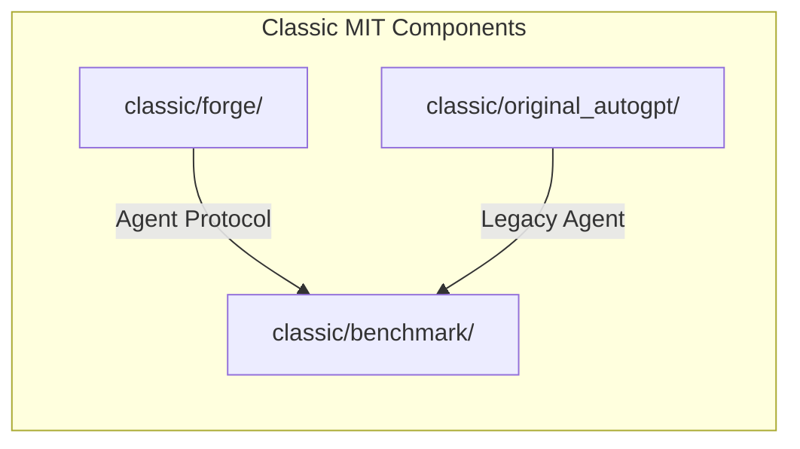
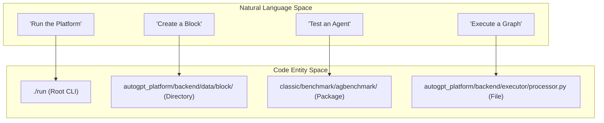

<!-- source: DeepWiki mcp.deepwiki.com · repo Significant-Gravitas/AutoGPT · page 1.1 Repository Structure · fetched 2026-10-26 -->

# Repository Structure

Relevant source files

The following files were used as context for generating this wiki page:

- [.claude/skills/pr-address/SKILL.md](.claude/skills/pr-address/SKILL.md)
- [.claude/skills/pr-review/SKILL.md](.claude/skills/pr-review/SKILL.md)
- [.github/ISSUE_TEMPLATE/1.bug.yml](.github/ISSUE_TEMPLATE/1.bug.yml)
- [.github/ISSUE_TEMPLATE/2.feature.yml](.github/ISSUE_TEMPLATE/2.feature.yml)
- [.github/PULL_REQUEST_TEMPLATE.md](.github/PULL_REQUEST_TEMPLATE.md)
- [.gitignore](.gitignore)
- [CLAUDE.md](CLAUDE.md)
- [CODE_OF_CONDUCT.md](CODE_OF_CONDUCT.md)
- [CONTRIBUTING.md](CONTRIBUTING.md)
- [LICENSE](LICENSE)
- [README.md](README.md)
- [autogpt_platform/AGENTS.md](autogpt_platform/AGENTS.md)
- [autogpt_platform/CLAUDE.md](autogpt_platform/CLAUDE.md)
- [autogpt_platform/backend/AGENTS.md](autogpt_platform/backend/AGENTS.md)
- [autogpt_platform/backend/CLAUDE.md](autogpt_platform/backend/CLAUDE.md)
- [autogpt_platform/frontend/CLAUDE.md](autogpt_platform/frontend/CLAUDE.md)
- [autogpt_platform/frontend/src/tests/AGENTS.md](autogpt_platform/frontend/src/tests/AGENTS.md)
- [autogpt_platform/frontend/src/tests/CLAUDE.md](autogpt_platform/frontend/src/tests/CLAUDE.md)
- [docs/content/code-of-conduct.md](docs/content/code-of-conduct.md)
- [docs/content/contributing.md](docs/content/contributing.md)
- [docs/platform/workspace-media-architecture.md](docs/platform/workspace-media-architecture.md)

## Purpose and Scope

This document describes the physical organization of the AutoGPT repository, including directory layout, license boundaries, and the relationship between the Platform and Classic codebases. It provides a map of where different components live within the repository structure.

For details on the Platform's internal architecture, see **Core Components (1.2)**. For Classic AutoGPT components, see **Classic AutoGPT (4)**.

---

## Overview

The AutoGPT repository houses two distinct product lines under different licenses, along with shared infrastructure. The repository has transitioned from a single agent project to a comprehensive platform for building and managing AI agents.

| Component | Directory | License | Purpose |
|-----------|-----------|---------|---------|
| **AutoGPT Platform** | `autogpt_platform/` | Polyform Shield | Modern agent builder with visual workflow editor and microservices. |
| **Classic AutoGPT** | `classic/` | MIT | Original autonomous agent, Forge development toolkit, and agbenchmark. |
| **Shared Libraries** | `autogpt_libs/` | MIT | Shared logic for auth, logging, and feature flags. |
| **Documentation** | `docs/` | N/A | User and developer documentation. |
| **CI/CD** | `.github/workflows/` | N/A | Continuous integration and deployment workflows. |

**Sources:** [README.md:127-133](), [LICENSE:1-19]()

---

## Directory Structure Diagram

The following diagram illustrates the relationship between the major directories and the licensing boundaries within the repository.

```mermaid
graph TB
    ROOT["/"]
    
    subgraph "AutoGPT Platform - Polyform Shield License"
        PLATFORM["autogpt_platform/"]
        PLATFORM_FE["autogpt_platform/frontend/"]
        PLATFORM_BE["autogpt_platform/backend/"]
        PLATFORM_INFRA["autogpt_platform/infra/"]
        
        FE_SRC["frontend/src/"]
        BE_EXEC["backend/executor/"]
        BE_BLOCKS["backend/data/block/"]
        BE_INTEGRATIONS["backend/integrations/"]
    end
    
    subgraph "Classic AutoGPT - MIT License"
        CLASSIC["classic/"]
        FORGE["classic/forge/"]
        BENCHMARK["classic/benchmark/"]
        CLASSIC_FE["classic/frontend/"]
        ORIGINAL["classic/original_autogpt/"]
    end
    
    subgraph "Shared & Infrastructure"
        LIBS["autogpt_libs/"]
        DOCS["docs/"]
        GITHUB[".github/"]
        ROOT_FILES["Root Configs"]
        CLI["run (CLI script)"]
    end
    
    ROOT --> PLATFORM
    ROOT --> CLASSIC
    ROOT --> LIBS
    ROOT --> DOCS
    ROOT --> GITHUB
    ROOT --> ROOT_FILES
    
    PLATFORM --> PLATFORM_FE
    PLATFORM --> PLATFORM_BE
    PLATFORM --> PLATFORM_INFRA
    
    CLASSIC --> FORGE
    CLASSIC --> BENCHMARK
    CLASSIC_FE --> CLASSIC
    CLASSIC --> ORIGINAL
    
    ROOT_FILES --> CLI
```

**Sources:** [README.md:1-239](), [.gitignore:1-182](), [LICENSE:1-21]()

---

## AutoGPT Platform Structure (`autogpt_platform/`)

The Platform directory contains the modern agent builder application. This is the primary focus of active development and is licensed under the Polyform Shield License [LICENSE:8-10]().

### Frontend (`autogpt_platform/frontend/`)

The frontend is a Next.js application that provides the visual interface for the Agent Builder, Marketplace, and Library [README.md:80-96]().

| Directory | Purpose |
|-----------|---------|
| `src/app/` | Next.js App Router pages (e.g., `/build`, `/library`, `/marketplace`). |
| `src/components/` | UI components, including the React Flow editor logic. |
| `src/hooks/` | Custom React hooks for graph management and API interaction. |
| `src/lib/` | Zustand stores (`nodeStore.ts`, `edgeStore.ts`) and API client utilities. |

### Backend (`autogpt_platform/backend/`)

The backend is a FastAPI-based microservice architecture that manages graph execution, scheduling, and integrations [README.md:98-107]().

| File/Directory | Purpose |
|------|---------|
| `backend/rest.py` | Primary FastAPI REST API server. |
| `backend/ws.py` | WebSocket server for real-time execution updates. |
| `backend/executor/` | The core execution engine (`processor.py`, `manager.py`). |
| `backend/data/block/` | Implementation of Agent Blocks (AI, Logic, Data). |
| `backend/prisma/` | Database schema (`schema.prisma`) and migrations. |

**Sources:** [README.md:80-107](), [.gitignore:180-194]()

---

## Classic AutoGPT Structure (`classic/`)

The `classic/` directory contains the legacy MIT-licensed components. These are maintained for community support and benchmarking [LICENSE:12-17]().

- **Forge (`classic/forge/`)**: A toolkit for building agents following the Agent Protocol standard [LICENSE:15]().
- **Benchmark (`classic/benchmark/`)**: The `agbenchmark` suite used to test agent performance across various challenges [LICENSE:16]().
- **Original AutoGPT (`classic/original_autogpt/`)**: The original standalone CLI agent that popularized the project [LICENSE:14]().

**Sources:** [README.md:132-133](), [LICENSE:12-17]()

---

## Shared Infrastructure

### autogpt_libs
A shared Python package located in `autogpt_libs/` that provides common utilities used by the platform backend. It includes modules for:
- **Authentication**: Supabase integration and JWT verification.
- **Logging**: Standardized logging configurations for microservices.
- **Feature Flags**: Logic for enabling/disabling features at runtime.

### Root Configuration
The root of the repository contains unified management tools:
- **`run`**: A unified CLI script used to manage the entire repository, from starting the platform to running benchmarks [README.md:64-78]().
- **`.github/workflows/`**: Contains CI/CD pipelines for backend, frontend, and Claude-based automation [CONTRIBUTING.md:1-11]().
- **`.claude/skills/`**: Contains "skills" for AI-assisted development, such as `pr-address` and `pr-review` [.claude/skills/pr-address/SKILL.md:1-12](), [.claude/skills/pr-review/SKILL.md:1-11]().

**Sources:** [README.md:1-78](), [CONTRIBUTING.md:1-38](), [.claude/skills/pr-address/SKILL.md:1-12]()

---

## License and Contribution Model

The repository uses a dual-license model to balance open-source contribution with commercial protection for the platform [LICENSE:1-21]().

1. **Polyform Shield License**: Applies to everything inside `autogpt_platform/`. It allows most uses but prohibits building a competing product [LICENSE:78-94]().
2. **MIT License**: Applies to everything outside the `autogpt_platform/` folder, including `classic/` and `autogpt_libs/` [LICENSE:12-19]().
3. **Contribution Agreement**: Contributions to the platform folder require agreeing to a Contributor License Agreement (CLA), while other folders remain standard MIT contributions [CONTRIBUTING.md:10-11]().

**Sources:** [LICENSE:1-180](), [CONTRIBUTING.md:10-11]()

---

## Implementation to Entity Mapping

The following diagram maps high-level system concepts to their specific code entities within the repository.

**Sources:** [README.md:64-107](), [.gitignore:162-168]()

---

