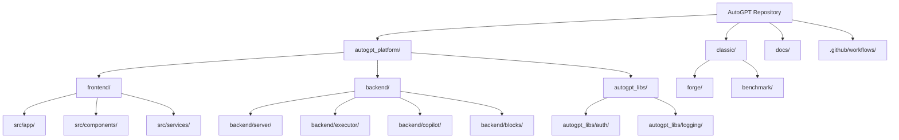
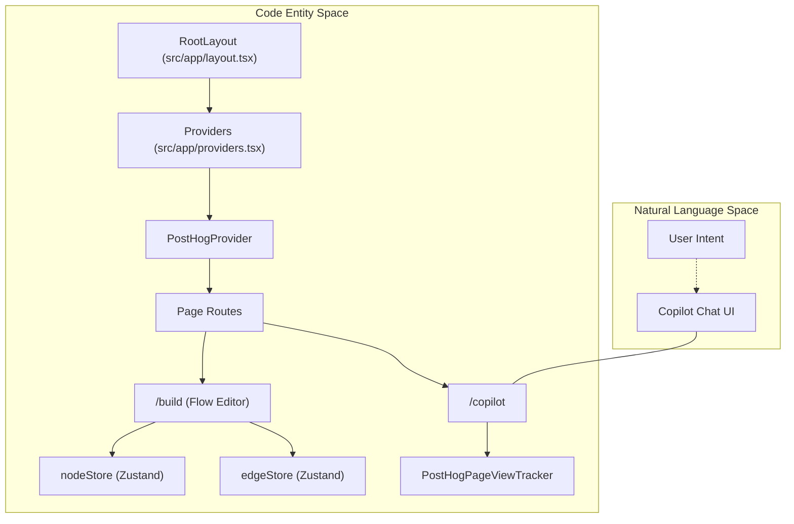
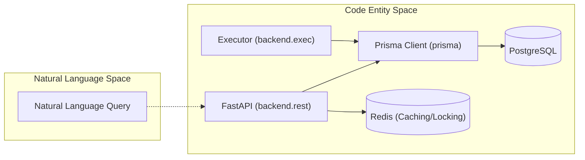

<!-- source: DeepWiki mcp.deepwiki.com · repo Significant-Gravitas/AutoGPT · page 1.2 Core Components · fetched 2026-10-26 -->

# Core Components

Relevant source files

The following files were used as context for generating this wiki page:

- [autogpt_platform/autogpt_libs/poetry.lock](autogpt_platform/autogpt_libs/poetry.lock)
- [autogpt_platform/autogpt_libs/pyproject.toml](autogpt_platform/autogpt_libs/pyproject.toml)
- [autogpt_platform/backend/poetry.lock](autogpt_platform/backend/poetry.lock)
- [autogpt_platform/backend/pyproject.toml](autogpt_platform/backend/pyproject.toml)
- [autogpt_platform/frontend/.env.default](autogpt_platform/frontend/.env.default)
- [autogpt_platform/frontend/.npmrc](autogpt_platform/frontend/.npmrc)
- [autogpt_platform/frontend/package.json](autogpt_platform/frontend/package.json)
- [autogpt_platform/frontend/playwright.config.ts](autogpt_platform/frontend/playwright.config.ts)
- [autogpt_platform/frontend/pnpm-lock.yaml](autogpt_platform/frontend/pnpm-lock.yaml)
- [autogpt_platform/frontend/pnpm-workspace.yaml](autogpt_platform/frontend/pnpm-workspace.yaml)
- [autogpt_platform/frontend/public/mockServiceWorker.js](autogpt_platform/frontend/public/mockServiceWorker.js)
- [autogpt_platform/frontend/src/app/layout.tsx](autogpt_platform/frontend/src/app/layout.tsx)
- [autogpt_platform/frontend/src/components/layout/Navbar/components/PreviewBanner/PreviewBanner.tsx](autogpt_platform/frontend/src/components/layout/Navbar/components/PreviewBanner/PreviewBanner.tsx)
- [autogpt_platform/frontend/src/providers/posthog/posthog-provider.tsx](autogpt_platform/frontend/src/providers/posthog/posthog-provider.tsx)
- [autogpt_platform/frontend/src/services/environment/index.ts](autogpt_platform/frontend/src/services/environment/index.ts)

This page provides a technical reference for the main components in the AutoGPT repository. The codebase is organized into two primary product lines: the **AutoGPT Platform** (modern, under Polyform Shield License) and **Classic AutoGPT** (legacy, MIT License), along with shared infrastructure and external service dependencies.

## Component Overview

The AutoGPT repository consists of the following major component groups:

| Component Group | Location | Description | License |
|----------------|----------|-------------|---------|
| **Platform Frontend** | `autogpt_platform/frontend/` | Next.js application for visual agent builder and Copilot | Polyform Shield |
| **Platform Backend** | `autogpt_platform/backend/` | FastAPI microservices for execution, data, and Copilot | Polyform Shield |
| **Shared Libraries** | `autogpt_platform/autogpt_libs/` | Common utilities for auth, logging, and feature flags | MIT |
| **Classic Components** | `classic/` | Forge toolkit, agbenchmark, and CLI | MIT |
| **External Services** | N/A | Supabase, Redis, RabbitMQ, PostgreSQL, LLM providers | N/A |

#### Repository Structure

Sources: [autogpt_platform/backend/pyproject.toml:1-105](), [autogpt_platform/frontend/package.json:1-135]()

## Platform Frontend

The Platform Frontend is a Next.js 15 application located in `autogpt_platform/frontend/`. It serves as the primary user interface for the Agent Builder (Flow Editor), the Agent Library, and the Copilot chat system.

#### Frontend Technology Stack

| Technology | Purpose | Version |
|-----------|---------|---------|
| **Next.js** | React framework with SSR and App Router | 15.5.18 |
| **React** | UI component library | 18.3.1 |
| **Zustand** | Lightweight state management | 5.0.8 |
| **React Flow** | Graph visualization for the Agent Builder | 12.9.2 |
| **Supabase SDK** | Authentication and real-time database client | 2.78.0 |
| **Tailwind CSS** | Utility-first styling | 3.4.17 |

#### Frontend Architecture

Sources: [autogpt_platform/frontend/package.json:101-134](), [autogpt_platform/frontend/src/app/layout.tsx:36-87](), [autogpt_platform/frontend/src/providers/posthog/posthog-provider.tsx:10-29]()

## Platform Backend

The Platform Backend is a FastAPI application located in `autogpt_platform/backend/`. It utilizes a microservice-inspired architecture where different logic domains are separated into specialized processes.

#### Backend Microservices and Entrypoints

The `pyproject.toml` defines several key scripts that act as service entrypoints:

| Service | Entrypoint | Responsibility |
|---------|------------|----------------|
| **App** | `backend.app:main` | Main combined entrypoint |
| **REST API** | `backend.rest:main` | FastAPI REST server for management and CRUD |
| **WebSocket** | `backend.ws:main` | Real-time communication for execution updates |
| **Executor** | `backend.exec:main` | The engine that processes Agent Graph executions |
| **Scheduler** | `backend.scheduler:main` | Handles cron-based graph execution triggers |
| **Copilot** | `backend.copilot.executor.__main__:main` | Orchestrates Copilot agent sessions |

#### Backend Data Flow

Sources: [autogpt_platform/backend/pyproject.toml:126-146](), [autogpt_platform/backend/poetry.lock:55-55]()

## Shared Libraries (autogpt-libs)

The `autogpt-libs` package is a shared internal dependency located in `autogpt_platform/autogpt_libs/`. It ensures consistency in cross-cutting concerns across the backend services.

#### Key Features
*   **Authentication**: Helpers for Supabase JWT validation and user context management.
*   **Logging**: Structured JSON logging configuration via `google-cloud-logging` [autogpt_platform/autogpt_libs/pyproject.toml:15-15]().
*   **Feature Flags**: Integration with LaunchDarkly for controlled feature rollouts [autogpt_platform/autogpt_libs/pyproject.toml:16-16]().
*   **Concurrency**: Redis-backed synchronization primitives for distributed locking [autogpt_platform/autogpt_libs/pyproject.toml:20-20]().

Sources: [autogpt_platform/autogpt_libs/pyproject.toml:1-22]()

## External Service Dependencies

The AutoGPT Platform relies on several external services for its operation:

1.  **Supabase**: Used for user authentication and as a managed PostgreSQL provider [autogpt_platform/frontend/src/services/environment/index.ts:47-57]().
2.  **Redis**: Acts as a message broker for WebSockets and provides distributed locking for execution management [autogpt_platform/backend/pyproject.toml:68-68]().
3.  **RabbitMQ**: (Optional/Alternative) Used for robust asynchronous task queuing and notification management [autogpt_platform/backend/pyproject.toml:12-12]().
4.  **LLM Providers**: Integration with OpenAI, Anthropic, Groq, and Ollama for AI block execution [autogpt_platform/backend/pyproject.toml:16-48]().
5.  **PostHog**: Integrated for frontend and backend product analytics [autogpt_platform/frontend/src/providers/posthog/posthog-provider.tsx:1-29]().

## Copilot System

The Copilot system is a specialized agentic interface designed to help users build and interact with the platform.

*   **Copilot Executor**: A dedicated service `backend.copilot.executor` that manages the lifecycle of a Copilot session.
*   **Copilot Bot**: Adapters for external platforms like Discord [autogpt_platform/backend/pyproject.toml:138-138]().
*   **Claude Agent SDK**: Used for advanced reasoning and code-related tasks within the Copilot environment [autogpt_platform/backend/pyproject.toml:21-21]().

Sources: [autogpt_platform/backend/pyproject.toml:137-138]()

---

