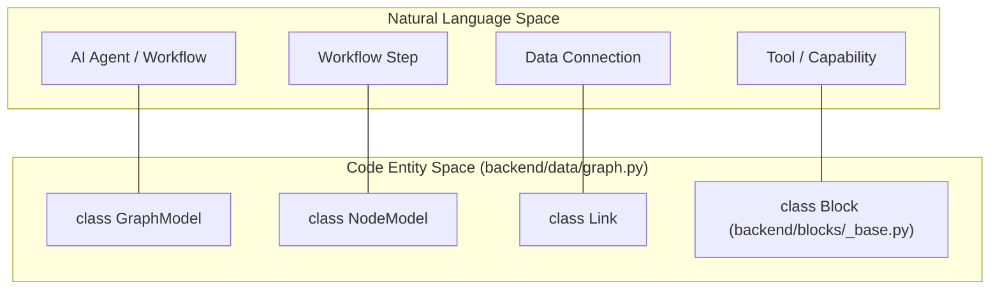
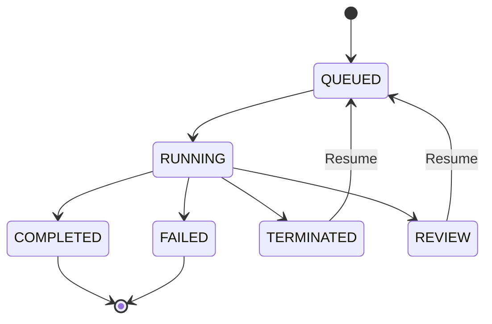
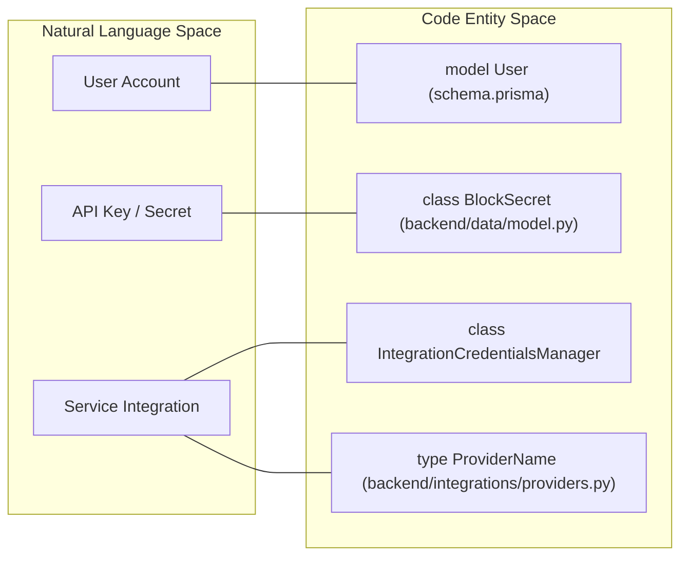

<!-- source: DeepWiki mcp.deepwiki.com · repo Significant-Gravitas/AutoGPT · page 1.3 Key Terminology · fetched 2026-10-26 -->

# Key Terminology

Relevant source files

The following files were used as context for generating this wiki page:

- [.github/ISSUE_TEMPLATE/1.bug.yml](.github/ISSUE_TEMPLATE/1.bug.yml)
- [.github/ISSUE_TEMPLATE/2.feature.yml](.github/ISSUE_TEMPLATE/2.feature.yml)
- [.github/PULL_REQUEST_TEMPLATE.md](.github/PULL_REQUEST_TEMPLATE.md)
- [.gitignore](.gitignore)
- [CODE_OF_CONDUCT.md](CODE_OF_CONDUCT.md)
- [CONTRIBUTING.md](CONTRIBUTING.md)
- [LICENSE](LICENSE)
- [README.md](README.md)
- [autogpt_platform/backend/backend/blocks/agent.py](autogpt_platform/backend/backend/blocks/agent.py)
- [autogpt_platform/backend/backend/data/block.py](autogpt_platform/backend/backend/data/block.py)
- [autogpt_platform/backend/backend/data/execution.py](autogpt_platform/backend/backend/data/execution.py)
- [autogpt_platform/backend/backend/data/graph.py](autogpt_platform/backend/backend/data/graph.py)
- [autogpt_platform/backend/backend/data/model.py](autogpt_platform/backend/backend/data/model.py)
- [autogpt_platform/backend/backend/executor/manager.py](autogpt_platform/backend/backend/executor/manager.py)
- [autogpt_platform/backend/backend/executor/utils.py](autogpt_platform/backend/backend/executor/utils.py)
- [autogpt_platform/backend/backend/executor/utils_test.py](autogpt_platform/backend/backend/executor/utils_test.py)
- [autogpt_platform/backend/backend/util/exceptions.py](autogpt_platform/backend/backend/util/exceptions.py)
- [autogpt_platform/backend/backend/util/settings.py](autogpt_platform/backend/backend/util/settings.py)
- [autogpt_platform/backend/schema.prisma](autogpt_platform/backend/schema.prisma)
- [autogpt_platform/frontend/src/lib/autogpt-server-api/types.ts](autogpt_platform/frontend/src/lib/autogpt-server-api/types.ts)
- [docs/content/code-of-conduct.md](docs/content/code-of-conduct.md)
- [docs/content/contributing.md](docs/content/contributing.md)

This document defines the key terminology and concepts used throughout the AutoGPT codebase. It covers the core entities, execution model, authentication system, and architectural components that developers need to understand when working with the platform.

## Core Platform Distinction

The AutoGPT repository contains two main systems that serve different purposes:

**AutoGPT Platform** - The production-ready system for building, deploying, and running AI agents. This includes the React frontend, FastAPI backend services, and full user management system with credits, authentication, and marketplace functionality. Code for this platform is located in `autogpt_platform/` and is licensed under the Polyform Shield License.

**AutoGPT Classic** - Legacy components including the original stand-alone AutoGPT Agent, Forge (agent development toolkit), and Benchmark (performance testing). These are located in `classic/` and are licensed under the MIT License.

Sources: [README.md:127-134](), [README.md:80-107]()

## Execution System Core Concepts

### Graph Execution Model

The AutoGPT Platform uses a **graph-based execution model** where AI workflows are represented as directed graphs.

| Term | Code Entity | Description |
| :--- | :--- | :--- |
| **Graph** | `AgentGraph` | A complete AI workflow definition containing nodes and their connections. Maps to `GraphModel` class. [autogpt_platform/backend/backend/data/graph.py:10-10]() |
| **Node** | `AgentNode` | Individual execution units within a graph that encapsulate a specific functional block with configuration. [autogpt_platform/backend/backend/data/graph.py:104-132]() |
| **Link** | `AgentNodeLink` | Directed connections between nodes that define data flow. [autogpt_platform/backend/backend/data/graph.py:82-102]() |
| **Block** | `Block` | Reusable functional components that nodes instantiate (e.g., LLM calls, Discord integration). [autogpt_platform/backend/backend/data/block.py:21-27]() |

**Natural Language to Code Mapping: Graph Entities**

Sources: [autogpt_platform/backend/backend/data/graph.py:82-157](), [autogpt_platform/backend/schema.prisma:243-324]()

### Execution Flow and Status

An **Execution** represents the lifecycle of running a Graph or a specific Node.

*   **GraphExecution** (`AgentGraphExecution`): A specific run instance of a graph with inputs, outputs, and execution metadata. [autogpt_platform/backend/backend/data/execution.py:168-189]()
*   **NodeExecution** (`AgentNodeExecution`): Execution instance of a single node within a graph execution. [autogpt_platform/backend/backend/data/execution.py:23-25]()
*   **ExecutionStatus**: Enum defining states: `QUEUED`, `RUNNING`, `COMPLETED`, `FAILED`, `TERMINATED`, `REVIEW`. [autogpt_platform/backend/backend/data/execution.py:130-165]()

**Execution State Machine**

Sources: [autogpt_platform/backend/backend/data/execution.py:135-165](), [autogpt_platform/backend/backend/executor/manager.py:142-149]()

### Block System

Blocks are the fundamental building blocks of functionality.

*   **BlockInput**: A dictionary representing input data for block execution. [autogpt_platform/backend/backend/data/block.py:15-15]()
*   **BlockOutput**: An `AsyncGenerator` yielding named output data tuples `(name, value)`. [autogpt_platform/backend/backend/data/block.py:16-17]()
*   **ExecutionProcessor**: The component responsible for executing nodes and managing their lifecycle within a graph run. [autogpt_platform/backend/backend/executor/manager.py:123-126]()

Sources: [autogpt_platform/backend/backend/data/block.py:15-18](), [autogpt_platform/backend/backend/executor/manager.py:135-136]()

## User System and Credentials

### User Model and Credits

*   **User**: Core user entity synchronized with Supabase. [autogpt_platform/backend/backend/model.py:53-108]()
*   **Credits**: The currency used to pay for block executions. Costs are calculated based on `BlockCostType` (RUN, BYTE, SECOND). [autogpt_platform/frontend/src/lib/autogpt-server-api/types.ts:6-10]()
*   **Usage Cost**: Calculated via `block_usage_cost`, which considers pre-flight estimates and post-flight actuals. [autogpt_platform/backend/backend/executor/utils.py:123-151]()

### Credentials and Providers

*   **Credentials**: Methods for authenticating with external services, including `api_key`, `oauth2`, `user_password`, and `host_scoped`. [autogpt_platform/frontend/src/lib/autogpt-server-api/types.ts:193-203]()
*   **IntegrationCredentialsManager**: Manages the acquisition and release of credentials during execution. [autogpt_platform/backend/backend/executor/manager.py:46-46]()

**Natural Language to Code Mapping: Authentication**

Sources: [autogpt_platform/backend/backend/data/model.py:53-108](), [autogpt_platform/frontend/src/lib/autogpt-server-api/types.ts:193-225](), [autogpt_platform/backend/backend/executor/utils.py:45-50]()

## Store and Library

*   **Store/Library**: The "Store" contains public agent listings (`StoreListing`), while the "Library" contains a user's personal collection of agents (`LibraryAgent`). [autogpt_platform/backend/backend/data/graph.py:8-15]()
*   **Agent Preset**: A saved configuration for an agent, including specific input values. [autogpt_platform/backend/schema.prisma:356-373]()
*   **Copilot**: An AI-powered assistant system for building and interacting with agents. [autogpt_platform/backend/backend/util/settings.py:188-201]()

Sources: [autogpt_platform/backend/backend/data/graph.py:8-15](), [autogpt_platform/backend/schema.prisma:356-373](), [autogpt_platform/backend/backend/util/settings.py:188-201]()

---

