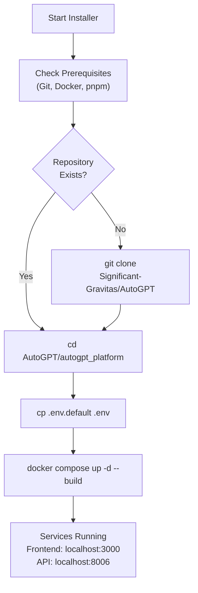
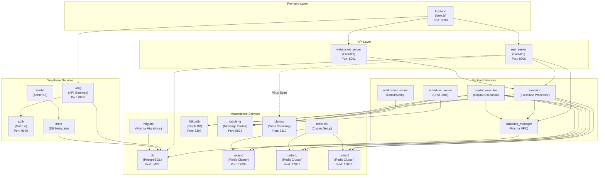
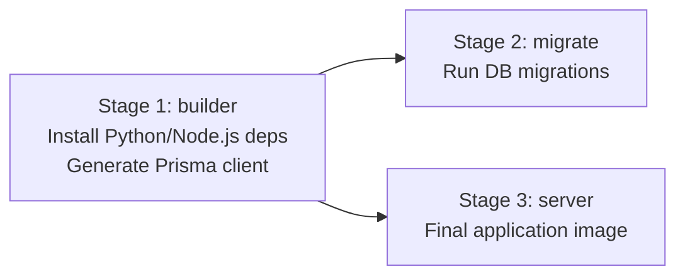
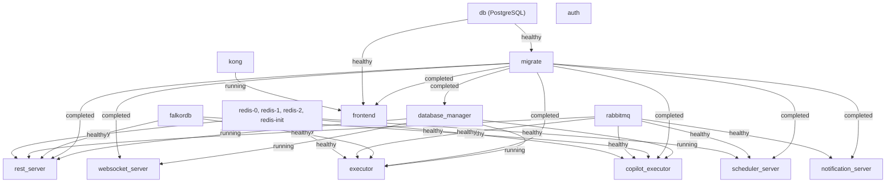
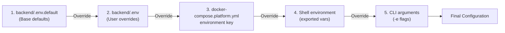

<!-- source: DeepWiki mcp.deepwiki.com · repo Significant-Gravitas/AutoGPT · page 2 Getting Started · fetched 2026-10-26 -->

# Getting Started

<details>
<summary>Relevant source files</summary>

The following files were used as context for generating this wiki page:

- [.dockerignore](.dockerignore)
- [.github/workflows/platform-backend-ci.yml](.github/workflows/platform-backend-ci.yml)
- [.github/workflows/platform-frontend-ci.yml](.github/workflows/platform-frontend-ci.yml)
- [.github/workflows/platform-fullstack-ci.yml](.github/workflows/platform-fullstack-ci.yml)
- [autogpt_platform/README.md](autogpt_platform/README.md)
- [autogpt_platform/backend/.env.default](autogpt_platform/backend/.env.default)
- [autogpt_platform/backend/Dockerfile](autogpt_platform/backend/Dockerfile)
- [autogpt_platform/backend/README.advanced.md](autogpt_platform/backend/README.advanced.md)
- [autogpt_platform/backend/README.md](autogpt_platform/backend/README.md)
- [autogpt_platform/backend/backend/copilot/tools/agent_browser.py](autogpt_platform/backend/backend/copilot/tools/agent_browser.py)
- [autogpt_platform/backend/backend/copilot/tools/agent_browser_integration_test.py](autogpt_platform/backend/backend/copilot/tools/agent_browser_integration_test.py)
- [autogpt_platform/backend/backend/copilot/tools/conftest.py](autogpt_platform/backend/backend/copilot/tools/conftest.py)
- [autogpt_platform/backend/backend/util/feature_flag_test.py](autogpt_platform/backend/backend/util/feature_flag_test.py)
- [autogpt_platform/backend/test/__init__.py](autogpt_platform/backend/test/__init__.py)
- [autogpt_platform/db/docker/docker-compose.yml](autogpt_platform/db/docker/docker-compose.yml)
- [autogpt_platform/db/docker/reset.sh](autogpt_platform/db/docker/reset.sh)
- [autogpt_platform/docker-compose.platform.yml](autogpt_platform/docker-compose.platform.yml)
- [autogpt_platform/docker-compose.yml](autogpt_platform/docker-compose.yml)
- [autogpt_platform/frontend/.env.default](autogpt_platform/frontend/.env.default)
- [autogpt_platform/frontend/.npmrc](autogpt_platform/frontend/.npmrc)
- [autogpt_platform/frontend/Dockerfile](autogpt_platform/frontend/Dockerfile)
- [autogpt_platform/frontend/package.json](autogpt_platform/frontend/package.json)
- [autogpt_platform/frontend/playwright.config.ts](autogpt_platform/frontend/playwright.config.ts)
- [autogpt_platform/frontend/pnpm-lock.yaml](autogpt_platform/frontend/pnpm-lock.yaml)
- [autogpt_platform/frontend/pnpm-workspace.yaml](autogpt_platform/frontend/pnpm-workspace.yaml)
- [autogpt_platform/frontend/public/mockServiceWorker.js](autogpt_platform/frontend/public/mockServiceWorker.js)
- [autogpt_platform/frontend/src/app/layout.tsx](autogpt_platform/frontend/src/app/layout.tsx)
- [autogpt_platform/frontend/src/app/page.tsx](autogpt_platform/frontend/src/app/page.tsx)
- [autogpt_platform/frontend/src/components/layout/Navbar/components/PreviewBanner/PreviewBanner.tsx](autogpt_platform/frontend/src/components/layout/Navbar/components/PreviewBanner/PreviewBanner.tsx)
- [autogpt_platform/frontend/src/providers/posthog/posthog-provider.tsx](autogpt_platform/frontend/src/providers/posthog/posthog-provider.tsx)
- [autogpt_platform/frontend/src/services/environment/index.ts](autogpt_platform/frontend/src/services/environment/index.ts)
- [autogpt_platform/frontend/src/services/feature-flags/__tests__/helpers.test.ts](autogpt_platform/frontend/src/services/feature-flags/__tests__/helpers.test.ts)
- [autogpt_platform/frontend/src/services/feature-flags/feature-flag-provider.tsx](autogpt_platform/frontend/src/services/feature-flags/feature-flag-provider.tsx)
- [autogpt_platform/frontend/src/services/feature-flags/helpers.ts](autogpt_platform/frontend/src/services/feature-flags/helpers.ts)

</details>


This page provides quick-start instructions for setting up and running the AutoGPT Platform locally. It covers system requirements, installation options, and initial setup verification. The AutoGPT Platform is a modern full-stack application for building, deploying, and managing AI agent workflows.

For detailed configuration options, see [Configuration](#2.2). For a step-by-step tutorial on creating your first agent, see [Quick Start Guide](#2.3). For production deployment, see [Deployment](#6).

---

## System Requirements

Before installing the AutoGPT Platform, ensure your system meets the following requirements:

### Hardware Requirements

| Component | Minimum | Recommended |
|-----------|---------|-------------|
| CPU | 4+ cores | 8+ cores |
| RAM | 8GB | 16GB |
| Storage | 10GB free space | 20GB+ free space |

### Software Requirements

| Software | Minimum Version | Notes |
|----------|----------------|-------|
| **Docker Engine** | 20.10.0 | Required for running backend services |
| **Docker Compose** | 2.0.0 | Included in Docker Desktop |
| **Git** | 2.30 | For cloning the repository |
| **Node.js** | 22.x | Required for frontend development |
| **pnpm** | 8.x | Recommended package manager for frontend |

### Operating System Support

- **Linux**: Ubuntu 20.04 or newer (recommended)
- **macOS**: 10.15 or newer
- **Windows**: Windows 10/11 with WSL2 (required for Docker compatibility)

**Windows Note**: Docker must use WSL2 backend instead of Hyper-V to avoid compatibility issues with `supabase-db` container.

### Network Requirements

- Stable internet connection for pulling Docker images and LLM API calls
- Access to required ports: `3000` (frontend), `8006` (REST API), `8001` (WebSocket), `5432` (PostgreSQL), `17000-17002` (Redis Cluster), `6380` (FalkorDB), `5672` (RabbitMQ)
- Ability to make outbound HTTPS connections to external services

Sources: [autogpt_platform/frontend/package.json:5-7](), [autogpt_platform/frontend/pnpm-lock.yaml:1-9](), [autogpt_platform/README.md:9-10]()

---

## Quick Setup with Installer Script (Recommended)

The AutoGPT Platform provides automated setup scripts that handle dependency installation, repository cloning, and service startup. This is the recommended method for local development and testing.

### For macOS/Linux:

```bash
curl -fsSL https://setup.agpt.co/install.sh -o install.sh && bash install.sh
```

### For Windows (PowerShell):

```powershell
powershell -c "iwr https://setup.agpt.co/install.bat -o install.bat; ./install.bat"
```

### What the Installer Does



**Installer Script Flow**: The automated setup process from prerequisite checking to running services.

The installer scripts perform the following steps:

1.  **Prerequisites Check**: Verifies Git, Docker, and pnpm are installed
2.  **Repository Detection**: Checks if running inside an existing AutoGPT repository
3.  **Clone (if needed)**: Clones the repository from GitHub if not present
4.  **Environment Setup**: Copies `.env.default` to `.env` in `autogpt_platform/` directory
5.  **Docker Compose**: Runs `docker compose up -d --build` to start all services
6.  **Logging**: Creates logs in `autogpt_platform/logs/docker_setup.log` for troubleshooting

Sources: [autogpt_platform/README.md:12-39]()

---

## Manual Setup

If you prefer manual control over the installation process or need to customize the setup, follow these steps:

### Step 1: Clone the Repository

```bash
git clone https://github.com/Significant-Gravitas/AutoGPT.git
cd AutoGPT/autogpt_platform
```

Sources: [autogpt_platform/README.md:16-21]()

### Step 2: Configure Environment Variables

Copy the default environment configuration:

```bash
cp .env.default .env
```

The `.env.default` file contains all required environment variables with default values. You can customize the `.env` file for your specific needs (see [Configuration](#2.2) for details).

Sources: [autogpt_platform/README.md:24-29]()

### Step 3: Start Services with Docker Compose

Run all platform services in detached mode:

```bash
docker compose up -d --build
```

This command references [autogpt_platform/docker-compose.yml:1-226](), which orchestrates the following services:



**AutoGPT Platform Docker Services**: Complete service architecture showing container names and ports as defined in docker-compose.yml.

Sources: [autogpt_platform/docker-compose.yml:1-226](), [autogpt_platform/docker-compose.platform.yml:1-339]()

### Multi-Stage Docker Build Process

The platform uses a multi-stage Docker build strategy for the backend services:



**Docker Multi-Stage Build**: Optimized build process defined in backend Dockerfile.

Sources: [autogpt_platform/backend/Dockerfile:3-54](), [autogpt_platform/backend/Dockerfile:57-87](), [autogpt_platform/backend/Dockerfile:90-160]()

### Using Makefile Commands (Alternative)

The repository includes a `Makefile` with convenience commands for common tasks:

| Command | Description |
|---------|-------------|
| `make start-core` | Start core services (Supabase, Redis, RabbitMQ, FalkorDB) |
| `make stop-core` | Stop core services |
| `make logs-core` | Tail logs for core services |
| `make run-backend` | Run backend FastAPI server locally |
| `make run-frontend` | Run frontend Next.js dev server locally |
| `make migrate` | Run database migrations |
| `make format` | Format and lint both backend and frontend |

Example workflow for local development:

```bash
# Start infrastructure services
make start-core

# In another terminal, run backend
make run-backend

# In another terminal, run frontend
make run-frontend
```

Sources: [autogpt_platform/README.md:42-70]()

---

## Verifying Installation

Once the services are running, verify the installation:

### 1. Check Service Health

Wait for all services to be healthy. This typically takes 2-5 minutes on first run:

```bash
docker compose ps
```

All services should show status `Up` or `Up (healthy)`. The `migrate` service will show `Exit 0` after completing successfully.

### 2. Access the Frontend

Open your browser and navigate to:

```
http://localhost:3000
```

You should see the AutoGPT Platform login page.

Sources: [autogpt_platform/frontend/src/app/layout.tsx:29-30](), [autogpt_platform/frontend/src/app/page.tsx:1-2]()

### 3. Verify API Endpoints

Check that the REST API is responding:

```bash
curl http://localhost:8006/health
```

Check the WebSocket server:

```bash
curl http://localhost:8001/health
```

Both should return status `200 OK`.

### Default Port Mapping

| Service | Port | URL |
|---------|------|-----|
| **Frontend** | 3000 | http://localhost:3000 |
| **REST API** | 8006 | http://localhost:8006/api |
| **WebSocket** | 8001 | ws://localhost:8001/ws |
| **Executor** | Internal | Internal only |
| **Copilot Executor** | Internal | Internal only |
| **Scheduler** | Internal | Internal only |
| **Database Manager** | Internal | Internal only |
| **Notification Manager** | Internal | Internal only |
| **PostgreSQL** | 5432 | localhost:5432 |
| **Redis Cluster** | 17000-17002 | localhost:17000, localhost:17001, localhost:17002 |
| **FalkorDB** | 6380 | localhost:6380 |
| **RabbitMQ Management** | 15672 | http://localhost:15672 |
| **Supabase Kong** | 8000 | http://localhost:8000 |

Sources: [autogpt_platform/docker-compose.platform.yml:104-105](), [autogpt_platform/docker-compose.platform.yml:119-120](), [autogpt_platform/docker-compose.platform.yml:124-125](), [autogpt_platform/docker-compose.platform.yml:140-141]()

---

## Service Dependencies and Startup Order

The Docker Compose configuration defines health checks and dependencies to ensure services start in the correct order:



**Service Startup Dependencies**: Containers wait for dependencies to be healthy before starting.

Key dependency relationships:

-   **migrate**: Waits for `db` to be healthy, runs Prisma migrations [autogpt_platform/docker-compose.platform.yml:69-70]()
-   **redis-init**: Waits for `redis-0`, `redis-1`, `redis-2` to be up before creating the cluster [autogpt_platform/docker-compose.platform.yml:133-134]()
-   **rest_server**, **executor**, **copilot_executor**, **scheduler_server**, **notification_server**: Depend on `migrate`, `db`, `redis-0`, `rabbitmq`, `falkordb` [autogpt_platform/docker-compose.platform.yml:19-34]()
-   **frontend**: Depends on `rest_server` and `websocket_server` (implicitly via API calls) and `kong` for Supabase auth.

Sources: [autogpt_platform/docker-compose.platform.yml:35-339](), [autogpt_platform/docker-compose.yml:167-169](), [autogpt_platform/docker-compose.yml:198-209]()

---

## Environment Variable Configuration

The platform uses a layered environment variable configuration system:



**Environment Variable Loading Order**: Later sources override earlier ones.

The default configuration in `backend/.env.default` includes:

-   **Database URLs**: Connection strings for PostgreSQL
-   **Service Hosts**: Internal Docker hostnames (e.g., `AGENTSERVER_HOST: rest_server`)
-   **External Services**: Supabase, Redis, RabbitMQ, FalkorDB connection details
-   **API Keys**: Placeholders for LLM provider keys (OpenAI, Anthropic, etc.)

Example environment variables from [autogpt_platform/docker-compose.platform.yml:9-34]():

```yaml
PYRO_HOST: "0.0.0.0"
AGENTSERVER_HOST: rest_server
REDIS_HOST: redis-0
RABBITMQ_HOST: rabbitmq
DB_HOST: db
SUPABASE_URL: http://kong:8000
DATABASE_URL: postgresql://postgres:your-super-secret-and-long-postgres-password@db:5432/postgres?connect_timeout=60&schema=platform
GRAPHITI_FALKORDB_HOST: falkordb
GRAPHITI_FALKORDB_PORT: "6379"
```

Sources: [autogpt_platform/docker-compose.platform.yml:1-42](), [autogpt_platform/backend/.env.default]()

---

## Troubleshooting Common Issues

### Port Conflicts

If services fail to start with "port already in use" errors:

```bash
# Check what's using the port
lsof -i :3000  # or :8006, :5432, etc.

# Stop conflicting services or change ports in .env
```

### Docker Not Running

```bash
# Check Docker status
docker info

# Start Docker Desktop (macOS/Windows)
# Or start Docker service (Linux)
sudo systemctl start docker
```

### Migration Failures

If the `migrate` service exits with errors:

```bash
# View migration logs
docker compose logs migrate

# Common fix: reset the database
docker compose down -v
docker compose up -d --build
```

### Service Health Check Failures

```bash
# View logs for unhealthy service
docker compose logs [service-name]

# Example: check database logs
docker compose logs db

# Force recreate a specific service
docker compose up -d --force-recreate [service-name]
```

Sources: [autogpt_platform/README.md:72-137]()

---

## Next Steps

Now that your AutoGPT Platform is running:

1.  **Configure API Keys**: See [Configuration](#2.2) to add LLM provider keys (OpenAI, Anthropic, etc.) and other service credentials

2.  **Create Your First Agent**: Follow the [Quick Start Guide](#2.3) to build a simple agent workflow using the visual Flow Editor

3.  **Explore the Builder**: Navigate to http://localhost:3000/build to access the visual agent builder interface

4.  **Review Documentation**:
    -   [Agent Builder (Flow Editor)](#3.1.1) - Learn about the visual workflow designer
    -   [Block System](#3.2.6) - Understand available building blocks
    -   [Creating Custom Blocks](#5.6) - Extend the platform with your own blocks

5.  **Development Setup**: If you plan to contribute, see [Development Environment Setup](#5.1) for local development instructions

Sources: [autogpt_platform/README.md:80-96]()

---

## Stopping and Managing Services

### Stop All Services

```bash
cd AutoGPT/autogpt_platform
docker compose down
```

### Stop and Remove Volumes (Fresh Start)

```bash
docker compose down -v
```

### View Logs

```bash
# All services
docker compose logs -f

# Specific service
docker compose logs -f rest_server

# Last 50 lines
docker compose logs --tail=50
```

### Restart a Single Service

```bash
docker compose restart rest_server
```

### Rebuild After Code Changes

```bash
docker compose up -d --build
```

Sources: [autogpt_platform/README.md:72-137]()

---

