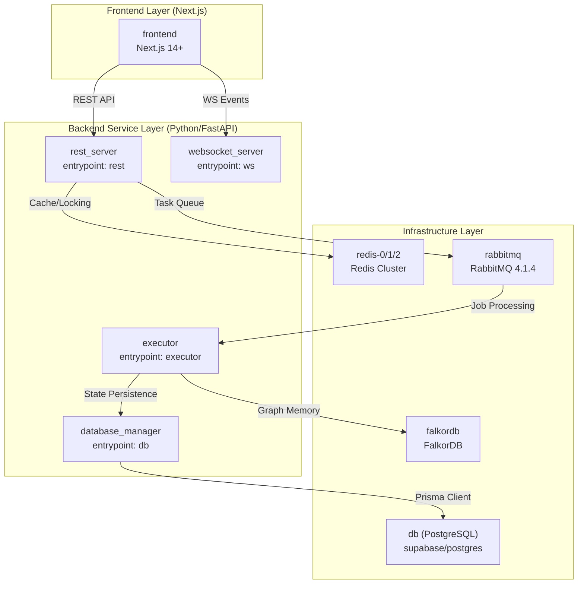

<!-- source: DeepWiki mcp.deepwiki.com · repo Significant-Gravitas/AutoGPT · page 2.1 Installation · fetched 2026-10-26 -->

# Installation

<details>
<summary>Relevant source files</summary>

The following files were used as context for generating this wiki page:

- [.dockerignore](.dockerignore)
- [.github/ISSUE_TEMPLATE/1.bug.yml](.github/ISSUE_TEMPLATE/1.bug.yml)
- [.github/ISSUE_TEMPLATE/2.feature.yml](.github/ISSUE_TEMPLATE/2.feature.yml)
- [.github/PULL_REQUEST_TEMPLATE.md](.github/PULL_REQUEST_TEMPLATE.md)
- [.github/workflows/platform-backend-ci.yml](.github/workflows/platform-backend-ci.yml)
- [.github/workflows/platform-frontend-ci.yml](.github/workflows/platform-frontend-ci.yml)
- [.github/workflows/platform-fullstack-ci.yml](.github/workflows/platform-fullstack-ci.yml)
- [.gitignore](.gitignore)
- [CODE_OF_CONDUCT.md](CODE_OF_CONDUCT.md)
- [CONTRIBUTING.md](CONTRIBUTING.md)
- [LICENSE](LICENSE)
- [README.md](README.md)
- [autogpt_platform/README.md](autogpt_platform/README.md)
- [autogpt_platform/backend/.env.default](autogpt_platform/backend/.env.default)
- [autogpt_platform/backend/Dockerfile](autogpt_platform/backend/Dockerfile)
- [autogpt_platform/backend/README.advanced.md](autogpt_platform/backend/README.advanced.md)
- [autogpt_platform/backend/README.md](autogpt_platform/backend/README.md)
- [autogpt_platform/backend/backend/copilot/tools/agent_browser.py](autogpt_platform/backend/backend/copilot/tools/agent_browser.py)
- [autogpt_platform/backend/backend/copilot/tools/agent_browser_integration_test.py](autogpt_platform/backend/backend/copilot/tools/agent_browser_integration_test.py)
- [autogpt_platform/backend/backend/copilot/tools/conftest.py](autogpt_platform/backend/backend/copilot/tools/conftest.py)
- [autogpt_platform/backend/backend/util/feature_flag_test.py](autogpt_platform/backend/backend/util/feature_flag_test.py)
- [autogpt_platform/backend/test/__init__.py](autogpt_platform/backend/test/__init__.py)
- [autogpt_platform/db/docker/docker-compose.yml](autogpt_platform/db/docker/docker-compose.yml)
- [autogpt_platform/db/docker/reset.sh](autogpt_platform/db/docker/reset.sh)
- [autogpt_platform/docker-compose.platform.yml](autogpt_platform/docker-compose.platform.yml)
- [autogpt_platform/docker-compose.yml](autogpt_platform/docker-compose.yml)
- [autogpt_platform/frontend/Dockerfile](autogpt_platform/frontend/Dockerfile)
- [autogpt_platform/frontend/src/app/page.tsx](autogpt_platform/frontend/src/app/page.tsx)
- [autogpt_platform/frontend/src/services/feature-flags/__tests__/helpers.test.ts](autogpt_platform/frontend/src/services/feature-flags/__tests__/helpers.test.ts)
- [autogpt_platform/frontend/src/services/feature-flags/feature-flag-provider.tsx](autogpt_platform/frontend/src/services/feature-flags/feature-flag-provider.tsx)
- [autogpt_platform/frontend/src/services/feature-flags/helpers.ts](autogpt_platform/frontend/src/services/feature-flags/helpers.ts)
- [docs/content/code-of-conduct.md](docs/content/code-of-conduct.md)
- [docs/content/contributing.md](docs/content/contributing.md)

</details>


This document provides a comprehensive technical guide for installing the AutoGPT Platform and its associated services. The installation is primarily orchestrated via Docker, supporting both local development and self-hosted production environments.

## System Requirements

Before installation, ensure the host system meets the following specifications to support the multi-service architecture.

### Hardware Requirements
| Component | Minimum | Recommended |
|-----------|---------|-------------|
| CPU | 4+ cores | 8+ cores |
| RAM | 8GB | 16GB |
| Storage | 10GB free space | 20GB+ free space |

### Software Prerequisites
| Software | Minimum Version | Purpose |
|----------|----------------|---------|
| Docker Engine | 20.10.0+ | Containerization [README.md:42]() |
| Docker Compose | 2.0.0+ | Service Orchestration [README.md:43]() |
| Git | 2.30+ | Source Control [README.md:44]() |
| Node.js | 16.x+ (22.x rec.) | Frontend Runtime [README.md:45]() |
| pnpm | 9.x+ | Frontend Package Manager [.github/workflows/platform-frontend-ci.yml:49]() |

**Sources:** [README.md:27-48](), [.github/workflows/platform-frontend-ci.yml:49-60]()

## Repository Structure and Initial Setup

The repository is divided into two main licensing zones. The `autogpt_platform` directory contains the modern Agent Builder and Server components under the Polyform Shield License.

1. **Clone the repository:**
   ```bash
   git clone https://github.com/Significant-Gravitas/AutoGPT.git
   cd AutoGPT
   ```

2. **Initialize Submodules:**
   The platform relies on shared libraries and database configurations.
   ```bash
   git submodule update --init --recursive
   ```

**Sources:** [LICENSE:1-19](), [CONTRIBUTING.md:10-12]()

## Docker-Based Installation (Recommended)

The platform utilizes a complex microservice architecture. The primary configuration is defined in `autogpt_platform/docker-compose.yml`, which extends `autogpt_platform/docker-compose.platform.yml`.

### Architecture Overview

The following diagram bridges the high-level services to their specific code implementations and Docker service names.



**Sources:** [autogpt_platform/docker-compose.yml:26-111](), [autogpt_platform/docker-compose.platform.yml:51-180](), [autogpt_platform/backend/Dockerfile:153-160]()

### Installation Steps

1. **Navigate to the platform directory:**
   ```bash
   cd autogpt_platform
   ```

2. **Configure Environment:**
   Create the `.env` file from the provided default. Note that `docker-compose.platform.yml` uses `backend/.env.default` as a base and overrides it with `backend/.env`.
   ```bash
   cp backend/.env.default backend/.env
   ```

3. **Deploy Services:**
   Run the following to pull images and start the stack:
   ```bash
   docker compose up -d
   ```

4. **Database Migrations:**
   The `migrate` service automatically handles Prisma migrations and type stub generation during startup.
   ```bash
   # Manual trigger if needed
   docker compose run migrate
   ```

**Sources:** [autogpt_platform/docker-compose.platform.yml:1-7](), [autogpt_platform/docker-compose.platform.yml:52-62]()

## Service Configuration Details

### Redis Cluster Setup
The platform uses a 3-master Redis Cluster for distributed locking and caching. In the `docker-compose.platform.yml`, three shards (`redis-0`, `redis-1`, `redis-2`) are initialized by a one-shot `redis-init` container using `redis-cli --cluster create`.

### Backend Service Mapping
| Docker Service | Port | Entrypoint Script | Role |
|----------------|------|-------------------|------|
| `rest_server` | 8000 | `rest` | Main API & Copilot routes |
| `executor` | 8002 | `executor` | Graph execution engine |
| `websocket_server`| 8001 | `ws` | Real-time execution updates |
| `database_manager`| 8004 | `db` | Centralized DB access service |
| `scheduler_server`| 8003 | `scheduler` | Scheduled agent triggers |

**Sources:** [autogpt_platform/docker-compose.platform.yml:100-137](), [autogpt_platform/backend/Dockerfile:153-156]()

## Frontend Setup (Local Development)

While the frontend can run in Docker, local execution is often preferred for development speed.

1. **Navigate to frontend:**
   ```bash
   cd autogpt_platform/frontend
   ```

2. **Install Dependencies:**
   ```bash
   pnpm install
   ```

3. **Generate API Client:**
   The frontend uses a generated client based on the backend's OpenAPI schema.
   ```bash
   pnpm generate:api
   ```

4. **Start Development Server:**
   ```bash
   pnpm dev
   ```

**Sources:** [.github/workflows/platform-frontend-ci.yml:151-158](), [README.md:80-96]()

## Manual Verification

After setup, verify the health of the system:

1. **Container Status:** `docker compose ps` should show all services as `healthy`.
2. **Database:** Verify migrations via `docker compose logs migrate`.
3. **Connectivity:**
    - Frontend: `http://localhost:3000`
    - Backend API: `http://localhost:8000/docs`
    - Redis Cluster: `redis-cli -p 17000 cluster info`

**Sources:** [autogpt_platform/docker-compose.platform.yml:106-114](), [autogpt_platform/docker-compose.platform.yml:158-165]()

---

