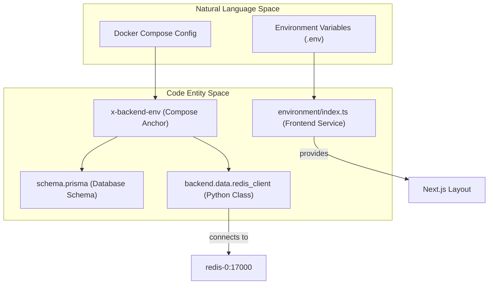
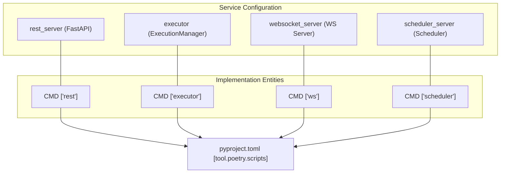

<!-- source: DeepWiki mcp.deepwiki.com · repo Significant-Gravitas/AutoGPT · page 2.2 Configuration · fetched 2026-10-26 -->

# Configuration

Relevant source files

The following files were used as context for generating this wiki page:

- [.dockerignore](.dockerignore)
- [.github/workflows/platform-backend-ci.yml](.github/workflows/platform-backend-ci.yml)
- [.github/workflows/platform-frontend-ci.yml](.github/workflows/platform-frontend-ci.yml)
- [.github/workflows/platform-fullstack-ci.yml](.github/workflows/platform-fullstack-ci.yml)
- [autogpt_platform/README.md](autogpt_platform/README.md)
- [autogpt_platform/backend/.env.default](autogpt_platform/backend/.env.default)
- [autogpt_platform/backend/Dockerfile](autogpt_platform/backend/Dockerfile)
- [autogpt_platform/backend/README.advanced.md](autogpt_platform/backend/README.advanced.md)
- [autogpt_platform/backend/README.md](autogpt_platform/backend/README.md)
- [autogpt_platform/backend/backend/copilot/tools/agent_browser.py](autogpt_platform/backend/backend/copilot/tools/agent_browser.py)
- [autogpt_platform/backend/backend/copilot/tools/agent_browser_integration_test.py](autogpt_platform/backend/backend/copilot/tools/agent_browser_integration_test.py)
- [autogpt_platform/backend/backend/copilot/tools/conftest.py](autogpt_platform/backend/backend/copilot/tools/conftest.py)
- [autogpt_platform/backend/backend/util/feature_flag_test.py](autogpt_platform/backend/backend/util/feature_flag_test.py)
- [autogpt_platform/backend/test/__init__.py](autogpt_platform/backend/test/__init__.py)
- [autogpt_platform/db/docker/docker-compose.yml](autogpt_platform/db/docker/docker-compose.yml)
- [autogpt_platform/db/docker/reset.sh](autogpt_platform/db/docker/reset.sh)
- [autogpt_platform/docker-compose.platform.yml](autogpt_platform/docker-compose.platform.yml)
- [autogpt_platform/docker-compose.yml](autogpt_platform/docker-compose.yml)
- [autogpt_platform/frontend/.env.default](autogpt_platform/frontend/.env.default)
- [autogpt_platform/frontend/.npmrc](autogpt_platform/frontend/.npmrc)
- [autogpt_platform/frontend/Dockerfile](autogpt_platform/frontend/Dockerfile)
- [autogpt_platform/frontend/package.json](autogpt_platform/frontend/package.json)
- [autogpt_platform/frontend/playwright.config.ts](autogpt_platform/frontend/playwright.config.ts)
- [autogpt_platform/frontend/pnpm-lock.yaml](autogpt_platform/frontend/pnpm-lock.yaml)
- [autogpt_platform/frontend/pnpm-workspace.yaml](autogpt_platform/frontend/pnpm-workspace.yaml)
- [autogpt_platform/frontend/public/mockServiceWorker.js](autogpt_platform/frontend/public/mockServiceWorker.js)
- [autogpt_platform/frontend/src/app/layout.tsx](autogpt_platform/frontend/src/app/layout.tsx)
- [autogpt_platform/frontend/src/app/page.tsx](autogpt_platform/frontend/src/app/page.tsx)
- [autogpt_platform/frontend/src/components/layout/Navbar/components/PreviewBanner/PreviewBanner.tsx](autogpt_platform/frontend/src/components/layout/Navbar/components/PreviewBanner/PreviewBanner.tsx)
- [autogpt_platform/frontend/src/providers/posthog/posthog-provider.tsx](autogpt_platform/frontend/src/providers/posthog/posthog-provider.tsx)
- [autogpt_platform/frontend/src/services/environment/index.ts](autogpt_platform/frontend/src/services/environment/index.ts)
- [autogpt_platform/frontend/src/services/feature-flags/__tests__/helpers.test.ts](autogpt_platform/frontend/src/services/feature-flags/__tests__/helpers.test.ts)
- [autogpt_platform/frontend/src/services/feature-flags/feature-flag-provider.tsx](autogpt_platform/frontend/src/services/feature-flags/feature-flag-provider.tsx)
- [autogpt_platform/frontend/src/services/feature-flags/helpers.ts](autogpt_platform/frontend/src/services/feature-flags/helpers.ts)

This document covers the configuration options, environment variables, and settings for the AutoGPT Platform. It explains how to configure services, authentication, external integrations, and the containerized development environment.

## Environment Variable Loading

The platform uses a layered approach to configuration, primarily managed through `.env` files and Docker Compose. 

### Loading Order
Configuration values are resolved in the following priority (later overrides earlier):
1. `backend/.env.default` - Base default values for all settings [autogpt_platform/docker-compose.platform.yml:2-2]().
2. `backend/.env` - User-specific custom overrides [autogpt_platform/docker-compose.platform.yml:3-3]().
3. `environment` key - Docker-specific overrides defined in the Compose files [autogpt_platform/docker-compose.platform.yml:4-4]().
4. Shell environment - Variables exported in the host shell [autogpt_platform/docker-compose.platform.yml:5-5]().

## Frontend Configuration

The Next.js frontend is configured via environment variables defined in `autogpt_platform/frontend/.env.default`.

### Core Service URLs

| Variable | Purpose | Example |
|----------|---------|---------|
| `FRONTEND_BASE_URL` | Frontend application base URL | `http://localhost:3000` |
| `NEXT_PUBLIC_AGPT_SERVER_URL` | Backend API server endpoint | `http://localhost:8006/api` |
| `NEXT_PUBLIC_AGPT_WS_SERVER_URL` | WebSocket server for real-time updates | `ws://localhost:8001/ws` |

### Analytics and Feature Flags
The frontend integrates with several external services for monitoring and progressive rollout:
- **PostHog**: Configured via `NEXT_PUBLIC_POSTHOG_KEY` and `NEXT_PUBLIC_POSTHOG_HOST` [autogpt_platform/frontend/src/providers/posthog/posthog-provider.tsx:1-20]().
- **LaunchDarkly**: Used for feature flags. Initialized with `NEXT_PUBLIC_LAUNCHDARKLY_CLIENT_ID` [autogpt_platform/frontend/src/services/feature-flags/feature-flag-provider.tsx:14-45]().
- **Sentry**: Error tracking enabled via `NEXT_PUBLIC_SENTRY_DSN` [autogpt_platform/frontend/package.json:67-67]().

## Backend Configuration

The backend services (REST, WebSocket, Executor, etc.) rely on a distributed architecture requiring several infrastructure components.

### Infrastructure Hostnames
In a Docker environment, the backend services communicate using internal Docker DNS hostnames rather than `localhost` [autogpt_platform/docker-compose.platform.yml:9-30]():

| Service | Hostname Variable | Default Value |
|---------|-------------------|---------------|
| REST API | `AGENTSERVER_HOST` | `rest_server` |
| Scheduler | `SCHEDULER_HOST` | `scheduler_server` |
| Database Manager | `DATABASEMANAGER_HOST` | `database_manager` |
| Execution Manager | `EXECUTIONMANAGER_HOST` | `executor` |
| Redis Cluster | `REDIS_HOST` | `redis-0` |
| RabbitMQ | `RABBITMQ_HOST` | `rabbitmq` |

### Database and Supabase Setup
The platform uses Supabase for authentication and PostgreSQL for data persistence.
- **Supabase URL**: Set to `http://kong:8000` for internal Docker networking [autogpt_platform/docker-compose.platform.yml:30-30]().
- **Database URL**: Configured via `DATABASE_URL` and `DIRECT_URL` (used by Prisma) [autogpt_platform/docker-compose.platform.yml:33-34]().

### Redis Cluster Configuration
The platform utilizes a 3-master Redis Cluster for distributed locking and caching [autogpt_platform/docker-compose.platform.yml:88-130](). 
- **Nodes**: `redis-0`, `redis-1`, `redis-2`.
- **Ports**: `17000`, `17001`, `17002`.
- **Initialization**: The `redis-init` service runs `redis-cli --cluster create` to form the cluster once nodes are healthy [autogpt_platform/docker-compose.platform.yml:131-137]().

## Configuration Data Flow

The following diagram bridges the gap between the configuration files and the code entities that consume them.

Sources: [autogpt_platform/docker-compose.platform.yml:9-25](), [autogpt_platform/frontend/src/app/layout.tsx:14-20](), [autogpt_platform/backend/Dockerfile:51-54]()

## External Integration Requirements

### LLM API Keys
The platform requires API keys for AI blocks to function. These are typically set in the `backend/.env` file:
- `OPENAI_API_KEY`: Required for OpenAI models.
- `ANTHROPIC_API_KEY`: Required for Claude models.

### Security and Scanning
- **ClamAV**: Used for scanning files in agent workspaces. Configured via `CLAMAV_SERVICE_HOST` [autogpt_platform/docker-compose.platform.yml:17-17]().
- **Bubblewrap**: The backend Docker image installs `bubblewrap` to provide an OS-level sandbox for the `bash_exec` tool when the E2B sandbox is not configured [autogpt_platform/backend/Dockerfile:96-108]().

## Service Architecture Mapping

This diagram maps the high-level configuration components to the specific backend service implementations defined in the repository.

Sources: [autogpt_platform/backend/Dockerfile:153-160](), [autogpt_platform/docker-compose.yml:70-111]()

## Development Configuration

### API Client Generation
The frontend relies on a generated TypeScript client. When backend routes change, the client must be updated:
1. `pnpm generate:api`: Fetches the OpenAPI schema from the running backend and regenerates the Orval client [autogpt_platform/frontend/package.json:28-29]().
2. `pnpm types`: Runs `tsc --noEmit` to verify type safety across the frontend [autogpt_platform/frontend/package.json:15-15]().

### CI/CD Environment
The GitHub Actions workflows mirror the local configuration:
- **Frontend CI**: Uses Node 22 and `pnpm` [ .github/workflows/platform-frontend-ci.yml:54-59]().
- **Backend CI**: Provisions a real 3-shard Redis cluster and RabbitMQ service to match the production/local environment [ .github/workflows/platform-backend-ci.yml:121-204]().

Sources: [autogpt_platform/frontend/package.json:8-29](), [.github/workflows/platform-backend-ci.yml:171-204](), [autogpt_platform/docker-compose.platform.yml:100-137]()

---

