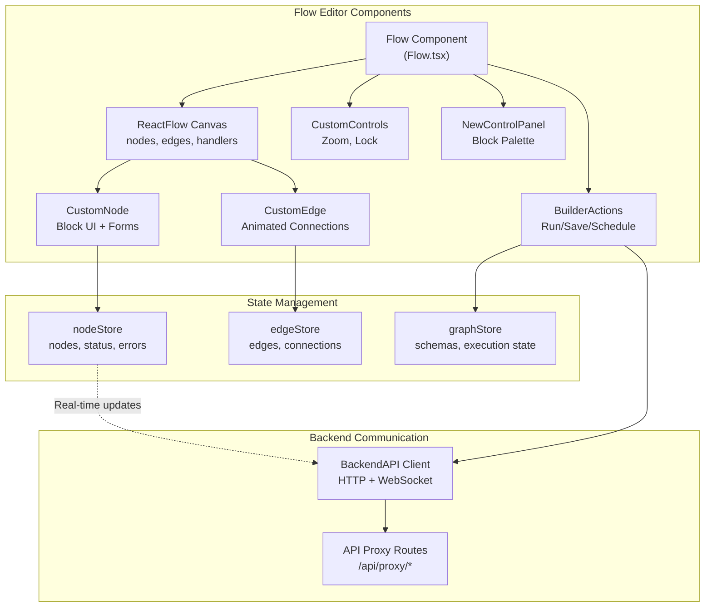
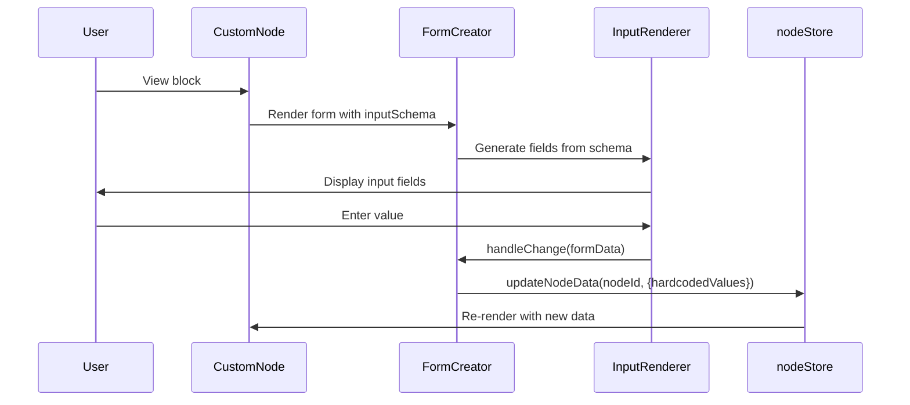
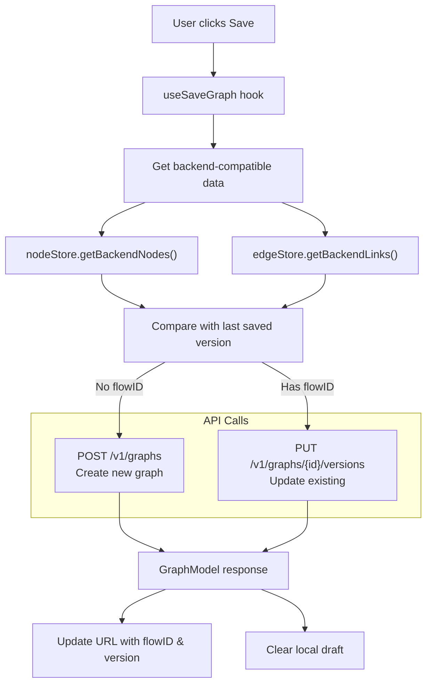
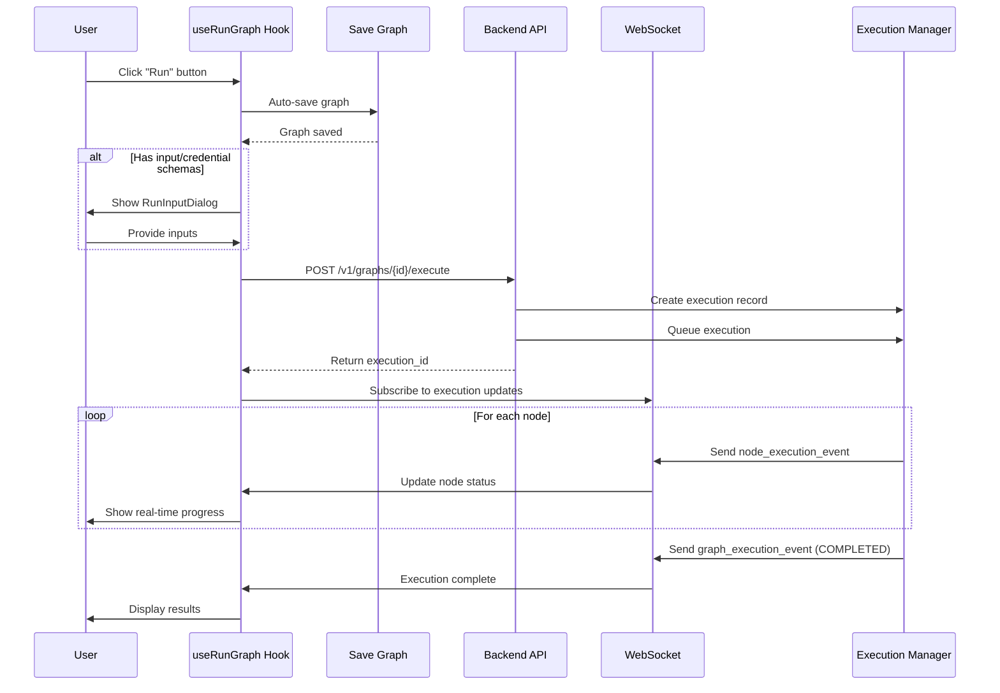
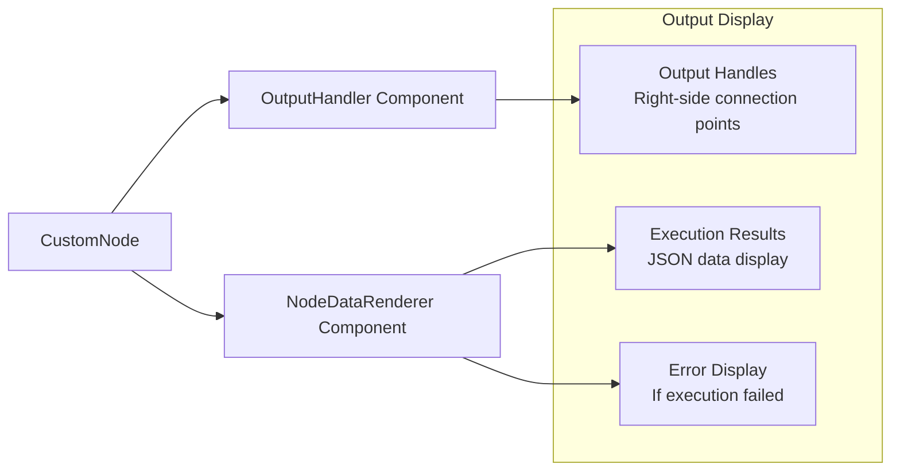

<!-- source: DeepWiki mcp.deepwiki.com · repo Significant-Gravitas/AutoGPT · page 2.3 Quick Start Guide · fetched 2026-10-26 -->

# Quick Start Guide

<details>
<summary>Relevant source files</summary>

The following files were used as context for generating this wiki page:

- [autogpt_platform/backend/backend/blocks/agent.py](autogpt_platform/backend/backend/blocks/agent.py)
- [autogpt_platform/backend/backend/data/block.py](autogpt_platform/backend/backend/data/block.py)
- [autogpt_platform/backend/backend/data/execution.py](autogpt_platform/backend/backend/data/execution.py)
- [autogpt_platform/backend/backend/data/graph.py](autogpt_platform/backend/backend/data/graph.py)
- [autogpt_platform/backend/backend/data/model.py](autogpt_platform/backend/backend/data/model.py)
- [autogpt_platform/backend/backend/executor/manager.py](autogpt_platform/backend/backend/executor/manager.py)
- [autogpt_platform/backend/backend/executor/utils.py](autogpt_platform/backend/backend/executor/utils.py)
- [autogpt_platform/backend/backend/executor/utils_test.py](autogpt_platform/backend/backend/executor/utils_test.py)
- [autogpt_platform/backend/backend/util/exceptions.py](autogpt_platform/backend/backend/util/exceptions.py)
- [autogpt_platform/backend/backend/util/settings.py](autogpt_platform/backend/backend/util/settings.py)
- [autogpt_platform/backend/schema.prisma](autogpt_platform/backend/schema.prisma)
- [autogpt_platform/frontend/src/app/(platform)/build/components/BuilderChatPanel/BuilderChatPanel.tsx](autogpt_platform/frontend/src/app/(platform)/build/components/BuilderChatPanel/BuilderChatPanel.tsx)
- [autogpt_platform/frontend/src/app/(platform)/build/components/BuilderChatPanel/__tests__/BuilderChatPanel.test.tsx](autogpt_platform/frontend/src/app/(platform)/build/components/BuilderChatPanel/__tests__/BuilderChatPanel.test.tsx)
- [autogpt_platform/frontend/src/app/(platform)/build/components/BuilderChatPanel/useBuilderChatPanel.ts](autogpt_platform/frontend/src/app/(platform)/build/components/BuilderChatPanel/useBuilderChatPanel.ts)
- [autogpt_platform/frontend/src/app/(platform)/build/components/FlowEditor/Flow/Flow.tsx](autogpt_platform/frontend/src/app/(platform)/build/components/FlowEditor/Flow/Flow.tsx)
- [autogpt_platform/frontend/src/app/(platform)/build/components/FlowEditor/Flow/useFlow.ts](autogpt_platform/frontend/src/app/(platform)/build/components/FlowEditor/Flow/useFlow.ts)
- [autogpt_platform/frontend/src/app/(platform)/build/components/FlowEditor/edges/CustomEdge.tsx](autogpt_platform/frontend/src/app/(platform)/build/components/FlowEditor/edges/CustomEdge.tsx)
- [autogpt_platform/frontend/src/app/(platform)/build/components/FlowEditor/edges/components/JSBeads.tsx](autogpt_platform/frontend/src/app/(platform)/build/components/FlowEditor/edges/components/JSBeads.tsx)
- [autogpt_platform/frontend/src/app/(platform)/build/components/FlowEditor/edges/components/SVGBeads.tsx](autogpt_platform/frontend/src/app/(platform)/build/components/FlowEditor/edges/components/SVGBeads.tsx)
- [autogpt_platform/frontend/src/app/(platform)/build/components/FlowEditor/edges/helpers.ts](autogpt_platform/frontend/src/app/(platform)/build/components/FlowEditor/edges/helpers.ts)
- [autogpt_platform/frontend/src/app/(platform)/build/components/FlowEditor/edges/useCustomEdge.ts](autogpt_platform/frontend/src/app/(platform)/build/components/FlowEditor/edges/useCustomEdge.ts)
- [autogpt_platform/frontend/src/app/(platform)/build/components/FlowEditor/nodes/CustomNode/CustomNode.tsx](autogpt_platform/frontend/src/app/(platform)/build/components/FlowEditor/nodes/CustomNode/CustomNode.tsx)
- [autogpt_platform/frontend/src/app/(platform)/build/components/FlowEditor/nodes/FormCreator.tsx](autogpt_platform/frontend/src/app/(platform)/build/components/FlowEditor/nodes/FormCreator.tsx)
- [autogpt_platform/frontend/src/app/(platform)/build/components/helper.ts](autogpt_platform/frontend/src/app/(platform)/build/components/helper.ts)
- [autogpt_platform/frontend/src/app/(platform)/build/stores/copyPasteStore.ts](autogpt_platform/frontend/src/app/(platform)/build/stores/copyPasteStore.ts)
- [autogpt_platform/frontend/src/app/(platform)/build/stores/edgeStore.ts](autogpt_platform/frontend/src/app/(platform)/build/stores/edgeStore.ts)
- [autogpt_platform/frontend/src/app/(platform)/build/stores/historyStore.ts](autogpt_platform/frontend/src/app/(platform)/build/stores/historyStore.ts)
- [autogpt_platform/frontend/src/app/(platform)/build/stores/nodeStore.ts](autogpt_platform/frontend/src/app/(platform)/build/stores/nodeStore.ts)
- [autogpt_platform/frontend/src/lib/autogpt-server-api/types.ts](autogpt_platform/frontend/src/lib/autogpt-server-api/types.ts)

</details>


## Purpose and Scope

This guide walks through creating, configuring, and executing your first agent graph in the AutoGPT Platform. You will learn how to use the Flow Editor to visually build an automation workflow by adding blocks, connecting them, configuring inputs and credentials, and running executions.

For installation and environment setup instructions, see [Installation](#2.1) and [Configuration](#2.2). For detailed technical documentation of the Flow Editor architecture, see [Agent Builder (Flow Editor)](#3.1.1).

---

## Prerequisites

Before starting, ensure you have:

- AutoGPT Platform running locally or access to a hosted instance
- At least one LLM API key configured (OpenAI, Anthropic, etc.) - see [Configuration](#2.2)
- A web browser (Chrome, Firefox, Edge recommended)
- Basic understanding of workflow/graph concepts

---

## Accessing the Flow Editor

The Flow Editor is the primary interface for building agent graphs. Navigate to:

```
http://localhost:3000/build
```

The Flow Editor loads at the `/build` route and consists of several key components:

| Component | Location | Purpose |
|-----------|----------|---------|
| **Canvas** | Center area | Visual workspace where you add and arrange blocks |
| **Block Panel** | Left sidebar | Browse and search available blocks |
| **Controls** | Top-right corner | Zoom, fit view, lock/unlock canvas |
| **Builder Actions** | Bottom-center floating panel | Run, save, schedule, and publish actions |

**Flow Editor Architecture**



Sources: [autogpt_platform/frontend/src/app/(platform)/build/components/FlowEditor/Flow/Flow.tsx:1-132](), [autogpt_platform/frontend/src/app/(platform)/build/components/BuilderActions/BuilderActions.tsx:1-23]()

---

## Building Your First Agent

### Step 1: Adding Blocks to the Canvas

Blocks are the fundamental building units of an agent graph. Each block performs a specific action (LLM call, HTTP request, data transformation, etc.).

**Method 1: Drag and Drop**

1. Open the Block Panel on the left side
2. Browse or search for a block (e.g., "AI Text Generator")
3. Drag the block onto the canvas
4. The block will be automatically positioned

**Method 2: Click to Add**

1. Click on a block in the Block Panel
2. The block is added at a calculated free position

The `useFlow` hook handles drag-and-drop block addition:

```typescript
// Drag handling in useFlow.ts
onDragOver: (event) => event.preventDefault()
onDrop: (event) => {
  const blockData = JSON.parse(event.dataTransfer.getData("application/reactflow"))
  const position = screenToFlowPosition({ x: event.clientX, y: event.clientY })
  addBlock(blockData, {}, position)
}
```

When a block is added, `nodeStore.addBlock()` creates a `CustomNode` with:
- Unique ID (incremented from `nodeCounter`)
- Block metadata (title, description, schemas)
- Initial position calculated by `findFreePosition()` to avoid overlaps
- Empty `hardcodedValues` for input configuration

Sources: [autogpt_platform/frontend/src/app/(platform)/build/components/FlowEditor/Flow/useFlow.ts:245-274](), [autogpt_platform/frontend/src/app/(platform)/build/stores/nodeStore.ts:139-178](), [autogpt_platform/frontend/src/app/(platform)/build/components/helper.ts:145-222]()

### Step 2: Connecting Blocks

Blocks are connected by drawing edges between output handles (right side) and input handles (left side). Data flows from source to target.

**Creating Connections:**

1. Click and drag from an **output handle** (right side of a block)
2. Drag to an **input handle** (left side of another block)
3. Release to create the connection
4. The edge appears as a bezier curve with optional animated beads during execution

**Connection Rules:**

- Type compatibility is enforced (string → string, object → object, etc.)
- Multiple outputs can connect to multiple inputs
- Connections are validated before graph execution

The `useCustomEdge` hook manages connection logic:

```typescript
// Connection validation in useCustomEdge.ts
onConnect: (connection) => {
  if (!connection.source || !connection.target || 
      !connection.sourceHandle || !connection.targetHandle) return
      
  const exists = edges.some(e => 
    e.source === connection.source && 
    e.target === connection.target &&
    e.sourceHandle === connection.sourceHandle &&
    e.targetHandle === connection.targetHandle
  )
  if (exists) return
  
  const isStatic = nodes.find(n => n.id === connection.source)?.data?.staticOutput
  addEdge({ ...connection, data: { isStatic } })
}
```

**Edge Data Structure:**

| Property | Type | Description |
|----------|------|-------------|
| `id` | string | Auto-generated: `{source}:{sourceHandle}->{target}:{targetHandle}` |
| `source` | string | Source node ID |
| `target` | string | Target node ID |
| `sourceHandle` | string | Output field name |
| `sink_name` | string | Input field name (backend `sink_name`) [autogpt_platform/backend/backend/data/graph.py:86-86]() |
| `data.isStatic` | boolean | Whether output is static (always available) |
| `data.beadUp` | number | Number of beads to animate up |
| `data.beadDown` | number | Number of beads completed |

Sources: [autogpt_platform/frontend/src/app/(platform)/build/components/FlowEditor/edges/useCustomEdge.ts:1-60](), [autogpt_platform/frontend/src/app/(platform)/build/components/FlowEditor/edges/CustomEdge.tsx:1-94](), [autogpt_platform/frontend/src/app/(platform)/build/stores/edgeStore.ts:34-69](), [autogpt_platform/backend/backend/data/graph.py:86-86]()

### Step 3: Configuring Block Inputs

Each block has an input schema that defines configurable parameters. Inputs are rendered dynamically using React JSON Schema Form (RJSF).

**Input Configuration Flow:**



**Form Rendering Process:**

1. `CustomNode` passes `inputSchema` to `FormCreator`
2. Schema is preprocessed by `preprocessInputSchema()` to handle advanced features
3. `FormCreator` uses `FormRenderer` with custom widgets and templates
4. User input triggers `handleChange()` which updates `nodeStore`
5. Changes are stored in `node.data.hardcodedValues`

**Input Types:**

| Schema Type | Rendered As | Example |
|-------------|-------------|---------|
| `string` | Text input | "Enter API key" |
| `number` | Number input | 100 |
| `boolean` | Checkbox/Toggle | true/false |
| `enum` | Dropdown/Select | ["gpt-4", "gpt-3.5-turbo"] |
| `object` | Nested form | `{ key: value }` |
| `array` | List with add/remove | `["item1", "item2"]` |
| `credentials` | Credential selector | OAuth or API key picker |

**Advanced Input Features:**

- **Dynamic Fields**: Use special naming conventions (`_#_` for dict keys, `_$_` for list indices) [autogpt_platform/backend/backend/data/graph.py:41-41]()
- **Conditional Display**: Fields can be hidden based on other field values
- **Validation**: Real-time validation with error display
- **Advanced Toggle**: Show/hide advanced parameters

Sources: [autogpt_platform/frontend/src/app/(platform)/build/components/FlowEditor/nodes/CustomNode/CustomNode.tsx:45-123](), [autogpt_platform/frontend/src/app/(platform)/build/components/FlowEditor/nodes/FormCreator.tsx:1-70](), [autogpt_platform/frontend/src/app/(platform)/build/components/FlowEditor/nodes/CustomNode/components/NodeAdvancedToggle.tsx:1-22](), [autogpt_platform/backend/backend/data/graph.py:41-41]()

### Step 4: Handling Credentials

Many blocks require credentials (API keys, OAuth tokens) to access external services. The AutoGPT Platform provides secure credential management.

**Credential Configuration:**

1. Click on a credential field in a block (identified by lock icon)
2. Select "Add New Credential" or choose from existing credentials
3. If adding new:
   - For **API Key**: Enter the key directly
   - For **OAuth**: Click "Connect" to open OAuth flow in popup
4. Credentials are stored securely and can be reused across blocks

**Credential Field Detection:**

```typescript
// Credential field schema example
{
  "type": "object",
  "properties": {
    "credentials": {
      "type": "object",
      "properties": {
        "id": { "type": "string" },
        "type": { "type": "string" },
        "title": { "type": "string" }
      },
      "required": ["id", "type"],
      "additionalProperties": { "type": "string" }
    }
  }
}
```
The `BlockIOCredentialsSubSchema` type defines the structure for credential fields in the block's input schema. This schema includes `credentials_provider`, `credentials_scopes`, and `credentials_types` to guide the UI in rendering the appropriate credential selection or creation flow. [autogpt_platform/frontend/src/lib/autogpt-server-api/types.ts:216-225]()

The form system recognizes credential fields and renders them with the `CredentialField` widget, which provides:
- List of available credentials for the provider
- "Add New" option
- OAuth flow initiation for supported providers
- Validation of credential availability

**Credential Storage:**

- Credentials are stored in `node.data.hardcodedValues.credentials`
- Only the credential ID is stored in the graph definition
- Actual secrets are stored server-side and never exposed to the frontend

Sources: [autogpt_platform/frontend/src/app/(platform)/build/components/BuilderActions/components/RunInputDialog/useRunInputDialog.ts:55-76](), [autogpt_platform/frontend/src/app/(platform)/build/components/FlowEditor/nodes/FormCreator.tsx:28-42](), [autogpt_platform/frontend/src/lib/autogpt-server-api/types.ts:216-225]()

---

## Saving Your Graph

Once you've built your graph, save it to persist your work.

**Save Methods:**

| Method | Trigger | Behavior |
|--------|---------|----------|
| **Manual Save** | Click "Save" in Builder Actions | Immediately saves graph |
| **Auto-save** | Automatic after changes | Saves draft every 15 seconds to local storage |
| **Before Run** | Click "Run" | Automatically saves before execution |

**Save Process Flow:**



**Backend Data Conversion:**

The frontend stores nodes and edges in React Flow format. Before saving, they're converted to backend format:

```typescript
// Node conversion in nodeStore.ts
convertCustomNodeToBackendNode: (node: CustomNode) => ({
  id: node.id,
  block_id: node.data.block_id,
  input_default: pruneEmptyValues(node.data.hardcodedValues),
  metadata: {
    position: node.position,
    customized_name: node.data.metadata?.customized_name
  }
})

// Edge conversion in helper.ts
customEdgeToLink: (edge: CustomEdge) => ({
  source_id: edge.source,
  sink_id: edge.target,
  source_name: edge.sourceHandle,
  sink_name: edge.targetHandle,
  is_static: edge.data?.isStatic
})
```

**Graph Versioning:**

- Each save creates a new version
- Version number is incremented automatically
- URL updates to include `flowID` and `flowVersion` query parameters
- Previous versions remain accessible (immutable history)

Sources: [autogpt_platform/frontend/src/app/(platform)/build/hooks/useSaveGraph.ts:1-192](), [autogpt_platform/frontend/src/app/(platform)/build/stores/nodeStore.ts:219-236](), [autogpt_platform/frontend/src/app/(platform)/build/components/helper.ts:64-83]()

---

## Running Your Agent

After building and saving your graph, execute it to see it in action.

**Execution Workflow:**



The `ExecutionProcessor` class [autogpt_platform/backend/backend/executor/manager.py:145-146]() is responsible for executing nodes within the graph. It takes a `Node` object and `NodeExecutionEntry` data, then triggers the block execution. The `execute_node` function [autogpt_platform/backend/backend/executor/manager.py:142-149]() handles the core logic of executing a single node, including input validation, block-specific input reshaping (e.g., for `AgentExecutorBlock` [autogpt_platform/backend/backend/executor/manager.py:198-203]() or `MCPToolBlock` [autogpt_platform/backend/backend/executor/manager.py:204-205]()), and persisting the execution result.

**Execution States:**

| Status | Description | Visual Indicator |
|--------|-------------|------------------|
| `QUEUED` | Waiting to start | Blue badge, no animation |
| `RUNNING` | Currently executing | Amber badge, spinner, pulsing border |
| `COMPLETED` | Successfully finished | Green badge |
| `FAILED` | Error occurred | Red badge, red border, error display |
| `TERMINATED` | Manually stopped | Orange badge |
| `REVIEW` | Requires human review | Yellow badge |

These statuses are defined by the `AgentExecutionStatus` enum [autogpt_platform/backend/schema.prisma:90-90]() in the Prisma schema and `ExecutionStatus` alias [autogpt_platform/backend/backend/data/execution.py:130-130]() in the backend.

**Real-time Updates:**

The `useFlowRealtime` hook manages WebSocket communication for live execution updates:

```typescript
// WebSocket event handlers in useFlowRealtime.ts
api.onWebSocketMessage("node_execution_event", (data) => {
  if (data.graph_exec_id != flowExecutionID) return
  
  updateNodeExecutionResult(data.node_id, data)
  updateNodeStatus(data.node_id, data.status)
  updateEdgeBeads(data.node_id, data)
})

api.onWebSocketMessage("graph_execution_event", (graphExecution) => {
  if (graphExecution.id != flowExecutionID) return
  
  setGraphExecutionStatus(graphExecution.status)
})
```

**Execution Visualization:**

- **Node Status**: Each node shows a status badge during execution
- **Edge Beads**: Animated beads flow along edges as data passes between nodes
- **Running Border**: Purple pulsing border around entire canvas during execution
- **Progress Tracking**: Nodes change color as they transition through states

**Error Handling:**

If execution fails with validation errors:
1. Failed nodes show red borders
2. Error messages appear in node UI
3. Toast notification displays summary
4. Fix errors and run again

Sources: [autogpt_platform/frontend/src/app/(platform)/build/components/BuilderActions/components/RunGraph/useRunGraph.ts:1-144](), [autogpt_platform/frontend/src/app/(platform)/build/components/FlowEditor/Flow/useFlowRealtime.ts:1-94](), [autogpt_platform/frontend/src/app/(platform)/build/stores/graphStore.ts:33-40](), [autogpt_platform/backend/backend/executor/manager.py:145-146](), [autogpt_platform/backend/backend/executor/manager.py:142-149](), [autogpt_platform/backend/backend/executor/manager.py:198-203](), [autogpt_platform/backend/backend/executor/manager.py:204-205](), [autogpt_platform/backend/schema.prisma:90-90](), [autogpt_platform/backend/backend/data/execution.py:130-130]()

---

## Viewing Execution Results

After execution completes, view the results directly in the Flow Editor.

**Result Display Methods:**

1. **Node Output Panel**: Click on any executed node to expand its output section
2. **Output Data**: Each node shows the data it produced
3. **Execution History**: Click "Agent Outputs" in Builder Actions to see all executions
4. **Detailed View**: View input data, output data, execution time, and token usage

**Node Output Structure:**



**Output Data Format:**

The `nodeExecutionResult` contains:

```typescript
interface NodeExecutionResult {
  node_exec_id: string
  graph_exec_id: string
  node_id: string
  status: AgentExecutionStatus
  input_data: Record<string, any>
  output_data: Record<string, any>
  execution_stats?: {
    executor_cost: number
    input_tokens: number
    output_tokens: number
    total_tokens: number
  }
}
```

**Accessing Historical Executions:**

1. Note the `flowExecutionID` in the URL (e.g., `?flowExecutionID=abc123`)
2. Click "Agent Outputs" to see list of past executions
3. Click on an execution to load its results into the canvas
4. Compare different runs to see how changes affect output

**Copy/Paste and Iteration:**

- **Copy Node**: Right-click node → "Copy Node" (or Ctrl/Cmd+C)
- **Paste**: Ctrl/Cmd+V pastes duplicates at viewport center
- **Modify and Re-run**: Adjust inputs and re-execute to iterate
- **Draft Recovery**: If browser closes, unsaved work is auto-recovered on next load

Sources: [autogpt_platform/frontend/src/app/(platform)/build/components/FlowEditor/nodes/OutputHandler.tsx:1-122](), [autogpt_platform/frontend/src/app/(platform)/build/components/FlowEditor/nodes/CustomNode/components/NodeOutput/NodeOutput.tsx](), [autogpt_platform/frontend/src/app/(platform)/build/components/FlowEditor/Flow/useCopyPaste.ts:1-167](), [autogpt_platform/frontend/src/app/(platform)/build/components/DraftRecoveryDialog/DraftRecoveryPopup.tsx:1-161]()

---

## Example: Building a Simple Text Summarization Agent

**Goal**: Create an agent that takes a URL, fetches the content, and summarizes it using an LLM.

**Steps:**

1. **Add Blocks**:
   - Add "Send Web Request Block" to fetch URL content
   - Add "AI Text Generator Block" to summarize

2. **Configure Web Request Block**:
   - Set `url` input to your target URL (e.g., "https://example.com/article")
   - Set `method` to "GET"

3. **Connect Blocks**:
   - Connect `body` output of Web Request → `prompt` input of AI Text Generator
   - This passes fetched content to the LLM

4. **Configure AI Text Generator**:
   - Add to `sys_prompt`: "Summarize the following text concisely:"
   - Select model (e.g., "gpt-4o-mini")
   - Add credentials for OpenAI

5. **Save**: Click Save in Builder Actions

6. **Run**: Click Run to execute

7. **View Results**: 
   - Web Request block shows fetched HTML
   - AI Text Generator shows summary in output
   - Edge beads animate showing data flow

**Next Steps**: 
- Add error handling with "AI Condition Block"
- Store result in database with appropriate integration block
- Schedule periodic execution for monitoring

---

## Keyboard Shortcuts

| Shortcut | Action |
|----------|--------|
| **Ctrl/Cmd + C** | Copy selected nodes |
| **Ctrl/Cmd + V** | Paste nodes at viewport center |
| **Backspace/Delete** | Delete selected nodes/edges |
| **Mouse Wheel** | Zoom in/out |
| **Space + Drag** | Pan canvas |
| **Double-click Node Title** | Edit node name |

Sources: [autogpt_platform/frontend/src/app/(platform)/build/components/FlowEditor/Flow/useCopyPaste.ts:22-149](), [autogpt_platform/frontend/src/app/(platform)/build/components/FlowEditor/Flow/Flow.tsx:91-108]()

---

## Troubleshooting Common Issues

### Block Not Connecting

**Problem**: Can't create edge between two blocks

**Solutions**:
- Verify type compatibility (string → string, not string → number)
- Check that target handle doesn't already have a connection (unless it's a list)
- Ensure canvas isn't locked (toggle lock button in controls)

### Execution Fails Immediately

**Problem**: Graph status shows FAILED right after running

**Solutions**:
- Check for red-bordered nodes indicating validation errors
- Verify all required inputs are provided
- Ensure credentials are valid and not expired
- Review error messages in failed node's output panel

### Real-time Updates Not Appearing

**Problem**: Node statuses don't update during execution

**Solutions**:
- Check browser console for WebSocket connection errors
- Verify backend is running and WebSocket endpoint is accessible
- Refresh page to re-establish WebSocket connection

### Draft Recovery Popup Keeps Appearing

**Problem**: "Unsaved changes found" popup appears repeatedly

**Solutions**:
- Click "Restore changes" to load draft
- OR click "Discard changes" to delete draft
- Wait for 24 hours for automatic draft expiration
- Clear browser IndexedDB if issue persists

Sources: [autogpt_platform/frontend/src/app/(platform)/build/components/BuilderActions/components/RunGraph/useRunGraph.ts:53-91](), [autogpt_platform/frontend/src/app/(platform)/build/components/FlowEditor/Flow/useFlowRealtime.ts:37-62](), [autogpt_platform/frontend/src/app/(platform)/build/components/DraftRecoveryDialog/useDraftRecoveryPopup.tsx:1-64]()

---

## Next Steps

Now that you've built and run your first agent, explore:

- **[Agent Library](#3.1.5)**: Manage and organize your saved agents
- **[Marketplace](#3.1.4)**: Discover and download pre-built agents from the community
- **[Agent Library](#3.1.5)**: Set up cron schedules to run agents automatically
- **[Creating Custom Blocks](#5.6)**: Build your own blocks for specialized functionality
- **[AI Blocks](#3.2.8)**: Learn about advanced AI blocks like SmartDecisionMaker
- **[Integration Blocks](#3.2.9)**: Connect to external services (Discord, Email, YouTube, etc.)

For detailed API documentation, see [REST API](#7.1) and [WebSocket API](#7.2).

---

