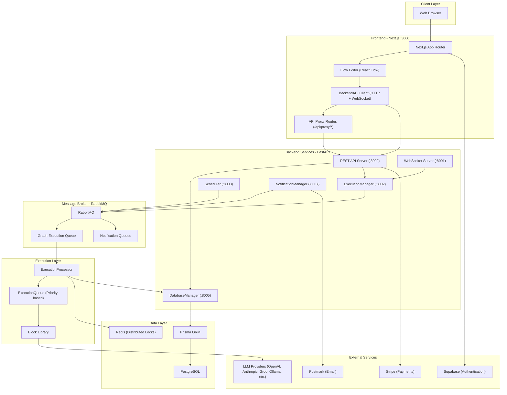
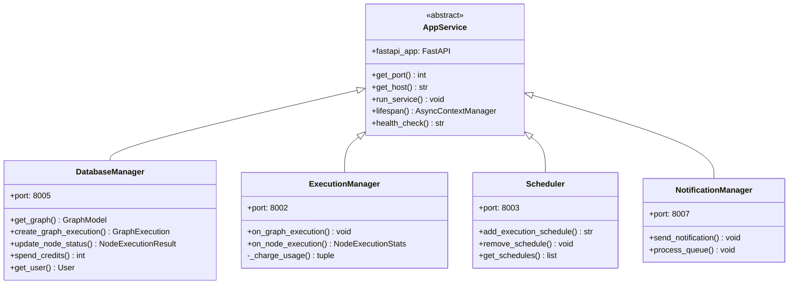
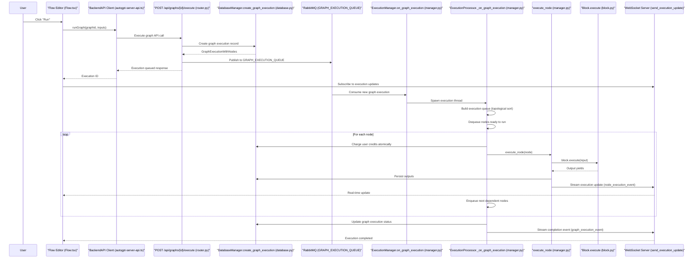
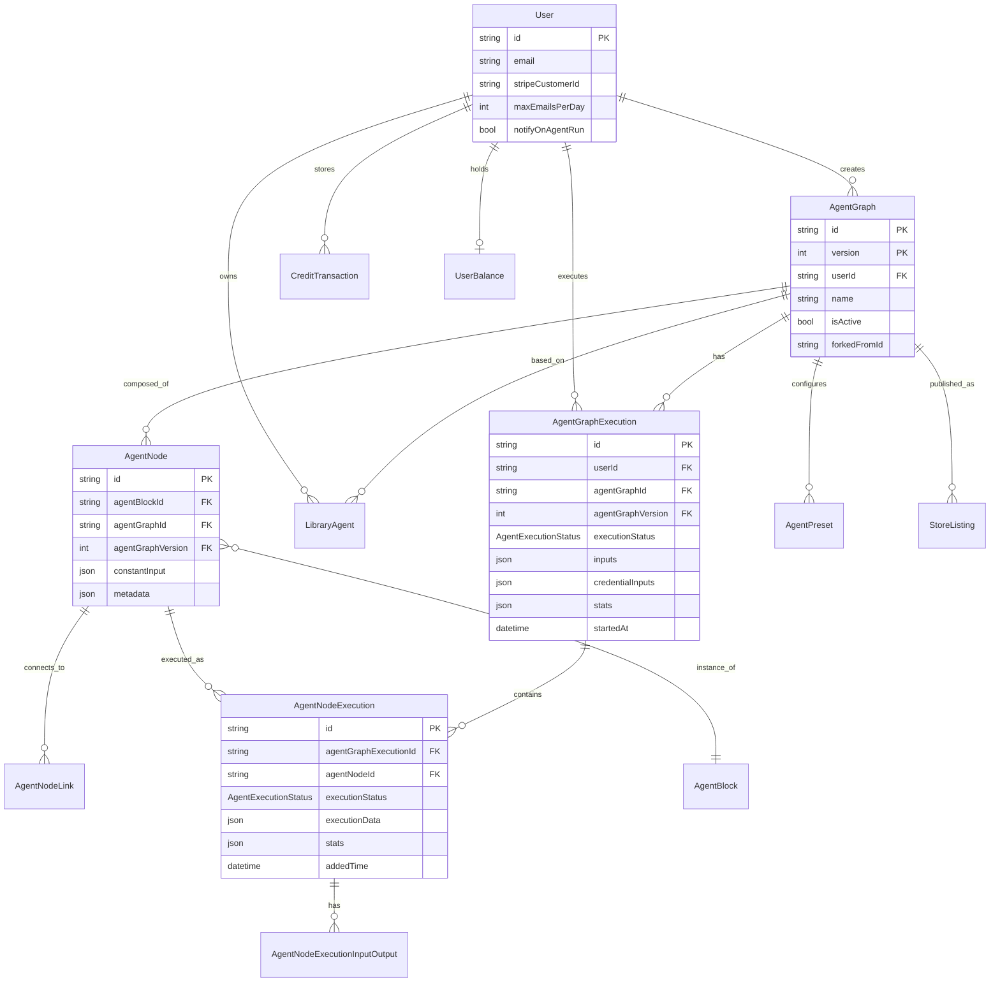
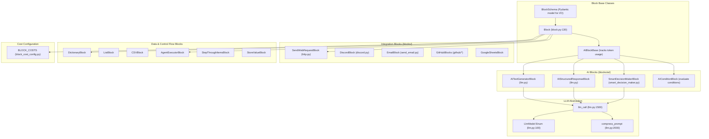

<!-- source: DeepWiki mcp.deepwiki.com · repo Significant-Gravitas/AutoGPT · page 3 AutoGPT Platform · fetched 2026-10-26 -->

# AutoGPT Platform

<details>
<summary>Relevant source files</summary>

The following files were used as context for generating this wiki page:

- [autogpt_platform/autogpt_libs/poetry.lock](autogpt_platform/autogpt_libs/poetry.lock)
- [autogpt_platform/autogpt_libs/pyproject.toml](autogpt_platform/autogpt_libs/pyproject.toml)
- [autogpt_platform/backend/poetry.lock](autogpt_platform/backend/poetry.lock)
- [autogpt_platform/backend/pyproject.toml](autogpt_platform/backend/pyproject.toml)
- [autogpt_platform/frontend/.env.default](autogpt_platform/frontend/.env.default)
- [autogpt_platform/frontend/.npmrc](autogpt_platform/frontend/.npmrc)
- [autogpt_platform/frontend/package.json](autogpt_platform/frontend/package.json)
- [autogpt_platform/frontend/playwright.config.ts](autogpt_platform/frontend/playwright.config.ts)
- [autogpt_platform/frontend/pnpm-lock.yaml](autogpt_platform/frontend/pnpm-lock.yaml)
- [autogpt_platform/frontend/pnpm-workspace.yaml](autogpt_platform/frontend/pnpm-workspace.yaml)
- [autogpt_platform/frontend/public/mockServiceWorker.js](autogpt_platform/frontend/public/mockServiceWorker.js)
- [autogpt_platform/frontend/src/app/layout.tsx](autogpt_platform/frontend/src/app/layout.tsx)
- [autogpt_platform/frontend/src/components/layout/Navbar/components/PreviewBanner/PreviewBanner.tsx](autogpt_platform/frontend/src/components/layout/Navbar/components/PreviewBanner/PreviewBanner.tsx)
- [autogpt_platform/frontend/src/providers/posthog/posthog-provider.tsx](autogpt_platform/frontend/src/providers/posthog/posthog-provider.tsx)
- [autogpt_platform/frontend/src/services/environment/index.ts](autogpt_platform/frontend/src/services/environment/index.ts)

</details>


---

## Purpose and Scope

This document describes the **AutoGPT Platform**, a modern full-stack system designed for building, deploying, and managing AI agent workflows. The Platform presents a visually-driven, graph-based interface for composing agent nodes (blocks) that integrate with various large language models (LLMs) and external services. It supports credit-based billing, OAuth2 and API key credential management, real-time execution updates, and a marketplace for agent sharing.

The AutoGPT Platform is the main product line released under the Polyform Shield License. It complements the legacy **AutoGPT Classic** codebase (MIT License), which is focused on standalone agent experimentation. For setup instructions, development guides, and API references, consult respective sections in this documentation.

Key highlights include:
- Visual flow editor using Next.js and React Flow
- Backend microservices implemented in Python/FastAPI
- Execution engine supporting dependency graph traversal and parallelism
- Integration with OpenAI, Anthropic, Groq, and other LLM providers
- Robust credentials system with distributed locks to prevent concurrent usage
- Marketplace and user library for agent discovery and management
- Advanced notification and credit billing systems
- Feature flags for controlled rollout of capabilities

Sources: [README.md:16-131](), [autogpt_platform/backend/backend/util/settings.py:65-428]()

---

## High-Level Architecture

The AutoGPT Platform employs a layered microservice architecture integrating frontend, backend services, data stores, and external systems.



**Inter-service communication** relies on REST HTTP requests, WebSocket streams for real-time updates, and RabbitMQ for message brokering and queueing graph executions and notifications.

Sources: [autogpt_platform/backend/backend/executor/manager.py:1-100](), [autogpt_platform/backend/backend/util/service.py:95-157](), [autogpt_platform/backend/backend/util/settings.py:199-242]()

---

## Core Backend Services Overview

The backend is organized as a set of FastAPI-powered microservices, inheriting common behavior from an abstract `AppService` class. Major services include:

- **DatabaseManager (:8005)**: Manages all database interactions using Prisma ORM, handling AgentGraph, executions, users, credits, and library entities.
- **ExecutionManager (:8002)**: Coordinates graph execution lifecycles, spawning `ExecutionProcessor` threads to run individual agent workflows in parallel.
- **Scheduler (:8003)**: Manages scheduled and webhook-triggered executions using `apscheduler`.
- **NotificationManager (:8007)**: Handles user notification event consumption, batching, rate limiting, and email dispatch via Postmark.



All services use shared async event loops and environment-driven configuration, coordinating via RabbitMQ queues for decoupled, scalable workflows.

Sources: [autogpt_platform/backend/backend/util/service.py:95-260](), [autogpt_platform/backend/backend/executor/database.py:99-148](), [autogpt_platform/backend/backend/executor/manager.py:1-100](), [autogpt_platform/backend/backend/executor/scheduler.py:1-80](), [autogpt_platform/backend/backend/notifications/notifications.py:1-80]()

---

## Execution Flow: From User Graph to Node Execution

The Platform enables users to trigger agent graph executions which proceed asynchronously with real-time feedback:



User workflows are managed via:
- `POST /api/graphs/{graph_id}/execute` endpoint initiating the process
- `ExecutionManager` consuming execution requests from RabbitMQ
- `ExecutionProcessor` managing node concurrency and running blocks
- Distributed credential locks preventing race conditions
- WebSocket streams delivering live node and graph execution events

Sources: [autogpt_platform/backend/backend/executor/manager.py:175-355](), [autogpt_platform/backend/backend/executor/manager.py:702-822](), [autogpt_platform/backend/backend/executor/manager.py:876-1120](), [autogpt_platform/backend/backend/executor/utils.py:59-180]()

---

## Data Model Overview

Database modeling is based on Prisma ORM mapping to core concepts of agents, nodes, executions, users, and credit transactions.



The enum `AgentExecutionStatus` uniformly tracks execution lifecycle states:

```python
# From schema.prisma
enum AgentExecutionStatus {
  INCOMPLETE  # Missing required inputs
  QUEUED      # Waiting in the execution queue
  RUNNING     # Currently executing
  COMPLETED   # Finished successfully
  TERMINATED  # Cancelled by user
  FAILED      # Execution failed
  REVIEW      # Requires human intervention
}
```

This strong schema design enables comprehensive management of agent workflows and user state.

Sources: [autogpt_platform/backend/schema.prisma:1-900](), [autogpt_platform/backend/backend/data/graph.py:110-764](), [autogpt_platform/backend/backend/data/execution.py:108-476](), [autogpt_platform/backend/backend/data/model.py:52-106]()

---

## Block System Architecture

Blocks are modular functional units representing individual steps or actions within an agent graph node. The system supports 50+ blocks categorized by function:



**Block Lifecycle:**

- Blocks are registered via decorators in `get_blocks()` for dynamic discovery.
- Each `AgentNode` references a block by `agentBlockId`.
- Input and output are validated using Pydantic models defined as subclasses of `BlockSchema`.
- Execution is implemented as async generator methods yielding outputs.
- Outputs persist as node execution input/output records.

**Examples of Block Categories:**

| Category         | Quantity | Example Blocks                          | Location           |
|------------------|----------|----------------------------------------|--------------------|
| AI               | 12+      | AITextGeneratorBlock, SmartDecisionMakerBlock | `blocks/ai/`       |
| Integration      | 20+      | GitHubBlock, DiscordBlock, SlackBlock  | `blocks/`           |
| Data Manipulation| 8        | JSONBlock, CSVBlock, DictionaryBlock   | `blocks/data/`      |
| Control Flow     | 6        | AgentExecutorBlock, StepThroughItemsBlock | `blocks/`         |
| Text Processing  | 5        | TextFormatterBlock, TextMatcherBlock   | `blocks/text/`      |

**Block Input/Output Example (Excerpt):**

```python
class AITextGeneratorBlock(AIBlockBase):
    class Input(BlockSchema):
        prompt: str
        model: LlmModel = LlmModel.GPT4O_MINI
        api_key: str = SchemaField(secret=True)

    class Output(BlockSchema):
        response: str

    async def execute(self, input: Input, **kwargs) -> AsyncGenerator[tuple[str, Any], None]:
        # Block logic
        yield "response", generated_text
```

Sources: [autogpt_platform/backend/backend/data/block.py:130-450](), [autogpt_platform/backend/backend/blocks/ai/llm.py:1-2500](), [autogpt_platform/backend/backend/data/block_cost_config.py:1-200]()

---

## Frontend Overview

The frontend is implemented as a modern React-based Next.js 14 app using the App Router paradigm.

```mermaid
graph TB
    subgraph "Next.js App Structure"
        LAYOUT["app/layout.tsx (Root Layout)"]
        PROVIDERS["Providers (Theme, Supabase, React Query)"]
        
        subgraph "Routes"
            BUILD["app/build/[agentId]/page.tsx (Flow Editor)"]
            LIBRARY["app/library/page.tsx (Agent Library)"]
            MARKETPLACE["app/marketplace/page.tsx (Agent Store)"]
            LOGIN["app/login/page.tsx (Authentication)"]
        end
    end
    
    subgraph "Flow Editor Components"
        FLOW["components/Flow.tsx (React Flow Canvas)"]
        CUSTOM_NODE["components/CustomNode.tsx (Block rendering)"]
        CUSTOM_EDGE["components/CustomEdge.tsx (Edge visualization)"]
        BLOCKS_CTRL["components/BlocksControl.tsx (Block palette)"]
        RUN_CTRL["components/BuilderActions.tsx (Run/Save controls)"]
    end
    
    subgraph "State Management - Zustand"
        NODE_STORE["nodeStore (stores/nodeStore.ts)"]
        EDGE_STORE["edgeStore (stores/edgeStore.ts)"]
        GRAPH_STORE["graphStore (stores/graphStore.ts)"]
        COPY_STORE["copyPasteStore (stores/copyPasteStore.ts)"]
    end
    
    subgraph "API Client"
        BACKEND_API["BackendAPI (lib/autogpt-server-api/client.ts)"]
        WS_CLIENT["WebSocket Client (Real-time)"]
        PROXY["API Proxy (app/api/proxy/[...path]/route.ts)"]
    end
    
    subgraph "Form System - React JSON Schema Form (RJSF)"
        INPUT_RENDERER["InputRenderer.tsx (Dynamic form builder)"]
        REGISTRY["Component Registry (Custom Widgets/Fields)"]
        WIDGETS["GoogleDrivePickerWidget and others"]
    end
    
    LAYOUT --> PROVIDERS
    PROVIDERS --> BUILD
    PROVIDERS --> LIBRARY
    PROVIDERS --> MARKETPLACE
    
    BUILD --> FLOW
    FLOW --> CUSTOM_NODE
    FLOW --> CUSTOM_EDGE
    FLOW --> BLOCKS_CTRL
    FLOW --> RUN_CTRL
    
    FLOW --> NODE_STORE
    FLOW --> EDGE_STORE
    FLOW --> GRAPH_STORE
    CUSTOM_NODE --> COPY_STORE
    
    CUSTOM_NODE --> INPUT_RENDERER
    INPUT_RENDERER --> REGISTRY
    REGISTRY --> WIDGETS
    
    RUN_CTRL --> BACKEND_API
    BACKEND_API --> PROXY
    BACKEND_API --> WS_CLIENT
    
    PROXY --> "Backend REST API"
    WS_CLIENT --> "Backend WebSocket"
```

**State Stores (Zustand):**

- `nodeStore` manages nodes and their statuses dynamically
- `edgeStore` holds edges connecting nodes
- `graphStore` manages graph metadata and lifecycle state
- `copyPasteStore` supports graph editing conveniences

**API Communication:**

- Uses a typed BackendAPI client encapsulating REST and WebSocket protocols
- Proxy routes handle backend request forwarding and authentication

Sources: [autogpt_platform/frontend/src/components/Flow.tsx](), [autogpt_platform/frontend/src/lib/autogpt-server-api/client.ts](), [autogpt_platform/frontend/package.json](), [autogpt_platform/frontend/src/app/layout.tsx]()

---

## Shared Libraries (autogpt-libs)

`autogpt-libs` is a shared Python package providing common utilities for backend services, including:

- Authentication helpers for OAuth2 flows and API keys
- Logging configuration and structured logging facilities
- Feature flag support using LaunchDarkly SDK
- Distributed lock management using Redis abstractions
- Environment configuration models and validation
- Common data types for inter-service contracts

This promotes code reuse and consistency across all backend microservices.

Sources: [autogpt_platform/autogpt_libs/pyproject.toml](), [autogpt_platform/backend/pyproject.toml]()

---

## Summary of Subsystems and Further Documentation

| Subsystem            | Wiki Section | Description                                                                                         |
|----------------------|--------------|---------------------------------------------------------------------------------------------------|
| **Frontend**         | [Frontend](#3.1)  | Next.js app with React Flow visual editor, state stores, API client, and UI components             |
| **Backend**          | [Backend](#3.2)  | Python FastAPI microservices: API, execution, database, scheduler, notifications                     |
| **Copilot System**   | [Copilot System](#3.3)  | AI-powered chat interface for building and running agents, including execution engine and tools    |
| **Shared Libraries** | [Shared Libraries (autogpt-libs)](#3.4)  | Common libraries (autogpt-libs) shared across backend services                                      |

For comprehensive details, see each subsystem documentation page.

Sources: [README.md:1-239](), [autogpt_platform/backend/backend/util/settings.py:1-689](), [autogpt_platform/backend/schema.prisma:1-900]()

---

The AutoGPT Platform's modular design and rich feature set offer a scalable foundation for AI agent development, deployment, and marketplace interaction. Detailed technical documentation of each component is available in child pages referenced above.

---

