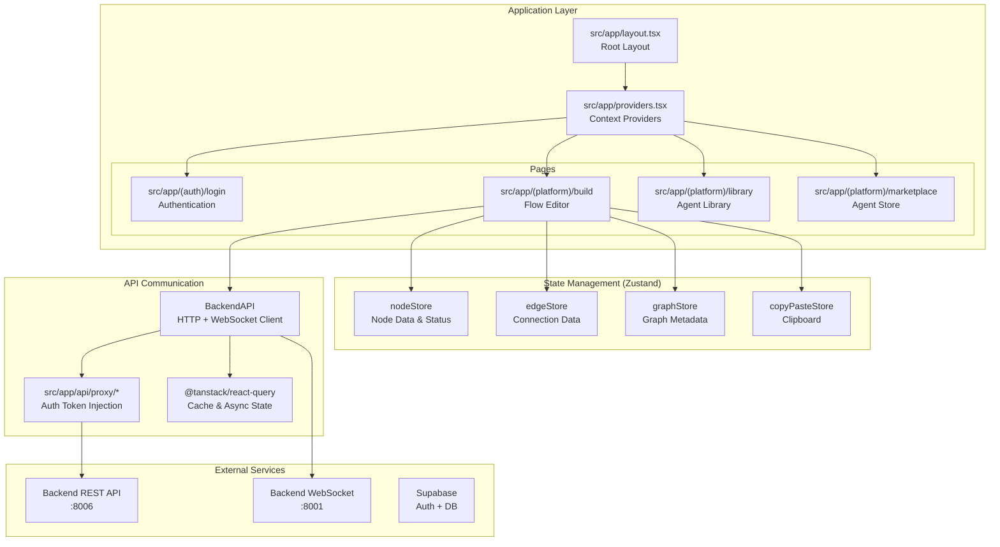

<!-- source: DeepWiki mcp.deepwiki.com · repo Significant-Gravitas/AutoGPT · page 3.1 Frontend · fetched 2026-10-26 -->

# Frontend

Relevant source files

The following files were used as context for generating this wiki page:

- [autogpt_platform/frontend/.env.default](autogpt_platform/frontend/.env.default)
- [autogpt_platform/frontend/.npmrc](autogpt_platform/frontend/.npmrc)
- [autogpt_platform/frontend/next.config.mjs](autogpt_platform/frontend/next.config.mjs)
- [autogpt_platform/frontend/package.json](autogpt_platform/frontend/package.json)
- [autogpt_platform/frontend/playwright.config.ts](autogpt_platform/frontend/playwright.config.ts)
- [autogpt_platform/frontend/pnpm-lock.yaml](autogpt_platform/frontend/pnpm-lock.yaml)
- [autogpt_platform/frontend/pnpm-workspace.yaml](autogpt_platform/frontend/pnpm-workspace.yaml)
- [autogpt_platform/frontend/public/mockServiceWorker.js](autogpt_platform/frontend/public/mockServiceWorker.js)
- [autogpt_platform/frontend/src/app/(platform)/marketplace/components/AgentsSection/AgentsSection.tsx](autogpt_platform/frontend/src/app/(platform)/marketplace/components/AgentsSection/AgentsSection.tsx)
- [autogpt_platform/frontend/src/app/(platform)/marketplace/components/BecomeACreator/BecomeACreator.tsx](autogpt_platform/frontend/src/app/(platform)/marketplace/components/BecomeACreator/BecomeACreator.tsx)
- [autogpt_platform/frontend/src/app/(platform)/marketplace/components/CreatorCard/CreatorCard.tsx](autogpt_platform/frontend/src/app/(platform)/marketplace/components/CreatorCard/CreatorCard.tsx)
- [autogpt_platform/frontend/src/app/(platform)/marketplace/components/CreatorCard/helper.ts](autogpt_platform/frontend/src/app/(platform)/marketplace/components/CreatorCard/helper.ts)
- [autogpt_platform/frontend/src/app/(platform)/marketplace/components/CreatorInfoCard/CreatorInfoCard.tsx](autogpt_platform/frontend/src/app/(platform)/marketplace/components/CreatorInfoCard/CreatorInfoCard.tsx)
- [autogpt_platform/frontend/src/app/(platform)/marketplace/components/FeaturedAgentCard/FeaturedAgentCard.tsx](autogpt_platform/frontend/src/app/(platform)/marketplace/components/FeaturedAgentCard/FeaturedAgentCard.tsx)
- [autogpt_platform/frontend/src/app/(platform)/marketplace/components/FeaturedCreators/FeaturedCreators.tsx](autogpt_platform/frontend/src/app/(platform)/marketplace/components/FeaturedCreators/FeaturedCreators.tsx)
- [autogpt_platform/frontend/src/app/(platform)/marketplace/components/FeaturedSection/FeaturedSection.tsx](autogpt_platform/frontend/src/app/(platform)/marketplace/components/FeaturedSection/FeaturedSection.tsx)
- [autogpt_platform/frontend/src/app/(platform)/marketplace/components/FilterChips/FilterChips.tsx](autogpt_platform/frontend/src/app/(platform)/marketplace/components/FilterChips/FilterChips.tsx)
- [autogpt_platform/frontend/src/app/(platform)/marketplace/components/FilterChips/useFilterChips.ts](autogpt_platform/frontend/src/app/(platform)/marketplace/components/FilterChips/useFilterChips.ts)
- [autogpt_platform/frontend/src/app/(platform)/marketplace/components/HeroSection/HeroSection.tsx](autogpt_platform/frontend/src/app/(platform)/marketplace/components/HeroSection/HeroSection.tsx)
- [autogpt_platform/frontend/src/app/(platform)/marketplace/components/HeroSection/helpers.ts](autogpt_platform/frontend/src/app/(platform)/marketplace/components/HeroSection/helpers.ts)
- [autogpt_platform/frontend/src/app/(platform)/marketplace/components/HeroSection/useHeroSection.ts](autogpt_platform/frontend/src/app/(platform)/marketplace/components/HeroSection/useHeroSection.ts)
- [autogpt_platform/frontend/src/app/(platform)/marketplace/components/StoreCard/StoreCard.tsx](autogpt_platform/frontend/src/app/(platform)/marketplace/components/StoreCard/StoreCard.tsx)
- [autogpt_platform/frontend/src/app/(platform)/marketplace/creator/[creator]/components/MainCreatorPage/MainCreatorPage.tsx](autogpt_platform/frontend/src/app/(platform)/marketplace/creator/[creator]/components/MainCreatorPage/MainCreatorPage.tsx)
- [autogpt_platform/frontend/src/app/(platform)/marketplace/search/components/MainSearchResultPage/MainSearchResultPage.tsx](autogpt_platform/frontend/src/app/(platform)/marketplace/search/components/MainSearchResultPage/MainSearchResultPage.tsx)
- [autogpt_platform/frontend/src/app/layout.tsx](autogpt_platform/frontend/src/app/layout.tsx)
- [autogpt_platform/frontend/src/components/__legacy__/composite/HeroSection.tsx](autogpt_platform/frontend/src/components/__legacy__/composite/HeroSection.tsx)
- [autogpt_platform/frontend/src/components/atoms/Avatar/Avatar.stories.tsx](autogpt_platform/frontend/src/components/atoms/Avatar/Avatar.stories.tsx)
- [autogpt_platform/frontend/src/components/atoms/Avatar/Avatar.tsx](autogpt_platform/frontend/src/components/atoms/Avatar/Avatar.tsx)
- [autogpt_platform/frontend/src/components/layout/Navbar/components/MobileNavbar/MobileNavBar.tsx](autogpt_platform/frontend/src/components/layout/Navbar/components/MobileNavbar/MobileNavBar.tsx)
- [autogpt_platform/frontend/src/components/layout/Navbar/components/PreviewBanner/PreviewBanner.tsx](autogpt_platform/frontend/src/components/layout/Navbar/components/PreviewBanner/PreviewBanner.tsx)
- [autogpt_platform/frontend/src/providers/posthog/posthog-provider.tsx](autogpt_platform/frontend/src/providers/posthog/posthog-provider.tsx)
- [autogpt_platform/frontend/src/services/environment/index.ts](autogpt_platform/frontend/src/services/environment/index.ts)

The AutoGPT Platform frontend is a Next.js application providing the user interface for creating, managing, and deploying AI agent workflows. Built with React and TypeScript, it features a visual flow editor, marketplace, agent library, and comprehensive authentication system.

## Architecture Overview

The frontend is a Next.js application using the App Router architecture. It communicates with multiple backend services via REST and WebSocket APIs, with authentication handled through Supabase.

### High-Level Application Architecture

**Sources:** [autogpt_platform/frontend/src/app/layout.tsx:1-87](), [autogpt_platform/frontend/package.json:1-198](), [autogpt_platform/frontend/src/services/environment/index.ts:27-45]()

### Technology Stack

The frontend leverages a modern React ecosystem with carefully selected libraries:

| Technology | Version | Purpose |
|------------|---------|---------|
| **Next.js** | 15.5.18 | React framework with App Router |
| **React** | 18.3.1 | UI library and component system |
| **TypeScript** | 5.9.3 | Type safety and tooling |
| **@xyflow/react** | 12.9.2 | Visual node-based graph editor |
| **Zustand** | 5.0.8 | Lightweight state management |
| **@rjsf/core** | 6.1.2 | JSON Schema Form rendering |
| **@tanstack/react-query** | 5.90.6 | Data fetching and caching |
| **@supabase/supabase-js** | 2.78.0 | Authentication client |
| **Tailwind CSS** | 3.4.17 | Utility-first CSS framework |
| **Radix UI** | Various | Headless accessible UI components |

**Sources:** [autogpt_platform/frontend/package.json:34-185]()

## Application Structure

### Routing and Pages

The application uses Next.js App Router with nested layouts:

| Route | Purpose | Key Components |
|-------|---------|----------------|
| `/login`, `/signup` | Authentication pages | Login forms, OAuth providers |
| `/build` | Visual flow editor | React Flow canvas, block palette |
| `/library` | User's saved agents | Agent list, scheduling, management |
| `/marketplace` | Public agent store | Browse, search, download agents |

Route groups organize pages:
- `(auth)` - Authentication pages without main layout.
- `(platform)` - Main application pages with navigation.

**Sources:** Directory structure at `autogpt_platform/frontend/src/app/`

## State Management

The application uses Zustand for state management with separate stores for different concerns. For details, see [State Management](#3.1.3).

### Key Stores

*   **nodeStore**: Manages node state including positions, input data, and execution status.
*   **edgeStore**: Tracks connections between nodes.
*   **graphStore**: Holds graph-level metadata like name and description.
*   **copyPasteStore**: Implements clipboard functionality for node selections.

**Sources:** [autogpt_platform/frontend/package.json:134-134]()

## Authentication System

Authentication is handled through Supabase. The system manages user sessions, OAuth providers, and onboarding flows. For details, see [Authentication](#3.1.6).

**Sources:** [autogpt_platform/frontend/src/app/layout.tsx:7-15](), [autogpt_platform/frontend/src/services/environment/index.ts:47-57]()

## API Communication Layer

The frontend communicates with backend services through a centralized client and proxy routes. For details, see [API Client](#3.1.7).

### Generated API Client

The frontend uses **Orval** to auto-generate TypeScript API clients from the backend's OpenAPI specification. This is integrated with **TanStack React Query** for efficient data fetching and caching.

**Sources:** [autogpt_platform/frontend/package.json:28-29](), [autogpt_platform/frontend/package.json:73-73]()

## Key Features

### Agent Builder (Flow Editor)
The visual flow editor is built with `@xyflow/react`. It allows users to drag-and-drop "Blocks" (nodes) and connect them to form "Agent Graphs". For details, see [Agent Builder (Flow Editor)](#3.1.1).

### Form System (RJSF)
The platform uses React JSON Schema Form (RJSF) to dynamically generate configuration forms for each block based on its schema. For details, see [Form System (RJSF)](#3.1.2).

### Marketplace
A community-driven store where users can browse, rate, and download agents. For details, see [Marketplace](#3.1.4).

### Agent Library
A personal management interface for an individual user's agents, including their execution history and scheduling. For details, see [Agent Library](#3.1.5).

## Development & Build System

### Package Management
The frontend uses **pnpm** (version 10.20.0) for dependency management.

**Sources:** [autogpt_platform/frontend/package.json:197-197](), [autogpt_platform/frontend/.npmrc:1-4]()

### Build Scripts
- `pnpm dev`: Starts the development server with API generation.
- `pnpm build`: Production build with memory optimization for large CSS chunks.
- `pnpm test:e2e`: Runs Playwright end-to-end tests.
- `pnpm generate:api`: Generates API hooks and types from the backend schema.

**Sources:** [autogpt_platform/frontend/package.json:8-30](), [autogpt_platform/frontend/next.config.mjs:28-52]()

### Environment Configuration
The application supports multiple environments (local, dev, prod) and behavior modes (cloud, local). Configuration is managed via environment variables and an internal `environment` service.

**Sources:** [autogpt_platform/frontend/src/services/environment/index.ts:1-167](), [autogpt_platform/frontend/.env.default:1-43]()

---

