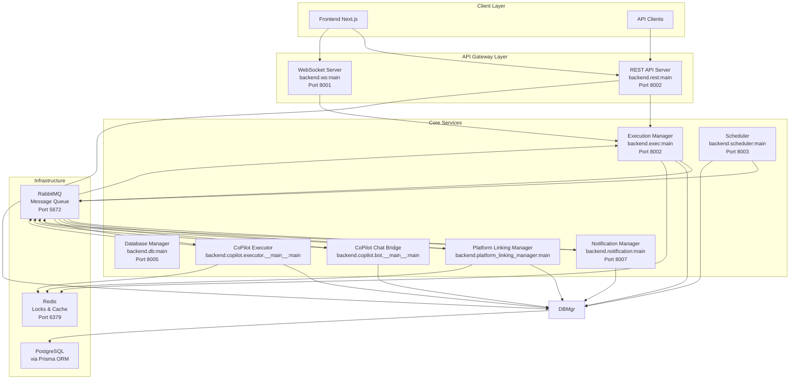
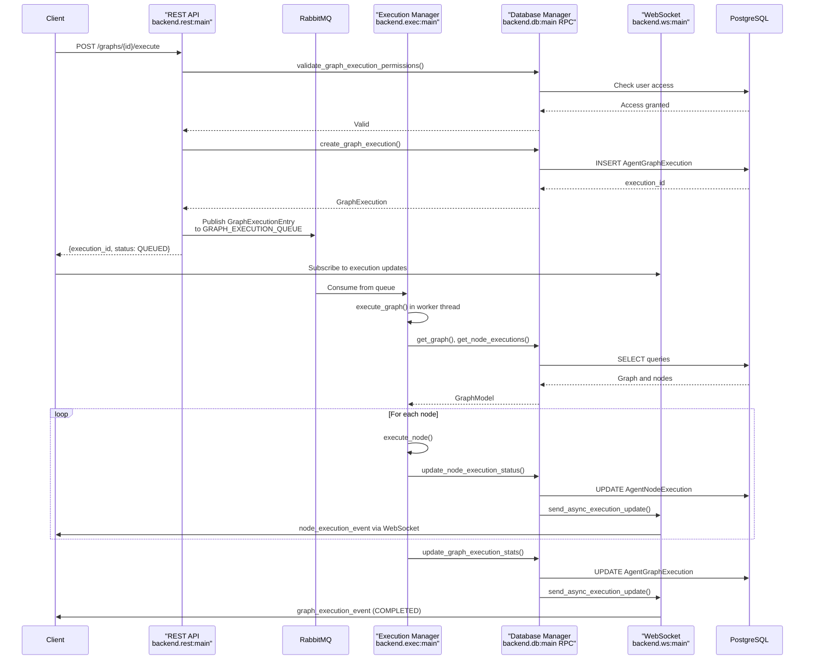
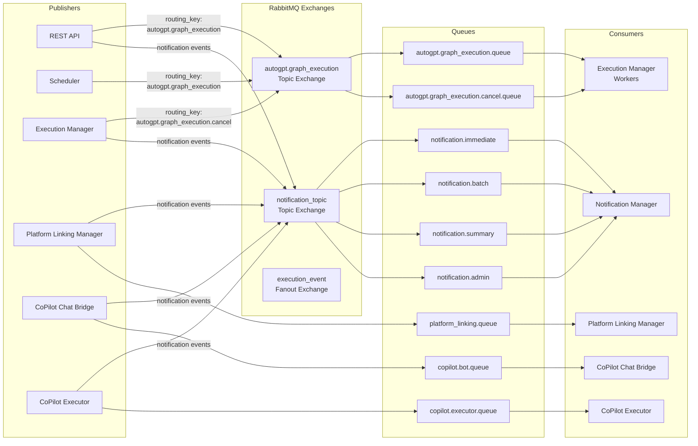
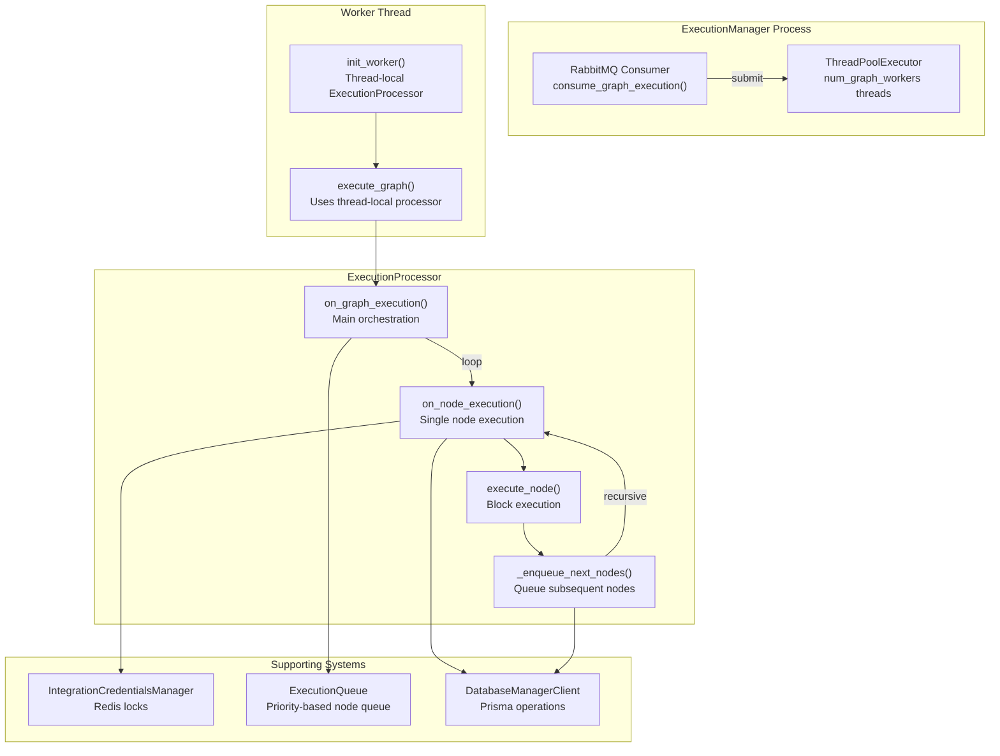

<!-- source: DeepWiki mcp.deepwiki.com · repo Significant-Gravitas/AutoGPT · page 3.2 Backend · fetched 2026-10-26 -->

# Backend

<details>
<summary>Relevant source files</summary>

The following files were used as context for generating this wiki page:

- [autogpt_platform/autogpt_libs/autogpt_libs/auth/config.py](autogpt_platform/autogpt_libs/autogpt_libs/auth/config.py)
- [autogpt_platform/autogpt_libs/poetry.lock](autogpt_platform/autogpt_libs/poetry.lock)
- [autogpt_platform/autogpt_libs/pyproject.toml](autogpt_platform/autogpt_libs/pyproject.toml)
- [autogpt_platform/backend/backend/app.py](autogpt_platform/backend/backend/app.py)
- [autogpt_platform/backend/backend/notification.py](autogpt_platform/backend/backend/notification.py)
- [autogpt_platform/backend/backend/rest.py](autogpt_platform/backend/backend/rest.py)
- [autogpt_platform/backend/backend/scheduler.py](autogpt_platform/backend/backend/scheduler.py)
- [autogpt_platform/backend/backend/util/decorator.py](autogpt_platform/backend/backend/util/decorator.py)
- [autogpt_platform/backend/backend/util/decorator_test.py](autogpt_platform/backend/backend/util/decorator_test.py)
- [autogpt_platform/backend/backend/util/process.py](autogpt_platform/backend/backend/util/process.py)
- [autogpt_platform/backend/backend/util/retry.py](autogpt_platform/backend/backend/util/retry.py)
- [autogpt_platform/backend/backend/util/retry_test.py](autogpt_platform/backend/backend/util/retry_test.py)
- [autogpt_platform/backend/poetry.lock](autogpt_platform/backend/poetry.lock)
- [autogpt_platform/backend/pyproject.toml](autogpt_platform/backend/pyproject.toml)

</details>


The AutoGPT Platform backend is a Python/FastAPI-based microservices system that orchestrates agent graph executions, manages user data and credentials, handles billing, and provides real-time execution updates. This page provides an overview of the backend architecture, technology stack, and core services.

For detailed information about specific subsystems, see:
- [Service Architecture](#3.2.1) — Explain the microservice pattern: REST API, WebSocket, ExecutionManager, DatabaseManager, Scheduler, NotificationManager, and inter-service communication via RabbitMQ
- [Execution System](#3.2.2) — In-depth documentation of graph execution: ExecutionProcessor, node queuing, topological sorting, execution lifecycle, node status tracking, and real-time updates via WebSocket
- [Data Models and Database](#3.2.3) — Document Prisma schema: AgentGraph, AgentNode, AgentGraphExecution, AgentNodeExecution, User, CreditTransaction, indexes, and relationships
- [Credit System](#3.2.4) — Explain the credit/billing system: transaction types, balance tracking, atomic deduction, usage cost calculation per block, auto top-up, Stripe integration, and subscription tiers
- [Credentials Management](#3.2.5) — Document credential storage and usage: OAuth flows, API key credentials, integration providers, distributed locking with Redis, and security considerations
- [Block System](#3.2.6) — Overview of the block architecture: Block base class, AIBlockBase, block categories (AI, Integration, Data, Control Flow), and how blocks are registered and executed
- [LLM Integration](#3.2.7) — Document the LLM abstraction layer: llm_call function, LlmModel enum, provider clients (OpenAI, Anthropic, Groq, etc.), prompt compression, tool call handling, and token tracking
- [AI Blocks](#3.2.8) — Document AI-powered blocks: AITextGeneratorBlock, AIStructuredResponseBlock, SmartDecisionMakerBlock (tool orchestration), AIConditionBlock, orchestrator block, and their configurations
- [Integration Blocks](#3.2.9) — Document blocks for external services: HTTP requests, YouTube transcription, Discord, Email, RSS, GitHub, Google Sheets/Gmail, Slack, Airtable, Linear, and other integration blocks
- [Data and Control Flow Blocks](#3.2.10) — Document utility blocks: data manipulation (Dictionary, List, CSV, JSON), text formatting, iteration, storage, branching, and debugging blocks
- [Dynamic Fields System](#3.2.11) — Explain dynamic field naming conventions (_#_ for dicts, _$_ for lists, _@_ for objects, _^_/_~_ for tools), field parsing, and how complex data structures are linked between blocks
- [Notification System](#3.2.12) — Document the notification architecture: RabbitMQ topic exchanges, queue types (immediate, batch, summary, admin), email templates, Postmark integration, and user preferences
- [Store and Library Management](#3.2.13) — Document store listings, submissions, reviews, library agents, presets, hybrid search with embeddings, and the admin review workflow
- [API Key Management](#3.2.14) — Document API key generation, permissions, revocation, and the keysmith system for secure key handling

---

## Architecture Overview

The backend follows a **microservices architecture** with multiple independent FastAPI services that communicate via RabbitMQ message queues and HTTP/RPC calls. Each service has a dedicated responsibility and runs on a separate port.

**Backend Services and Ports**



Sources: [autogpt_platform/backend/pyproject.toml:127-139](), [autogpt_platform/backend/backend/app.py:49-59]()

---

## Technology Stack

The backend is built on the following core technologies:

| Component | Technology | Purpose |
|-----------|-----------|---------|
| **Web Framework** | FastAPI 0.128+ | REST API endpoints, WebSocket server, async request handling |
| **Database** | PostgreSQL | Primary data store for users, graphs, executions, transactions |
| **ORM** | Prisma 0.15+ | Type-safe database client generation, migrations |
| **Message Queue** | RabbitMQ | Asynchronous task distribution, execution queue management |
| **Cache & Locks** | Redis 6.2+ | Distributed locking, execution counters, cache |
| **Task Scheduling** | APScheduler 3.11+ | Cron-based agent execution, periodic maintenance jobs |
| **Process Management** | Multiprocessing, Threading | Worker pool for concurrent graph executions |
| **Monitoring** | Sentry, Prometheus | Error tracking, performance metrics |
| **Retry Logic** | Tenacity | Robust retry mechanisms with exponential backoff and jitter |

**Key Python Dependencies**

```python
# Core framework
fastapi = "^0.128.6"
uvicorn = { extras = ["standard"], version = "^0.40.0" }
pydantic = { extras = ["email"], version = "^2.12.5" }

# Database & ORM
prisma = "^0.15.0"
sqlalchemy = "^2.0.40"
psycopg2-binary = "^2.9.10" # PostgreSQL driver

# Message queue & async
aio-pika = "^9.5.5"
redis = "^6.2.0"
websockets = "^15.0"

# Scheduling & execution
apscheduler = "^3.11.1"
tenacity = "^9.1.4" # For retry logic

# LLM providers
openai = "^1.97.1"
anthropic = "^0.79.0"
groq = "^0.30.0"
ollama = "^0.6.1"

# Authentication & security
supabase = "2.28.0"
cryptography = "^46.0"
pyjwt = { version = "^2.11.0", extras = ["crypto"] } # Used in autogpt-libs

# Shared libraries
autogpt-libs = { path = "../autogpt_libs", develop = true }
```

Sources: [autogpt_platform/backend/pyproject.toml:10-104](), [autogpt_platform/autogpt_libs/pyproject.toml:9-23]()

---

## Service Architecture

For details on the microservice pattern, inter-service communication via RabbitMQ, and the roles of each service, see [Service Architecture](#3.2.1).

**Microservices Communication Pattern**



Sources: [autogpt_platform/backend/backend/app.py:49-59](), [autogpt_platform/backend/backend/executor/manager.py:162-170](), [autogpt_platform/backend/backend/executor/utils.py:1-56](), [autogpt_platform/backend/backend/util/service.py:95-156]()

### Service Responsibilities

**1. REST API Server (`backend.rest:main`)**
- Handles HTTP requests on port 8002.
- Routes defined in `backend/server/v2/` for various endpoints.
- Authenticates requests via Supabase JWT tokens.
- Delegates execution requests to Execution Manager via RabbitMQ.
- Provides synchronous responses for CRUD operations.

**2. WebSocket Server (`backend.ws:main`)**
- Maintains persistent connections on port 8001.
- Subscribes to execution events from `AsyncRedisEventBus`.
- Pushes real-time updates: `node_execution_event`, `graph_execution_event`.
- Authentication via JWT tokens in connection handshake.

**3. Execution Manager (`backend.exec:main`)**
- Consumes `GraphExecutionEntry` messages from RabbitMQ.
- Manages a `ThreadPoolExecutor` with configurable worker pool size.
- Orchestrates node execution in topological order.
- Handles credentials acquisition with Redis-based distributed locks.
- Tracks execution statistics and updates database.
- Core functions: `on_graph_execution()`, `on_node_execution()`, `execute_node()`.
- For details, see [Execution System](#3.2.2).

**4. Database Manager (`backend.db:main`)**
- Runs as RPC service on port 8005.
- Exposes database operations as async methods.
- Methods decorated with `@expose` are callable remotely.
- Centralizes all Prisma database access.
- Examples: `get_graph()`, `create_graph_execution()`, `update_node_execution_status()`.
- For details, see [Data Models and Database](#3.2.3).

**5. Scheduler (`backend.scheduler:main`)**
- APScheduler-based cron job manager on port 8003.
- Triggers scheduled agent executions via `AgentPreset` configurations.
- Maintains jobs in SQLAlchemy-backed job store (PostgreSQL).
- Handles webhook-triggered executions.
- Periodic maintenance: OAuth token cleanup, cloud storage cleanup, error rate monitoring.

**6. Notification Manager (`backend.notification:main`)**
- Processes notification events from RabbitMQ topic exchanges.
- Queues: immediate, batch (1-minute delay), summary (daily/weekly), admin.
- Sends emails via Postmark API.
- Batches notifications to respect user preferences (max 3 emails/day).
- Notification types: agent runs, low balance, execution failures, summaries.
- For details, see [Notification System](#3.2.12).

**7. Platform Linking Manager (`backend.platform_linking_manager:main`)**
- Manages connections and data flow between the AutoGPT Platform and external systems.
- Handles tasks related to linking user accounts or data across different platforms.

**8. CoPilot Chat Bridge (`backend.copilot.bot.__main__:main`)**
- Facilitates communication between the Copilot frontend and the backend Copilot executor.
- Manages chat sessions and message routing for the AI assistant.

**9. CoPilot Executor (`backend.copilot.executor.__main__:main`)**
- Executes tasks and processes requests originating from the Copilot system.
- Orchestrates AI tools and agents in response to Copilot commands.

Sources: [autogpt_platform/backend/pyproject.toml:127-139](), [autogpt_platform/backend/backend/app.py:49-59](), [autogpt_platform/backend/backend/executor/manager.py:515-700](), [autogpt_platform/backend/backend/scheduler.py:1-100](), [autogpt_platform/backend/backend/notification.py]()

---

## Configuration Management

The backend uses a **layered configuration system** with environment variables, `.env` files, and programmatic defaults.

**Configuration Classes**

| Class | File | Purpose |
|-------|------|---------|
| `Config` | `backend/util/settings.py` | Application settings (ports, thresholds, feature flags) |
| `Secrets` | `backend/util/settings.py` | Sensitive data (API keys, database URLs, encryption keys) |
| `Settings` | `backend/util/settings.py` | Combined container for `Config` + `Secrets` |

**Key Configuration Parameters**

```python
# From backend/util/settings.py:65-196
class Config(UpdateTrackingModel):
    # Worker pool
    num_graph_workers: int = 10  # Max concurrent graph executions
    fastapi_thread_pool_size: int = 60  # Thread pool for sync endpoints
    
    # Service ports
    websocket_server_port: int = 8001
    execution_manager_port: int = 8002
    execution_scheduler_port: int = 8003
    database_api_port: int = 8005
    notification_service_port: int = 8007
    
    # Credit system
    enable_credit: bool = False
    num_user_credits_refill: int = 1500
    low_balance_threshold: int = 500  # cents ($5)
    execution_cost_per_threshold: int = 1
    execution_cost_count_threshold: int = 100
    
    # External services
    rabbitmq_host: str = "localhost"
    rabbitmq_port: int = 5672
    redis_host: str = "localhost"
    redis_port: int = 6379
    
    # Platform URLs
    platform_base_url: str = ""  # Required for webhooks
    frontend_base_url: str = ""  # For OAuth redirects
```

**Environment Variables**

The backend expects these critical environment variables:

```bash
# Database
DATABASE_URL="postgresql://..."
DIRECT_URL="postgresql://..."  # For migrations

# Supabase authentication
SUPABASE_URL="https://..."
SUPABASE_SERVICE_ROLE_KEY="..."

# Message queue
RABBITMQ_DEFAULT_USER="..."
RABBITMQ_DEFAULT_PASS="..."

# LLM providers
OPENAI_API_KEY="..."
ANTHROPIC_API_KEY="..."

# Encryption
ENCRYPTION_KEY="..."  # For credentials storage
```

Sources: [autogpt_platform/backend/backend/util/settings.py:65-528]()

---

## Data Flow and Message Queue Architecture

For details on the RabbitMQ exchanges, queues, and message types used for inter-service communication, see [Service Architecture](#3.2.1).

**RabbitMQ Exchange and Queue Configuration**



**Key RabbitMQ Configuration**

| Constant | Value | Purpose |
|----------|-------|---------|
| `GRAPH_EXECUTION_EXCHANGE` | `"autogpt.graph_execution"` | Routes execution requests |
| `GRAPH_EXECUTION_QUEUE_NAME` | `"autogpt.graph_execution.queue"` | Holds pending executions |
| `GRAPH_EXECUTION_CANCEL_QUEUE_NAME` | `"autogpt.graph_execution.cancel.queue"` | Holds cancellation requests |
| `GRAPH_EXECUTION_ROUTING_KEY` | `"autogpt.graph_execution"` | Execution message routing |

**Message Types**

```python
# From backend/executor/utils.py and backend/data/execution.py
class GraphExecutionEntry(BaseModel):
    user_id: str
    graph_exec_id: str
    graph_id: str
    graph_version: int
    execution_context: ExecutionContext

class NodeExecutionEntry(BaseModel):
    user_id: str
    graph_exec_id: str
    graph_id: str
    graph_version: int
    node_exec_id: str
    node_id: str
    block_id: str
    inputs: BlockInput
    execution_context: ExecutionContext

class CancelExecutionEvent(BaseModel):
    user_id: str
    graph_exec_id: str
```

Sources: [autogpt_platform/backend/backend/executor/utils.py:80-110](), [autogpt_platform/backend/backend/data/execution.py:78-112](), [autogpt_platform/backend/backend/executor/manager.py:80-96]()

---

## Core Data Models

The backend uses **Prisma ORM** to interact with PostgreSQL. The schema is defined in `schema.prisma` and generates type-safe Python client code. For details, see [Data Models and Database](#3.2.3).

**Primary Database Tables**

```mermaid
erDiagram
    User ||--o{ AgentGraph : creates
    User ||--o{ AgentGraphExecution : runs
    User ||--o{ CreditTransaction : has
    User ||--|| UserBalance : has
    
    AgentGraph ||--o{ AgentNode : contains
    AgentGraph ||--o{ AgentGraphExecution : executed_as
    AgentGraph ||--o{ AgentPreset : configured_as
    AgentGraph ||--o{ LibraryAgent : listed_in
    
    AgentNode ||--o{ AgentNodeLink : connected_by
    AgentNode }o--|| AgentBlock : uses
    AgentNode ||--o{ AgentNodeExecution : executed_as
    
    AgentGraphExecution ||--o{ AgentNodeExecution : contains
    AgentGraphExecution }o--o| AgentPreset : triggered_by
    
    AgentNodeExecution ||--o{ AgentNodeExecutionInputOutput : has
    
    User {
        string id PK
        string email UK
        string stripeCustomerId
        boolean notifyOnAgentRun
        boolean notifyOnLowBalance
    }
    
    AgentGraph {
        string id PK
        int version PK
        string userId FK
        string name
        string description
        boolean isActive
    }
    
    AgentNode {
        string id PK
        string agentBlockId FK
        string agentGraphId FK
        int agentGraphVersion FK
        json constantInput
    }
    
    AgentGraphExecution {
        string id PK
        string userId FK
        string agentGraphId FK
        int agentGraphVersion FK
        AgentExecutionStatus executionStatus
        json stats
    }
    
    AgentNodeExecution {
        string id PK
        string agentNodeId FK
        string agentGraphExecutionId FK
        AgentExecutionStatus executionStatus
        json executionStats
    }
    
    UserBalance {
        string userId PK FK
        int credits
    }
    
    CreditTransaction {
        string id PK
        string userId FK
        int amount
        CreditTransactionType transactionType
    }
```

**Key Model Classes**

| Python Class | Prisma Model | Purpose |
|--------------|--------------|---------|
| `GraphModel` | `AgentGraph` | Agent graph definition with nodes and links |
| `NodeModel` | `AgentNode` | Individual node in graph with block reference |
| `GraphExecution` | `AgentGraphExecution` | Execution instance with inputs/outputs |
| `NodeExecutionResult` | `AgentNodeExecution` | Node execution result with status |
| `User` | `User` | User account with notification preferences |
| `UserBalance` | `UserBalance` | User credit balance (cents) |

**Execution Status Enum**

```python
# From prisma.enums.AgentExecutionStatus
class ExecutionStatus(Enum):
    INCOMPLETE = "INCOMPLETE"  # Waiting for inputs
    QUEUED = "QUEUED"          # In execution queue
    RUNNING = "RUNNING"        # Currently executing
    COMPLETED = "COMPLETED"    # Successfully finished
    TERMINATED = "TERMINATED"  # Cancelled by user
    FAILED = "FAILED"          # Error occurred
    REVIEW = "REVIEW"          # Waiting for human review
```

Sources: [autogpt_platform/backend/schema.prisma:1-400](), [autogpt_platform/backend/backend/data/graph.py:1-200](), [autogpt_platform/backend/backend/data/execution.py:90-290]()

---

## Execution System Overview

The **Execution Manager** is the core orchestrator that processes agent graphs. It uses a **thread pool** to execute multiple graphs concurrently. For details, see [Execution System](#3.2.2).

**Execution Manager Components**



**Execution Lifecycle**

1.  **Queue Phase**: REST API publishes `GraphExecutionEntry` to RabbitMQ.
2.  **Consume Phase**: `ExecutionManager.consume_graph_execution()` picks up message.
3.  **Worker Phase**: Submits `execute_graph()` to thread pool.
4.  **Initialize Phase**: Build `ExecutionQueue` with topologically sorted nodes.
5.  **Node Loop Phase**: For each node in queue:
    -   Check credits and charge user.
    -   Acquire credentials with Redis lock.
    -   Execute block logic.
    -   Persist outputs to database.
    -   Enqueue next nodes based on output links.
    -   Send WebSocket updates.
6.  **Completion Phase**: Update execution stats, send final event.

**Credit Charging**

```python
# From backend/executor/manager.py:823-873
def _charge_usage(self, node_exec: NodeExecutionEntry, execution_count: int):
    # Charge for block execution
    block = get_block(node_exec.block_id)
    cost, matching_filter = block_usage_cost(block, node_exec.inputs)
    if cost > 0:
        remaining_balance = db_client.spend_credits(
            user_id=node_exec.user_id,
            cost=cost,
            metadata=UsageTransactionMetadata(...)
        )
    
    # Charge for execution count (every 100 nodes = 1 cent)
    cost, usage_count = execution_usage_cost(execution_count)
    if cost > 0:
        remaining_balance = db_client.spend_credits(...)
```

Sources: [autogpt_platform/backend/backend/executor/manager.py:515-900](), [autogpt_platform/backend/backend/executor/utils.py:95-158]()

---

## Block System

**Blocks** are the fundamental execution units in the platform. Each block implements specific logic (LLM calls, API requests, data transformations) and is wired into graphs via nodes. For details, see [Block System](#3.2.6).

**Block Class Hierarchy**

```python
# From backend/data/block.py
class Block(ABC):
    """Base class for all blocks"""
    id: ClassVar[str]  # Unique block identifier
    name: ClassVar[str]
    description: ClassVar[str]
    categories: ClassVar[set[BlockCategory]]
    block_type: ClassVar[BlockType]
    input_schema: ClassVar[type[BlockSchema]]
    output_schema: ClassVar[type[BlockSchema]]
    
    @abstractmethod
    async def execute(self, input_data: BlockInput, **kwargs) -> BlockOutput:
        """Execute block logic, yield (output_name, output_data) tuples"""
        pass

class AIBlockBase(Block):
    """Base for AI-powered blocks with token tracking"""
    execution_stats: NodeExecutionStats  # Tracks token usage
```

**Block Registration**

Blocks are discovered via a plugin system:

```python
# From backend/data/block.py:800-850
@cached
def get_blocks() -> dict[str, Block]:
    """Load all blocks from autogpt_platform/backend/blocks/"""
    blocks = {}
    for block_class in Block.__subclasses__():
        try:
            block = block_class()
            blocks[block.id] = block
        except Exception as e:
            logger.exception(f"Failed to load block {block_class}")
    return blocks

def get_block(block_id: str) -> Block | None:
    return get_blocks().get(block_id)
```

**Block Cost Configuration**

Block execution costs are defined in `backend/data/block_cost_config.py`:

```python
class BlockCost(BaseModel):
    cost_amount: int  # Cost in cents
    cost_type: BlockCostType  # RUN, BYTE, or SECOND
    cost_filter: BlockInput  # Conditions for this cost

BLOCK_COSTS: dict[type[Block], list[BlockCost]] = {
    AITextGeneratorBlock: [
        BlockCost(cost_amount=1, cost_type=BlockCostType.RUN, 
                  cost_filter={"model": "gpt-4o"}),
        BlockCost(cost_amount=5, cost_type=BlockCostType.RUN,
                  cost_filter={"model": "o1-preview"}),
    ],
    # ... more blocks
}
```

Sources: [autogpt_platform/backend/backend/data/block.py:1-1000](), [autogpt_platform/backend/backend/data/block_cost_config.py:1-100](), [autogpt_platform/backend/backend/executor/utils.py:117-158]()

---

## Credentials Management

The platform supports multiple credential types for integrations. For details, see [Credentials Management](#3.2.5).

| Credential Type | Use Case | Storage |
|----------------|----------|---------|
| `oauth2` | Google, GitHub, Discord, etc. | Encrypted in `IntegrationCredentials` table |
| `api_key` | OpenAI, Anthropic, custom APIs | Encrypted with `ENCRYPTION_KEY` |
| `user_password` | Basic auth services | Encrypted |
| `host_scoped` | Custom API keys per hostname | Encrypted |

**Credentials Acquisition with Distributed Locking**

The Execution Manager uses Redis-based locks to ensure only one block uses a credential at a time:

```python
# From backend/executor/manager.py:250-300
creds_locks: list[AsyncRedisLock] = []

# Acquire locks for all credentials in input schema
for field_name, input_type in input_model.get_credentials_fields().items():
    credentials_meta = input_type(**input_data[field_name])
    credentials, lock = await creds_manager.acquire(user_id, credentials_meta.id)
    creds_locks.append(lock)
    extra_exec_kwargs[field_name] = credentials

try:
    # Execute block with credentials
    async for output_name, output_data in node_block.execute(input_data, **extra_exec_kwargs):
        yield output_name, output_data
finally:
    # Always release locks
    for creds_lock in creds_locks:
        if await creds_lock.locked() and await creds_lock.owned():
            await creds_lock.release()
```

**Credentials Store Interface**

```python
# From backend/integrations/credentials_store.py
class IntegrationCredentialsStore:
    async def acquire(self, user_id: str, credentials_id: str) -> tuple[Credentials, AsyncRedisLock]:
        """Get credentials and acquire distributed lock"""
        # Fetch from database
        credentials = await self._get_credentials(user_id, credentials_id)
        # Acquire Redis lock with key: f"creds:{credentials_id}"
        lock = await self._acquire_lock(credentials_id)
        return credentials, lock
    
    async def store(self, user_id: str, credentials: CredentialsInput) -> str:
        """Encrypt and store credentials"""
        encrypted = encrypt_credentials(credentials)
        credentials_id = await db.create_integration_credentials(user_id, encrypted)
        return credentials_id
```

Sources: [autogpt_platform/backend/backend/integrations/credentials_store.py:1-400](), [autogpt_platform/backend/backend/executor/manager.py:250-345]()

---

## Deployment and Docker

The backend is containerized using a multi-stage Docker build.

**Dockerfile Stages**

```dockerfile
# From autogpt_platform/backend/Dockerfile

# Stage 1: builder - Install all dependencies
FROM debian:13-slim AS builder
RUN apt-get update && apt-get install -y python3 python3-pip python3-venv
COPY pyproject.toml poetry.lock ./
RUN python3 -m venv /venv && /venv/bin/pip install poetry
RUN /venv/bin/poetry install --no-root

# Stage 2: server_dependencies - Minimal runtime base
FROM debian:13-slim AS server_dependencies
COPY --from=builder /venv /venv
COPY schema.prisma ./
RUN /venv/bin/prisma generate

# Stage 3: migrate - Database migrations only
FROM server_dependencies AS migrate
ENTRYPOINT ["/venv/bin/prisma", "migrate", "deploy"]

# Stage 4: server - Full application
FROM server_dependencies AS server
COPY backend/ ./backend/
WORKDIR /app
EXPOSE 8001 8002 8003 8005 8007
ENTRYPOINT ["/venv/bin/python", "-m"]
```

**Docker Compose Service Definitions**

```yaml
# Typical docker-compose.yml structure
services:
  postgres:
    image: postgres:16
    environment:
      POSTGRES_DB: autogpt
      POSTGRES_USER: ${POSTGRES_USER}
      POSTGRES_PASSWORD: ${POSTGRES_PASSWORD}
  
  redis:
    image: redis:7
    command: redis-server --requirepass ${REDIS_PASSWORD}
  
  rabbitmq:
    image: rabbitmq:3-management
    environment:
      RABBITMQ_DEFAULT_USER: ${RABBITMQ_DEFAULT_USER}
      RABBITMQ_DEFAULT_PASS: ${RABBITMQ_DEFAULT_PASS}
  
  backend-migrate:
    build:
      target: migrate
    depends_on: [postgres]
  
  backend-rest:
    build:
      target: server
    command: rest
    ports: ["8002:8002"]
    depends_on: [backend-migrate, redis, rabbitmq]
  
  backend-websocket:
    build:
      target: server
    command: ws
    ports: ["8001:8001"]
    depends_on: [redis]
  
  backend-executor:
    build:
      target: server
    command: executor
    depends_on: [rabbitmq, redis, postgres]
  
  backend-scheduler:
    build:
      target: server
    command: scheduler
    ports: ["8003:8003"]
    depends_on: [postgres]
  
  backend-notification:
    build:
      target: server
    command: notification
    ports: ["8007:8007"]
    depends_on: [rabbitmq]

  backend-platform-linking-manager:
    build:
      target: server
    command: platform-linking-manager
    depends_on: [rabbitmq, redis, postgres]

  backend-copilot-executor:
    build:
      target: server
    command: copilot-executor
    depends_on: [rabbitmq, redis, postgres]

  backend-copilot-bot:
    build:
      target: server
    command: copilot-bot
    depends_on: [rabbitmq, redis, postgres]
```

Sources: [autogpt_platform/backend/Dockerfile:1-100](), [autogpt_platform/backend/pyproject.toml:106-120]()

---

## Entry Points and CLI

The backend exposes multiple entry points via Poetry scripts:

```toml
# From pyproject.toml
[tool.poetry.scripts]
app = "backend.app:main"                  # Starts all core services
rest = "backend.rest:main"                # REST API server
ws = "backend.ws:main"                    # WebSocket server
executor = "backend.exec:main"            # Execution Manager
scheduler = "backend.scheduler:main"      # Scheduler service
notification = "backend.notification:main" # Notification service
db = "backend.db:main"                    # Database Manager RPC
platform-linking-manager = "backend.platform_linking_manager:main" # Platform Linking Manager
copilot-executor = "backend.copilot.executor.__main__:main" # CoPilot Executor
copilot-bot = "backend.copilot.bot.__main__:main" # CoPilot Chat Bridge
cli = "backend.cli:main"                  # CLI utilities
```

**Starting Services**

```bash
# Development (with Poetry)
poetry run app         # Start all core services
poetry run rest        # Start REST API on :8002
poetry run ws          # Start WebSocket on :8001
poetry run executor    # Start Execution Manager
poetry run scheduler   # Start Scheduler on :8003
poetry run notification # Start Notification Manager on :8007
poetry run platform-linking-manager # Start Platform Linking Manager
poetry run copilot-executor # Start CoPilot Executor
poetry run copilot-bot # Start CoPilot Chat Bridge

# Production (Docker)
docker compose up -d
```

**Database Migrations**

```bash
# Generate Prisma client
poetry run prisma generate

# Create migration
poetry run prisma migrate dev --name <migration_name>

# Apply migrations
poetry run prisma migrate deploy
```

Sources: [autogpt_platform/backend/pyproject.toml:127-147]()

---

## Testing and CI

The backend has a comprehensive test suite with CI/CD via GitHub Actions.

**Test Structure**

```
backend/
├── test/
│   ├── integration/       # Integration tests with real services
│   ├── unit/             # Unit tests for individual components
│   └── data/             # Test data and fixtures
```

**CI Pipeline**

```yaml
# From .github/workflows/platform-backend-ci.yml
name: AutoGPT Platform - Backend CI

on:
  push:
    paths:
      - "autogpt_platform/backend/**"

jobs:
  test:
    runs-on: ubuntu-latest
    services:
      postgres:
        image: postgres:16
      redis:
        image: redis:7
      rabbitmq:
        image: rabbitmq:3
      supabase:
        image: supabase/supabase-local
    
    steps:
      - uses: actions/checkout@v4
      - uses: actions/setup-python@v5
        with:
          python-version: '3.11'
      
      - name: Install Poetry
        run: pipx install poetry
      
      - name: Install dependencies
        run: poetry install
      
      - name: Generate Prisma client
        run: poetry run prisma generate
      
      - name: Run linting
        run: poetry run ruff check
      
      - name: Run type checking
        run: poetry run pyright
      
      - name: Run tests
        run: poetry run pytest
```

**Code Quality Tools**

| Tool | Purpose | Configuration |
|------|---------|---------------|
| **Ruff** | Fast Python linter (replaces Flake8) | `pyproject.toml` |
| **Black** | Code formatter | `pyproject.toml` |
| **Pyright** | Type checker | `pyproject.toml` |
| **pytest** | Test runner | `pytest.ini_options` |
| **pre-commit** | Git hooks for quality checks | `.pre-commit-config.yaml` |

Sources: [autogpt_platform/backend/pyproject.toml:160-178]()

---

## Monitoring and Observability

The backend integrates with Sentry for error tracking and Prometheus for metrics.

**Sentry Configuration**

```python
# From backend/util/metrics.py
def sentry_init():
    if settings.secrets.sentry_dsn:
        sentry_sdk.init(
            dsn=settings.secrets.sentry_dsn,
            environment=settings.config.app_env.value,
            integrations=[
                # Automatic instrumentation
                FastAPIIntegration(),
                SQLAlchemyIntegration(),
                LaunchDarklyIntegration(),
                OpenAIIntegration(),
                AnthropicIntegration(),
            ],
            traces_sample_rate=0.1,  # 10% of requests
        )
```

**Prometheus Metrics**

```python
# From backend/executor/manager.py:106-115
active_runs_gauge = Gauge(
    "execution_manager_active_runs",
    "Number of active graph runs"
)

pool_size_gauge = Gauge(
    "execution_manager_pool_size", 
    "Maximum number of graph workers"
)

utilization_gauge = Gauge(
    "execution_manager_utilization_ratio",
    "Ratio of active graph runs to max graph workers"
)
```

**Structured Logging**

The backend uses structured JSON logging when `STRUCTURED_LOGGING_ENABLED=true`:

```python
# From backend/util/logging.py
logger.info(
    "Node execution completed",
    extra={
        "component": "ExecutionManager",
        "user_id": user_id,
        "graph_id": graph_id,
        "node_id": node_id,
        "execution_time_ms": 1234,
    }
)
```

Sources: [autogpt_platform/backend/backend/executor/manager.py:106-115](), [autogpt_platform/backend/backend/util/logging.py:1-100]()

---

## Robustness and Error Handling

The backend incorporates several mechanisms to ensure robustness and graceful error handling:

**1. Process Management (`backend.util.process.AppProcess`)**
- Each core service (e.g., `AgentServer`, `ExecutionManager`) inherits from `AppProcess` [autogpt_platform/backend/backend/util/process.py:16-46]().
- This class provides standardized lifecycle management: `start()`, `stop()`, `cleanup()`, and signal handling for graceful shutdown [autogpt_platform/backend/backend/util/process.py:104-149]().
- It ensures that resources are properly released and services terminate cleanly.

**2. Retry Decorators (`backend.util.retry.create_retry_decorator`, `backend.util.retry.conn_retry`)**
- The `tenacity` library is used to implement robust retry logic for transient failures.
- `create_retry_decorator` provides a configurable decorator for general function retries with exponential backoff and jitter [autogpt_platform/backend/backend/util/retry.py:122-158]().
- `conn_retry` is specifically designed for connection-related operations, providing continuous retries for infrastructure components like Redis or RabbitMQ [autogpt_platform/backend/backend/util/retry.py:170-240]().
- Critical retry alerts are rate-limited and sent to Discord if a function approaches its failure threshold [autogpt_platform/backend/backend/util/retry.py:44-69]().

**3. Error Logging Decorators (`backend.util.decorator.error_logged`, `backend.util.decorator.async_error_logged`)**
- These decorators provide a consistent way to log exceptions in synchronous and asynchronous functions [autogpt_platform/backend/backend/util/decorator.py:97-209]().
- They offer an option to `swallow` (suppress) the exception or re-raise it, allowing for controlled error handling without crashing the application [autogpt_platform/backend/backend/util/decorator.py:123-141]().

**4. Time Measurement Decorators (`backend.util.decorator.time_measured`, `backend.util.decorator.async_time_measured`)**
- Used to measure the CPU and wall time of function execution, aiding in performance monitoring and bottleneck identification [autogpt_platform/backend/backend/util/decorator.py:45-94]().

Sources: [autogpt_platform/backend/backend/util/process.py:16-149](), [autogpt_platform/backend/backend/util/retry.py:122-240](), [autogpt_platform/backend/backend/util/retry_test.py:19-61](), [autogpt_platform/backend/backend/util/decorator.py:45-209](), [autogpt_platform/backend/backend/util/decorator_test.py:9-33]()

---

