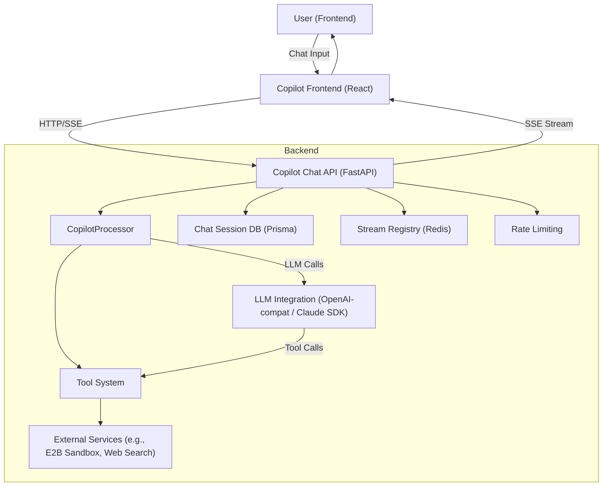
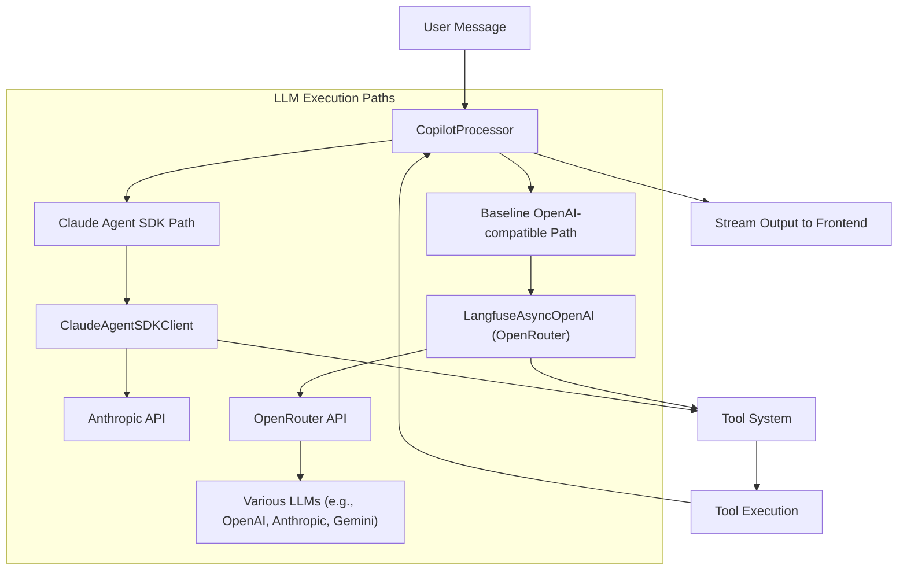

<!-- source: DeepWiki mcp.deepwiki.com · repo Significant-Gravitas/AutoGPT · page 3.3 Copilot System · fetched 2026-10-26 -->

# 3.3 Copilot System

Relevant source files

The following files were used as context for generating this wiki page:

- [autogpt_platform/backend/backend/api/features/chat/routes.py](autogpt_platform/backend/backend/api/features/chat/routes.py)
- [autogpt_platform/backend/backend/api/features/chat/routes_test.py](autogpt_platform/backend/backend/api/features/chat/routes_test.py)
- [autogpt_platform/backend/backend/copilot/baseline/service.py](autogpt_platform/backend/backend/copilot/baseline/service.py)
- [autogpt_platform/backend/backend/copilot/baseline/service_unit_test.py](autogpt_platform/backend/backend/copilot/baseline/service_unit_test.py)
- [autogpt_platform/backend/backend/copilot/config.py](autogpt_platform/backend/backend/copilot/config.py)
- [autogpt_platform/backend/backend/copilot/config_test.py](autogpt_platform/backend/backend/copilot/config_test.py)
- [autogpt_platform/backend/backend/copilot/constants.py](autogpt_platform/backend/backend/copilot/constants.py)
- [autogpt_platform/backend/backend/copilot/db.py](autogpt_platform/backend/backend/copilot/db.py)
- [autogpt_platform/backend/backend/copilot/db_test.py](autogpt_platform/backend/backend/copilot/db_test.py)
- [autogpt_platform/backend/backend/copilot/executor/processor.py](autogpt_platform/backend/backend/copilot/executor/processor.py)
- [autogpt_platform/backend/backend/copilot/model.py](autogpt_platform/backend/backend/copilot/model.py)
- [autogpt_platform/backend/backend/copilot/model_normalize_test.py](autogpt_platform/backend/backend/copilot/model_normalize_test.py)
- [autogpt_platform/backend/backend/copilot/model_test.py](autogpt_platform/backend/backend/copilot/model_test.py)
- [autogpt_platform/backend/backend/copilot/sdk/e2e_compaction_test.py](autogpt_platform/backend/backend/copilot/sdk/e2e_compaction_test.py)
- [autogpt_platform/backend/backend/copilot/sdk/p0_guardrails_test.py](autogpt_platform/backend/backend/copilot/sdk/p0_guardrails_test.py)
- [autogpt_platform/backend/backend/copilot/sdk/response_adapter.py](autogpt_platform/backend/backend/copilot/sdk/response_adapter.py)
- [autogpt_platform/backend/backend/copilot/sdk/response_adapter_test.py](autogpt_platform/backend/backend/copilot/sdk/response_adapter_test.py)
- [autogpt_platform/backend/backend/copilot/sdk/retry_scenarios_test.py](autogpt_platform/backend/backend/copilot/sdk/retry_scenarios_test.py)
- [autogpt_platform/backend/backend/copilot/sdk/service.py](autogpt_platform/backend/backend/copilot/sdk/service.py)
- [autogpt_platform/backend/backend/copilot/sdk/service_test.py](autogpt_platform/backend/backend/copilot/sdk/service_test.py)
- [autogpt_platform/backend/backend/copilot/sdk/session_persistence_test.py](autogpt_platform/backend/backend/copilot/sdk/session_persistence_test.py)
- [autogpt_platform/backend/backend/copilot/service.py](autogpt_platform/backend/backend/copilot/service.py)
- [autogpt_platform/backend/backend/copilot/session_cleanup.py](autogpt_platform/backend/backend/copilot/session_cleanup.py)
- [autogpt_platform/backend/backend/copilot/stream_registry.py](autogpt_platform/backend/backend/copilot/stream_registry.py)
- [autogpt_platform/backend/backend/copilot/stream_registry_test.py](autogpt_platform/backend/backend/copilot/stream_registry_test.py)
- [autogpt_platform/backend/backend/data/db_manager.py](autogpt_platform/backend/backend/data/db_manager.py)
- [autogpt_platform/frontend/src/app/(platform)/copilot/CopilotPage.tsx](autogpt_platform/frontend/src/app/(platform)/copilot/CopilotPage.tsx)
- [autogpt_platform/frontend/src/app/(platform)/copilot/components/ChatContainer/ChatContainer.tsx](autogpt_platform/frontend/src/app/(platform)/copilot/components/ChatContainer/ChatContainer.tsx)
- [autogpt_platform/frontend/src/app/(platform)/copilot/components/ChatMessagesContainer/ChatMessagesContainer.tsx](autogpt_platform/frontend/src/app/(platform)/copilot/components/ChatMessagesContainer/ChatMessagesContainer.tsx)
- [autogpt_platform/frontend/src/app/(platform)/copilot/components/ChatMessagesContainer/__tests__/ChatMessagesContainer.test.tsx](autogpt_platform/frontend/src/app/(platform)/copilot/components/ChatMessagesContainer/__tests__/ChatMessagesContainer.test.tsx)
- [autogpt_platform/frontend/src/app/(platform)/copilot/components/ChatMessagesContainer/__tests__/LoadMoreSentinel.test.tsx](autogpt_platform/frontend/src/app/(platform)/copilot/components/ChatMessagesContainer/__tests__/LoadMoreSentinel.test.tsx)
- [autogpt_platform/frontend/src/app/(platform)/copilot/helpers/__tests__/convertChatSessionToUiMessages.test.ts](autogpt_platform/frontend/src/app/(platform)/copilot/helpers/__tests__/convertChatSessionToUiMessages.test.ts)
- [autogpt_platform/frontend/src/app/(platform)/copilot/helpers/convertChatSessionToUiMessages.ts](autogpt_platform/frontend/src/app/(platform)/copilot/helpers/convertChatSessionToUiMessages.ts)
- [autogpt_platform/frontend/src/app/(platform)/copilot/useChatSession.ts](autogpt_platform/frontend/src/app/(platform)/copilot/useChatSession.ts)
- [autogpt_platform/frontend/src/app/(platform)/copilot/useCopilotPage.ts](autogpt_platform/frontend/src/app/(platform)/copilot/useCopilotPage.ts)
- [autogpt_platform/frontend/src/app/(platform)/copilot/useLoadMoreMessages.ts](autogpt_platform/frontend/src/app/(platform)/copilot/useLoadMoreMessages.ts)
- [autogpt_platform/frontend/src/app/api/openapi.json](autogpt_platform/frontend/src/app/api/openapi.json)

The Copilot System provides an AI-powered chat interface within the AutoGPT Platform, enabling users to interactively build, run, and manage AI agents. It acts as a conversational layer over the agent execution engine, allowing users to describe their goals in natural language and have the Copilot translate those into actionable steps, tool calls, and agent configurations.

The system is designed to be flexible, supporting different underlying LLM execution paths and a rich set of tools for agent interaction, file management, and external service integration. The frontend provides a dynamic chat experience with real-time streaming updates, while the backend handles session management, message processing, and tool execution.

For detailed information on specific aspects of the Copilot System, refer to the following child pages:
- [Copilot Architecture and Execution](#3.3.1)
- [Copilot Chat API and Frontend](#3.3.2)
- [Copilot Tools](#3.3.3)
- [Copilot Rate Limiting and Usage](#3.3.4)
- [Copilot Bot Adapters](#3.3.5)

## High-Level Architecture

The Copilot system is composed of a FastAPI backend and a React frontend. The backend orchestrates interactions with Large Language Models (LLMs) and various tools, managing chat sessions and streaming responses. The frontend provides the user interface for these interactions.

Sources: [autogpt_platform/backend/backend/api/features/chat/routes.py:1-114](), [autogpt_platform/backend/backend/copilot/sdk/service.py:1-167](), [autogpt_platform/backend/backend/copilot/baseline/service.py:1-130]()

## Execution Paths

The Copilot backend supports two primary execution paths for interacting with LLMs:

1.  **Claude Agent SDK Path**: This path leverages the `claude_agent_sdk` for advanced agentic capabilities, particularly with Anthropic models. It provides structured tool use, reasoning, and a more robust agentic loop. This path is enabled when `use_claude_agent_sdk` is true in the `ChatConfig` [autogpt_platform/backend/backend/copilot/config.py:36-39]().
2.  **Baseline OpenAI-compatible Path**: This path uses a generic OpenAI-compatible API for LLM interactions, typically routing through OpenRouter. It supports tool calling and streaming, serving as a fallback or for models not supported by the Claude Agent SDK. This path is used when the SDK path is not enabled [autogpt_platform/backend/backend/copilot/baseline/service.py:1-7]().

Both paths share common components like the `ToolSystem` and `ChatSessionDB`, but their interaction with the LLM and the way they handle streaming and tool orchestration differ.

Sources: [autogpt_platform/backend/backend/copilot/sdk/service.py:35-37](), [autogpt_platform/backend/backend/copilot/baseline/service.py:47-50](), [autogpt_platform/backend/backend/copilot/config.py:54-102](), [autogpt_platform/backend/backend/copilot/service.py:67-80]()

For a deep dive into the specifics of these execution paths, including the `CoPilotProcessor`, stream registry, session lifecycle, and transcript management, see [Copilot Architecture and Execution](#3.3.1).

## Chat Interface and API

The Copilot provides a real-time chat experience through a FastAPI backend and a React frontend. The backend exposes API endpoints for managing chat sessions, sending messages, and receiving streaming updates via Server-Sent Events (SSE).

The frontend components, such as `CopilotPage`, `useCopilotPage`, and `ChatMessagesContainer`, handle user input, display messages, and manage the interactive elements of the chat.

For more information on the API routes, session management, message hydration, and frontend components, refer to [Copilot Chat API and Frontend](#3.3.2).

## Tool System

A core feature of the Copilot is its extensive tool system, which allows the AI to interact with the environment and perform actions. These tools range from agent creation and execution to file management, bash execution in sandboxed environments, web search, and human-in-the-loop (HITL) interactions. The system also incorporates a robust permission model to control tool access.

For a comprehensive overview of the available tools, their functionalities, and the permission model, see [Copilot Tools](#3.3.3).

## Rate Limiting and Usage

To manage resource consumption and ensure fair usage, the Copilot system implements a microdollar-based rate limiting mechanism. This system tracks usage, applies daily and weekly windows, and uses tier multipliers to adjust limits. A fail-closed policy ensures that resource limits are respected. The frontend includes a `RateLimitGate` component to inform users about their usage status.

For detailed information on the rate limiting system, usage windows, and the `RateLimitGate` component, refer to [Copilot Rate Limiting and Usage](#3.3.4).

## Bot Adapters

The Copilot system is designed to be extensible, allowing integration with external messaging platforms through a bot adapter system. This enables users to interact with the Copilot from platforms like Discord, initiating and managing Copilot sessions outside the main web interface.

For details on the bot adapter architecture and how Copilot sessions are initiated from external channels, see [Copilot Bot Adapters](#3.3.5).

---

