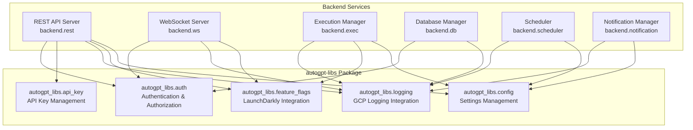
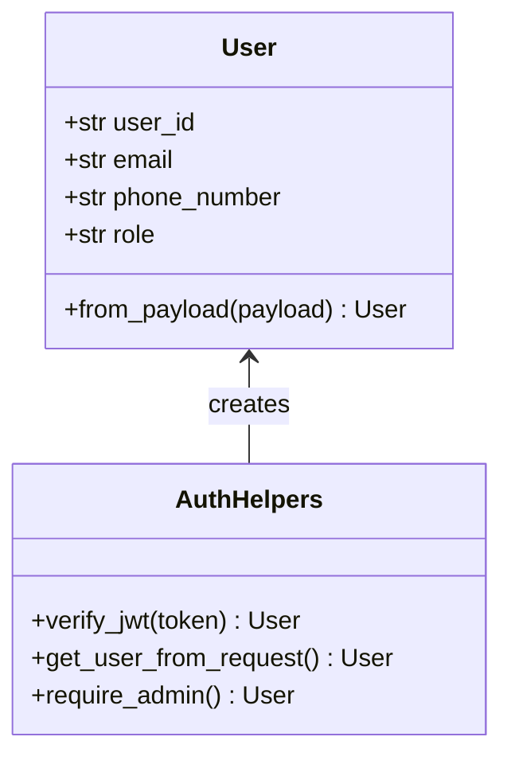
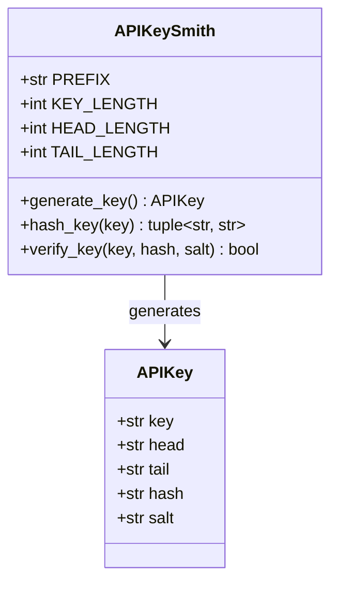
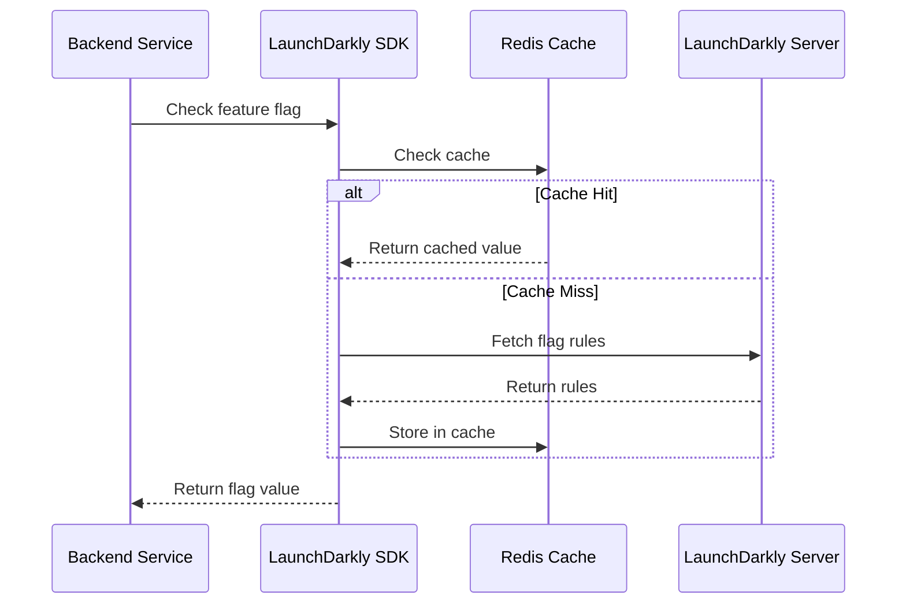
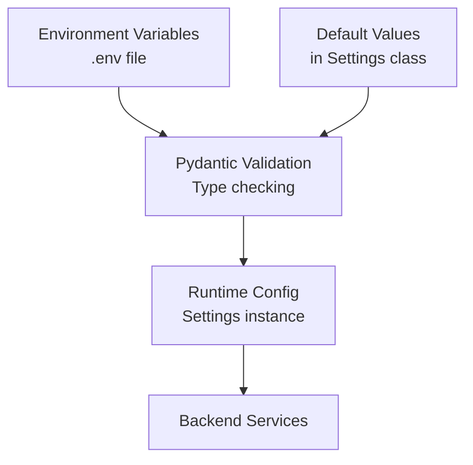
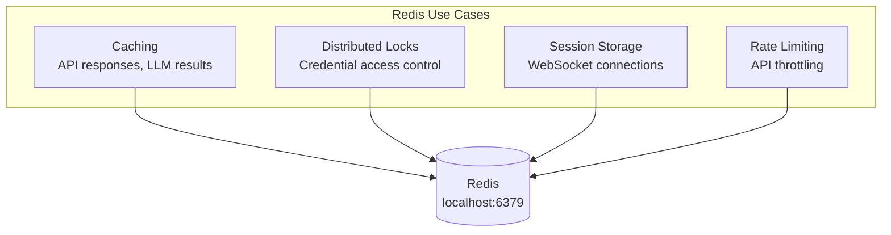
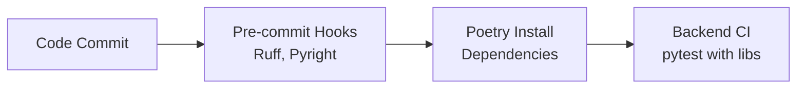
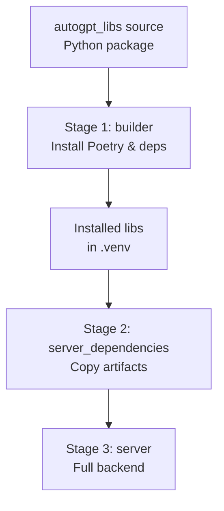

<!-- source: DeepWiki mcp.deepwiki.com · repo Significant-Gravitas/AutoGPT · page 3.4 Shared Libraries (autogpt-libs) · fetched 2026-10-26 -->

# Shared Libraries (autogpt-libs)

<details>
<summary>Relevant source files</summary>

The following files were used as context for generating this wiki page:

- [autogpt_platform/autogpt_libs/autogpt_libs/logging/config.py](autogpt_platform/autogpt_libs/autogpt_libs/logging/config.py)
- [autogpt_platform/autogpt_libs/poetry.lock](autogpt_platform/autogpt_libs/poetry.lock)
- [autogpt_platform/autogpt_libs/pyproject.toml](autogpt_platform/autogpt_libs/pyproject.toml)
- [autogpt_platform/backend/backend/blocks/code_extraction_block.py](autogpt_platform/backend/backend/blocks/code_extraction_block.py)
- [autogpt_platform/backend/backend/util/logging.py](autogpt_platform/backend/backend/util/logging.py)
- [autogpt_platform/backend/poetry.lock](autogpt_platform/backend/poetry.lock)
- [autogpt_platform/backend/pyproject.toml](autogpt_platform/backend/pyproject.toml)

</details>


The `autogpt-libs` package provides shared utilities and infrastructure components used across all AutoGPT Platform backend services. This library centralizes authentication, logging, feature flags, API key management, and configuration helpers to ensure consistency across microservices.

For information about the backend services that consume this library, see [Backend](#3.2). For development setup and contribution guidelines, see [Development Environment Setup](#5.1).

---

## Overview

The `autogpt-libs` package is a Python library located at [autogpt_platform/autogpt_libs/]() that serves as a foundation for all backend services in the AutoGPT Platform. It is installed as a path dependency in the backend's [autogpt_platform/backend/pyproject.toml:18]() configuration:

```toml
autogpt-libs = { path = "../autogpt_libs", develop = true }
```

This ensures that changes to the shared library are immediately reflected in dependent services during development.

**Sources:** [autogpt_platform/autogpt_libs/pyproject.toml:1-41](), [autogpt_platform/backend/pyproject.toml:18]()

---

## Package Architecture

The following diagram shows the relationship between `autogpt-libs` and the backend services:



**Sources:** [autogpt_platform/autogpt_libs/pyproject.toml:1-41](), [autogpt_platform/backend/pyproject.toml:126-146]()

---

## Core Dependencies

The library manages the following critical dependencies:

| Dependency | Version | Purpose |
|------------|---------|---------|
| `fastapi` | ^0.128.7 | Web framework base |
| `pydantic` | ^2.12.5 | Data validation and settings |
| `pyjwt[crypto]` | ^2.11.0 | JWT token handling |
| `supabase` | ^2.28.0 | Authentication provider |
| `redis` | ^6.2.0 | Caching and session storage |
| `launchdarkly-server-sdk` | ^9.15.0 | Feature flag management |
| `google-cloud-logging` | ^3.13.0 | Structured logging to GCP |
| `cryptography` | ^46.0 | Encryption primitives |
| `uvicorn` | ^0.40.0 | ASGI server |

**Sources:** [autogpt_platform/autogpt_libs/pyproject.toml:9-22]()

---

## Authentication System

### User Model

The authentication system provides a simple `User` dataclass that represents authenticated users across all services:



The `User` model is defined at [autogpt_platform/autogpt_libs/autogpt_libs/auth/models.py:8-22]():

- **`user_id`**: Unique identifier from Supabase (UUID format)
- **`email`**: User's email address
- **`phone_number`**: User's phone number (optional)
- **`role`**: User role for authorization (e.g., "admin", "user")

The `from_payload()` class method constructs a `User` instance from a decoded JWT payload, extracting the subject (`sub`) as the user ID.

**Default User Constants:**
- `DEFAULT_USER_ID = "3e53486c-cf57-477e-ba2a-cb02dc828e1a"`
- `DEFAULT_EMAIL = "default@example.com"`

These constants are used in development and testing environments where authentication may be bypassed.

**Sources:** [autogpt_platform/autogpt_libs/autogpt_libs/auth/models.py:1-23]()

### JWT Integration

The authentication system integrates with Supabase for JWT verification. Services use the `pyjwt` library with cryptographic support to validate tokens:

1. Extract JWT from `Authorization: Bearer <token>` header
2. Verify token signature using Supabase's public key
3. Decode payload and construct `User` object
4. Attach user to request context for authorization checks

**Sources:** [autogpt_platform/autogpt_libs/pyproject.toml:19]()

---

## API Key Management (Keysmith)

The `autogpt_libs.api_key.keysmith` module provides secure API key generation and verification for the platform's API key system. This is separate from JWT-based user authentication and is used for programmatic access.

### APIKeySmith Class



**Key Features:**

1. **Secure Key Generation** ([autogpt_platform/autogpt_libs/autogpt_libs/api_key/test_keysmith.py:6-15]()):
   - Generates random keys with a prefix (e.g., `agpt_`)
   - Stores only hash + salt, not the raw key
   - Returns head/tail fragments for display purposes

2. **Legacy Key Support** ([autogpt_platform/autogpt_libs/autogpt_libs/api_key/test_keysmith.py:29-40]()):
   - Supports old keys hashed with SHA256 only (no salt)
   - Allows migration by re-hashing with salt

3. **Secure Verification** ([autogpt_platform/autogpt_libs/autogpt_libs/api_key/test_keysmith.py:17-27]()):
   - Uses salted hashing (PBKDF2 or similar)
   - Prevents timing attacks
   - Validates key prefix before hashing

### Usage Pattern

```python
# Generate a new key
keysmith = APIKeySmith()
api_key = keysmith.generate_key()
# Store: api_key.hash, api_key.salt
# Display to user once: api_key.key
# Display publicly: api_key.head + "..." + api_key.tail

# Verify a key
is_valid = keysmith.verify_key(
    user_provided_key, 
    stored_hash, 
    stored_salt
)
```

**Sources:** [autogpt_platform/autogpt_libs/autogpt_libs/api_key/test_keysmith.py:1-80]()

---

## Logging and Observability

The library provides structured logging integration with Google Cloud Logging for centralized log aggregation across all backend services.

### Logging Components

```mermaid
graph LR
    SERVICE["Backend Service<br/>(REST/WS/Exec)"]
    LOGGING_CONFIG["autogpt_libs.logging.config.LoggingConfig"]
    CONFIGURE_LOGGING["autogpt_libs.logging.config.configure_logging()"]
    AGPTFormatter["autogpt_libs.logging.formatters.AGPTFormatter"]
    BelowLevelFilter["autogpt_libs.logging.filters.BelowLevelFilter"]
    StructuredLogHandler["google.cloud.logging.handlers.StructuredLogHandler"]
    RotatingFileHandler["logging.handlers.RotatingFileHandler"]
    
    SERVICE -- calls --> CONFIGURE_LOGGING
    CONFIGURE_LOGGING -- uses --> LOGGING_CONFIG
    
    subgraph "Console Logging (Non-Structured)"
        CONFIGURE_LOGGING -- creates --> STDOUT_HANDLER[logging.StreamHandler(sys.stdout)]
        CONFIGURE_LOGGING -- creates --> STDERR_HANDLER[logging.StreamHandler(sys.stderr)]
        STDOUT_HANDLER -- uses --> BelowLevelFilter
        STDOUT_HANDLER -- uses --> AGPTFormatter
        STDERR_HANDLER -- uses --> AGPTFormatter
    end
    
    subgraph "Cloud Logging (Structured)"
        CONFIGURE_LOGGING -- creates --> CLOUD_HANDLER[StructuredLogHandler(sys.stdout)]
    end
    
    subgraph "File Logging"
        CONFIGURE_LOGGING -- creates --> ACTIVITY_FILE_HANDLER[RotatingFileHandler(activity.log)]
        CONFIGURE_LOGGING -- creates --> DEBUG_FILE_HANDLER[RotatingFileHandler(debug.log)]
        CONFIGURE_LOGGING -- creates --> ERROR_FILE_HANDLER[RotatingFileHandler(error.log)]
        ACTIVITY_FILE_HANDLER -- uses --> AGPTFormatter
        DEBUG_FILE_HANDLER -- uses --> AGPTFormatter
        ERROR_FILE_HANDLER -- uses --> AGPTFormatter
    end
    
    CONFIGURE_LOGGING -- configures --> ROOT_LOGGER[logging.basicConfig()]
    
    ROOT_LOGGER -- outputs to --> STDOUT_HANDLER
    ROOT_LOGGER -- outputs to --> STDERR_HANDLER
    ROOT_LOGGER -- outputs to --> CLOUD_HANDLER
    ROOT_LOGGER -- outputs to --> ACTIVITY_FILE_HANDLER
    ROOT_LOGGER -- outputs to --> DEBUG_FILE_HANDLER
    ROOT_LOGGER -- outputs to --> ERROR_FILE_HANDLER
```

**Configuration Options:**
- Environment-based log level control (`LOG_LEVEL`) via `LoggingConfig` [autogpt_platform/autogpt_libs/autogpt_libs/logging/config.py:38-42]()
- Structured JSON output for GCP via `StructuredLogHandler` [autogpt_platform/autogpt_libs/autogpt_libs/logging/config.py:123-126]()
- Colorized console output for local development via `AGPTFormatter` [autogpt_platform/autogpt_libs/autogpt_libs/logging/config.py:105-107]()
- File logging with rotation via `RotatingFileHandler` [autogpt_platform/autogpt_libs/autogpt_libs/logging/config.py:138-144]()
- Global socket timeout and gRPC keepalive configuration [autogpt_platform/autogpt_libs/autogpt_libs/logging/config.py:17-23]()

The `configure_logging` function [autogpt_platform/autogpt_libs/autogpt_libs/logging/config.py:77-192]() is responsible for setting up the logging handlers and formatters based on the `LoggingConfig`. The backend service calls this function, optionally forcing cloud logging based on its own environment settings [autogpt_platform/backend/backend/util/logging.py:11-14]().

**Sources:** [autogpt_platform/autogpt_libs/pyproject.toml:15](), [autogpt_platform/autogpt_libs/pyproject.toml:11](), [autogpt_platform/autogpt_libs/autogpt_libs/logging/config.py:1-192](), [autogpt_platform/backend/backend/util/logging.py:8-14]()

---

## Feature Flags (LaunchDarkly)

The library integrates LaunchDarkly for runtime feature flag management, enabling gradual rollouts and A/B testing without deployments.

### Feature Flag Architecture



**Common Use Cases:**
1. **Gradual Feature Rollout**: Enable features for 10% of users, then 50%, then 100%
2. **Admin-Only Features**: Gate features behind role-based targeting
3. **Kill Switches**: Quickly disable problematic features in production
4. **A/B Testing**: Serve different block implementations to different user cohorts

**Integration Pattern:**
```python
from autogpt_libs.feature_flags import get_flag_value

if get_flag_value("enable-new-llm-provider", user_id):
    # Use new provider
else:
    # Use old provider
```

**Sources:** [autogpt_platform/autogpt_libs/pyproject.toml:16]()

---

## Configuration Management

The library uses Pydantic Settings for type-safe configuration management with environment variable support.

### Settings Hierarchy



**Key Features:**
1. **Type Safety**: All config values validated at startup
2. **Environment Overrides**: `.env` files override defaults
3. **Automatic Parsing**: Booleans, integers, lists parsed from strings
4. **Secrets Management**: Integration with encrypted environment variables

**Common Settings:**
- `DATABASE_URL`: PostgreSQL connection string
- `REDIS_HOST`, `REDIS_PORT`: Redis connection
- `SUPABASE_URL`, `SUPABASE_SERVICE_ROLE_KEY`: Authentication
- `ENCRYPTION_KEY`: For encrypting sensitive credentials
- `LAUNCHDARKLY_SDK_KEY`: Feature flag service

**Sources:** [autogpt_platform/autogpt_libs/pyproject.toml:17-18]()

---

## Redis Integration

The library provides Redis client configuration for caching and distributed locking across services:



The `redis` dependency ([autogpt_platform/autogpt_libs/pyproject.toml:20]()) provides:
- **Connection pooling** for efficient resource usage
- **Async support** via `redis.asyncio` for non-blocking operations
- **Serialization helpers** for complex Python objects
- **Expiring cache** support via `expiringdict` ([autogpt_platform/autogpt_libs/pyproject.toml:13]())

**Sources:** [autogpt_platform/autogpt_libs/pyproject.toml:13](), [autogpt_platform/autogpt_libs/pyproject.toml:20]()

---

## CI/CD Integration

The shared library has its own CI pipeline that runs independently and as part of backend CI:

### Pre-commit Hooks

The library enforces code quality through automated pre-commit checks:

| Hook | Purpose | Configuration |
|------|---------|---------------|
| `poetry-install-platform-libs` | Ensure dependencies are installed | [.pre-commit-config.yaml:36-43]() |
| `ruff-lint-platform-libs` | Fast linting | [.pre-commit-config.yaml:95-99]() |
| `ruff-format-platform-libs` | Code formatting | [.pre-commit-config.yaml:101-104]() |
| `pyright-platform-libs` | Type checking | [.pre-commit-config.yaml:197-204]() |

### CI Workflow



The backend CI workflow ([.github/workflows/platform-backend-ci.yml:1-226]()) includes:
1. **Dependency Installation**: Poetry installs libs first ([.github/workflows/platform-backend-ci.yml:134]())
2. **Linting**: Ruff checks libs code ([.github/workflows/platform-backend-ci.yml:186]())
3. **Testing**: Backend tests import and use libs ([.github/workflows/platform-backend-ci.yml:188-195]())

**Sources:** [.pre-commit-config.yaml:36-43](), [.pre-commit-config.yaml:95-104](), [.pre-commit-config.yaml:197-204](), [.github/workflows/platform-backend-ci.yml:1-226]()

---

## Docker Build Integration

The library is included in the backend's multi-stage Docker build:



**Build Steps:**
1. **Copy libs source** ([autogpt_platform/backend/Dockerfile:43]()):
   ```dockerfile
   COPY autogpt_platform/autogpt_libs /app/autogpt_platform/autogpt_libs
   ```

2. **Install with Poetry** ([autogpt_platform/backend/Dockerfile:46]()):
   ```dockerfile
   RUN poetry install --no-ansi --no-root
   ```

3. **Copy to runtime stage** ([autogpt_platform/backend/Dockerfile:86]()):
   ```dockerfile
   COPY autogpt_platform/autogpt_libs /app/autogpt_platform/autogpt_libs
   ```

**Sources:** [autogpt_platform/backend/Dockerfile:43-46](), [autogpt_platform/backend/Dockerfile:86]()

---

## Development Dependencies

The library includes dev dependencies for testing and type checking:

| Dependency | Version | Purpose |
|------------|---------|---------|
| `pyright` | ^1.1.408 | Static type checking |
| `pytest` | ^8.4.1 | Testing framework |
| `pytest-asyncio` | ^1.3.0 | Async test support |
| `pytest-mock` | ^3.15.1 | Mocking utilities |
| `pytest-cov` | ^7.1.0 | Coverage reporting |
| `ruff` | ^0.15.7 | Fast linting |

These tools ensure code quality and prevent regressions when modifying shared utilities.

**Sources:** [autogpt_platform/autogpt_libs/pyproject.toml:24-30]()

---

## Usage Examples

### Service Initialization Pattern

Backend services typically initialize the shared library components at startup:

```python
# In backend service initialization
from autogpt_libs.auth import get_current_user
from autogpt_libs.logging import setup_logging
from autogpt_libs.feature_flags import init_launchdarkly
from autogpt_libs.config import Settings

# Load settings
settings = Settings()

# Configure logging
setup_logging(settings.LOG_LEVEL)

# Initialize feature flags
init_launchdarkly(settings.LAUNCHDARKLY_SDK_KEY)

# Use in FastAPI dependency
@app.get("/protected")
async def protected_route(user: User = Depends(get_current_user)):
    return {"user_id": user.user_id}
```

### API Key Verification

```python
from autogpt_libs.api_key import APIKeySmith

keysmith = APIKeySmith()

# On API key creation
new_key = keysmith.generate_key()
# Store new_key.hash and new_key.salt in database
# Return new_key.key to user (only time they'll see it)

# On API request
is_valid = keysmith.verify_key(
    provided_key=request.headers["X-API-Key"],
    stored_hash=db_record.hash,
    stored_salt=db_record.salt
)
```

**Sources:** [autogpt_platform/autogpt_libs/autogpt_libs/api_key/test_keysmith.py:6-54](), [autogpt_platform/autogpt_libs/autogpt_libs/auth/models.py:8-22]()

---

