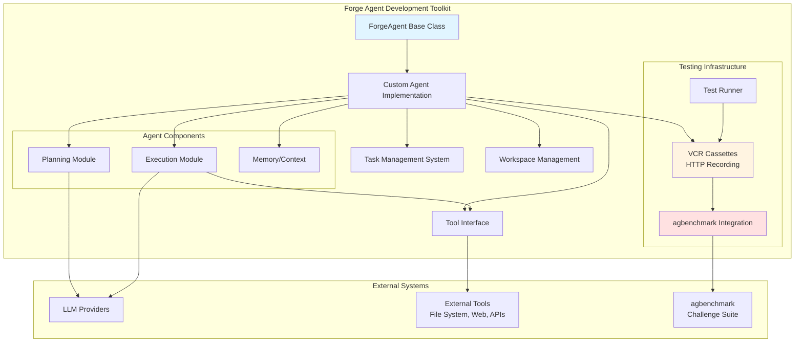
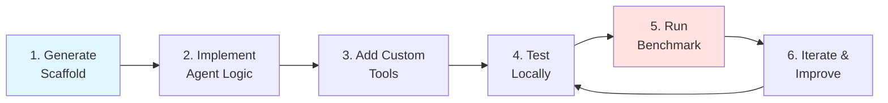
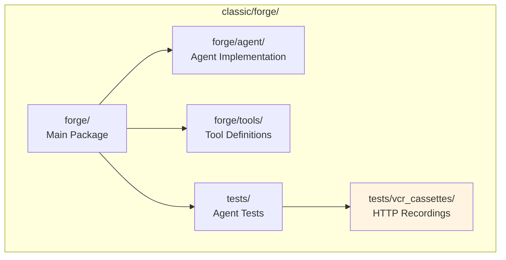
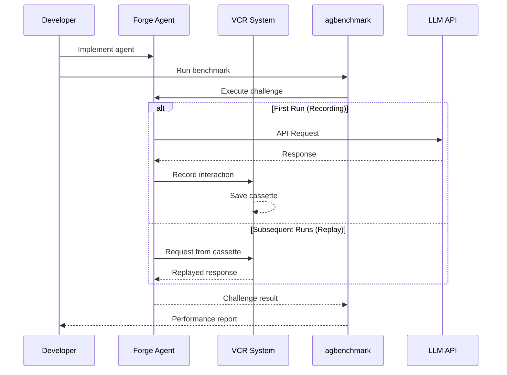
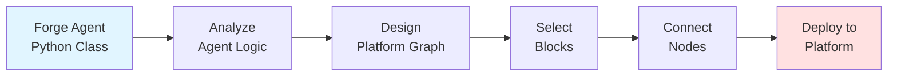

<!-- source: DeepWiki mcp.deepwiki.com · repo Significant-Gravitas/AutoGPT · page 4.1 Forge · fetched 2026-10-26 -->

# Forge

<details>
<summary>Relevant source files</summary>

The following files were used as context for generating this wiki page:

- [.github/ISSUE_TEMPLATE/1.bug.yml](.github/ISSUE_TEMPLATE/1.bug.yml)
- [.github/ISSUE_TEMPLATE/2.feature.yml](.github/ISSUE_TEMPLATE/2.feature.yml)
- [.github/PULL_REQUEST_TEMPLATE.md](.github/PULL_REQUEST_TEMPLATE.md)
- [.gitignore](.gitignore)
- [CODE_OF_CONDUCT.md](CODE_OF_CONDUCT.md)
- [CONTRIBUTING.md](CONTRIBUTING.md)
- [LICENSE](LICENSE)
- [README.md](README.md)
- [docs/content/code-of-conduct.md](docs/content/code-of-conduct.md)
- [docs/content/contributing.md](docs/content/contributing.md)

</details>


## Purpose and Scope

This document covers **Forge**, the Classic AutoGPT agent development toolkit located in the `classic/forge/` directory. Forge is part of the MIT-licensed Classic AutoGPT components and provides a framework for building standalone autonomous agents. This represents the original AutoGPT architecture, separate from the modern AutoGPT Platform.

For information about the modern Platform-based agent development, see [AutoGPT Platform](#3). For performance testing of Forge agents, see [Benchmark (agbenchmark)](#4.2). For running Forge commands, see [CLI](#4.3).

**Note**: Forge is considered legacy software. New agent development should use the AutoGPT Platform (section [AutoGPT Platform](#3)), which offers a visual graph builder, managed execution infrastructure, and extensive block library.

Sources: [README.md:132-133]()

---

## Overview

Forge is a toolkit for building autonomous agents that can execute tasks by breaking them down into steps, using tools, and making decisions. Unlike the Platform's graph-based architecture, Forge agents are implemented as Python classes with explicit control flow.

### Key Characteristics

| Aspect | Description |
|--------|-------------|
| **Location** | `classic/forge/` directory |
| **License** | MIT License |
| **Architecture** | Standalone agent framework with Python classes |
| **Development Model** | Code-first agent implementation |
| **Execution** | Local execution via CLI |
| **Testing** | agbenchmark integration with VCR cassettes |

Forge provides:
- **Agent Boilerplate**: Base classes and scaffolding for agent development
- **Tool System**: Interface for agents to interact with external systems
- **Task Management**: Structures for breaking down and tracking tasks
- **Testing Infrastructure**: Integration with agbenchmark and HTTP recording

Sources: [README.md:132-133](), [LICENSE:15-16]()

---

## Architecture

### High-Level Component Structure



**Diagram: Forge Architecture Overview**

Forge provides a base agent framework that developers extend to create custom agents. The system includes planning and execution modules that interact with LLMs, a tool system for external interactions, and a testing infrastructure integrated with agbenchmark.

Sources: [README.md:132-133]()

---

## Agent Development Workflow

### Typical Development Process



**Diagram: Agent Development Lifecycle**

### Agent Implementation Pattern

Forge agents typically follow this structure:

1.  **Extend Base Class**: Create a class that extends the Forge agent base
2.  **Implement Planning**: Define how the agent breaks down tasks into steps
3.  **Implement Execution**: Define how each step is executed using available tools
4.  **Add Tools**: Register tools the agent can use (file operations, web requests, etc.)
5.  **Configure Memory**: Set up context and memory management for multi-step tasks

### Code Organization



**Diagram: Forge Directory Structure**

The `classic/forge/` directory contains the core framework, agent implementations, tool definitions, and test infrastructure including VCR cassettes for HTTP recording.

Sources: [README.md:132-133]()

---

## Testing Infrastructure

### VCR Cassettes for Reproducible Testing

Forge uses **VCR (Video Cassette Recorder)** for recording and replaying HTTP interactions during tests. This enables:

-   **Reproducible Tests**: Tests replay recorded HTTP responses without live API calls
-   **Faster Test Execution**: No network latency or API rate limits during testing
-   **Cost Reduction**: Avoid LLM API costs during test runs
-   **Benchmark Compliance**: Ensure consistent behavior for agbenchmark evaluation

The VCR cassettes are stored in a separate Git submodule:

```
classic/forge/tests/vcr_cassettes (submodule)
└── Repository: github.com/Significant-Gravitas/Auto-GPT-test-cassettes
```

This submodule structure allows the cassette data to be versioned independently from the main codebase.

### Integration with agbenchmark

Forge agents are designed to integrate with the agbenchmark system (see [Benchmark (agbenchmark)](#4.2)), which provides:

-   **Standardized Challenges**: A suite of tasks to evaluate agent capabilities
-   **Performance Metrics**: Scoring based on task completion, efficiency, and resource usage
-   **Regression Testing**: Ensure improvements don't break existing capabilities
-   **Comparative Analysis**: Compare different agent implementations



**Diagram: Testing Workflow with VCR and agbenchmark**

Sources: [.gitignore:163-167]()

---

## Relationship to AutoGPT Platform

### Forge vs Platform Comparison

| Feature | Forge (Classic) | AutoGPT Platform |
|---------|-----------------|------------------|
| **Development Model** | Code-first Python classes | Visual graph builder |
| **License** | MIT | Polyform Shield |
| **Execution** | Local CLI | Managed cloud service |
| **Architecture** | Monolithic agent | Composable blocks |
| **Deployment** | Self-hosted | Platform-hosted |
| **Testing** | agbenchmark + VCR | Built-in execution logs |
| **LLM Integration** | Direct API calls | Unified `llm_call` abstraction |
| **Tool System** | Custom implementations | Pre-built blocks library |

### Migration Path

Developers using Forge who want to migrate to the Platform should:

1.  **Understand Block Architecture**: Study the Platform's block system (see [Block System](#3.2.6))
2.  **Map Agent Logic to Graphs**: Convert agent planning and execution logic into connected blocks
3.  **Leverage AI Blocks**: Use `SmartDecisionMakerBlock` for agentic tool orchestration (see [AI Blocks](#3.2.8))
4.  **Utilize Platform Services**: Take advantage of managed execution, credentials, and scheduling



**Diagram: Migration from Forge to Platform**

Sources: [README.md:129-133](), [LICENSE:3-4]()

---

## CLI Integration

Forge agents are executed through the unified CLI system documented in [CLI](#4.3). The CLI provides commands for:

-   **Agent Creation**: Scaffolding new agent projects
-   **Agent Execution**: Running agents with specific tasks
-   **Benchmark Execution**: Running agbenchmark against agents
-   **Development Tools**: Utilities for agent development

For detailed CLI usage, see the [CLI](#4.3) documentation.

---

## Future of Forge

Forge represents the original AutoGPT architecture and is maintained for:

-   **Legacy Support**: Existing agents and integrations continue to function
-   **Benchmark Standards**: agbenchmark provides a standard evaluation framework
-   **MIT License**: Permissive licensing for educational and research purposes
-   **Historical Reference**: Documents the evolution of AutoGPT's architecture

**Active development has shifted to the AutoGPT Platform**. New users should start with the Platform's visual builder and extensive block library rather than implementing Forge agents from scratch.

For modern agent development, see:
-   [AutoGPT Platform](#3)
-   [Agent Builder (Flow Editor)](#3.1.1)
-   [Block System](#3.2.6)
-   [Creating Custom Blocks](#5.6)

Sources: [README.md:129-133](), [LICENSE:15-16]()

---

