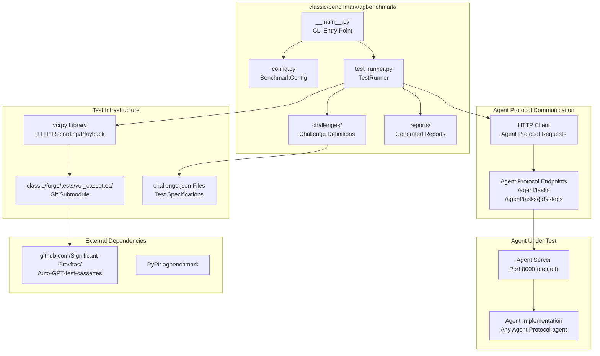
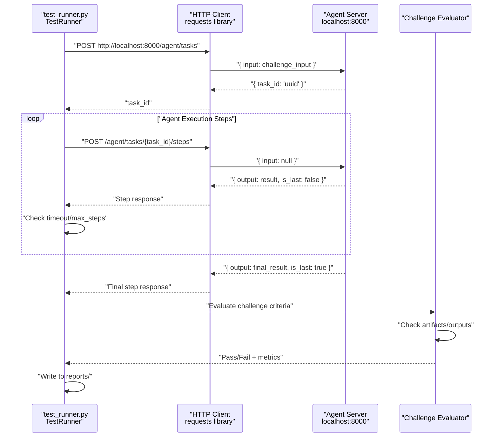
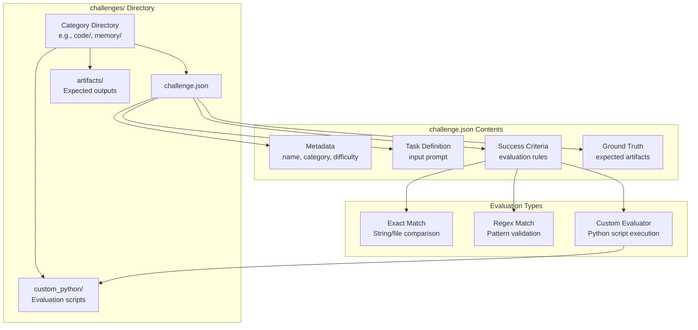
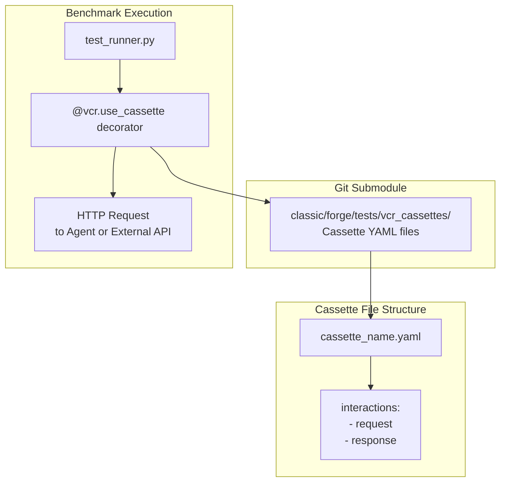

<!-- source: DeepWiki mcp.deepwiki.com · repo Significant-Gravitas/AutoGPT · page 4.2 Benchmark (agbenchmark) · fetched 2026-10-26 -->

# Benchmark (agbenchmark)

Relevant source files

The following files were used as context for generating this wiki page:

- [.github/ISSUE_TEMPLATE/1.bug.yml](.github/ISSUE_TEMPLATE/1.bug.yml)
- [.github/ISSUE_TEMPLATE/2.feature.yml](.github/ISSUE_TEMPLATE/2.feature.yml)
- [.github/PULL_REQUEST_TEMPLATE.md](.github/PULL_REQUEST_TEMPLATE.md)
- [.gitignore](.gitignore)
- [CODE_OF_CONDUCT.md](CODE_OF_CONDUCT.md)
- [CONTRIBUTING.md](CONTRIBUTING.md)
- [LICENSE](LICENSE)
- [README.md](README.md)
- [docs/content/code-of-conduct.md](docs/content/code-of-conduct.md)
- [docs/content/contributing.md](docs/content/contributing.md)

The `agbenchmark` package is a performance testing framework for evaluating autonomous AI agents that implement the Agent Protocol standard. Located in `classic/benchmark/agbenchmark/`, it provides automated, reproducible test execution across categorized challenges with detailed reporting capabilities.

The benchmark is distributed as a standalone PyPI package (`agbenchmark`) and can test any Agent Protocol-compliant agent, both within and outside the AutoGPT ecosystem. It is licensed under the MIT License [LICENSE:13-16]().

For information about building agents that can be tested with the benchmark, see [Forge](#4.1). For details about the CLI interface used to run benchmarks, see [CLI](#4.3).

**Sources:** [README.md:132-133](), [LICENSE:13-16]()

## Architecture Overview

The benchmark operates as a standalone testing harness that communicates with agents via HTTP requests to Agent Protocol endpoints. The framework executes challenge definitions, manages test data through VCR cassettes, and generates performance reports.

### System Architecture

**Sources:** [LICENSE:13-16](), [README.md:132-133]()

## Directory Structure

The benchmark package is organized as follows:

| Path | Purpose |
|------|---------|
| `classic/benchmark/agbenchmark/__main__.py` | CLI entry point and argument parsing |
| `classic/benchmark/agbenchmark/config.py` | Configuration management and `BenchmarkConfig` class |
| `classic/benchmark/agbenchmark/test_runner.py` | Core test execution orchestration |
| `classic/benchmark/agbenchmark/challenges/` | Challenge definition files (JSON/YAML) |
| `classic/benchmark/agbenchmark/reports/` | Generated test reports and analytics [classic/benchmark/agbenchmark/reports/]() |
| `classic/forge/tests/vcr_cassettes/` | VCR cassette recordings (Git submodule) |

**Sources:** [.gitignore:163-167](), [LICENSE:13-16]()

## Agent Protocol Integration

The benchmark communicates with agents using the Agent Protocol HTTP API. The framework makes HTTP requests to standard Agent Protocol endpoints and evaluates responses against challenge success criteria.

### Protocol Communication Flow

### Agent Protocol Endpoints Used

| Endpoint | Method | Purpose |
|----------|--------|---------|
| `/agent/tasks` | POST | Create new task with challenge input |
| `/agent/tasks/{task_id}/steps` | POST | Execute next step in task |
| `/agent/tasks/{task_id}` | GET | Retrieve task status and artifacts |

**Sources:** [README.md:132-133](), [.github/ISSUE_TEMPLATE/1.bug.yml:117]()

## Challenge System

Challenges are defined as JSON or YAML files in `classic/benchmark/agbenchmark/challenges/`. Each challenge specifies input data, success criteria, and evaluation metrics.

### Challenge Definition Structure

### Challenge Categories

Challenges are organized by capability type [github/ISSUE_TEMPLATE/1.bug.yml:110-121]():

| Category | Description |
|----------|-------------|
| **Installation** | Setup and environment verification |
| **Memory** | Information retention across steps |
| **Performance** | Speed and efficiency metrics |
| **Prompt** | LLM prompt adherence |
| **Commands** | Tool and command execution |
| **Challenges** | Complex multi-step problem solving |

### Challenge Metrics

Each challenge execution tracks:

- **Success/Failure** - Boolean pass/fail status
- **Execution Time** - Total seconds from task creation to completion
- **Step Count** - Number of Agent Protocol steps executed
- **Artifact Validation** - File outputs, console logs, and API responses

**Sources:** [.github/ISSUE_TEMPLATE/1.bug.yml:110-121](), [.gitignore:163-167]()

## CLI Usage

The benchmark is invoked via the unified CLI wrapper `./run` from the repository root, which delegates to the `agbenchmark` package.

### Common Command Patterns

| Command | Description |
|---------|-------------|
| `./run benchmark` | Run all challenges against default agent |
| `./run benchmark --category code` | Run only challenges in specific category |
| `./run benchmark --test TestName` | Run specific challenge by name |
| `./run benchmark --mock` | Run with VCR cassette playback |

**Sources:** [README.md:132-133](), [.gitignore:163-167]()

## VCR Cassette System

The benchmark uses `vcrpy` to record and replay HTTP interactions, enabling deterministic test execution without requiring live external services. Cassettes are stored in a Git submodule.

### VCR Architecture

### Benefits of VCR Cassettes

- **Deterministic Testing** - Identical responses on every run.
- **CI/CD Compatibility** - No external API keys required for test execution.
- **Performance** - Fast playback without network latency.

**Sources:** [.gitignore:163-167](), [README.md:132-133]()

## Reporting and Analytics

The Benchmark system generates comprehensive reports that provide detailed insights into agent performance.

- **Reports Directory**: Results are written to `classic/benchmark/agbenchmark/reports/` [.gitignore:163]().
- **Data Persistence**: Includes performance metrics, success rates, and execution traces.
- **Historical Tracking**: Allows for comparative analysis across different agent versions or configurations.

**Sources:** [.gitignore:163-167]()

---

