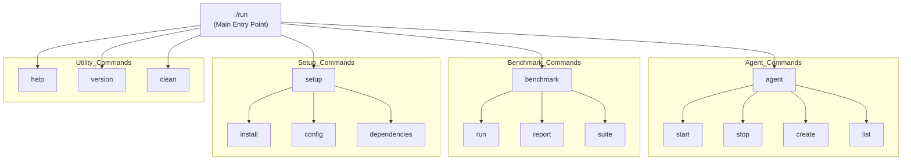
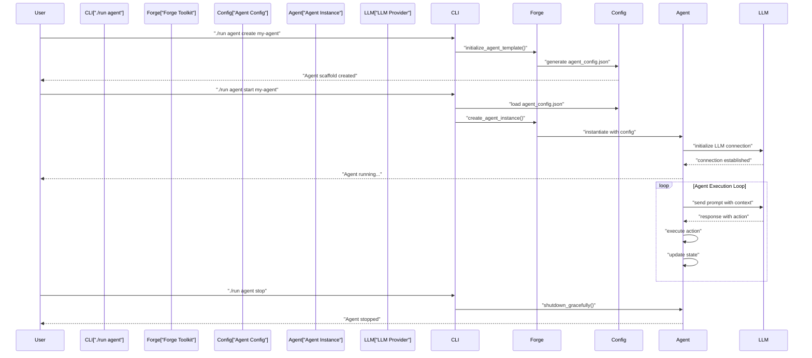
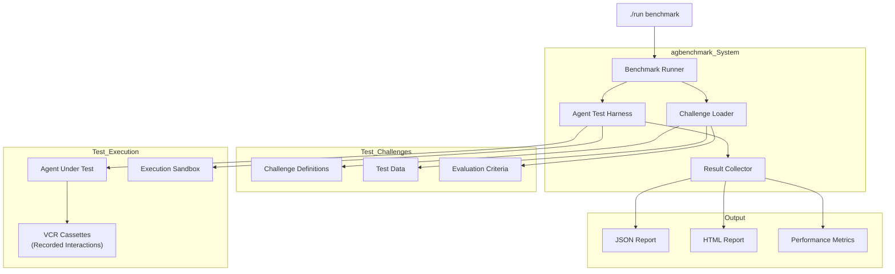
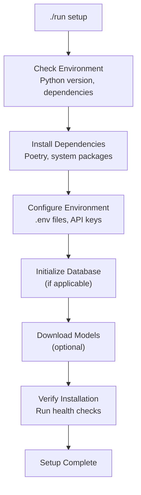
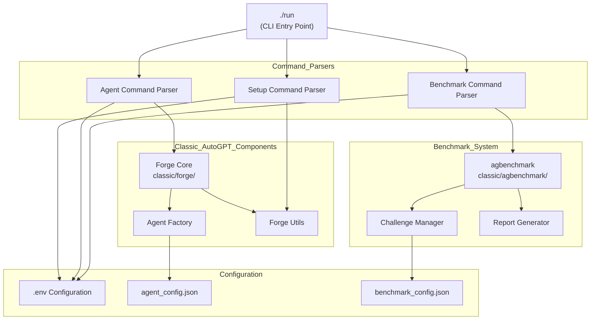

<!-- source: DeepWiki mcp.deepwiki.com · repo Significant-Gravitas/AutoGPT · page 4.3 CLI · fetched 2026-10-26 -->

# CLI

<details>
<summary>Relevant source files</summary>

The following files were used as context for generating this wiki page:

- [.github/ISSUE_TEMPLATE/1.bug.yml](.github/ISSUE_TEMPLATE/1.bug.yml)
- [.github/ISSUE_TEMPLATE/2.feature.yml](.github/ISSUE_TEMPLATE/2.feature.yml)
- [.github/PULL_REQUEST_TEMPLATE.md](.github/PULL_REQUEST_TEMPLATE.md)
- [.gitignore](.gitignore)
- [CODE_OF_CONDUCT.md](CODE_OF_CONDUCT.md)
- [CONTRIBUTING.md](CONTRIBUTING.md)
- [LICENSE](LICENSE)
- [README.md](README.md)
- [docs/content/code-of-conduct.md](docs/content/code-of-conduct.md)
- [docs/content/contributing.md](docs/content/contributing.md)

</details>


This document describes the unified command-line interface (CLI) for Classic AutoGPT components. The CLI provides a single entry point (`./run`) for executing agent commands, running benchmarks, and performing setup tasks. This interface is part of the MIT-licensed Classic AutoGPT system, which operates independently from the AutoGPT Platform [README.md:132-133]().

For information about the AutoGPT Platform's REST and WebSocket APIs, see [API Reference](#7). For details on the Forge agent toolkit, see [Forge](#4.1). For benchmark system documentation, see [Benchmark (agbenchmark)](#4.2).

**Scope**: This document covers the CLI command structure, common workflows, and how the CLI integrates with underlying Classic AutoGPT components.

## Overview

The Classic AutoGPT CLI serves as the primary interface for developers working with the original autonomous agent system [README.md:132-133](). It consolidates multiple command domains into a single executable script, providing commands for:

- Managing and running autonomous agents
- Executing benchmark tests against agents
- Setting up development environments
- Managing agent configurations and dependencies

The CLI is located at the repository root and is invoked via `./run` followed by command-specific arguments.

## Command Structure

The CLI follows a hierarchical command structure with top-level command groups and subcommands within each group.

### CLI Command Hierarchy



Sources: `README.md`, `LICENSE:13-17`

## Agent Commands

Agent commands interact with the Forge agent development toolkit, allowing developers to create, configure, and execute autonomous agents.

### Agent Command Flow



Sources: `LICENSE:15`, `CONTRIBUTING.md:28`

### Common Agent Command Patterns

| Command | Purpose | Typical Usage |
|---------|---------|---------------|
| `./run agent create <name>` | Initialize new agent from template | Create agent scaffold with default configuration |
| `./run agent start <name>` | Launch agent execution | Start autonomous agent with specified configuration |
| `./run agent stop` | Halt running agent | Gracefully shut down agent and save state |
| `./run agent list` | Show available agents | Display all configured agents in workspace |
| `./run agent config <name>` | Edit agent configuration | Modify agent parameters, LLM settings, tool access |

Sources: `LICENSE:14-15`

## Benchmark Commands

Benchmark commands interface with the `agbenchmark` system for performance testing and validation of agent capabilities [LICENSE:16]().

### Benchmark Execution Architecture



Sources: `LICENSE:16`, `.gitignore:163-167`

### Benchmark Command Reference

| Command | Purpose | Example |
|---------|---------|---------|
| `./run benchmark run` | Execute full benchmark suite | Run all challenges against configured agent |
| `./run benchmark run --category <cat>` | Run specific category | Execute only challenges in category (e.g., coding, retrieval) |
| `./run benchmark run --test <test>` | Run single test | Execute specific challenge by name |
| `./run benchmark report` | Generate test report | Create HTML/JSON report from last benchmark run |
| `./run benchmark suite --list` | List available suites | Display all challenge categories and tests |

Sources: `LICENSE:16`, `.gitignore:163-167`

## Setup Commands

Setup commands handle environment initialization, dependency installation, and configuration management for Classic AutoGPT development.

### Setup Workflow



Sources: `README.md:29-53`

### Setup Command Details

| Command | Function | Notes |
|---------|----------|-------|
| `./run setup install` | Install all dependencies | Uses Poetry for Python package management |
| `./run setup config` | Interactive configuration | Prompts for API keys, model selection, workspace paths |
| `./run setup dependencies` | Check and install system deps | Verifies Docker, Node.js, and other requirements |
| `./run setup --check` | Validate current setup | Runs health checks without making changes |

Sources: `README.md:41-47`, `CONTRIBUTING.md:19-21`

## CLI Implementation Architecture

The CLI integrates with multiple Classic AutoGPT subsystems, serving as a unified interface layer.

### CLI to Subsystem Mapping



Sources: `LICENSE:13-17`, `.gitignore:163-167`

## CLI Configuration

The CLI relies on environment variables and configuration files to operate.

### Configuration File Hierarchy

| Configuration Type | Location | Purpose |
|-------------------|----------|---------|
| Environment Variables | `.env` (root directory) | Global settings, API keys, service URLs [README.md:22]() |
| Agent Configuration | `classic/original_autogpt/keys.py` | Legacy API key storage [.gitignore:3]() |
| Benchmark Reports | `classic/benchmark/agbenchmark/reports/` | Benchmark execution history [.gitignore:163]() |
| Workspace Configuration | `auto_gpt_workspace/` directory | Agent working directory, persistent data [.gitignore:5]() |

### Key Environment Variables

| Variable | Purpose | Example |
|----------|---------|---------|
| `OPENAI_API_KEY` | OpenAI API authentication | `sk-...` |
| `ANTHROPIC_API_KEY` | Anthropic API authentication | `sk-ant-...` |
| `SMART_LLM` | Default LLM model selection | `gpt-4` [.github/ISSUE_TEMPLATE/1.bug.yml:93]() |
| `LOG_LEVEL` | Logging verbosity | `DEBUG` |

Sources: `.github/ISSUE_TEMPLATE/1.bug.yml:93-100`, `.gitignore:8-10`

## Relationship to AutoGPT Platform

The Classic AutoGPT CLI operates independently from the AutoGPT Platform's web-based interface and API. Key differences:

| Aspect | Classic CLI | AutoGPT Platform |
|--------|-------------|------------------|
| License | MIT [LICENSE:13]() | Polyform Shield [LICENSE:9]() |
| Interface | Command-line | Web browser [README.md:82]() |
| Agent Definition | Code + JSON config | Visual graph editor [README.md:84]() |
| Execution Model | Local process | Distributed microservices [README.md:100]() |

Sources: `LICENSE:1-19`, `README.md:80-106`

## Logging and Debugging

### Logging Configuration

The CLI respects the `LOG_LEVEL` environment variable and supports output to the `logs/` directory [.gitignore:17]().

```bash
# Enable debug logging
LOG_LEVEL=DEBUG ./run agent start my-agent

# View error logs
cat logs/error.log
```

Sources: `.github/ISSUE_TEMPLATE/1.bug.yml:151`, `.gitignore:17-18`

---

