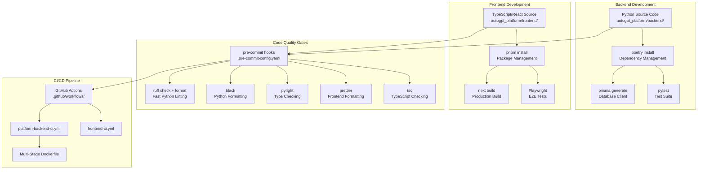
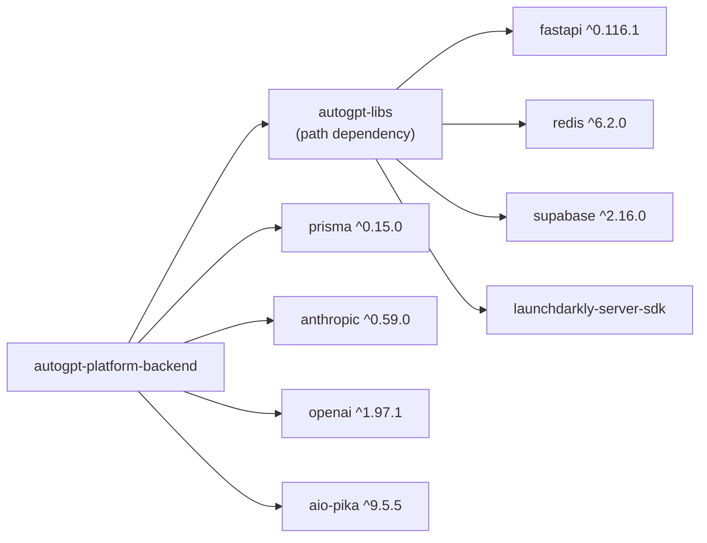
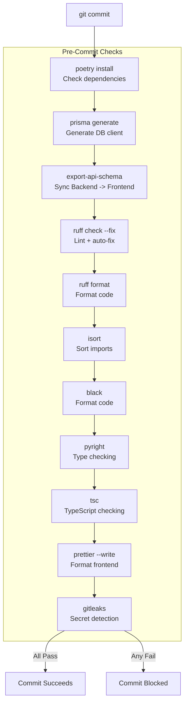

<!-- source: DeepWiki mcp.deepwiki.com · repo Significant-Gravitas/AutoGPT · page 5 Development · fetched 2026-10-26 -->

# Development

<details>
<summary>Relevant source files</summary>

The following files were used as context for generating this wiki page:

- [.claude/skills/pr-address/SKILL.md](.claude/skills/pr-address/SKILL.md)
- [.claude/skills/pr-review/SKILL.md](.claude/skills/pr-review/SKILL.md)
- [.gitleaks.toml](.gitleaks.toml)
- [.pre-commit-config.yaml](.pre-commit-config.yaml)
- [.secrets.baseline](.secrets.baseline)
- [CLAUDE.md](CLAUDE.md)
- [autogpt_platform/AGENTS.md](autogpt_platform/AGENTS.md)
- [autogpt_platform/CLAUDE.md](autogpt_platform/CLAUDE.md)
- [autogpt_platform/backend/AGENTS.md](autogpt_platform/backend/AGENTS.md)
- [autogpt_platform/backend/CLAUDE.md](autogpt_platform/backend/CLAUDE.md)
- [autogpt_platform/backend/backend/blocks/block_cost_tracking_test.py](autogpt_platform/backend/backend/blocks/block_cost_tracking_test.py)
- [autogpt_platform/backend/backend/blocks/replicate/replicate_block.py](autogpt_platform/backend/backend/blocks/replicate/replicate_block.py)
- [autogpt_platform/backend/backend/blocks/replicate/replicate_block_cost_test.py](autogpt_platform/backend/backend/blocks/replicate/replicate_block_cost_test.py)
- [autogpt_platform/backend/backend/blocks/text_to_speech_block.py](autogpt_platform/backend/backend/blocks/text_to_speech_block.py)
- [autogpt_platform/backend/backend/copilot/tools/helpers.py](autogpt_platform/backend/backend/copilot/tools/helpers.py)
- [autogpt_platform/backend/backend/copilot/tools/helpers_test.py](autogpt_platform/backend/backend/copilot/tools/helpers_test.py)
- [autogpt_platform/backend/backend/data/block_cost_config_test.py](autogpt_platform/backend/backend/data/block_cost_config_test.py)
- [autogpt_platform/backend/backend/executor/block_usage_cost_test.py](autogpt_platform/backend/backend/executor/block_usage_cost_test.py)
- [autogpt_platform/frontend/CLAUDE.md](autogpt_platform/frontend/CLAUDE.md)
- [autogpt_platform/frontend/src/tests/AGENTS.md](autogpt_platform/frontend/src/tests/AGENTS.md)
- [autogpt_platform/frontend/src/tests/CLAUDE.md](autogpt_platform/frontend/src/tests/CLAUDE.md)
- [docs/platform/workspace-media-architecture.md](docs/platform/workspace-media-architecture.md)

</details>


This page provides comprehensive guidance for developers contributing to AutoGPT. It covers development environment setup, code quality standards, testing infrastructure, and contribution workflows. The AutoGPT repository uses modern development tools including Poetry for Python dependency management, pnpm for Node.js packages, pre-commit hooks for code quality, and GitHub Actions for CI/CD.

The development process emphasizes code quality through automated linting, type checking, and testing. Contributors should familiarize themselves with the pre-commit hooks and CI workflows before submitting changes.

## Overview of Development Tools

The AutoGPT project uses distinct toolchains for different components:

| Component | Package Manager | Type Checking | Linting | Testing |
|-----------|----------------|---------------|---------|---------|
| **Platform Backend** | Poetry 2.1.1 | Pyright | Ruff, Black, isort | pytest |
| **Platform Frontend** | pnpm | TypeScript | ESLint, Prettier | Playwright |
| **Shared Libs** | Poetry | Pyright | Ruff | pytest |
| **Classic Components** | Poetry | Pyright | Flake8, Black, isort | pytest |

Sources: [autogpt_platform/backend/pyproject.toml:44](), [.pre-commit-config.yaml:1-279]()

## Development Environment Architecture

**Diagram: Development Tool Chain**


Sources: [autogpt_platform/backend/pyproject.toml:1-144](), [.pre-commit-config.yaml:1-279]()

## Dependency Management

### Backend: Poetry Configuration

The Platform backend uses Poetry 2.1.1 for dependency management. The `pyproject.toml` defines package metadata, dependencies, and development tools.

**Key Poetry Configuration:**

| Setting | Value | Purpose |
|---------|-------|---------|
| Python Version | `>=3.10,<3.14` | Python 3.10-3.13 supported |
| Poetry Version | `2.1.1` | Locked version for reproducibility |
| Package Name | `autogpt-platform-backend` | PyPI package identifier |
| Build System | `poetry-core` | Build backend |

**Poetry Scripts** (defined in [autogpt_platform/backend/pyproject.toml:106-121]()):

```
app      = "backend.app:main"           # Main application entry
rest     = "backend.rest:main"          # REST API server
db       = "backend.db:main"            # Database manager
ws       = "backend.ws:main"            # WebSocket server
executor = "backend.exec:main"          # Execution processor
scheduler = "backend.scheduler:main"    # Scheduler service
notification = "backend.notification:main"  # Notification manager
lint     = "linter:lint"                # Run linting
format   = "linter:format"              # Format code
test     = "run_tests:test"             # Run test suite
```

**Key Dependencies:**

- **FastAPI** (`^0.116.1`): REST API framework
- **Prisma** (`^0.15.0`): Database ORM
- **Pydantic** (`^2.11.7`): Data validation
- **Redis** (`^6.2.0`): Caching and locks
- **aio-pika** (`^9.5.5`): RabbitMQ client

Sources: [autogpt_platform/backend/pyproject.toml:1-144](), [autogpt_platform/backend/poetry.lock:1-100]()

### Shared Libraries: autogpt-libs

The `autogpt_libs` package is a path dependency shared between backend services. It provides common utilities for authentication, logging, and feature flags.

**Diagram: Dependency Graph**


Sources: [autogpt_platform/backend/pyproject.toml:17](), [autogpt_platform/autogpt_libs/pyproject.toml:1-41]()

## Pre-Commit Hooks

The repository uses pre-commit hooks to enforce code quality standards before commits. All hooks are defined in [.pre-commit-config.yaml:1-279]().

**Diagram: Pre-Commit Hook Flow**


### Hook Categories

**1. Dependency Management** ([.pre-commit-config.yaml:36-107]()):
- `poetry-install-platform-backend`: Ensures backend dependencies are up-to-date.
- `pnpm-install-platform-frontend`: Manages frontend dependencies via pnpm.
- `prisma-generate`: Regenerates Prisma client and stubs when `schema.prisma` changes.

**2. Python Linting & Formatting** ([.pre-commit-config.yaml:164-210]()):
- **Ruff**: Fast linting and formatting for `autogpt_platform/backend/` and `autogpt_libs/`.
- **isort**: Enforces consistent import sorting.
- **Black**: Standardized Python code formatting.

**3. Type Checking & Frontend Quality** ([.pre-commit-config.yaml:223-268]()):
- **Pyright**: Static type checking for backend Python code.
- **Prettier**: Formatting for frontend assets (TS, JSX, JSON).
- **ESLint**: Linting for frontend TypeScript code.

**4. Security** ([.pre-commit-config.yaml:20-35]()):
- **detect-secrets**: Scans for high-entropy strings using a baseline [.secrets.baseline:1-143]().
- **gitleaks**: Scans for leaked API keys and credentials.

Sources: [.pre-commit-config.yaml:1-279](), [.secrets.baseline:1-143]()

## Claude Code Agent Automation

AutoGPT uses a fleet of Claude Code agents to automate development tasks. These are managed via skills in the `.claude/skills` directory.

- **Orchestration**: The `orchestrate` skill manages multiple agents in `tmux` sessions.
- **PR Management**: Specialized skills exist for reviewing (`pr-review`), addressing feedback (`pr-address`), and polishing PRs.
- **Worktree System**: Agents operate in isolated git worktrees to avoid interfering with local development.

For details, see [Claude Code Agent Automation](#5.7).

Sources: [.claude/skills/pr-address/SKILL.md:1-112](), [.claude/skills/pr-review/SKILL.md:1-87]()

## Development Child Pages

For deep technical details on specific development areas, refer to the following child pages:

- [Development Environment Setup](#5.1) — Local installation, Poetry/pnpm, and IDE configuration.
- [Code Quality Standards](#5.2) — Linting rules, formatting standards, and type checking.
- [Contributing Guidelines](#5.3) — PR requirements, branching strategy, and conventional commits.
- [CI/CD Workflows](#5.4) — GitHub Actions, Docker builds, and deployment pipelines.
- [Testing](#5.5) — Pytest, Playwright, VCR cassettes, and test data management.
- [Creating Custom Blocks](#5.6) — Tutorial on extending the `Block` base class and defining schemas.
- [Claude Code Agent Automation](#5.7) — Documentation for `.claude/skills` and agent orchestration.

Sources: [autogpt_platform/backend/backend/blocks/_base.py:7-13](), [autogpt_platform/backend/backend/blocks/replicate/replicate_block.py:38-110]()

---

