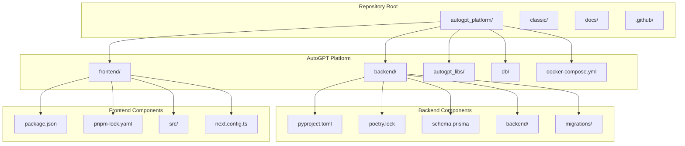
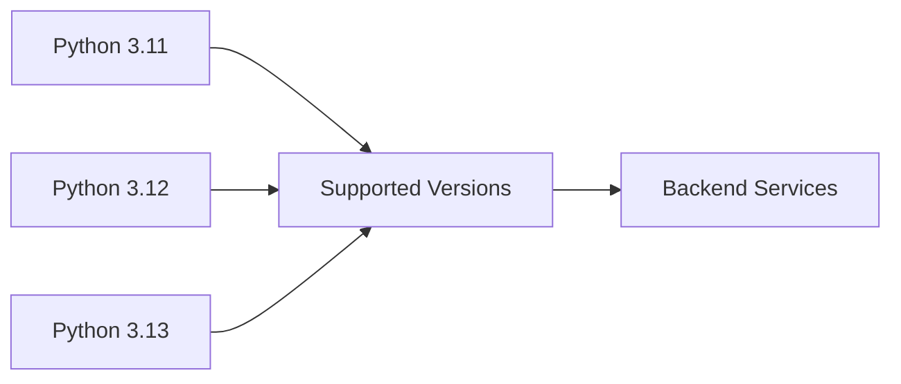
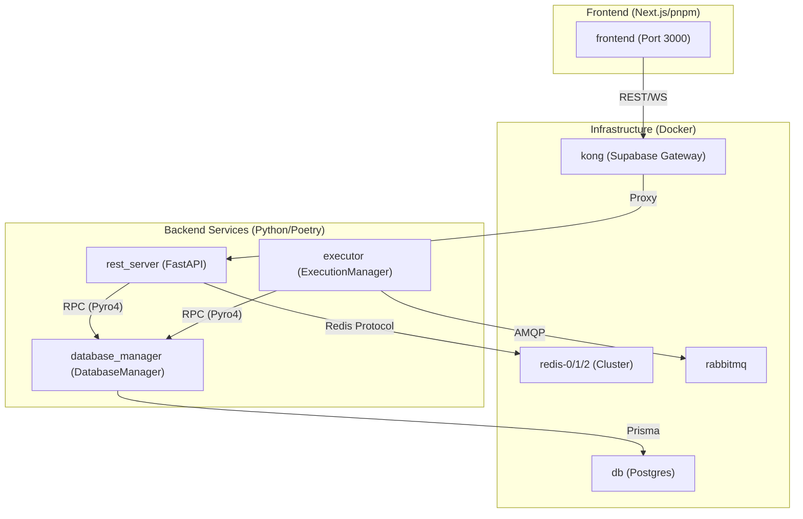

<!-- source: DeepWiki mcp.deepwiki.com · repo Significant-Gravitas/AutoGPT · page 5.1 Development Environment Setup · fetched 2026-10-26 -->

# Development Environment Setup

<details>
<summary>Relevant source files</summary>

The following files were used as context for generating this wiki page:

- [.claude/skills/pr-address/SKILL.md](.claude/skills/pr-address/SKILL.md)
- [.claude/skills/pr-review/SKILL.md](.claude/skills/pr-review/SKILL.md)
- [.dockerignore](.dockerignore)
- [.github/workflows/platform-backend-ci.yml](.github/workflows/platform-backend-ci.yml)
- [.github/workflows/platform-frontend-ci.yml](.github/workflows/platform-frontend-ci.yml)
- [.github/workflows/platform-fullstack-ci.yml](.github/workflows/platform-fullstack-ci.yml)
- [CLAUDE.md](CLAUDE.md)
- [autogpt_platform/AGENTS.md](autogpt_platform/AGENTS.md)
- [autogpt_platform/CLAUDE.md](autogpt_platform/CLAUDE.md)
- [autogpt_platform/README.md](autogpt_platform/README.md)
- [autogpt_platform/backend/.env.default](autogpt_platform/backend/.env.default)
- [autogpt_platform/backend/AGENTS.md](autogpt_platform/backend/AGENTS.md)
- [autogpt_platform/backend/CLAUDE.md](autogpt_platform/backend/CLAUDE.md)
- [autogpt_platform/backend/Dockerfile](autogpt_platform/backend/Dockerfile)
- [autogpt_platform/backend/README.advanced.md](autogpt_platform/backend/README.advanced.md)
- [autogpt_platform/backend/README.md](autogpt_platform/backend/README.md)
- [autogpt_platform/backend/backend/copilot/tools/agent_browser.py](autogpt_platform/backend/backend/copilot/tools/agent_browser.py)
- [autogpt_platform/backend/backend/copilot/tools/agent_browser_integration_test.py](autogpt_platform/backend/backend/copilot/tools/agent_browser_integration_test.py)
- [autogpt_platform/backend/backend/copilot/tools/conftest.py](autogpt_platform/backend/backend/copilot/tools/conftest.py)
- [autogpt_platform/backend/backend/util/feature_flag_test.py](autogpt_platform/backend/backend/util/feature_flag_test.py)
- [autogpt_platform/backend/test/__init__.py](autogpt_platform/backend/test/__init__.py)
- [autogpt_platform/db/docker/docker-compose.yml](autogpt_platform/db/docker/docker-compose.yml)
- [autogpt_platform/db/docker/reset.sh](autogpt_platform/db/docker/reset.sh)
- [autogpt_platform/docker-compose.platform.yml](autogpt_platform/docker-compose.platform.yml)
- [autogpt_platform/docker-compose.yml](autogpt_platform/docker-compose.yml)
- [autogpt_platform/frontend/CLAUDE.md](autogpt_platform/frontend/CLAUDE.md)
- [autogpt_platform/frontend/Dockerfile](autogpt_platform/frontend/Dockerfile)
- [autogpt_platform/frontend/src/app/page.tsx](autogpt_platform/frontend/src/app/page.tsx)
- [autogpt_platform/frontend/src/services/feature-flags/__tests__/helpers.test.ts](autogpt_platform/frontend/src/services/feature-flags/__tests__/helpers.test.ts)
- [autogpt_platform/frontend/src/services/feature-flags/feature-flag-provider.tsx](autogpt_platform/frontend/src/services/feature-flags/feature-flag-provider.tsx)
- [autogpt_platform/frontend/src/services/feature-flags/helpers.ts](autogpt_platform/frontend/src/services/feature-flags/helpers.ts)
- [autogpt_platform/frontend/src/tests/AGENTS.md](autogpt_platform/frontend/src/tests/AGENTS.md)
- [autogpt_platform/frontend/src/tests/CLAUDE.md](autogpt_platform/frontend/src/tests/CLAUDE.md)
- [docs/platform/workspace-media-architecture.md](docs/platform/workspace-media-architecture.md)

</details>


## Purpose and Scope

This page provides detailed instructions for setting up a local development environment for the AutoGPT Platform. It covers tool installation, dependency management, service configuration, and local execution workflows for both backend and frontend development.

For information about code quality standards and pre-commit hooks, see [Code Quality Standards](5.2). For production deployment, see [Deployment](6).

---

## Prerequisites

Before setting up the development environment, ensure you have the following tools installed:

| Tool | Minimum Version | Purpose |
|------|----------------|---------|
| **Git** | Latest | Version control and repository cloning |
| **Docker** | Latest | Running infrastructure services (PostgreSQL, Redis, RabbitMQ) |
| **Docker Compose** | V2+ | Multi-container orchestration |
| **Python** | 3.11-3.13 | Backend runtime (3.12+ recommended) |
| **Node.js** | 22.18.0 | Frontend runtime and tooling |
| **Poetry** | 2.0+ | Python dependency management for backend |
| **pnpm** | Latest | Node.js package manager for frontend |

Sources: [autogpt_platform/backend/pyproject.toml:10-11](), [.github/workflows/platform-frontend-ci.yml:57](), [autogpt_platform/backend/Dockerfile:24-34](), [.github/workflows/platform-backend-ci.yml:43]()

---

## Repository Structure Overview



**Key Directories:**
- `autogpt_platform/backend/` - FastAPI backend services, blocks, and database schema [autogpt_platform/backend/pyproject.toml:1-114]()
- `autogpt_platform/frontend/` - Next.js React application for the Flow Editor [autogpt_platform/frontend/package.json:1-100]()
- `autogpt_platform/autogpt_libs/` - Shared Python libraries for authentication, logging, and utilities [autogpt_platform/autogpt_libs/pyproject.toml:1-41]()
- `autogpt_platform/db/` - Supabase Docker configuration and database setup [autogpt_platform/docker-compose.yml:139-169]()
- `.github/workflows/` - CI/CD pipeline definitions [.github/workflows/platform-fullstack-ci.yml:1-200]()

Sources: [autogpt_platform/README.md:1-191](), [autogpt_platform/docker-compose.yml:1-226]()

---

## Backend Development Setup

### Installing Poetry

Poetry is used to manage Python dependencies and virtual environments. The repository uses a script to ensure version consistency with the lockfile [.github/workflows/platform-backend-ci.yml:53-56]().

Install it globally:
```bash
curl -sSL https://install.python-poetry.org | python3 -
```

Verify installation:
```bash
poetry --version
```

Sources: [.github/workflows/platform-backend-ci.yml:51-56](), [autogpt_platform/backend/Dockerfile:36-42]()

### Python Version Requirements

The backend supports Python 3.11 through 3.13. The CI pipeline explicitly tests against these versions [.github/workflows/platform-backend-ci.yml:74]().



Sources: [autogpt_platform/backend/pyproject.toml:11](), [.github/workflows/platform-backend-ci.yml:74](), [autogpt_platform/backend/Dockerfile:24-26]()

### Installing Backend Dependencies

Navigate to the backend directory and install dependencies:

```bash
cd autogpt_platform/backend
poetry install
```

This command creates a virtual environment and installs production and development dependencies, including the `autogpt-libs` package as a path dependency [autogpt_platform/backend/pyproject.toml:17]().

Sources: [.github/workflows/platform-backend-ci.yml:58-59](), [autogpt_platform/backend/Dockerfile:45-48]()

### Generating Prisma Client

The backend uses Prisma as its ORM. After installing dependencies, generate the Prisma client and the type stubs:

```bash
poetry run prisma generate
poetry run gen-prisma-stub
```

This reads `schema.prisma` and generates the Python client, which is essential for type-safe database operations in the platform [autogpt_platform/backend/Dockerfile:50-54]().

Sources: [autogpt_platform/backend/Dockerfile:50-54](), [.github/workflows/platform-backend-ci.yml:101-102]()

### Running Backend Services Locally

The backend architecture consists of several microservices. To run them locally, first start the core infrastructure:

```bash
# From autogpt_platform/ directory
make start-core
```

This starts the essential services defined in the `deps` profile of the compose file [autogpt_platform/docker-compose.yml:192-211]().

**Service Entry Points:**
The following scripts are defined in `pyproject.toml` and can be run via `poetry run <script>` [autogpt_platform/backend/pyproject.toml:106-114]():
- `rest`: REST API server (FastAPI)
- `ws`: WebSocket server for real-time updates
- `executor`: The main execution engine for agent graphs
- `db`: Database management service
- `scheduler`: Handles scheduled agent runs
- `notification`: Manages user notifications

Sources: [autogpt_platform/backend/pyproject.toml:106-114](), [autogpt_platform/README.md:41-70](), [autogpt_platform/docker-compose.platform.yml:9-35]()

---

## Frontend Development Setup

### Installing Node.js and pnpm

The frontend requires Node.js 22.18.0 and uses pnpm.

**Install dependencies:**
```bash
cd autogpt_platform/frontend
pnpm install --frozen-lockfile
```

Sources: [.github/workflows/platform-frontend-ci.yml:49-62](), [autogpt_platform/frontend/Dockerfile:4]()

### API Client Generation

The frontend generates a TypeScript client from the backend's OpenAPI specification. This ensures type safety across the network boundary [autogpt_platform/README.md:167-174]().

```bash
# Ensure backend is running, then:
pnpm generate:api
```

This script performs a `fetch:openapi` followed by `generate:api-client` using Orval [autogpt_platform/README.md:171-173]().

Sources: [autogpt_platform/README.md:167-190](), [.github/workflows/platform-fullstack-ci.yml:139-141]()

---

## Running Services Locally

### Docker Compose Profiles

The platform uses Docker Compose with profiles to allow selective service startup.

| Profile | Command | Purpose |
|---------|---------|---------|
| `local` | `docker compose --profile local up deps` | Starts infrastructure (DB, Redis, RabbitMQ, Supabase) without backend code [autogpt_platform/docker-compose.yml:192-211]() |
| `local` | `docker compose --profile local up deps_backend` | Starts infrastructure + all backend microservices [autogpt_platform/docker-compose.yml:212-226]() |

Sources: [autogpt_platform/docker-compose.yml:171-226](), [autogpt_platform/README.md:41-70]()

### Local Infrastructure Diagram

This diagram maps the local development services to their respective code entities and network locations.



Sources: [autogpt_platform/docker-compose.platform.yml:9-35](), [autogpt_platform/docker-compose.yml:70-111](), [autogpt_platform/backend/pyproject.toml:106-114]()

---

## Environment Configuration

The system relies on `.env` files for configuration. A template is provided in `.env.default` [autogpt_platform/backend/.env.default:1-181]().

**Key Configuration Sections:**
- **PostgreSQL**: `DB_HOST`, `DB_USER`, `DB_PASS`, `DATABASE_URL` [autogpt_platform/backend/.env.default:6-17]()
- **Redis**: `REDIS_HOST`, `REDIS_PORT` [autogpt_platform/backend/.env.default:21-23]()
- **RabbitMQ**: `RABBITMQ_DEFAULT_USER`, `RABBITMQ_DEFAULT_PASS` [autogpt_platform/backend/.env.default:26-28]()
- **Supabase**: `SUPABASE_URL`, `SUPABASE_SERVICE_ROLE_KEY` [autogpt_platform/backend/.env.default:30-32]()
- **LLM Keys**: `OPENAI_API_KEY`, `ANTHROPIC_API_KEY`, etc. [autogpt_platform/backend/.env.default:68-77]()

Sources: [autogpt_platform/backend/.env.default:1-181](), [autogpt_platform/docker-compose.platform.yml:1-35]()

---

## Claude Code Agent Automation

For developers using Claude Code, the repository includes specialized "skills" in `.claude/skills/` to automate common development tasks [.claude/skills/pr-address/SKILL.md:1-10]() [.claude/skills/pr-review/SKILL.md:1-10]().

- **pr-address**: Automatically fetches PR comments and loops until CI is green and feedback is addressed [.claude/skills/pr-address/SKILL.md:3-9]().
- **Orchestration**: Skills for managing fleets of agents in `tmux` sessions for large-scale refactors.

Sources: [.claude/skills/pr-address/SKILL.md:1-10](), [autogpt_platform/CLAUDE.md:1-2]()

---

