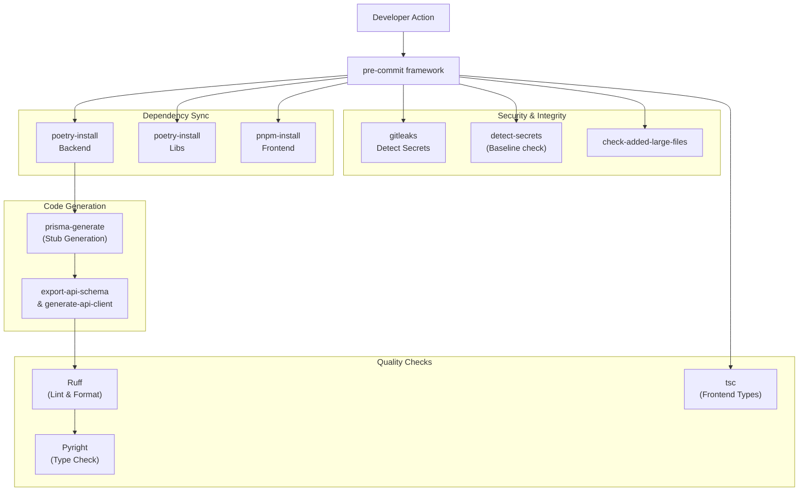
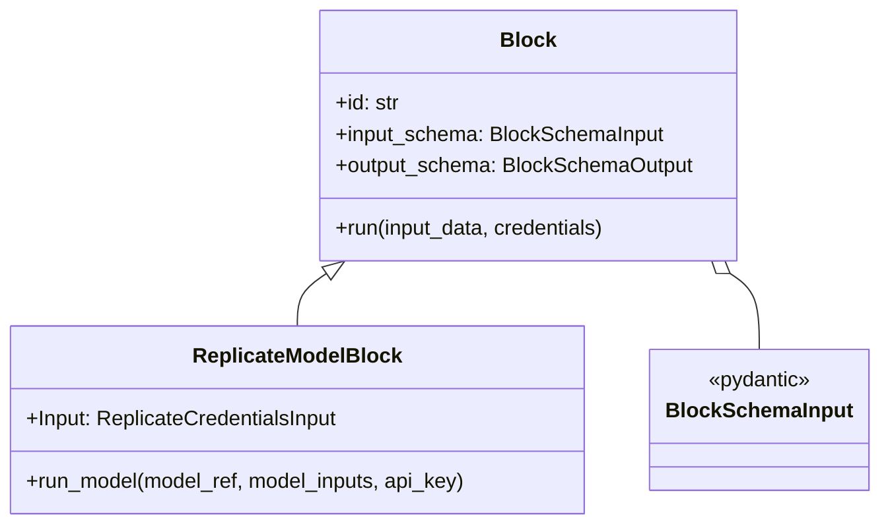
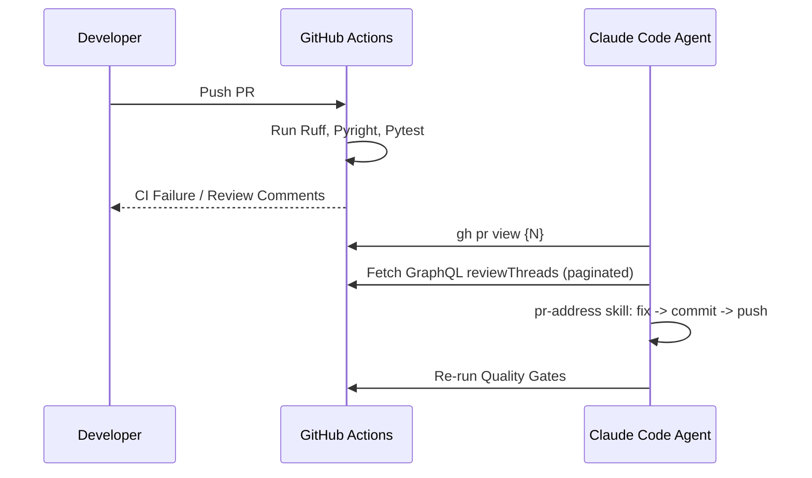

<!-- source: DeepWiki mcp.deepwiki.com · repo Significant-Gravitas/AutoGPT · page 5.2 Code Quality Standards · fetched 2026-10-26 -->

# Code Quality Standards

Relevant source files

The following files were used as context for generating this wiki page:

- [.claude/skills/pr-address/SKILL.md](.claude/skills/pr-address/SKILL.md)
- [.claude/skills/pr-review/SKILL.md](.claude/skills/pr-review/SKILL.md)
- [.gitleaks.toml](.gitleaks.toml)
- [.pre-commit-config.yaml](.pre-commit-config.yaml)
- [.secrets.baseline](.secrets.baseline)
- [CLAUDE.md](CLAUDE.md)
- [autogpt_platform/AGENTS.md](autogpt_platform/AGENTS.md)
- [autogpt_platform/CLAUDE.md](autogpt_platform/CLAUDE.md)
- [autogpt_platform/backend/AGENTS.md](autogpt_platform/backend/AGENTS.md)
- [autogpt_platform/backend/CLAUDE.md](autogpt_platform/backend/CLAUDE.md)
- [autogpt_platform/backend/backend/blocks/block_cost_tracking_test.py](autogpt_platform/backend/backend/blocks/block_cost_tracking_test.py)
- [autogpt_platform/backend/backend/blocks/replicate/replicate_block.py](autogpt_platform/backend/backend/blocks/replicate/replicate_block.py)
- [autogpt_platform/backend/backend/blocks/replicate/replicate_block_cost_test.py](autogpt_platform/backend/backend/blocks/replicate/replicate_block_cost_test.py)
- [autogpt_platform/backend/backend/blocks/text_to_speech_block.py](autogpt_platform/backend/backend/blocks/text_to_speech_block.py)
- [autogpt_platform/backend/backend/copilot/tools/helpers.py](autogpt_platform/backend/backend/copilot/tools/helpers.py)
- [autogpt_platform/backend/backend/copilot/tools/helpers_test.py](autogpt_platform/backend/backend/copilot/tools/helpers_test.py)
- [autogpt_platform/backend/backend/data/block_cost_config_test.py](autogpt_platform/backend/backend/data/block_cost_config_test.py)
- [autogpt_platform/backend/backend/executor/block_usage_cost_test.py](autogpt_platform/backend/backend/executor/block_usage_cost_test.py)
- [autogpt_platform/frontend/CLAUDE.md](autogpt_platform/frontend/CLAUDE.md)
- [autogpt_platform/frontend/src/tests/AGENTS.md](autogpt_platform/frontend/src/tests/AGENTS.md)
- [autogpt_platform/frontend/src/tests/CLAUDE.md](autogpt_platform/frontend/src/tests/CLAUDE.md)
- [docs/platform/workspace-media-architecture.md](docs/platform/workspace-media-architecture.md)

This document defines the code quality standards enforced across the AutoGPT repository. It covers linting, formatting, type checking, and testing requirements for both backend (Python) and frontend (TypeScript) code.

For information about setting up your development environment to use these tools, see [Development Environment Setup](#5.1). For details on the CI/CD workflows that enforce these standards, see [CI/CD Workflows](#5.4).

---

## Overview

The AutoGPT project enforces strict code quality standards through automated tooling at two levels:

1. **Pre-commit hooks** - Run locally before each commit to catch issues early.
2. **CI/CD validation** - Run on all pull requests to ensure standards are met.

The repository uses a dual-license structure and maintains different standards for the **Platform** (modern Python + Next.js) and **Classic** (legacy components) codebases.

| Component | Linter | Formatter | Type Checker |
|-----------|--------|-----------|--------------|
| Platform Backend | Ruff | Ruff + Black | Pyright |
| Platform Libs | Ruff | Ruff | Pyright |
| Platform Frontend | ESLint | Prettier | TypeScript (tsc) |
| Classic AutoGPT | Flake8 | Black + isort | Pyright |

**Sources:** [.pre-commit-config.yaml:1-243](), [autogpt_platform/backend/pyproject.toml:115-144](), [autogpt_platform/autogpt_libs/pyproject.toml:36-41]()

---

## Pre-commit Hook System

### Architecture and Execution Flow

The pre-commit system is configured to run on `pre-commit`, `pre-push`, and `post-checkout` stages [.pre-commit-config.yaml:1-6]().

**Pre-commit Hook Execution Flow**

**Sources:** [.pre-commit-config.yaml:1-243]()

### Hook Categories

#### Secret Detection
The repository uses two layers of secret detection:
1. **Detect Secrets**: Uses a baseline file `.secrets.baseline` to ignore known false positives while scanning `autogpt_platform/` [.pre-commit-config.yaml:20-29]().
2. **Gitleaks**: Scans the entire history for sensitive data [.pre-commit-config.yaml:30-35]().

**Sources:** [.pre-commit-config.yaml:20-35](), [.secrets.baseline:1-142]()

#### Dependency & Client Generation
To ensure type checking is accurate, hooks automatically update dependencies and generated code:
- **Poetry/PNPM Install**: Runs when lockfiles change [.pre-commit-config.yaml:40-90]().
- **Prisma Generate**: Executes `poetry run prisma generate` and `poetry run gen-prisma-stub` when the schema or backend dependencies change [.pre-commit-config.yaml:112-130]().
- **API Synchronization**: `export-api-schema` exports the FastAPI schema to `openapi.json`, and `generate-api-client` regenerates the frontend API client [.pre-commit-config.yaml:132-162]().

---

## Python Code Quality Tools

### Ruff (Platform Components)
Ruff is the primary linter and formatter for modern components. It is configured in `pyproject.toml` with a target version of Python 3.10 [.autogpt_platform/backend/pyproject.toml:142-144]().

- **Backend Hook**: Runs with `--fix` to automatically resolve linting errors [.pre-commit-config.yaml:167-172]().
- **Libs Hook**: Runs both `ruff` and `ruff-format` [.pre-commit-config.yaml:173-183]().

### Pyright (Type Checking)
Pyright is used for static type checking across all Python modules. It is configured to run on the entire project context rather than individual files to maintain global type safety [.pre-commit-config.yaml:184-232]().

#### Type Safety in Execution Space
The `execute_block` function in the Copilot system demonstrates strict type enforcement, using `coerce_inputs_to_schema` to ensure runtime data matches the Pydantic `BlockSchemaInput` definitions [autogpt_platform/backend/backend/copilot/tools/helpers.py:164-191]().

**Natural Language to Code Entity: Block System Types**

**Sources:** [autogpt_platform/backend/backend/blocks/replicate/replicate_block.py:38-75](), [autogpt_platform/backend/backend/copilot/tools/helpers.py:164-191]()

---

## Frontend Code Quality Tools

### Prettier
Prettier enforces a consistent style for the Next.js frontend. The hook runs within the `autogpt_platform/frontend` directory and automatically formats files [.pre-commit-config.yaml:173-181]().

### TypeScript Compiler (tsc)
Type checking is performed via `pnpm types`, which runs `tsc` in non-emitting mode to validate the frontend's strict typing requirements [.pre-commit-config.yaml:234-242]().

---

## CI/CD Quality Gates

The CI pipeline for the backend enforces these standards on every PR using a multi-stage workflow:

1. **Environment Setup**: Installs Python (3.11-3.13) and system dependencies [.github/workflows/platform-backend-ci.yml:32-35]().
2. **Service Initialization**: Starts Redis, RabbitMQ, and ClamAV [.github/workflows/platform-backend-ci.yml:38-67]().
3. **Poetry Validation**: Checks if `poetry.lock` is up-to-date with `pyproject.toml` [.github/workflows/platform-backend-ci.yml:122-131]().
4. **Linting**: Executes `poetry run lint`, which triggers the internal `linter:lint` command [.github/workflows/platform-backend-ci.yml:184-186]().
5. **Testing**: Runs `pytest` with coverage [.github/workflows/platform-backend-ci.yml:188-195]().

### Automated PR Review & Addressing
The repository includes Claude Code skills to automate the adherence to these standards:
- **pr-review**: Checks for correctness, security, and quality using a criticality badge system (`🔴 Blocker`, `🟠 Should Fix`, etc.) [.claude/skills/pr-review/SKILL.md:45-70]().
- **pr-address**: Automatically fetches review comments (paginating through GraphQL and REST APIs) and loops until CI is green [.claude/skills/pr-address/SKILL.md:30-104]().

**Natural Language to Code Entity: Automated Quality Loop**

**Sources:** [.claude/skills/pr-review/SKILL.md:1-87](), [.claude/skills/pr-address/SKILL.md:1-104](), [.github/workflows/platform-backend-ci.yml:1-226]()

---

## Best Practices

### Block Development Standards
When creating new blocks (e.g., `ReplicateModelBlock` or `UnrealTextToSpeechBlock`), developers must:
- Define explicit `Input` and `Output` schemas using `SchemaField` [autogpt_platform/backend/backend/blocks/replicate/replicate_block.py:49-81]().
- Use `SecretStr` for sensitive credentials [autogpt_platform/backend/backend/blocks/text_to_speech_block.py:1-18]().
- Implement `test_mock` and `test_input` within the `__init__` for automated unit testing [autogpt_platform/backend/backend/blocks/replicate/replicate_block.py:82-110]().
- Emit `NodeExecutionStats` for accurate billing via the `provider_cost` field [autogpt_platform/backend/backend/blocks/text_to_speech_block.py:100-117]().

**Sources:** [autogpt_platform/backend/backend/blocks/replicate/replicate_block.py:38-160](), [autogpt_platform/backend/backend/blocks/text_to_speech_block.py:37-117]()

---

