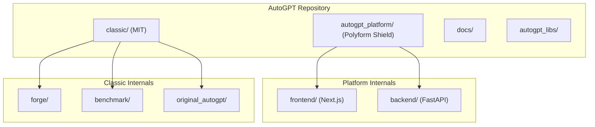
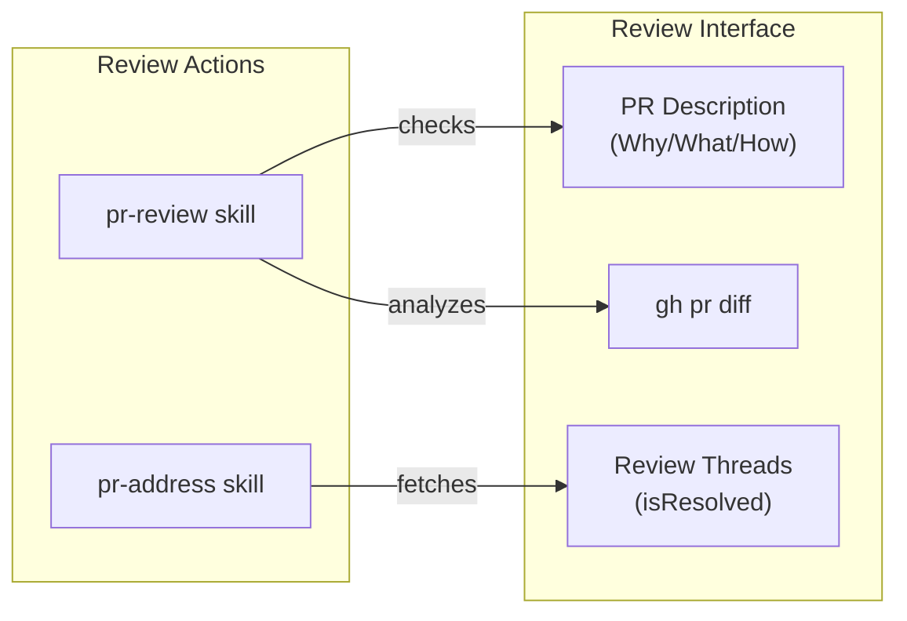

<!-- source: DeepWiki mcp.deepwiki.com · repo Significant-Gravitas/AutoGPT · page 5.3 Contributing Guidelines · fetched 2026-10-26 -->

# Contributing Guidelines

Relevant source files

The following files were used as context for generating this wiki page:

- [.claude/skills/pr-address/SKILL.md](.claude/skills/pr-address/SKILL.md)
- [.claude/skills/pr-review/SKILL.md](.claude/skills/pr-review/SKILL.md)
- [.github/ISSUE_TEMPLATE/1.bug.yml](.github/ISSUE_TEMPLATE/1.bug.yml)
- [.github/ISSUE_TEMPLATE/2.feature.yml](.github/ISSUE_TEMPLATE/2.feature.yml)
- [.github/PULL_REQUEST_TEMPLATE.md](.github/PULL_REQUEST_TEMPLATE.md)
- [.gitignore](.gitignore)
- [CLAUDE.md](CLAUDE.md)
- [CODE_OF_CONDUCT.md](CODE_OF_CONDUCT.md)
- [CONTRIBUTING.md](CONTRIBUTING.md)
- [LICENSE](LICENSE)
- [README.md](README.md)
- [autogpt_platform/AGENTS.md](autogpt_platform/AGENTS.md)
- [autogpt_platform/CLAUDE.md](autogpt_platform/CLAUDE.md)
- [autogpt_platform/backend/AGENTS.md](autogpt_platform/backend/AGENTS.md)
- [autogpt_platform/backend/CLAUDE.md](autogpt_platform/backend/CLAUDE.md)
- [autogpt_platform/frontend/CLAUDE.md](autogpt_platform/frontend/CLAUDE.md)
- [autogpt_platform/frontend/src/tests/AGENTS.md](autogpt_platform/frontend/src/tests/AGENTS.md)
- [autogpt_platform/frontend/src/tests/CLAUDE.md](autogpt_platform/frontend/src/tests/CLAUDE.md)
- [docs/content/code-of-conduct.md](docs/content/code-of-conduct.md)
- [docs/content/contributing.md](docs/content/contributing.md)
- [docs/platform/workspace-media-architecture.md](docs/platform/workspace-media-architecture.md)

## Purpose and Scope

This document explains the process for contributing code, documentation, and other improvements to the AutoGPT repository. It covers PR submission requirements, code review workflows, branching strategies, and community standards. AutoGPT uses a dual-license model: the `autogpt_platform` folder is under the **Polyform Shield License**, while all other folders (Classic AutoGPT, Forge, Benchmark) are under the **MIT License** [README.md:127-134](). By contributing to the `autogpt_platform` folder, you agree to the terms of the Contributor License Agreement (CLA) [CONTRIBUTING.md:10-12]().

---

## Contribution Areas

The repository is organized into distinct components. Understanding this structure ensures PRs are correctly labeled and reviewed by the appropriate maintainers.

### Repository Architecture

**Sources:** [README.md:127-134](), [LICENSE:1-20]()

---

## Contribution Workflow

AutoGPT follows a standard fork-and-pull-request model. We encourage discussing large changes in the [Discord dev channel](https://discord.com/channels/1092243196446249134/1095817829405704305) before implementation [CONTRIBUTING.md:15-17]().

### Branching Strategy
- **`master` / `main`**: The stable branch.
- **`stable`**: Production-ready releases.
- **Feature Branches**: Create branches from `master` for your changes (e.g., `feat/add-google-calendar-block` or `fix/execution-engine-deadlock`).

### Step-by-Step Process

1. **Search for Existing Issues**: Thoroughly search [existing issues] to avoid duplicate work [CONTRIBUTING.md:14-14](), [.github/ISSUE_TEMPLATE/1.bug.yml:11-12]().
2. **Fork and Clone**: Fork the repository and set up your local environment.
3. **Pre-commit Hooks**: Ensure pre-commit hooks (Ruff, Black, Pyright, Prettier) are installed. These run automatically on commit [CONTRIBUTING.md:19-19]().
4. **Draft PR**: For large changes, create a **Draft PR** early to signal work-in-progress [CONTRIBUTING.md:18-18]().
5. **Commit with Conventional Commits**: Use clear, descriptive prefixes:
    - `feat:` for new features.
    - `fix:` for bug fixes.
    - `docs:` for documentation changes.
    - `refactor:` for code changes that neither fix a bug nor add a feature.

**Sources:** [CONTRIBUTING.md:13-25](), [.github/ISSUE_TEMPLATE/1.bug.yml:8-19]()

---

## Pull Request Requirements

Every Pull Request must follow the [PULL_REQUEST_TEMPLATE.md]().

### PR Structure (Why / What / How)
Reviewers need context to judge the approach. Every PR must include:
- **Why**: The problem being solved or the motivation for the change [.github/PULL_REQUEST_TEMPLATE.md:3-3]().
- **What**: A high-level summary of the changes [.github/PULL_REQUEST_TEMPLATE.md:4-4]().
- **How**: Technical details on the implementation and architecture decisions [.github/PULL_REQUEST_TEMPLATE.md:5-5]().

### PR Checklist
- [ ] **Test Plan**: You must include a manual or automated test plan in the PR description [.github/PULL_REQUEST_TEMPLATE.md:15-17]().
- [ ] **Configuration**: If you changed environment variables, ensure `.env.default` and `docker-compose.yml` are updated [.github/PULL_REQUEST_TEMPLATE.md:30-34]().
- [ ] **No Broken Code**: Validate your changes locally before pushing [CONTRIBUTING.md:21-21]().

**Sources:** [.github/PULL_REQUEST_TEMPLATE.md:1-44](), [CONTRIBUTING.md:20-23]()

---

## Code Review Process

AutoGPT uses a rigorous review process, often involving automated AI agents and human maintainers.

### Automated Reviewers
- **`autogpt-reviewer`**: Posts structured reviews (Blockers, Should Fix, Nice to Have) as top-level reviews [.claude/skills/pr-address/SKILL.md:131-131]().
- **`coderabbitai[bot]`**: Provides summaries and inline suggestions [.claude/skills/pr-address/SKILL.md:133-133]().
- **`sentry[bot]`**: Predicts potential bugs in inline threads [.claude/skills/pr-address/SKILL.md:132-132]().

### Addressing Feedback
The standard sequence for addressing review comments is:
**Fix → Commit → Push → Reply → Resolve** [.claude/skills/pr-address/SKILL.md:148-148]().

| Criticality | Badge | Action Required |
| :--- | :--- | :--- |
| **Blocker** | `🔴 **Blocker**` | Must fix before merge [.claude/skills/pr-review/SKILL.md:65-65]() |
| **Should Fix** | `🟠 **Should Fix**` | Important improvement [.claude/skills/pr-review/SKILL.md:66-66]() |
| **Nice to Have** | `🟡 **Nice to Have**` | Minor suggestion [.claude/skills/pr-review/SKILL.md:67-67]() |
| **Nit** | `🔵 **Nit**` | Style or wording [.claude/skills/pr-review/SKILL.md:68-68]() |

### Code Entity Association (Review Context)

**Sources:** [.claude/skills/pr-address/SKILL.md:11-112](), [.claude/skills/pr-review/SKILL.md:11-87]()

---

## Community Standards

### Bug Reporting
When reporting a bug, use the [Bug Report Template](.github/ISSUE_TEMPLATE/1.bug.yml). Provide:
- **Operating System** (Windows, Linux, MacOS, Docker, WSL) [.github/ISSUE_TEMPLATE/1.bug.yml:53-64]().
- **LLM Provider** (Azure, Groq, Anthropic, etc.) [.github/ISSUE_TEMPLATE/1.bug.yml:89-100]().
- **Commit Hash**: Output of `git rev-parse HEAD` [.github/ISSUE_TEMPLATE/1.bug.yml:49-49]().
- **Logs**: Relevant content from `logs/activity.log` or `logs/error.log` [.github/ISSUE_TEMPLATE/1.bug.yml:151-168]().

### Feature Requests
Use the [Feature Request Template](.github/ISSUE_TEMPLATE/2.feature.yml). Focus on the **Motivation**: how the lack of this feature affects your workflow [.github/ISSUE_TEMPLATE/2.feature.yml:25-28]().

### General Conduct
- Avoid duplicate issues and PRs [CONTRIBUTING.md:14-14]().
- Avoid unnecessary changes based purely on personal preference [CONTRIBUTING.md:22-23]().
- Be respectful and follow the `CODE_OF_CONDUCT.md`.

**Sources:** [.github/ISSUE_TEMPLATE/1.bug.yml:1-168](), [.github/ISSUE_TEMPLATE/2.feature.yml:1-29](), [CONTRIBUTING.md:13-38]()

---

