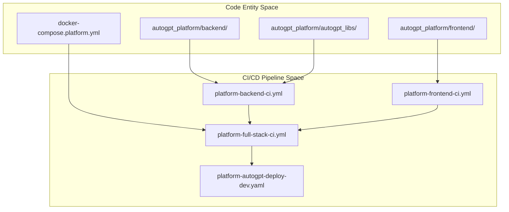
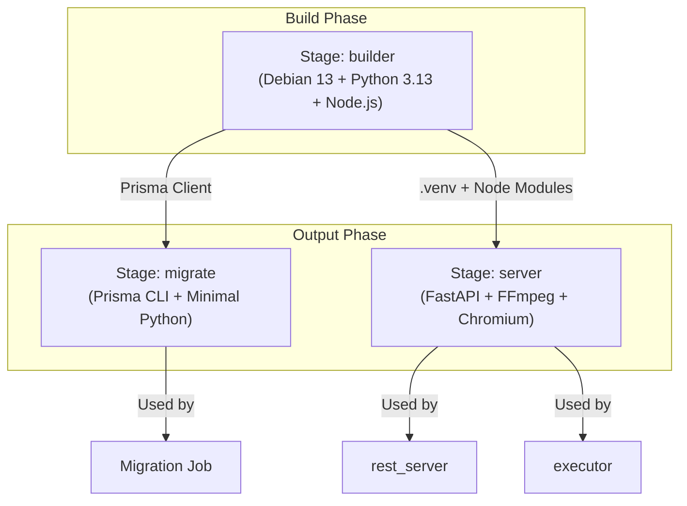

<!-- source: DeepWiki mcp.deepwiki.com · repo Significant-Gravitas/AutoGPT · page 5.4 CI/CD Workflows · fetched 2026-10-26 -->

# CI/CD Workflows

Relevant source files

The following files were used as context for generating this wiki page:

- [.dockerignore](.dockerignore)
- [.github/workflows/claude-ci-failure-auto-fix.yml](.github/workflows/claude-ci-failure-auto-fix.yml)
- [.github/workflows/claude-dependabot.yml](.github/workflows/claude-dependabot.yml)
- [.github/workflows/claude.yml](.github/workflows/claude.yml)
- [.github/workflows/codeql.yml](.github/workflows/codeql.yml)
- [.github/workflows/copilot-setup-steps.yml](.github/workflows/copilot-setup-steps.yml)
- [.github/workflows/docs-block-sync.yml](.github/workflows/docs-block-sync.yml)
- [.github/workflows/docs-claude-review.yml](.github/workflows/docs-claude-review.yml)
- [.github/workflows/docs-enhance.yml](.github/workflows/docs-enhance.yml)
- [.github/workflows/platform-autogpt-deploy-dev.yaml](.github/workflows/platform-autogpt-deploy-dev.yaml)
- [.github/workflows/platform-autogpt-deploy-prod.yml](.github/workflows/platform-autogpt-deploy-prod.yml)
- [.github/workflows/platform-backend-ci.yml](.github/workflows/platform-backend-ci.yml)
- [.github/workflows/platform-dev-deploy-event-dispatcher.yml](.github/workflows/platform-dev-deploy-event-dispatcher.yml)
- [.github/workflows/platform-frontend-ci.yml](.github/workflows/platform-frontend-ci.yml)
- [.github/workflows/platform-fullstack-ci.yml](.github/workflows/platform-fullstack-ci.yml)
- [autogpt_platform/README.md](autogpt_platform/README.md)
- [autogpt_platform/backend/.env.default](autogpt_platform/backend/.env.default)
- [autogpt_platform/backend/Dockerfile](autogpt_platform/backend/Dockerfile)
- [autogpt_platform/backend/README.advanced.md](autogpt_platform/backend/README.advanced.md)
- [autogpt_platform/backend/README.md](autogpt_platform/backend/README.md)
- [autogpt_platform/backend/backend/copilot/tools/agent_browser.py](autogpt_platform/backend/backend/copilot/tools/agent_browser.py)
- [autogpt_platform/backend/backend/copilot/tools/agent_browser_integration_test.py](autogpt_platform/backend/backend/copilot/tools/agent_browser_integration_test.py)
- [autogpt_platform/backend/backend/copilot/tools/conftest.py](autogpt_platform/backend/backend/copilot/tools/conftest.py)
- [autogpt_platform/backend/backend/util/feature_flag_test.py](autogpt_platform/backend/backend/util/feature_flag_test.py)
- [autogpt_platform/backend/test/__init__.py](autogpt_platform/backend/test/__init__.py)
- [autogpt_platform/db/docker/docker-compose.yml](autogpt_platform/db/docker/docker-compose.yml)
- [autogpt_platform/db/docker/reset.sh](autogpt_platform/db/docker/reset.sh)
- [autogpt_platform/docker-compose.platform.yml](autogpt_platform/docker-compose.platform.yml)
- [autogpt_platform/docker-compose.yml](autogpt_platform/docker-compose.yml)
- [autogpt_platform/frontend/Dockerfile](autogpt_platform/frontend/Dockerfile)
- [autogpt_platform/frontend/src/app/page.tsx](autogpt_platform/frontend/src/app/page.tsx)
- [autogpt_platform/frontend/src/services/feature-flags/__tests__/helpers.test.ts](autogpt_platform/frontend/src/services/feature-flags/__tests__/helpers.test.ts)
- [autogpt_platform/frontend/src/services/feature-flags/feature-flag-provider.tsx](autogpt_platform/frontend/src/services/feature-flags/feature-flag-provider.tsx)
- [autogpt_platform/frontend/src/services/feature-flags/helpers.ts](autogpt_platform/frontend/src/services/feature-flags/helpers.ts)

This page documents the Continuous Integration and Continuous Deployment (CI/CD) workflows used in the AutoGPT repository. It details the GitHub Actions configurations for the AutoGPT Platform (Frontend, Backend, and Full-stack), Docker image builds, deployment strategies, and AI-driven automation using Claude.

## CI/CD Architecture

The AutoGPT project employs a modular CI/CD strategy that mirrors its repository structure. Workflows are partitioned by component to optimize execution time and resource usage.

**CI/CD System Mapping: From Code to Pipeline**

Sources: [.github/workflows/platform-backend-ci.yml:1-18](), [.github/workflows/platform-frontend-ci.yml:1-18](), [.github/workflows/platform-fullstack-ci.yml:1-16]()

## Platform Backend CI

The backend CI workflow focuses on Python code quality, type safety, and integration testing for the FastAPI services.

### Key Components
- **Linting**: Uses `ruff` and `black` via `poetry run lint` [[.github/workflows/platform-backend-ci.yml:60-61]]().
- **Type Checking**: Executes `pyright` across a matrix of Python versions (3.11, 3.12, 3.13) [[.github/workflows/platform-backend-ci.yml:71-105]]().
- **Test Infrastructure**: Provisions a multi-service environment using GitHub Actions services and manual Docker container management for complex topologies like Redis Clusters [[.github/workflows/platform-backend-ci.yml:121-204]]().

### Service Matrix for Backend Tests
| Service | Image | Role |
|---------|-------|------|
| RabbitMQ | `rabbitmq:4.1.4` | Task queue for `ExecutionManager` and `NotificationManager` [[.github/workflows/platform-backend-ci.yml:128-140]]() |
| ClamAV | `clamav/clamav-debian` | Malware scanning for user-uploaded files [[.github/workflows/platform-backend-ci.yml:141-157]]() |
| Redis Cluster | `redis:7` | 3-shard cluster for distributed locking and state [[.github/workflows/platform-backend-ci.yml:171-204]]() |

Sources: [.github/workflows/platform-backend-ci.yml:71-119](), [autogpt_platform/docker-compose.platform.yml:100-137]()

## Platform Frontend CI

The frontend CI validates the Next.js application, ensuring UI consistency and API compatibility.

### Workflow Stages
1. **Linting**: Runs `pnpm lint` to enforce coding standards [[.github/workflows/platform-frontend-ci.yml:64-88]]().
2. **Integration Testing**: Executes unit and integration tests via `pnpm test:unit` after generating the API client [[.github/workflows/platform-frontend-ci.yml:129-158]]().
3. **Chromatic (UI Regression)**: Optionally runs visual regression tests on component changes [[.github/workflows/platform-frontend-ci.yml:90-127]]().
4. **API Client Generation**: Validates that the TypeScript client can be successfully generated from the backend OpenAPI schema [[.github/workflows/platform-frontend-ci.yml:154-155]]().

Sources: [.github/workflows/platform-frontend-ci.yml:31-167]()

## Full-stack CI and E2E Testing

The full-stack workflow (`platform-fullstack-ci.yml`) is the primary gate for ensuring the frontend and backend remain in sync.

### API Schema Synchronization
A critical check in this workflow is the `check-api-types` job. It exports the OpenAPI schema from the backend and compares it against the version committed in the frontend directory [[.github/workflows/platform-fullstack-ci.yml:51-138]](). If they differ, the CI fails, forcing the developer to regenerate the client and fix any breaking changes.

### End-to-End (E2E) Testing
The `e2e_test` job stands up the entire platform using Docker Compose [[.github/workflows/platform-fullstack-ci.yml:149-195]]().
- **Environment**: Uses a "big-boi" runner to handle the resource-heavy Docker stack.
- **Docker Bake**: Uses `docker compose config` to resolve service definitions before building with cache support [[.github/workflows/platform-fullstack-ci.yml:181-195]]().

Sources: [.github/workflows/platform-fullstack-ci.yml:51-148](), [.github/workflows/platform-fullstack-ci.yml:149-195]()

## Docker Build System

The repository uses a multi-stage `Dockerfile` to produce optimized images for different roles (migration, server, etc.).

**Dockerfile Stages and Artifact Flow**

Sources: [autogpt_platform/backend/Dockerfile:1-161]()

- **Builder Stage**: Installs all build-time dependencies, including `poetry`, `nodejs`, and `build-essential` [[autogpt_platform/backend/Dockerfile:3-48]]().
- **Migrate Stage**: A lightweight image containing only the Prisma CLI and the migration files [[autogpt_platform/backend/Dockerfile:59-86]]().
- **Server Stage**: The production image. It includes system-level tools for agents, such as `ffmpeg`, `imagemagick`, and a sandboxed `chromium` for the `agent-browser` tool [[autogpt_platform/backend/Dockerfile:90-137]]().

## Deployment Workflows

### Development Environment
The development deployment is triggered on pushes to the `dev` branch [[.github/workflows/platform-autogpt-deploy-dev.yaml:3-7]]().
1. **Migration**: Runs `prisma migrate deploy` against the development database [[.github/workflows/platform-autogpt-deploy-dev.yaml:21-49]]().
2. **Dispatch**: Triggers a downstream build/deploy workflow in the `AutoGPT_cloud_infrastructure` repository via a repository dispatch event [[.github/workflows/platform-autogpt-deploy-dev.yaml:50-61]]().

### Production Environment
Production deployment follows a similar pattern but is gated by the `master` branch and requires manual approval or specific release triggers.

Sources: [.github/workflows/platform-autogpt-deploy-dev.yaml:1-61]()

## Claude Automation Workflows

AutoGPT utilizes `Claude Code` for automated PR maintenance and issue handling.

### Claude Integration
The `claude.yml` workflow triggers when `@claude` is mentioned in issues or PR comments [[.github/workflows/claude.yml:3-28]]().
- **Environment Setup**: It mirrors the full platform CI environment, setting up Python/Poetry, Node/pnpm, and a local Docker stack (Supabase, Redis, RabbitMQ) [[.github/workflows/claude.yml:51-124]]().
- **Docker Caching**: Implements a custom Docker image caching mechanism using `.tar` files to speed up the setup of the complex local-dev stack [[.github/workflows/claude.yml:126-183]]().
- **Permissions**: Restricted to repository `OWNER` or `MEMBER` to prevent unauthorized resource usage [[.github/workflows/claude.yml:21-28]]().

Sources: [.github/workflows/claude.yml:1-183]()

## Summary Table: CI/CD Matrix

| Workflow File | Trigger Path | Key Actions |
|---------------|--------------|-------------|
| `platform-backend-ci.yml` | `autogpt_platform/backend/**` | Pyright, Pytest, Redis Cluster Tests |
| `platform-frontend-ci.yml` | `autogpt_platform/frontend/**` | Pnpm Lint, Integration Tests, Chromatic |
| `platform-fullstack-ci.yml` | `autogpt_platform/**` | API Schema Sync Check, Docker Compose E2E |
| `platform-autogpt-deploy-dev.yaml` | `dev` branch | Database Migration, Infrastructure Dispatch |
| `claude.yml` | Mentions/Comments | AI-driven PR fixes and issue resolution |

Sources: [.github/workflows/platform-backend-ci.yml:1-18](), [.github/workflows/platform-frontend-ci.yml:1-18](), [.github/workflows/platform-fullstack-ci.yml:1-16](), [.github/workflows/platform-autogpt-deploy-dev.yaml:1-7](), [.github/workflows/claude.yml:1-12]()

---

