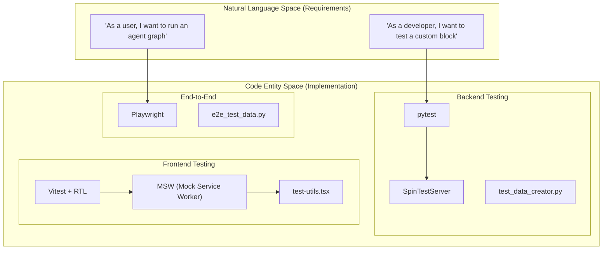
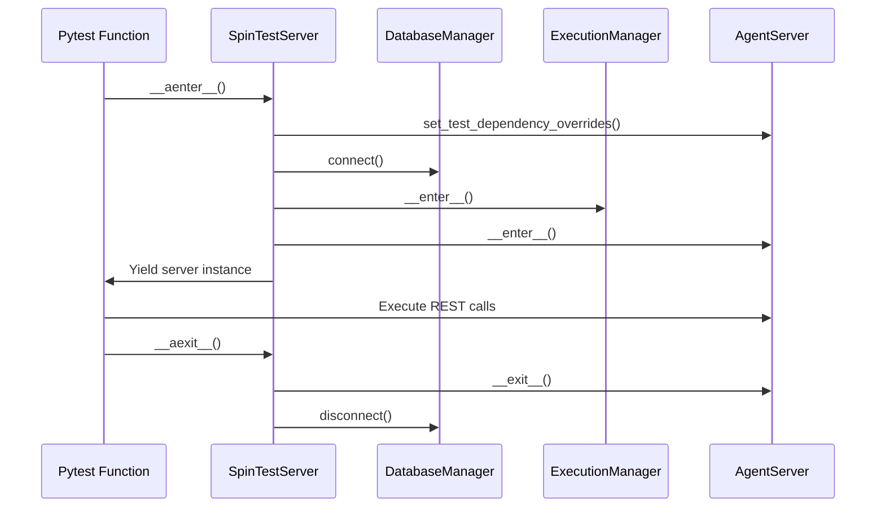

<!-- source: DeepWiki mcp.deepwiki.com · repo Significant-Gravitas/AutoGPT · page 5.5 Testing · fetched 2026-10-26 -->

# Testing

Relevant source files

The following files were used as context for generating this wiki page:

- [.claude/skills/write-frontend-tests/SKILL.md](.claude/skills/write-frontend-tests/SKILL.md)
- [.github/copilot-instructions.md](.github/copilot-instructions.md)
- [AGENTS.md](AGENTS.md)
- [autogpt_platform/Makefile](autogpt_platform/Makefile)
- [autogpt_platform/backend/agents/calculator-agent.json](autogpt_platform/backend/agents/calculator-agent.json)
- [autogpt_platform/backend/backend/util/test.py](autogpt_platform/backend/backend/util/test.py)
- [autogpt_platform/backend/test/test_data_creator.py](autogpt_platform/backend/test/test_data_creator.py)
- [autogpt_platform/frontend/.eslintrc.json](autogpt_platform/frontend/.eslintrc.json)
- [autogpt_platform/frontend/AGENTS.md](autogpt_platform/frontend/AGENTS.md)
- [autogpt_platform/frontend/CONTRIBUTING.md](autogpt_platform/frontend/CONTRIBUTING.md)
- [autogpt_platform/frontend/README.md](autogpt_platform/frontend/README.md)
- [autogpt_platform/frontend/TESTING.md](autogpt_platform/frontend/TESTING.md)
- [autogpt_platform/frontend/src/app/(platform)/library/__tests__/main.test.tsx](autogpt_platform/frontend/src/app/(platform)/library/__tests__/main.test.tsx)
- [autogpt_platform/frontend/src/app/(platform)/marketplace/components/MainAgentPage/__tests__/main.test.tsx](autogpt_platform/frontend/src/app/(platform)/marketplace/components/MainAgentPage/__tests__/main.test.tsx)
- [autogpt_platform/frontend/src/tests/integrations/test-utils.tsx](autogpt_platform/frontend/src/tests/integrations/test-utils.tsx)

This document provides a comprehensive guide to the testing infrastructure in the AutoGPT repository. It covers test frameworks, execution strategies, CI/CD integration, and best practices for writing and running tests across the Platform and Classic components.

---

## Overview

The AutoGPT repository employs comprehensive testing strategies across both the modern Platform and Classic components. The testing infrastructure is designed to ensure code quality, prevent regressions, and validate system behavior through unit tests, integration tests, and end-to-end tests.

### Test Framework Stack

| Component | Test Framework | Additional Tools | Purpose |
|-----------|---------------|------------------|---------|
| **Platform Backend** | `pytest` | `pytest-asyncio`, `pytest-mock`, `vcrpy` | Logic & Integration |
| **Platform Frontend** | `Vitest` | `React Testing Library`, `MSW` | Component Integration |
| **E2E Testing** | `Playwright` | Browser automation | Critical User Flows |
| **Visual Testing** | `Storybook` | `Chromatic` | Design System UI |

### Testing Architecture

**Sources:** [autogpt_platform/frontend/TESTING.md:5-9](), [autogpt_platform/backend/backend/util/test.py:29-35](), [autogpt_platform/backend/test/test_data_creator.py:1-17]()

---

## Platform Backend Testing

The backend uses `pytest` as the primary test framework. It supports unit tests for individual functions and integration tests that spin up the full service stack.

### SpinTestServer Utility
The `SpinTestServer` class in `backend/util/test.py` provides a context manager to programmatically start and stop the entire backend infrastructure for integration testing.

**Sources:** [autogpt_platform/backend/backend/util/test.py:29-74]()

### Block Testing
Individual execution blocks are tested using `execute_block_test`. This utility handles:
1.  **Mocking**: Automatically mocks block methods defined in `block.test_mock`. [autogpt_platform/backend/backend/util/test.py:122-143]()
2.  **Context Injection**: Injects a fresh `ExecutionContext` with unique IDs for every test run. [autogpt_platform/backend/backend/util/test.py:153-168]()
3.  **Credential Handling**: Automatically maps `test_credentials` to the block's input schema. [autogpt_platform/backend/backend/util/test.py:171-185]()

**Sources:** [autogpt_platform/backend/backend/util/test.py:107-168]()

---

## Platform Frontend Testing

The frontend follows a "Client-First" testing strategy, prioritizing integration tests over unit tests.

### Integration Tests (Vitest + RTL + MSW)
Integration tests are the primary testing method (~90% of coverage). They render full pages and mock API responses at the network level.

-   **File Location**: Tests live in `__tests__/` directories adjacent to the code they test. [autogpt_platform/frontend/TESTING.md:24-38]()
-   **API Mocking**: Uses **Mock Service Worker (MSW)**. Handlers are auto-generated from the OpenAPI spec by Orval. [autogpt_platform/frontend/TESTING.md:45-54]()
-   **Custom Render**: The `render` function from `test-utils.tsx` wraps components in necessary providers: `QueryClientProvider`, `BackendAPIProvider`, and `TooltipProvider`. [autogpt_platform/frontend/src/tests/integrations/test-utils.tsx:19-42]()

### E2E Tests (Playwright)
Playwright is reserved for critical user journeys such as authentication and multi-page navigation.

-   **Seeded Data**: E2E tests rely on a dedicated script `backend/test/e2e_test_data.py` to create deterministic test accounts. [autogpt_platform/frontend/TESTING.md:132-135]()
-   **Auth States**: Playwright saves authentication state in `frontend/.auth/states/` to avoid re-logging in for every test. [autogpt_platform/frontend/TESTING.md:139-141]()

**Sources:** [autogpt_platform/frontend/TESTING.md:5-13](), [autogpt_platform/frontend/src/tests/integrations/test-utils.tsx:19-42]()

---

## Test Data Management

### Test Data Creator Utility
The `test_data_creator.py` script is used to populate a development or test database with a large volume of realistic data.

| Entity | Count / Frequency | Code Reference |
|--------|-------------------|----------------|
| **Users** | 100 | [autogpt_platform/backend/test/test_data_creator.py:48]() |
| **Graphs** | 1-5 per User | [autogpt_platform/backend/test/test_data_creator.py:52-53]() |
| **Nodes** | 2-5 per Graph | [autogpt_platform/backend/test/test_data_creator.py:56-59]() |
| **Executions** | 1-20 per Graph | [autogpt_platform/backend/test/test_data_creator.py:68-71]() |

The utility uses `Faker` for text data and services like `picsum.photos` for image URLs. [autogpt_platform/backend/test/test_data_creator.py:76-83]()

### Test User Constants
The system uses a hardcoded `DEFAULT_USER_ID` for local testing environments to simplify data ownership checks.
-   **ID**: `3e53486c-cf57-477e-ba2a-cb02dc828e1a` [autogpt_platform/backend/backend/util/test.py:39]()

**Sources:** [autogpt_platform/backend/test/test_data_creator.py:45-74](), [autogpt_platform/backend/backend/util/test.py:38-39]()

---

## Execution Commands

### Backend
| Command | Description |
|---------|-------------|
| `poetry run test` | Run all pytest suites |
| `poetry run pytest path/to/test.py` | Run a specific test file |
| `make test-data` | Run the test data creator utility |

### Frontend
| Command | Description |
|---------|-------------|
| `pnpm test:unit` | Run Vitest integration/unit tests |
| `pnpm test` | Run Playwright E2E tests (requires build) |
| `pnpm test-ui` | Run Playwright with the interactive UI |
| `pnpm storybook` | Launch Storybook for visual component testing |

**Sources:** [autogpt_platform/frontend/README.md:78-87](), [autogpt_platform/Makefile:46-47](), [autogpt_platform/frontend/AGENTS.md:7-21]()

---

