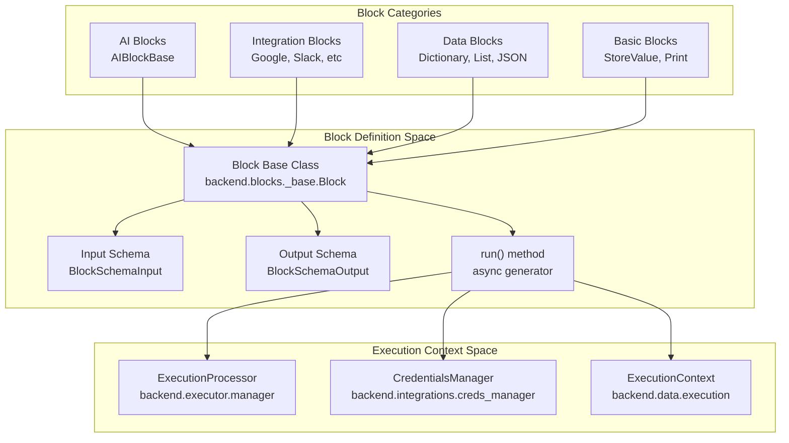
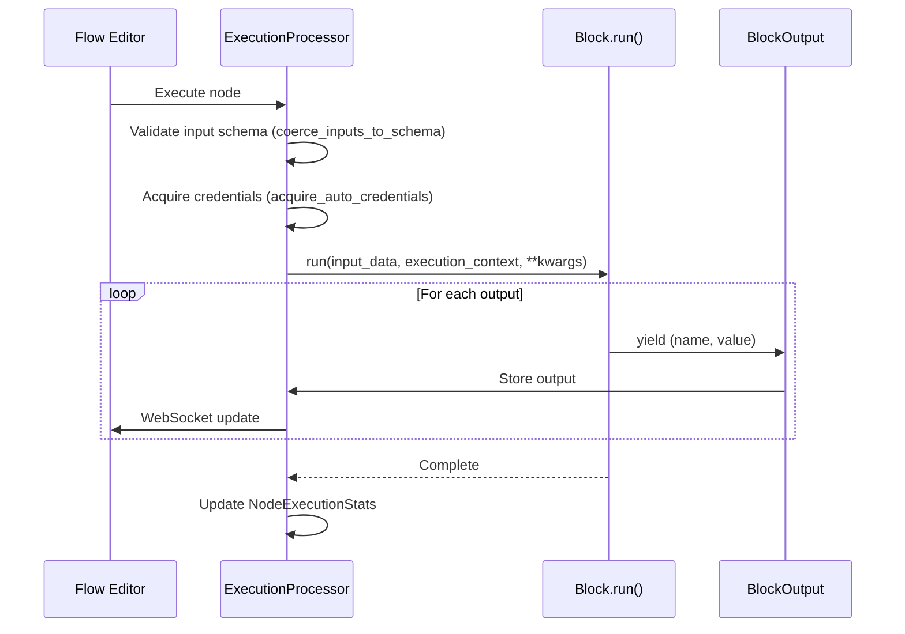

<!-- source: DeepWiki mcp.deepwiki.com · repo Significant-Gravitas/AutoGPT · page 5.6 Creating Custom Blocks · fetched 2026-10-26 -->

# Creating Custom Blocks

<details>
<summary>Relevant source files</summary>

The following files were used as context for generating this wiki page:

- [.gitleaks.toml](.gitleaks.toml)
- [.pre-commit-config.yaml](.pre-commit-config.yaml)
- [.secrets.baseline](.secrets.baseline)
- [autogpt_platform/backend/backend/blocks/basic.py](autogpt_platform/backend/backend/blocks/basic.py)
- [autogpt_platform/backend/backend/blocks/block_cost_tracking_test.py](autogpt_platform/backend/backend/blocks/block_cost_tracking_test.py)
- [autogpt_platform/backend/backend/blocks/data_manipulation.py](autogpt_platform/backend/backend/blocks/data_manipulation.py)
- [autogpt_platform/backend/backend/blocks/generic_webhook/__init__.py](autogpt_platform/backend/backend/blocks/generic_webhook/__init__.py)
- [autogpt_platform/backend/backend/blocks/io.py](autogpt_platform/backend/backend/blocks/io.py)
- [autogpt_platform/backend/backend/blocks/replicate/replicate_block.py](autogpt_platform/backend/backend/blocks/replicate/replicate_block.py)
- [autogpt_platform/backend/backend/blocks/replicate/replicate_block_cost_test.py](autogpt_platform/backend/backend/blocks/replicate/replicate_block_cost_test.py)
- [autogpt_platform/backend/backend/blocks/test/test_block.py](autogpt_platform/backend/backend/blocks/test/test_block.py)
- [autogpt_platform/backend/backend/blocks/text.py](autogpt_platform/backend/backend/blocks/text.py)
- [autogpt_platform/backend/backend/blocks/text_to_speech_block.py](autogpt_platform/backend/backend/blocks/text_to_speech_block.py)
- [autogpt_platform/backend/backend/blocks/time_blocks.py](autogpt_platform/backend/backend/blocks/time_blocks.py)
- [autogpt_platform/backend/backend/copilot/tools/helpers.py](autogpt_platform/backend/backend/copilot/tools/helpers.py)
- [autogpt_platform/backend/backend/copilot/tools/helpers_test.py](autogpt_platform/backend/backend/copilot/tools/helpers_test.py)
- [autogpt_platform/backend/backend/data/block_cost_config_test.py](autogpt_platform/backend/backend/data/block_cost_config_test.py)
- [autogpt_platform/backend/backend/executor/block_usage_cost_test.py](autogpt_platform/backend/backend/executor/block_usage_cost_test.py)
- [autogpt_platform/backend/backend/executor/manager_test.py](autogpt_platform/backend/backend/executor/manager_test.py)
- [autogpt_platform/backend/backend/sdk/builder.py](autogpt_platform/backend/backend/sdk/builder.py)
- [autogpt_platform/backend/backend/sdk/provider.py](autogpt_platform/backend/backend/sdk/provider.py)
- [autogpt_platform/backend/backend/sdk/registry.py](autogpt_platform/backend/backend/sdk/registry.py)
- [autogpt_platform/backend/backend/util/text.py](autogpt_platform/backend/backend/util/text.py)
- [autogpt_platform/backend/load-tests/tests/api/graph-execution-test.js](autogpt_platform/backend/load-tests/tests/api/graph-execution-test.js)
- [autogpt_platform/backend/test/blocks/test_list_concatenation.py](autogpt_platform/backend/test/blocks/test_list_concatenation.py)
- [autogpt_platform/backend/test/sdk/test_sdk_patching.py](autogpt_platform/backend/test/sdk/test_sdk_patching.py)
- [autogpt_platform/backend/test/sdk/test_sdk_registry.py](autogpt_platform/backend/test/sdk/test_sdk_registry.py)
- [docs/CLAUDE.md](docs/CLAUDE.md)
- [docs/integrations/block-integrations/basic.md](docs/integrations/block-integrations/basic.md)

</details>


## Purpose and Scope

This guide explains how to develop custom blocks for the AutoGPT Platform. Blocks are the fundamental building units that users connect in the visual Flow Editor to create agent workflows. This page covers:

- The block architecture and base classes
- Defining input/output schemas using Pydantic and `SchemaField`
- Implementing the execution logic in the `run` method
- Testing, cost configuration, and registration

For details about the execution system that runs these blocks, see [Execution System](#3.2.2).

---

## Block Architecture Overview

### Core Components



**Block Lifecycle in Code**



Sources: [autogpt_platform/backend/backend/blocks/_base.py:1-50](), [autogpt_platform/backend/backend/copilot/tools/helpers.py:164-210](), [autogpt_platform/backend/backend/blocks/basic.py:18-48]()

---

## Creating a Simple Block

### Minimal Block Structure

Every block must:
1. Extend the `Block` base class. [autogpt_platform/backend/backend/blocks/_base.py:10-20]()
2. Define `Input` (extending `BlockSchemaInput`) and `Output` (extending `BlockSchemaOutput`) classes. [autogpt_platform/backend/backend/blocks/basic.py:19-33]()
3. Provide a unique UUID `id` and metadata in `__init__`. [autogpt_platform/backend/backend/blocks/basic.py:35-48]()
4. Implement an `async run()` method that yields outputs as `(key, value)` pairs. [autogpt_platform/backend/backend/blocks/basic.py:50-66]()

### Example: Simple Store Value Block

```python
class StoreValueBlock(Block):
    class Input(BlockSchemaInput):
        input: Any = SchemaField(description="Trigger value")
        data: Any = SchemaField(description="Constant data", default=None)

    class Output(BlockSchemaOutput):
        output: Any = SchemaField(description="The stored data")

    def __init__(self):
        super().__init__(
            id="1ff065e9-88e8-4358-9d82-8dc91f622ba9",
            description="Stores and forwards a value.",
            categories={BlockCategory.BASIC},
            input_schema=StoreValueBlock.Input,
            output_schema=StoreValueBlock.Output,
            test_input=[{"input": "Hello"}],
            test_output=[("output", "Hello")],
            static_output=True,
        )

    async def run(self, input_data: Input, **kwargs) -> BlockOutput:
        yield "output", input_data.data or input_data.input
```

Sources: [autogpt_platform/backend/backend/blocks/basic.py:69-109]()

---

## Schema Definitions

### SchemaField Parameters

The `SchemaField` utility (extending Pydantic's `Field`) defines how fields appear in the UI and how they are validated. [autogpt_platform/backend/backend/data/model.py:10-30]()

| Parameter | Type | Purpose |
|-----------|------|---------|
| `description` | `str` | Tooltip/Description in the Flow Editor. [autogpt_platform/backend/backend/blocks/basic.py:20-22]() |
| `placeholder` | `str` | Hint text in the input field. [autogpt_platform/backend/backend/blocks/data_manipulation.py:24]() |
| `default` | `Any` | Default value if the user leaves it empty. [autogpt_platform/backend/backend/blocks/basic.py:25]() |
| `advanced` | `bool` | If `True`, hidden behind an "Advanced" toggle in the UI. [autogpt_platform/backend/backend/blocks/basic.py:26]() |
| `title` | `str` | Overrides the field name for display. [autogpt_platform/backend/backend/blocks/basic.py:27]() |

### Complex Types

Blocks support standard Python types, Pydantic models, and specialized types for the platform:
- `MediaFileType`: For URLs, data URIs, or local paths. [autogpt_platform/backend/backend/util/type.py:15-24]()
- `dict[str, Any]`: For dynamic key-value pairs. [autogpt_platform/backend/backend/blocks/data_manipulation.py:22]()
- `enum.Enum`: To create dropdown selections in the UI. [autogpt_platform/backend/backend/blocks/basic.py:166-172]()

Sources: [autogpt_platform/backend/backend/blocks/basic.py:18-33](), [autogpt_platform/backend/backend/blocks/data_manipulation.py:20-33]()

---

## The run() Method

### Method Signature

```python
async def run(
    self,
    input_data: Input,
    *,
    execution_context: ExecutionContext,
    **kwargs,
) -> BlockOutput:
```

- `input_data`: An instance of your defined `Input` class, pre-validated by Pydantic. [autogpt_platform/backend/backend/blocks/basic.py:52]()
- `execution_context`: Contains runtime information like `user_id`, `graph_id`, and `user_timezone`. [autogpt_platform/backend/backend/data/execution.py:12-20]()
- `**kwargs`: Used for injecting credentials or other system-level parameters. [autogpt_platform/backend/backend/blocks/replicate/replicate_block.py:113-114]()

### Yielding Outputs

Blocks use `yield` to return data. This allows a single block to produce multiple different outputs or stream multiple values for the same output key. [autogpt_platform/backend/backend/blocks/basic.py:62-66]()

```python
async def run(self, input_data: Input, **kwargs) -> BlockOutput:
    # Standard output
    yield "output", "success"
    
    # Multiple different outputs
    yield "status", "complete"
    yield "data", {"key": "value"}
```

Sources: [autogpt_platform/backend/backend/blocks/basic.py:136-138](), [autogpt_platform/backend/backend/blocks/text.py:71-74]()

---

## Testing and Validation

### Built-in Block Testing

The platform includes a test runner `execute_block_test` that validates blocks against the `test_input` and `test_output` defined in their `__init__`. [autogpt_platform/backend/backend/util/test.py:10]()

**Defining Tests in Block:**
```python
def __init__(self):
    super().__init__(
        # ...
        test_input={"text": "Hello, World!"},
        test_output=[
            ("output", "Hello, World!"),
            ("status", "printed"),
        ],
    )
```

### Manual Testing with Pytest

You can write complex tests using `pytest` and the block registry. [autogpt_platform/backend/backend/blocks/test/test_block.py:17-24]()

```python
@pytest.mark.parametrize("block", get_blocks().values())
async def test_available_blocks(block: Type[Block]):
    await execute_block_test(block())
```

Sources: [autogpt_platform/backend/backend/blocks/test/test_block.py:1-24](), [autogpt_platform/backend/backend/blocks/basic.py:121-134]()

---

## Credentials Handling

If a block requires an API key or OAuth, use `CredentialsField`. [autogpt_platform/backend/backend/blocks/replicate/replicate_block.py:50-52]()

```python
from backend.data.model import CredentialsField, APIKeyCredentials

class Input(BlockSchemaInput):
    credentials: ReplicateCredentialsInput = CredentialsField(
        description="Enter your Replicate API key."
    )

async def run(self, input_data: Input, *, credentials: APIKeyCredentials, **kwargs):
    api_key = credentials.api_key.get_secret_value()
    # Use api_key in your logic
```

The system automatically injects the `credentials` object into the `run` method if the input schema contains a `CredentialsField`. [autogpt_platform/backend/backend/copilot/tools/helpers.py:164-183]()

Sources: [autogpt_platform/backend/backend/blocks/replicate/replicate_block.py:49-52](), [autogpt_platform/backend/backend/blocks/replicate/replicate_block.py:112-114]()

---

## Cost Configuration

Block execution costs are calculated per-run and can depend on input parameters.

1. **Static Cost**: Defined in `BLOCK_COSTS` within the cost configuration system. [autogpt_platform/backend/backend/executor/utils.py:31]()
2. **Provider Cost**: For blocks using external APIs (like Replicate or LLMs), the `provider_cost` can be calculated based on runtime metrics like `predict_time`. [autogpt_platform/backend/backend/blocks/replicate/replicate_block.py:35]()

Sources: [autogpt_platform/backend/backend/blocks/replicate/replicate_block.py:30-35](), [autogpt_platform/backend/backend/executor/utils.py:31]()

---

## Best Practices

- **UUIDs**: Every block must have a unique UUID v4. [autogpt_platform/backend/backend/blocks/test/test_block.py:130-138]()
- **Idempotency**: Use `static_output=True` for blocks that produce the same output for the same input, allowing the execution engine to optimize. [autogpt_platform/backend/backend/blocks/basic.py:47]()
- **Security**: Validate input lengths and regex patterns to prevent ReDoS or memory exhaustion. [autogpt_platform/backend/backend/blocks/text.py:149-152]()
- **Jinja2**: Use `TextFormatter` for blocks that require string interpolation or HTML formatting. [autogpt_platform/backend/backend/util/text.py:27-115]()

Sources: [autogpt_platform/backend/backend/blocks/text.py:149-152](), [autogpt_platform/backend/backend/util/text.py:27-115](), [autogpt_platform/backend/backend/blocks/basic.py:47]()

---

