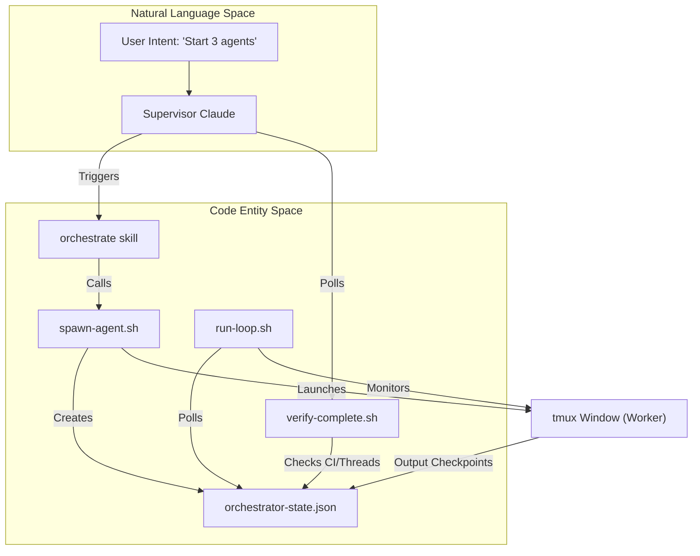
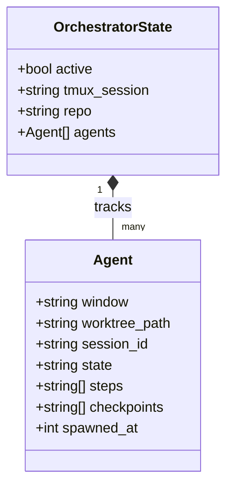

<!-- source: DeepWiki mcp.deepwiki.com · repo Significant-Gravitas/AutoGPT · page 5.7 Claude Code Agent Automation · fetched 2026-10-26 -->

# Claude Code Agent Automation

Relevant source files

The following files were used as context for generating this wiki page:

- [.claude/skills/orchestrate/SKILL.md](.claude/skills/orchestrate/SKILL.md)
- [.claude/skills/orchestrate/scripts/capacity.sh](.claude/skills/orchestrate/scripts/capacity.sh)
- [.claude/skills/orchestrate/scripts/classify-pane.sh](.claude/skills/orchestrate/scripts/classify-pane.sh)
- [.claude/skills/orchestrate/scripts/find-spare.sh](.claude/skills/orchestrate/scripts/find-spare.sh)
- [.claude/skills/orchestrate/scripts/notify.sh](.claude/skills/orchestrate/scripts/notify.sh)
- [.claude/skills/orchestrate/scripts/poll-cycle.sh](.claude/skills/orchestrate/scripts/poll-cycle.sh)
- [.claude/skills/orchestrate/scripts/recycle-agent.sh](.claude/skills/orchestrate/scripts/recycle-agent.sh)
- [.claude/skills/orchestrate/scripts/run-loop.sh](.claude/skills/orchestrate/scripts/run-loop.sh)
- [.claude/skills/orchestrate/scripts/spawn-agent.sh](.claude/skills/orchestrate/scripts/spawn-agent.sh)
- [.claude/skills/orchestrate/scripts/status.sh](.claude/skills/orchestrate/scripts/status.sh)
- [.claude/skills/orchestrate/scripts/verify-complete.sh](.claude/skills/orchestrate/scripts/verify-complete.sh)
- [.claude/skills/pr-address/SKILL.md](.claude/skills/pr-address/SKILL.md)
- [.claude/skills/pr-review/SKILL.md](.claude/skills/pr-review/SKILL.md)
- [.claude/skills/pr-test/SKILL.md](.claude/skills/pr-test/SKILL.md)
- [CLAUDE.md](CLAUDE.md)
- [autogpt_platform/AGENTS.md](autogpt_platform/AGENTS.md)
- [autogpt_platform/CLAUDE.md](autogpt_platform/CLAUDE.md)
- [autogpt_platform/backend/AGENTS.md](autogpt_platform/backend/AGENTS.md)
- [autogpt_platform/backend/CLAUDE.md](autogpt_platform/backend/CLAUDE.md)
- [autogpt_platform/frontend/CLAUDE.md](autogpt_platform/frontend/CLAUDE.md)
- [autogpt_platform/frontend/src/tests/AGENTS.md](autogpt_platform/frontend/src/tests/AGENTS.md)
- [autogpt_platform/frontend/src/tests/CLAUDE.md](autogpt_platform/frontend/src/tests/CLAUDE.md)
- [docs/platform/workspace-media-architecture.md](docs/platform/workspace-media-architecture.md)

This page documents the automation framework located in the `.claude/skills` directory, designed to manage and orchestrate fleets of **Claude Code** agents. The system provides high-level "skills" for PR lifecycle management (reviewing, addressing, testing, and polishing) and a sophisticated orchestration layer for parallel task execution using `tmux` and git worktrees.

## 1. Orchestration System

The orchestration system allows a single "Supervisor" Claude session to manage multiple "Worker" Claude agents. Each worker runs in its own `tmux` window and a dedicated git worktree to prevent environment contamination.

### 1.1 Core Architecture

The system operates on a dual-layer supervision model:
1.  **Orchestrating Claude (Supervisor):** The active Claude session that provides high-level judgment, monitors progress, and nudges stalled agents [ .claude/skills/orchestrate/SKILL.md:38-44 ]().
2.  **Mechanical Babysitter (`run-loop.sh`):** A zero-token shell script that handles repetitive tasks like auto-approving safe dialogs and restarting crashed agents [ .claude/skills/orchestrate/SKILL.md:46-47 ]().

### 1.2 Data Flow: Supervisor to Worker

The following diagram illustrates how the Orchestrator initiates a worker agent and tracks its progress through the state file.

**Orchestration Logic Flow**

Sources: [ .claude/skills/orchestrate/SKILL.md:1-35 ](), [ .claude/skills/orchestrate/scripts/spawn-agent.sh:4-13 ]()

### 1.3 Key Scripts and Functions

| Script | Functionality |
| :--- | :--- |
| `spawn-agent.sh` | Creates a `tmux` window, checkouts a branch in a spare worktree, and launches Claude with a stable `--session-id` [ .claude/skills/orchestrate/scripts/spawn-agent.sh:33-43 ](). |
| `run-loop.sh` | Performs "Mechanical Babysitting": auto-approves `y/n` prompts for safe commands (git, npm, pytest) and restarts agents if they exit [ .claude/skills/orchestrate/scripts/run-loop.sh:4-11 ](), [ .claude/skills/orchestrate/scripts/run-loop.sh:162-166 ](). |
| `verify-complete.sh` | Validates that a PR task is truly finished by checking: 1. Checkpoints, 2. CI status, 3. Unresolved threads, 4. Freshness of CI runs [ .claude/skills/orchestrate/scripts/verify-complete.sh:4-11 ](). |
| `recycle-agent.sh` | Kills the worker window and restores the worktree to a "spare" branch for future use [ .claude/skills/orchestrate/SKILL.md:26-26 ](). |

Sources: [ .claude/skills/orchestrate/SKILL.md:22-33 ](), [ .claude/skills/orchestrate/scripts/run-loop.sh:1-11 ]()

---

## 2. PR Workflow Skills

The repository includes specialized skills for automating the GitHub Pull Request lifecycle.

### 2.1 PR Address (`pr-address`)
This skill automates the loop of resolving reviewer comments. It is designed to handle large PRs with hundreds of threads.

*   **Pagination Logic:** The skill enforces mandatory pagination of GraphQL `reviewThreads`. It must loop until `hasNextPage == false` because GitHub returns threads oldest-first; recent (blocking) comments often appear on the last page [ .claude/skills/pr-address/SKILL.md:32-43 ]().
*   **Action Sequence:** The skill follows a strict protocol: `fix → commit → push → reply → resolve`. It is forbidden from resolving a thread without a code commit [ .claude/skills/pr-address/SKILL.md:148-150 ]().

Sources: [ .claude/skills/pr-address/SKILL.md:1-9 ](), [ .claude/skills/pr-address/SKILL.md:66-96 ]()

### 2.2 PR Review (`pr-review`)
Automates the inspection of code for correctness, security, and quality.
*   **Criticality Badges:** Every comment is prefixed with a badge: `🔴 **Blocker**`, `🟠 **Should Fix**`, `🟡 **Nice to Have**`, or `🔵 **Nit**` [ .claude/skills/pr-review/SKILL.md:61-68 ]().
*   **Inline Posting:** Findings are posted directly as inline comments using the GitHub API [ .claude/skills/pr-review/SKILL.md:81-86 ]().

Sources: [ .claude/skills/pr-review/SKILL.md:1-8 ](), [ .claude/skills/pr-review/SKILL.md:45-58 ]()

---

## 3. Worktree and State Management

### 3.1 Worktree Lifecycle
To enable parallel execution, the system uses git worktrees. The `find-spare.sh` script identifies unused worktrees (e.g., `AutoGPT6` on branch `spare/6`) [ .claude/skills/orchestrate/SKILL.md:24-24 ](). When an agent is spawned, it checkouts a feature branch in that worktree [ .claude/skills/orchestrate/scripts/spawn-agent.sh:38-39 ]().

### 3.2 State Persistence
The fleet status is tracked in `~/.claude/orchestrator-state.json`. This file is the source of truth for the `run-loop.sh` and the Supervisor Claude.

**State Entity Mapping**

Sources: [ .claude/skills/orchestrate/SKILL.md:95-130 ](), [ .claude/skills/orchestrate/scripts/spawn-agent.sh:47-74 ]()

### 3.3 Agent States
Agents transition through several states during their lifecycle:
*   `running`: Active and working.
*   `idle`: Process exited or crashed (triggers a "KICK" restart by `run-loop.sh`) [ .claude/skills/orchestrate/scripts/run-loop.sh:114-122 ]().
*   `waiting_approval`: Claude is paused at a prompt requiring human or supervisor intervention.
*   `done`: Task verified by `verify-complete.sh`, but window is still open for inspection [ .claude/skills/orchestrate/SKILL.md:142-142 ]().

Sources: [ .claude/skills/orchestrate/SKILL.md:140-140 ](), [ .claude/skills/orchestrate/scripts/run-loop.sh:114-116 ]()

---

## 4. Manual E2E Testing (`pr-test`)

The `pr-test` skill provides a framework for manual end-to-end testing of the AutoGPT Platform.

*   **Screenshot Requirements:** The skill mandates screenshots at every significant step, named sequentially (e.g., `01-credits-before.png`). These are pushed to a temporary branch and embedded in a PR comment [ .claude/skills/pr-test/SKILL.md:19-29 ]().
*   **State Verification:** Tests must verify state changes by querying the backend directly. This includes using `redis-cli` to check rate limits or `psql` to verify database persistence [ .claude/skills/pr-test/SKILL.md:54-64 ](), [ .claude/skills/pr-test/SKILL.md:84-88 ]().
*   **Serial Execution Rule:** Because integration tests use shared resources (Docker ports, databases), the orchestrator ensures that `pr-test` is never run in parallel across multiple agents [ .claude/skills/orchestrate/SKILL.md:144-146 ]().

Sources: [ .claude/skills/pr-test/SKILL.md:1-9 ](), [ .claude/skills/pr-test/SKILL.md:15-50 ]()

---

