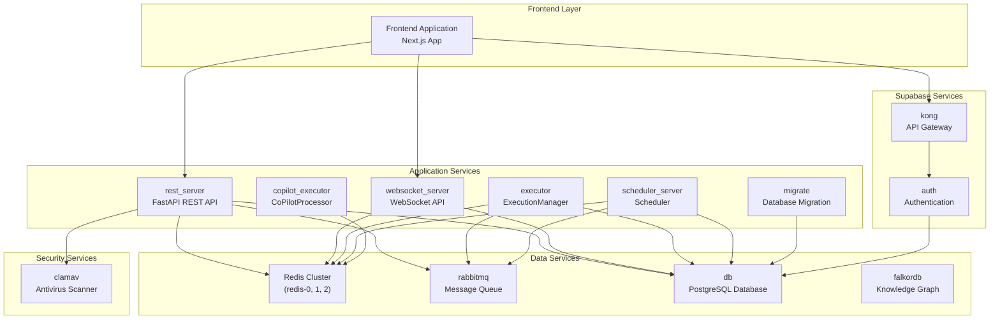
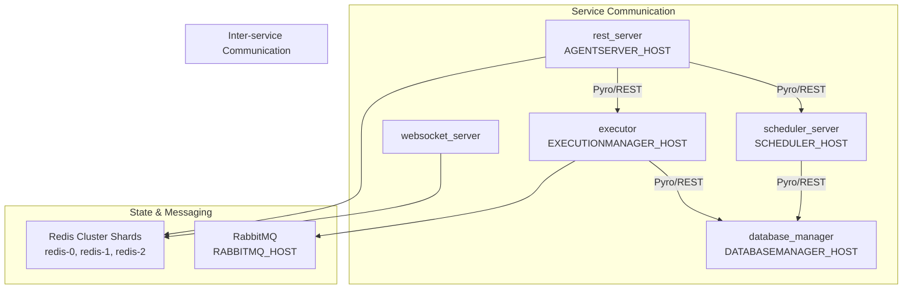

<!-- source: DeepWiki mcp.deepwiki.com · repo Significant-Gravitas/AutoGPT · page 6 Deployment · fetched 2026-10-26 -->

# Deployment

<details>
<summary>Relevant source files</summary>

The following files were used as context for generating this wiki page:

- [.dockerignore](.dockerignore)
- [.github/workflows/platform-backend-ci.yml](.github/workflows/platform-backend-ci.yml)
- [.github/workflows/platform-frontend-ci.yml](.github/workflows/platform-frontend-ci.yml)
- [.github/workflows/platform-fullstack-ci.yml](.github/workflows/platform-fullstack-ci.yml)
- [autogpt_platform/README.md](autogpt_platform/README.md)
- [autogpt_platform/backend/.env.default](autogpt_platform/backend/.env.default)
- [autogpt_platform/backend/Dockerfile](autogpt_platform/backend/Dockerfile)
- [autogpt_platform/backend/README.advanced.md](autogpt_platform/backend/README.advanced.md)
- [autogpt_platform/backend/README.md](autogpt_platform/backend/README.md)
- [autogpt_platform/backend/backend/copilot/tools/agent_browser.py](autogpt_platform/backend/backend/copilot/tools/agent_browser.py)
- [autogpt_platform/backend/backend/copilot/tools/agent_browser_integration_test.py](autogpt_platform/backend/backend/copilot/tools/agent_browser_integration_test.py)
- [autogpt_platform/backend/backend/copilot/tools/conftest.py](autogpt_platform/backend/backend/copilot/tools/conftest.py)
- [autogpt_platform/backend/backend/util/feature_flag_test.py](autogpt_platform/backend/backend/util/feature_flag_test.py)
- [autogpt_platform/backend/test/__init__.py](autogpt_platform/backend/test/__init__.py)
- [autogpt_platform/db/docker/docker-compose.yml](autogpt_platform/db/docker/docker-compose.yml)
- [autogpt_platform/db/docker/reset.sh](autogpt_platform/db/docker/reset.sh)
- [autogpt_platform/docker-compose.platform.yml](autogpt_platform/docker-compose.platform.yml)
- [autogpt_platform/docker-compose.yml](autogpt_platform/docker-compose.yml)
- [autogpt_platform/frontend/Dockerfile](autogpt_platform/frontend/Dockerfile)
- [autogpt_platform/frontend/src/app/page.tsx](autogpt_platform/frontend/src/app/page.tsx)
- [autogpt_platform/frontend/src/services/feature-flags/__tests__/helpers.test.ts](autogpt_platform/frontend/src/services/feature-flags/__tests__/helpers.test.ts)
- [autogpt_platform/frontend/src/services/feature-flags/feature-flag-provider.tsx](autogpt_platform/frontend/src/services/feature-flags/feature-flag-provider.tsx)
- [autogpt_platform/frontend/src/services/feature-flags/helpers.ts](autogpt_platform/frontend/src/services/feature-flags/helpers.ts)

</details>


This document covers production deployment strategies for AutoGPT Platform, including Docker orchestration, service dependencies, and environment management. The deployment architecture is designed for scalable, production-ready operation with proper service isolation and monitoring.

For development setup and initial configuration, see [Getting Started](#2). For infrastructure-level CI/CD processes, see [CI/CD Workflows](#5.4).

## Deployment Architecture

AutoGPT Platform uses a microservices architecture deployed via Docker Compose, with clear separation between application services, data services, and external dependencies.

### Core Service Architecture



Sources: [autogpt_platform/docker-compose.platform.yml:51-277](), [autogpt_platform/docker-compose.yml:26-169]()

### Service Communication Flow

The system relies on specific environment variables to define service discovery within the Docker network.



Sources: [autogpt_platform/docker-compose.platform.yml:9-35](), [autogpt_platform/docker-compose.platform.yml:100-137]()

## Service Dependencies

The deployment uses strict service dependencies with health checks to ensure proper startup ordering.

### Dependency Hierarchy

| Service | Depends On | Health Check Mechanism |
|---------|------------|------------------------|
| `migrate` | `db` | `prisma migrate status` [autogpt_platform/docker-compose.platform.yml:77-82]() |
| `redis-init` | `redis-0, 1, 2` | `redis-cli cluster info` [autogpt_platform/docker-compose.platform.yml:131-137]() |
| `db` | `rabbitmq` | `rabbitmq-diagnostics ping` [autogpt_platform/docker-compose.yml:166-168]() |
| `rest_server` | `db`, `redis-0`, `rabbitmq` | Container Health Status |

For a deep dive into the Compose configuration, see [Docker Compose Deployment](#6.1).

## Environment Configuration

### Core Environment Variables

Configuration is managed via `.env` files, with `backend/.env.default` providing the base values.

#### Database & Messaging

```bash
# Database connection string for Docker network
DATABASE_URL=postgresql://postgres:password@db:5432/postgres?schema=platform
# Redis Cluster Entrypoint
REDIS_HOST=redis-0
REDIS_PORT=17000
# RabbitMQ
RABBITMQ_HOST=rabbitmq
```

#### Security & Keys

```bash
# Required for sensitive data storage
ENCRYPTION_KEY=dvziYgz0KSK8FENhju0ZYi8-fRTfAdlz6YLhdB_jhNw=
# JWT Verification for Supabase
JWT_VERIFY_KEY=your-super-secret-jwt-token
```

For a full reference of available variables, see [Environment Configuration](#6.2).

Sources: [autogpt_platform/backend/.env.default:7-38](), [autogpt_platform/docker-compose.platform.yml:18-35]()

## Docker Build Process

### Backend Multi-Stage Build

The backend [autogpt_platform/backend/Dockerfile]() uses a sophisticated multi-stage build to minimize image size and provide a secure runtime.

1.  **`builder`**: Installs build dependencies (Python 3.13, Node.js, Poetry) and generates the Prisma client [autogpt_platform/backend/Dockerfile:3-54]().
2.  **`migrate`**: A lightweight stage containing only the Prisma CLI and migration files for database updates [autogpt_platform/backend/Dockerfile:59-86]().
3.  **`server`**: The final production image. It includes runtime dependencies like `ffmpeg`, `imagemagick`, and `bubblewrap` for secure tool execution [autogpt_platform/backend/Dockerfile:90-109]().

### Frontend Build

The frontend [autogpt_platform/frontend/Dockerfile]() uses a standard Next.js standalone build:
-   **`base`**: pnpm dependency installation [autogpt_platform/frontend/Dockerfile:2-6]().
-   **`build`**: Generates the API client and runs `next build` [autogpt_platform/frontend/Dockerfile:9-33]().
-   **`prod`**: Minimal runtime using the `standalone` output [autogpt_platform/frontend/Dockerfile:36-56]().

## Database Management

The platform uses Prisma for schema management and migrations. Production deployments must run the `migrate` service to ensure the schema is up to date before application services start.

**Key Operations:**
-   **Migrations**: Handled by the `migrate` service using `prisma migrate deploy` [autogpt_platform/docker-compose.platform.yml:52-62]().
-   **Type Generation**: `python3 scripts/gen_prisma_types_stub.py` is required for backend type safety [autogpt_platform/backend/Dockerfile:54]().

For detailed database procedures, see [Database Management](#6.3).

## Operational Considerations

### Resource Management
-   **Redis Cluster**: Local deployments use a 3-master shard setup (redis-0, 1, 2) to mirror production environments [autogpt_platform/docker-compose.platform.yml:100-126]().
-   **ClamAV**: Used for virus scanning on uploaded files, configured with specific stream and file size limits [autogpt_platform/docker-compose.yml:112-131]().
-   **Agent Sandbox**: The backend image includes `bubblewrap` to provide OS-level sandboxing for the `bash_exec` tool when external sandboxes like E2B are not configured [autogpt_platform/backend/Dockerfile:108]().

### CI/CD Integration
The repository includes GitHub Action workflows for automated testing and validation of the deployment artifacts:
-   **Backend CI**: Runs linters, type-checks, and tests against a real Redis Cluster and RabbitMQ [ .github/workflows/platform-backend-ci.yml:111-204]().
-   **Frontend CI**: Handles linting, unit tests, and API client generation checks [ .github/workflows/platform-frontend-ci.yml:64-167]().
-   **Full-stack CI**: Validates that the frontend API client is in sync with the backend OpenAPI schema [ .github/workflows/platform-fullstack-ci.yml:51-148]().

Sources: [autogpt_platform/README.md:141-165](), [autogpt_platform/backend/Dockerfile:96-109]()

---

