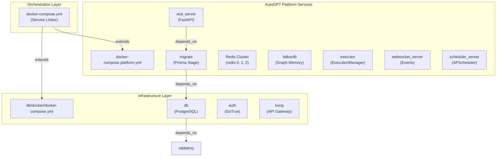
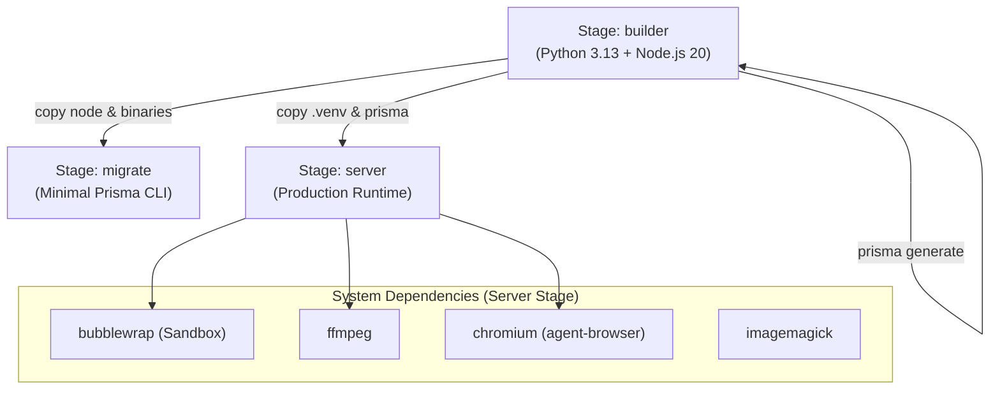
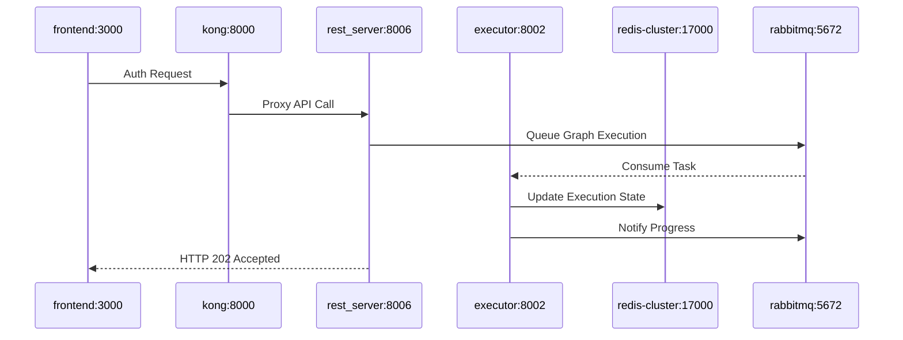

<!-- source: DeepWiki mcp.deepwiki.com · repo Significant-Gravitas/AutoGPT · page 6.1 Docker Compose Deployment · fetched 2026-10-26 -->

# Docker Compose Deployment

Relevant source files

The following files were used as context for generating this wiki page:

- [.dockerignore](.dockerignore)
- [.github/workflows/platform-backend-ci.yml](.github/workflows/platform-backend-ci.yml)
- [.github/workflows/platform-frontend-ci.yml](.github/workflows/platform-frontend-ci.yml)
- [.github/workflows/platform-fullstack-ci.yml](.github/workflows/platform-fullstack-ci.yml)
- [autogpt_platform/README.md](autogpt_platform/README.md)
- [autogpt_platform/backend/.env.default](autogpt_platform/backend/.env.default)
- [autogpt_platform/backend/Dockerfile](autogpt_platform/backend/Dockerfile)
- [autogpt_platform/backend/README.advanced.md](autogpt_platform/backend/README.advanced.md)
- [autogpt_platform/backend/README.md](autogpt_platform/backend/README.md)
- [autogpt_platform/backend/backend/copilot/tools/agent_browser.py](autogpt_platform/backend/backend/copilot/tools/agent_browser.py)
- [autogpt_platform/backend/backend/copilot/tools/agent_browser_integration_test.py](autogpt_platform/backend/backend/copilot/tools/agent_browser_integration_test.py)
- [autogpt_platform/backend/backend/copilot/tools/conftest.py](autogpt_platform/backend/backend/copilot/tools/conftest.py)
- [autogpt_platform/backend/backend/util/feature_flag_test.py](autogpt_platform/backend/backend/util/feature_flag_test.py)
- [autogpt_platform/backend/test/__init__.py](autogpt_platform/backend/test/__init__.py)
- [autogpt_platform/db/docker/docker-compose.yml](autogpt_platform/db/docker/docker-compose.yml)
- [autogpt_platform/db/docker/reset.sh](autogpt_platform/db/docker/reset.sh)
- [autogpt_platform/docker-compose.platform.yml](autogpt_platform/docker-compose.platform.yml)
- [autogpt_platform/docker-compose.yml](autogpt_platform/docker-compose.yml)
- [autogpt_platform/frontend/Dockerfile](autogpt_platform/frontend/Dockerfile)
- [autogpt_platform/frontend/src/app/page.tsx](autogpt_platform/frontend/src/app/page.tsx)
- [autogpt_platform/frontend/src/services/feature-flags/__tests__/helpers.test.ts](autogpt_platform/frontend/src/services/feature-flags/__tests__/helpers.test.ts)
- [autogpt_platform/frontend/src/services/feature-flags/feature-flag-provider.tsx](autogpt_platform/frontend/src/services/feature-flags/feature-flag-provider.tsx)
- [autogpt_platform/frontend/src/services/feature-flags/helpers.ts](autogpt_platform/frontend/src/services/feature-flags/helpers.ts)

Docker Compose orchestrates the multi-container deployment of the AutoGPT Platform, managing service dependencies, networking, and environment configuration. This system coordinates backend services, high-availability Redis clusters, message queues, and a local Supabase infrastructure through a layered composition approach.

## Architecture Overview

The AutoGPT Platform uses a multi-file Docker Compose strategy. The primary `docker-compose.yml` file extends definitions from `docker-compose.platform.yml` and the Supabase stack in `db/docker/docker-compose.yml`.

### Service Composition Structure

Sources: [autogpt_platform/docker-compose.yml:26-169](), [autogpt_platform/docker-compose.platform.yml:51-180]()

## Core Platform Services

The platform services are built using a multi-stage `Dockerfile` that optimizes for different runtime requirements (e.g., a lightweight `migrate` stage vs. a feature-rich `server` stage).

### Backend Service Definitions

| Service | Code Entrypoint | Role | Port(s) |
|:---|:---|:---|:---|
| `rest_server` | `backend.rest` | Main API, OAuth, and User Management | 8006, 8007 |
| `executor` | `backend.exec` | `ExecutionProcessor` for graph nodes | 8002 |
| `websocket_server`| `backend.ws` | Real-time `node_execution_event` streams | 8001 |
| `scheduler_server`| `backend.scheduler`| Cron-based agent triggers | 8003 |
| `database_manager`| `backend.db` | Centralized Prisma interface | 8004 |

Sources: [autogpt_platform/backend/Dockerfile:154-160](), [autogpt_platform/docker-compose.platform.yml:1-35]()

### High Availability Redis Cluster
The platform deploys a 3-master Redis Cluster for local development and production parity. This setup uses `redis-0`, `redis-1`, and `redis-2` shards. A one-shot `redis-init` container executes the `redis-cli --cluster create` command once the shards are healthy.

- **Internal Networking**: Each shard announces its Docker hostname (e.g., `redis-0`) using `--cluster-announce-hostname`. [autogpt_platform/docker-compose.platform.yml:100-103]()
- **Address Mapping**: The backend uses `REDIS_USE_ANNOUNCED_ADDRESS: "true"` to ensure `CLUSTER SLOTS` returns hostnames resolvable within the Docker network. [autogpt_platform/docker-compose.platform.yml:21-25]()

## Container Build Pipeline

The backend utilizes a multi-stage build process in `autogpt_platform/backend/Dockerfile` to minimize image size and provide required system dependencies for AI agents.

Sources: [autogpt_platform/backend/Dockerfile:1-160]()

## Network & Data Flow

The deployment uses two primary networks: `app-network` (internal service communication) and `shared-network` (cross-stack integration).

### Service Networking Diagram

Sources: [autogpt_platform/docker-compose.yml:1-23](), [autogpt_platform/docker-compose.platform.yml:9-35]()

## Environment Configuration

Environment variables are loaded in a specific hierarchy: `.env.default` -> `.env` -> Docker `environment` keys.

### Key Configuration Overrides
When running in Docker, local `localhost` defaults are overridden to use service hostnames:
- `DB_HOST: db` [autogpt_platform/docker-compose.platform.yml:18]()
- `RABBITMQ_HOST: rabbitmq` [autogpt_platform/docker-compose.platform.yml:26]()
- `SUPABASE_URL: http://kong:8000` [autogpt_platform/docker-compose.platform.yml:30]()

### Database Connection Strings
The `DATABASE_URL` is explicitly defined in the compose file to ensure it uses the correct `db` hostname and `platform` schema, bypassing interpolation issues with dynamic hostnames. [autogpt_platform/docker-compose.platform.yml:32-34]()

## Health Checks and Reliability

Docker Compose manages service readiness to prevent race conditions during startup.

- **RabbitMQ**: Used as a gate for the database. The `db` service waits for `rabbitmq` to be healthy to avoid `eacces` errors during erlang cookie writes. [autogpt_platform/docker-compose.yml:154-169]()
- **Database Migrations**: The `migrate` service runs `prisma migrate status` to ensure the schema is up-to-date before dependent services start. [autogpt_platform/docker-compose.platform.yml:77-85]()
- **Redis Cluster**: The `redis-init` sidecar checks `cluster_state:ok` before attempting creation to ensure idempotency. [autogpt_platform/docker-compose.platform.yml:131-137]()

Sources: [autogpt_platform/docker-compose.platform.yml:106-114](), [autogpt_platform/docker-compose.yml:127-132]()

## Development Features

### Docker Compose Watch
The platform supports live-reloading for the backend and migrations using the `watch` action.
- **Migrations**: Changes to `autogpt_platform/backend/migrations` trigger a `rebuild` of the `migrate` service. [autogpt_platform/docker-compose.platform.yml:63-67]()
- **Frontend**: The frontend Dockerfile supports `NEXT_PUBLIC_PW_TEST` and `NEXT_PUBLIC_SOURCEMAPS` build arguments for CI and debugging. [autogpt_platform/frontend/Dockerfile:12-18]()

### Local Profiles
The `deps` and `deps_backend` services use the `local` profile to group all infrastructure dependencies, allowing developers to start the entire stack with a single target. [autogpt_platform/docker-compose.yml:171-226]()

---

