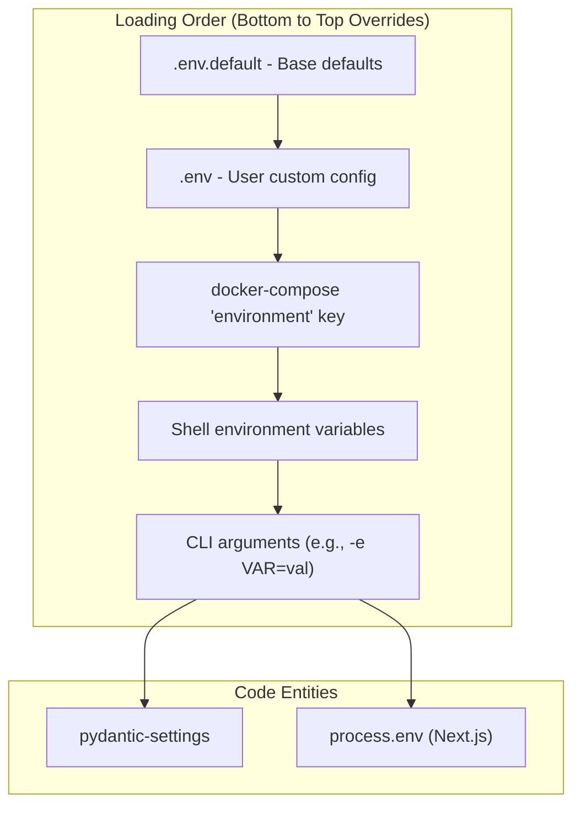
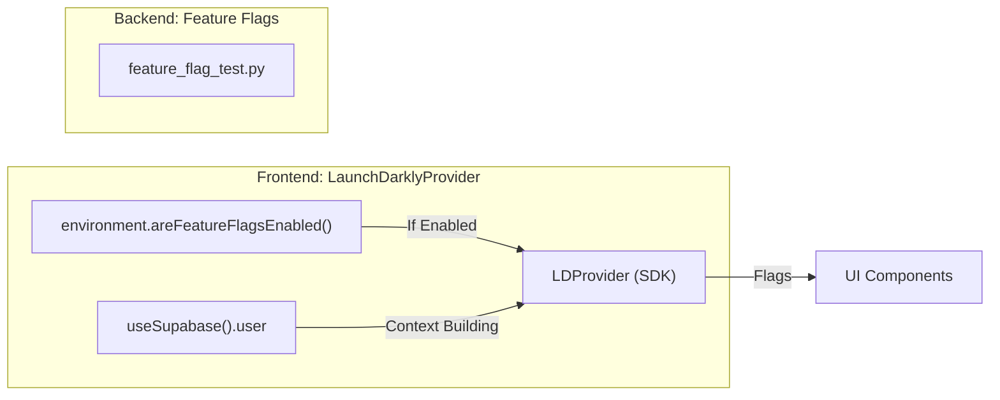

<!-- source: DeepWiki mcp.deepwiki.com · repo Significant-Gravitas/AutoGPT · page 6.2 Environment Configuration · fetched 2026-10-26 -->

# Environment Configuration

<details>
<summary>Relevant source files</summary>

The following files were used as context for generating this wiki page:

- [.dockerignore](.dockerignore)
- [.github/workflows/platform-backend-ci.yml](.github/workflows/platform-backend-ci.yml)
- [.github/workflows/platform-frontend-ci.yml](.github/workflows/platform-frontend-ci.yml)
- [.github/workflows/platform-fullstack-ci.yml](.github/workflows/platform-fullstack-ci.yml)
- [autogpt_platform/README.md](autogpt_platform/README.md)
- [autogpt_platform/backend/.env.default](autogpt_platform/backend/.env.default)
- [autogpt_platform/backend/Dockerfile](autogpt_platform/backend/Dockerfile)
- [autogpt_platform/backend/README.advanced.md](autogpt_platform/backend/README.advanced.md)
- [autogpt_platform/backend/README.md](autogpt_platform/backend/README.md)
- [autogpt_platform/backend/backend/copilot/tools/agent_browser.py](autogpt_platform/backend/backend/copilot/tools/agent_browser.py)
- [autogpt_platform/backend/backend/copilot/tools/agent_browser_integration_test.py](autogpt_platform/backend/backend/copilot/tools/agent_browser_integration_test.py)
- [autogpt_platform/backend/backend/copilot/tools/conftest.py](autogpt_platform/backend/backend/copilot/tools/conftest.py)
- [autogpt_platform/backend/backend/util/feature_flag_test.py](autogpt_platform/backend/backend/util/feature_flag_test.py)
- [autogpt_platform/backend/test/__init__.py](autogpt_platform/backend/test/__init__.py)
- [autogpt_platform/db/docker/docker-compose.yml](autogpt_platform/db/docker/docker-compose.yml)
- [autogpt_platform/db/docker/reset.sh](autogpt_platform/db/docker/reset.sh)
- [autogpt_platform/docker-compose.platform.yml](autogpt_platform/docker-compose.platform.yml)
- [autogpt_platform/docker-compose.yml](autogpt_platform/docker-compose.yml)
- [autogpt_platform/frontend/.env.default](autogpt_platform/frontend/.env.default)
- [autogpt_platform/frontend/.npmrc](autogpt_platform/frontend/.npmrc)
- [autogpt_platform/frontend/Dockerfile](autogpt_platform/frontend/Dockerfile)
- [autogpt_platform/frontend/package.json](autogpt_platform/frontend/package.json)
- [autogpt_platform/frontend/playwright.config.ts](autogpt_platform/frontend/playwright.config.ts)
- [autogpt_platform/frontend/pnpm-lock.yaml](autogpt_platform/frontend/pnpm-lock.yaml)
- [autogpt_platform/frontend/pnpm-workspace.yaml](autogpt_platform/frontend/pnpm-workspace.yaml)
- [autogpt_platform/frontend/public/mockServiceWorker.js](autogpt_platform/frontend/public/mockServiceWorker.js)
- [autogpt_platform/frontend/src/app/layout.tsx](autogpt_platform/frontend/src/app/layout.tsx)
- [autogpt_platform/frontend/src/app/page.tsx](autogpt_platform/frontend/src/app/page.tsx)
- [autogpt_platform/frontend/src/components/layout/Navbar/components/PreviewBanner/PreviewBanner.tsx](autogpt_platform/frontend/src/components/layout/Navbar/components/PreviewBanner/PreviewBanner.tsx)
- [autogpt_platform/frontend/src/providers/posthog/posthog-provider.tsx](autogpt_platform/frontend/src/providers/posthog/posthog-provider.tsx)
- [autogpt_platform/frontend/src/services/environment/index.ts](autogpt_platform/frontend/src/services/environment/index.ts)
- [autogpt_platform/frontend/src/services/feature-flags/__tests__/helpers.test.ts](autogpt_platform/frontend/src/services/feature-flags/__tests__/helpers.test.ts)
- [autogpt_platform/frontend/src/services/feature-flags/feature-flag-provider.tsx](autogpt_platform/frontend/src/services/feature-flags/feature-flag-provider.tsx)
- [autogpt_platform/frontend/src/services/feature-flags/helpers.ts](autogpt_platform/frontend/src/services/feature-flags/helpers.ts)

</details>


This document provides a comprehensive technical reference for the environment configuration of the AutoGPT Platform. It covers the hierarchy of environment variable loading, service-specific settings, feature flags, and the integration of external service providers.

## Configuration Loading Hierarchy

The AutoGPT Platform utilizes a layered approach to environment configuration, particularly within Docker-orchestrated environments. Variables are loaded in a specific order where later stages override earlier ones.



Sources: [autogpt_platform/docker-compose.platform.yml:1-6](), [autogpt_platform/README.md:23-29]()

## Core Service Infrastructure

The platform backend is composed of multiple microservices that rely on a shared set of infrastructure hostnames and connection strings. In a Docker environment, these are typically overridden to use internal service names.

### Service Host Configuration
| Variable | Default (Local) | Docker Override | Purpose |
|----------|-----------------|-----------------|---------|
| `AGENTSERVER_HOST` | `localhost` | `rest_server` | REST API service host |
| `SCHEDULER_HOST` | `localhost` | `scheduler_server` | Task scheduler service host |
| `DATABASEMANAGER_HOST` | `localhost` | `database_manager` | Database management service host |
| `EXECUTIONMANAGER_HOST` | `localhost` | `executor` | Graph execution engine host |
| `NOTIFICATIONMANAGER_HOST` | `localhost` | `notification_server` | Notification delivery service host |

Sources: [autogpt_platform/docker-compose.platform.yml:9-16]()

### Data Layer Connectivity
*   **Database**: Managed via `DATABASE_URL` and `DIRECT_URL`. In Docker, these point to the `db` service with specific schema parameters `schema=platform` [autogpt_platform/docker-compose.platform.yml:33-34]().
*   **Redis Cluster**: Configured as a 3-shard cluster (`redis-0`, `redis-1`, `redis-2`). The variable `REDIS_USE_ANNOUNCED_ADDRESS` is set to `true` to ensure the backend uses the Docker-resolvable hostnames provided by the cluster gossip protocol [autogpt_platform/docker-compose.platform.yml:19-25]().
*   **Graphiti (FalkorDB)**: Connected via `GRAPHITI_FALKORDB_HOST` (default `falkordb`) and `GRAPHITI_FALKORDB_PORT` (`6379`). Authentication is enforced via `GRAPHITI_FALKORDB_PASSWORD` [autogpt_platform/docker-compose.platform.yml:27-28](), [autogpt_platform/docker-compose.platform.yml:150-151]().

## Frontend Environment Settings

The Next.js frontend utilizes `process.env` variables, prefixed with `NEXT_PUBLIC_` for client-side accessibility.

### Build and Runtime Flags
*   **Analytics**: `NEXT_PUBLIC_GA_MEASUREMENT_ID` configures Google Analytics [autogpt_platform/frontend/src/app/layout.tsx:62-64]().
*   **DevTools**: `NEXT_PUBLIC_REACT_QUERY_DEVTOOL` toggles the visibility of the React Query debugging interface [autogpt_platform/frontend/src/app/layout.tsx:72-77]().
*   **Testing**: `NEXT_PUBLIC_PW_TEST` is used during CI to trigger specialized build configurations for Playwright E2E testing [autogpt_platform/frontend/package.json:16-17]().

### Environment Detection Logic
The frontend identifies its operational context (Local vs Dev vs Prod) to serve appropriate assets, such as favicons:
```typescript
const isDev = environment.isDev();
const isLocal = environment.isLocal();

const faviconPath = isDev
  ? "/favicon-dev.ico"
  : isLocal
    ? "/favicon-local.ico"
    : "/favicon.ico";
```
Sources: [autogpt_platform/frontend/src/app/layout.tsx:19-26]()

## Feature Flags and A/B Testing

The platform integrates **LaunchDarkly** for runtime feature management. This is implemented via the `LaunchDarklyProvider` component.



*   **Initialization**: The provider checks `environment.areFeatureFlagsEnabled()` and requires a `NEXT_PUBLIC_LAUNCHDARKLY_CLIENT_ID` [autogpt_platform/frontend/src/services/feature-flags/feature-flag-provider.tsx:16-17]().
*   **User Context**: Flags are evaluated against a context built from the Supabase user object via `buildLDContext(user)` [autogpt_platform/frontend/src/services/feature-flags/feature-flag-provider.tsx:21]().
*   **Observability**: Flag usage is reported to Sentry via the `Sentry.buildLaunchDarklyFlagUsedHandler()` [autogpt_platform/frontend/src/services/feature-flags/feature-flag-provider.tsx:39]().

Sources: [autogpt_platform/frontend/src/services/feature-flags/feature-flag-provider.tsx:14-45]()

## External Integrations and Sandboxing

### LLM Providers
API keys for providers like OpenAI are configured in the backend `.env`. In CI environments, these are injected as secrets (e.g., `OPENAI_INTERNAL_API_KEY`) to facilitate E2E tests that require live embeddings [autogpt_platform/github/workflows/platform-fullstack-ci.yml:166-170]().

### Code Execution and Browsing
*   **Agent Browser**: The `agent-browser` tool (used by Copilot) requires an executable path, configured via `AGENT_BROWSER_EXECUTABLE_PATH`. In Docker, this points to `/usr/bin/chromium` [autogpt_platform/backend/Dockerfile:137]().
*   **Sandboxing**: For local code execution without E2B, the platform utilizes **bubblewrap** to provide an OS-level sandbox with whitelist-only filesystem access and no network connectivity [autogpt_platform/backend/Dockerfile:97-108]().

### Security and Scanning
*   **ClamAV**: Used for file scanning. Configuration includes `CLAMAV_SERVICE_HOST` and various `CLAMD_CONF_*` variables to control stream limits and thread counts [autogpt_platform/docker-compose.platform.yml:16-17](), [autogpt_platform/docker-compose.platform.yml:120-126]().

## Production vs Development Defaults

The repository maintains a clear distinction between development convenience and production hardening.

| Feature | Development (Local) | Production (Cloud) |
|---------|---------------------|--------------------|
| **Supabase Auth** | `GOTRUE_MAILER_AUTOCONFIRM: true` | SMTP with verification |
| **Database** | Direct access (Port 5432) | Connection pooling (Supavisor) |
| **Redis** | Volatile (No volumes) | Persistent volumes |
| **ClamAV** | Enabled (Healthcheck) | Scaled service |
| **Source Maps** | `NEXT_PUBLIC_SOURCEMAPS: true` | Stripped/Private |

Sources: [autogpt_platform/docker-compose.yml:152-165](), [autogpt_platform/docker-compose.platform.yml:91-94](), [autogpt_platform/.github/workflows/platform-fullstack-ci.yml:187-191]()

---

