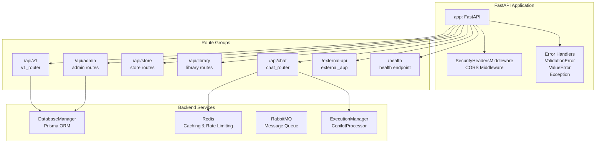
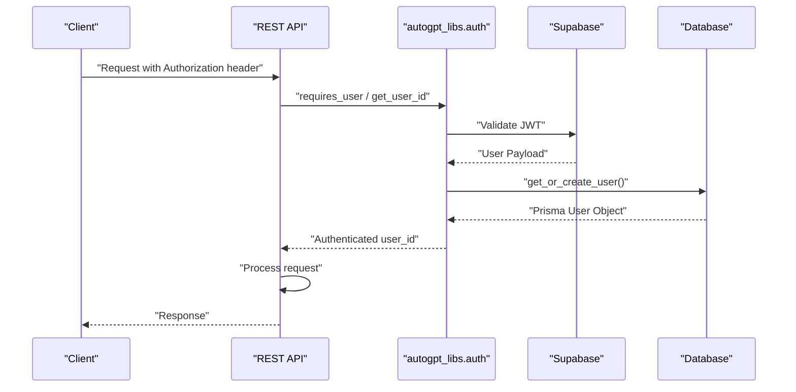
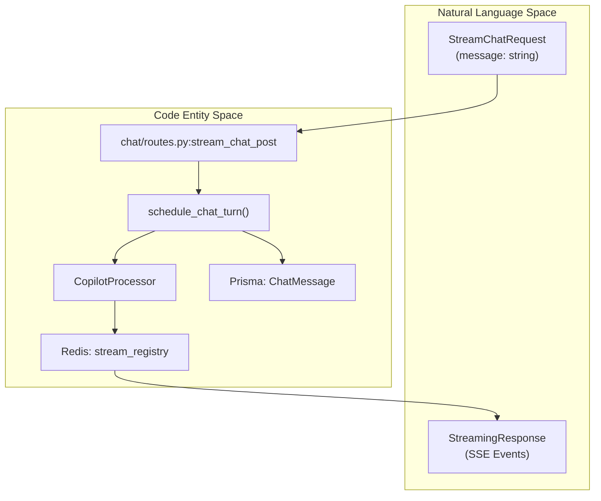
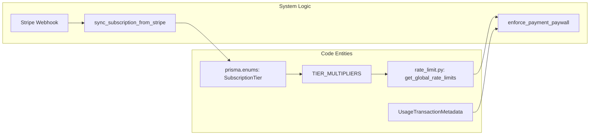

<!-- source: DeepWiki mcp.deepwiki.com · repo Significant-Gravitas/AutoGPT · page 7.1 REST API · fetched 2026-10-26 -->

# REST API

Relevant source files

The following files were used as context for generating this wiki page:

- [autogpt_platform/backend/backend/api/conftest.py](autogpt_platform/backend/backend/api/conftest.py)
- [autogpt_platform/backend/backend/api/external/fastapi_app.py](autogpt_platform/backend/backend/api/external/fastapi_app.py)
- [autogpt_platform/backend/backend/api/external/v1/routes.py](autogpt_platform/backend/backend/api/external/v1/routes.py)
- [autogpt_platform/backend/backend/api/external/v1/routes_test.py](autogpt_platform/backend/backend/api/external/v1/routes_test.py)
- [autogpt_platform/backend/backend/api/features/admin/diagnostics_admin_routes.py](autogpt_platform/backend/backend/api/features/admin/diagnostics_admin_routes.py)
- [autogpt_platform/backend/backend/api/features/chat/routes.py](autogpt_platform/backend/backend/api/features/chat/routes.py)
- [autogpt_platform/backend/backend/api/features/chat/routes_test.py](autogpt_platform/backend/backend/api/features/chat/routes_test.py)
- [autogpt_platform/backend/backend/api/features/library/routes/presets.py](autogpt_platform/backend/backend/api/features/library/routes/presets.py)
- [autogpt_platform/backend/backend/api/features/subscription_routes_test.py](autogpt_platform/backend/backend/api/features/subscription_routes_test.py)
- [autogpt_platform/backend/backend/api/features/v1.py](autogpt_platform/backend/backend/api/features/v1.py)
- [autogpt_platform/backend/backend/api/rest_api.py](autogpt_platform/backend/backend/api/rest_api.py)
- [autogpt_platform/backend/backend/copilot/db.py](autogpt_platform/backend/backend/copilot/db.py)
- [autogpt_platform/backend/backend/copilot/db_test.py](autogpt_platform/backend/backend/copilot/db_test.py)
- [autogpt_platform/backend/backend/copilot/model.py](autogpt_platform/backend/backend/copilot/model.py)
- [autogpt_platform/backend/backend/copilot/model_test.py](autogpt_platform/backend/backend/copilot/model_test.py)
- [autogpt_platform/backend/backend/copilot/rate_limit.py](autogpt_platform/backend/backend/copilot/rate_limit.py)
- [autogpt_platform/backend/backend/copilot/rate_limit_test.py](autogpt_platform/backend/backend/copilot/rate_limit_test.py)
- [autogpt_platform/backend/backend/data/credit.py](autogpt_platform/backend/backend/data/credit.py)
- [autogpt_platform/backend/backend/data/credit_subscription_test.py](autogpt_platform/backend/backend/data/credit_subscription_test.py)
- [autogpt_platform/backend/backend/data/db_manager.py](autogpt_platform/backend/backend/data/db_manager.py)
- [autogpt_platform/backend/backend/util/feature_flag.py](autogpt_platform/backend/backend/util/feature_flag.py)
- [autogpt_platform/frontend/src/app/(platform)/copilot/CopilotPage.tsx](autogpt_platform/frontend/src/app/(platform)/copilot/CopilotPage.tsx)
- [autogpt_platform/frontend/src/app/(platform)/copilot/components/ChatContainer/ChatContainer.tsx](autogpt_platform/frontend/src/app/(platform)/copilot/components/ChatContainer/ChatContainer.tsx)
- [autogpt_platform/frontend/src/app/(platform)/copilot/components/ChatMessagesContainer/ChatMessagesContainer.tsx](autogpt_platform/frontend/src/app/(platform)/copilot/components/ChatMessagesContainer/ChatMessagesContainer.tsx)
- [autogpt_platform/frontend/src/app/(platform)/copilot/components/ChatMessagesContainer/__tests__/ChatMessagesContainer.test.tsx](autogpt_platform/frontend/src/app/(platform)/copilot/components/ChatMessagesContainer/__tests__/ChatMessagesContainer.test.tsx)
- [autogpt_platform/frontend/src/app/(platform)/copilot/components/ChatMessagesContainer/__tests__/LoadMoreSentinel.test.tsx](autogpt_platform/frontend/src/app/(platform)/copilot/components/ChatMessagesContainer/__tests__/LoadMoreSentinel.test.tsx)
- [autogpt_platform/frontend/src/app/(platform)/copilot/helpers/__tests__/convertChatSessionToUiMessages.test.ts](autogpt_platform/frontend/src/app/(platform)/copilot/helpers/__tests__/convertChatSessionToUiMessages.test.ts)
- [autogpt_platform/frontend/src/app/(platform)/copilot/helpers/convertChatSessionToUiMessages.ts](autogpt_platform/frontend/src/app/(platform)/copilot/helpers/convertChatSessionToUiMessages.ts)
- [autogpt_platform/frontend/src/app/(platform)/copilot/useChatSession.ts](autogpt_platform/frontend/src/app/(platform)/copilot/useChatSession.ts)
- [autogpt_platform/frontend/src/app/(platform)/copilot/useCopilotPage.ts](autogpt_platform/frontend/src/app/(platform)/copilot/useCopilotPage.ts)
- [autogpt_platform/frontend/src/app/(platform)/copilot/useLoadMoreMessages.ts](autogpt_platform/frontend/src/app/(platform)/copilot/useLoadMoreMessages.ts)
- [autogpt_platform/frontend/src/app/(platform)/profile/(user)/credits/components/SubscriptionTierSection/SubscriptionTierSection.tsx](autogpt_platform/frontend/src/app/(platform)/profile/(user)/credits/components/SubscriptionTierSection/SubscriptionTierSection.tsx)
- [autogpt_platform/frontend/src/app/(platform)/profile/(user)/credits/components/SubscriptionTierSection/__tests__/SubscriptionTierSection.test.tsx](autogpt_platform/frontend/src/app/(platform)/profile/(user)/credits/components/SubscriptionTierSection/__tests__/SubscriptionTierSection.test.tsx)
- [autogpt_platform/frontend/src/app/(platform)/profile/(user)/credits/components/SubscriptionTierSection/helpers.ts](autogpt_platform/frontend/src/app/(platform)/profile/(user)/credits/components/SubscriptionTierSection/helpers.ts)
- [autogpt_platform/frontend/src/app/(platform)/profile/(user)/credits/components/SubscriptionTierSection/useSubscriptionTierSection.ts](autogpt_platform/frontend/src/app/(platform)/profile/(user)/credits/components/SubscriptionTierSection/useSubscriptionTierSection.ts)
- [autogpt_platform/frontend/src/app/(platform)/profile/(user)/credits/page.tsx](autogpt_platform/frontend/src/app/(platform)/profile/(user)/credits/page.tsx)
- [autogpt_platform/frontend/src/app/api/openapi.json](autogpt_platform/frontend/src/app/api/openapi.json)

## Purpose and Scope

The REST API serves as the primary interface for interacting with the AutoGPT Platform backend services. It provides comprehensive endpoints for user authentication, agent graph management, execution control, credit management, marketplace operations, and the AI Copilot system. The API follows RESTful principles and is implemented using FastAPI.

For information about WebSocket real-time communication, see [WebSocket API](#7.2). For Agent Protocol compliance, see [Agent Protocol](#7.3).

## API Architecture

The REST API is built on a modular FastAPI application with versioned endpoints and middleware for security, authentication, and error handling.

### Application Structure

**Sources:** [autogpt_platform/backend/backend/api/rest_api.py:1-50](), [autogpt_platform/backend/backend/api/features/v1.py:161-165](), [autogpt_platform/backend/backend/api/features/chat/routes.py:165-167]()

### Configuration and Settings

The API server is configured through environment variables and settings classes that control behavior across different deployment environments, including feature flags via LaunchDarkly.

**Sources:** [autogpt_platform/backend/backend/util/settings.py:1-50](), [autogpt_platform/backend/backend/util/feature_flag.py:30-69]()

## Authentication System

The API uses Supabase-based authentication with middleware that validates JWT tokens and manages user sessions.

### Authentication Flow

**Sources:** [autogpt_platform/backend/backend/api/features/v1.py:12-25](), [autogpt_platform/backend/backend/api/features/v1.py:172-180]()

## Core Endpoint Groups

### AI Copilot Chat Endpoints

The Copilot API handles conversational interactions, turn management, and real-time streaming via Server-Sent Events (SSE).

| Endpoint | Method | Purpose |
|----------|--------|---------|
| `/sessions` | GET | List user chat sessions |
| `/sessions` | POST | Create a new chat session |
| `/sessions/{id}` | DELETE | Delete a chat session |
| `/sessions/{id}/title` | PATCH | Update session title |
| `/sessions/{id}/stream` | POST | Stream chat response (SSE) |
| `/sessions/{id}/messages` | GET | Get paginated message history |

**Sources:** [autogpt_platform/backend/backend/api/features/chat/routes.py:165-300](), [autogpt_platform/backend/backend/copilot/db.py:68-149]()

### Credits, Billing, and Subscriptions

The platform implements a dual-budget system: **Credits** for block executions and **Microdollars** for Copilot LLM infrastructure costs.

| Endpoint | Method | Purpose |
|----------|--------|---------|
| `/credits` | GET | Get user credit balance |
| `/credits/top-up` | POST | Request credit top-up via Stripe |
| `/credits/history` | GET | Get transaction history |
| `/subscriptions/checkout` | POST | Create Stripe subscription checkout |
| `/subscriptions/tier` | GET | Get current subscription tier |

**Sources:** [autogpt_platform/backend/backend/api/features/v1.py:57-82](), [autogpt_platform/backend/backend/data/credit.py:146-170](), [autogpt_platform/backend/backend/copilot/rate_limit.py:107-121]()

### Admin and Diagnostics

Endpoints restricted to administrators for monitoring system health and managing resource costs.

| Endpoint | Method | Purpose |
|----------|--------|---------|
| `/api/admin/diagnostics/executions` | GET | Get execution health metrics |
| `/api/admin/diagnostics/executions/cleanup-orphaned` | POST | Force cleanup of stuck executions |
| `/api/admin/blocks/cost-estimates` | GET | Export block cost analytics |

**Sources:** [autogpt_platform/frontend/src/app/api/openapi.json:10-132](), [autogpt_platform/backend/backend/api/features/admin/diagnostics_admin_routes.py:1-20]()

## Data Flow and Models

### Copilot Message Processing

The Copilot system uses a specialized processing flow to bridge natural language requests to code execution (blocks/tools).

**Sources:** [autogpt_platform/backend/backend/api/features/chat/routes.py:194-250](), [autogpt_platform/backend/backend/copilot/model.py:76-104]()

### Credit and Subscription Logic

Subscription tiers directly influence API rate limits and resource quotas.

**Sources:** [autogpt_platform/backend/backend/copilot/rate_limit.py:83-121](), [autogpt_platform/backend/backend/data/credit.py:64-73](), [autogpt_platform/backend/backend/api/features/v1.py:57-82]()

## Error Handling

The API uses standardized error responses and HTTP status codes to communicate failure states.

| Status Code | Meaning | Context |
|-------------|---------|---------|
| 401 | Not Authenticated | Missing or invalid JWT |
| 402 | Payment Required | Insufficient credits or subscription required |
| 404 | Not Found | Resource (graph, session, file) missing |
| 422 | Validation Error | Pydantic schema validation failure |
| 429 | Too Many Requests | Rate limit exceeded (microdollars) |
| 503 | Service Unavailable | Redis/RabbitMQ connection failure |

**Sources:** [autogpt_platform/backend/backend/api/features/chat/routes.py:46-59](), [autogpt_platform/backend/backend/util/exceptions.py:130-134](), [autogpt_platform/backend/backend/copilot/rate_limit.py:8-13]()

---

