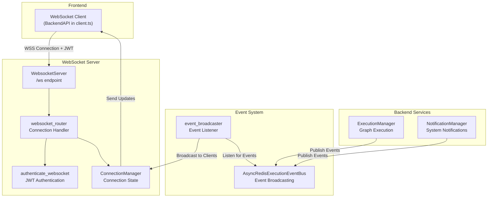
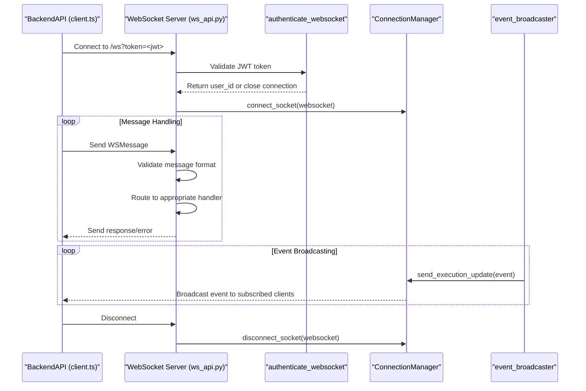
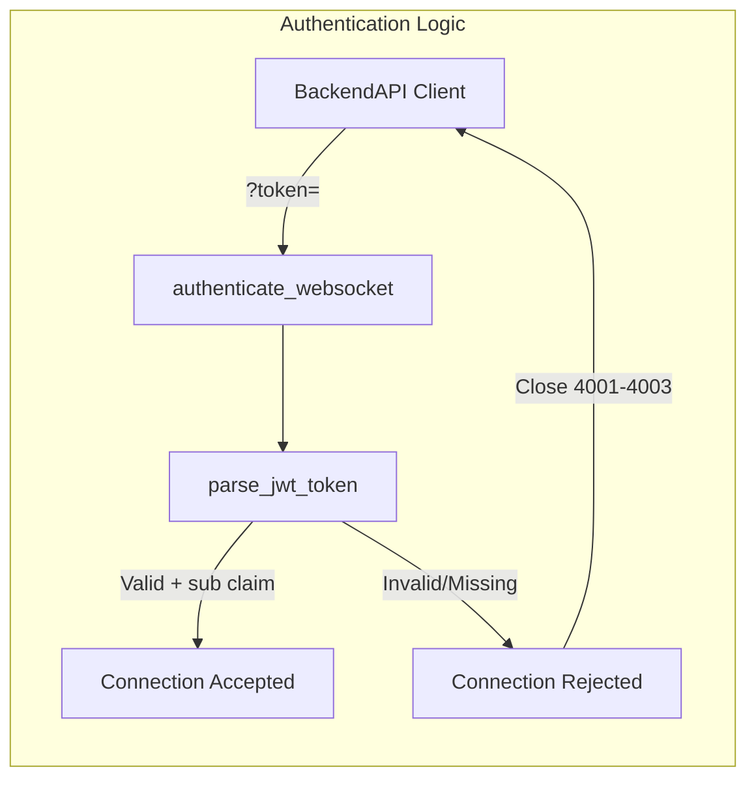
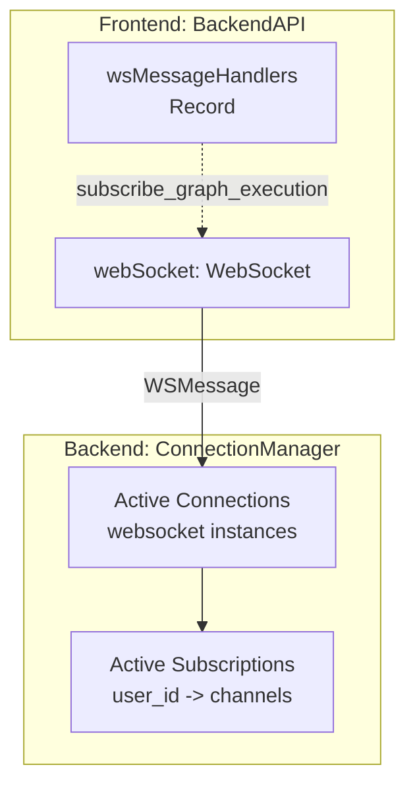

<!-- source: DeepWiki mcp.deepwiki.com · repo Significant-Gravitas/AutoGPT · page 7.2 WebSocket API · fetched 2026-10-26 -->

# WebSocket API

<details>
<summary>Relevant source files</summary>

The following files were used as context for generating this wiki page:

- [autogpt_platform/backend/backend/data/notifications.py](autogpt_platform/backend/backend/data/notifications.py)
- [autogpt_platform/backend/backend/data/user.py](autogpt_platform/backend/backend/data/user.py)
- [autogpt_platform/backend/backend/executor/scheduler.py](autogpt_platform/backend/backend/executor/scheduler.py)
- [autogpt_platform/backend/backend/monitoring/block_error_monitor.py](autogpt_platform/backend/backend/monitoring/block_error_monitor.py)
- [autogpt_platform/backend/backend/monitoring/late_execution_monitor.py](autogpt_platform/backend/backend/monitoring/late_execution_monitor.py)
- [autogpt_platform/backend/backend/monitoring/notification_monitor.py](autogpt_platform/backend/backend/monitoring/notification_monitor.py)
- [autogpt_platform/backend/backend/notifications/email.py](autogpt_platform/backend/backend/notifications/email.py)
- [autogpt_platform/backend/backend/notifications/notifications.py](autogpt_platform/backend/backend/notifications/notifications.py)
- [autogpt_platform/backend/backend/notifications/templates/agent_run.html.jinja2](autogpt_platform/backend/backend/notifications/templates/agent_run.html.jinja2)
- [autogpt_platform/backend/backend/notifications/templates/base.html.jinja2](autogpt_platform/backend/backend/notifications/templates/base.html.jinja2)
- [autogpt_platform/backend/backend/util/service.py](autogpt_platform/backend/backend/util/service.py)
- [autogpt_platform/backend/backend/util/service_test.py](autogpt_platform/backend/backend/util/service_test.py)
- [autogpt_platform/frontend/src/app/api/mutators/__tests__/custom-mutator.test.ts](autogpt_platform/frontend/src/app/api/mutators/__tests__/custom-mutator.test.ts)
- [autogpt_platform/frontend/src/app/api/mutators/custom-mutator.ts](autogpt_platform/frontend/src/app/api/mutators/custom-mutator.ts)
- [autogpt_platform/frontend/src/app/api/proxy/[...path]/__tests__/route.test.ts](autogpt_platform/frontend/src/app/api/proxy/[...path]/__tests__/route.test.ts)
- [autogpt_platform/frontend/src/app/api/proxy/[...path]/route.ts](autogpt_platform/frontend/src/app/api/proxy/[...path]/route.ts)
- [autogpt_platform/frontend/src/app/api/transcribe/route.ts](autogpt_platform/frontend/src/app/api/transcribe/route.ts)
- [autogpt_platform/frontend/src/app/api/workspace/files/upload/route.ts](autogpt_platform/frontend/src/app/api/workspace/files/upload/route.ts)
- [autogpt_platform/frontend/src/lib/autogpt-server-api/__tests__/client.test.ts](autogpt_platform/frontend/src/lib/autogpt-server-api/__tests__/client.test.ts)
- [autogpt_platform/frontend/src/lib/autogpt-server-api/__tests__/helpers.test.ts](autogpt_platform/frontend/src/lib/autogpt-server-api/__tests__/helpers.test.ts)
- [autogpt_platform/frontend/src/lib/autogpt-server-api/client.ts](autogpt_platform/frontend/src/lib/autogpt-server-api/client.ts)
- [autogpt_platform/frontend/src/lib/autogpt-server-api/helpers.ts](autogpt_platform/frontend/src/lib/autogpt-server-api/helpers.ts)
- [autogpt_platform/frontend/src/lib/supabase/actions.ts](autogpt_platform/frontend/src/lib/supabase/actions.ts)
- [autogpt_platform/frontend/src/lib/supabase/helpers.ts](autogpt_platform/frontend/src/lib/supabase/helpers.ts)
- [autogpt_platform/frontend/src/lib/supabase/hooks/useSupabase.ts](autogpt_platform/frontend/src/lib/supabase/hooks/useSupabase.ts)
- [autogpt_platform/frontend/src/lib/supabase/hooks/useSupabaseStore.ts](autogpt_platform/frontend/src/lib/supabase/hooks/useSupabaseStore.ts)
- [autogpt_platform/frontend/src/lib/supabase/middleware.ts](autogpt_platform/frontend/src/lib/supabase/middleware.ts)
- [autogpt_platform/frontend/src/lib/supabase/server/getServerSupabase.ts](autogpt_platform/frontend/src/lib/supabase/server/getServerSupabase.ts)
- [autogpt_platform/frontend/src/lib/withRoleAccess.ts](autogpt_platform/frontend/src/lib/withRoleAccess.ts)
- [autogpt_platform/frontend/src/middleware.ts](autogpt_platform/frontend/src/middleware.ts)
- [autogpt_platform/frontend/src/playwright/utils/signup.ts](autogpt_platform/frontend/src/playwright/utils/signup.ts)

</details>


The WebSocket API provides real-time communication between the AutoGPT Platform frontend and backend services. It enables live updates for agent execution status, graph execution events, and other real-time notifications without requiring constant polling from the client.

For information about the REST API endpoints, see [REST API](#7.1). For details about the Agent Protocol standard, see [Agent Protocol](#7.3).

## Architecture Overview

The WebSocket API is built on FastAPI and uses Redis for event broadcasting across distributed services. The system maintains persistent connections with authenticated clients and broadcasts execution events in real-time.

Title: WebSocket Architecture and Event Flow


**Sources:** [autogpt_platform/backend/backend/server/ws_api.py:1-324](), [autogpt_platform/frontend/src/lib/autogpt-server-api/client.ts:92-113]()

## WebSocket Endpoint

The WebSocket API exposes a single endpoint that handles all real-time communication. In the frontend, the `BackendAPI` class manages this connection via `this.wsUrl` [autogpt_platform/frontend/src/lib/autogpt-server-api/client.ts:112]().

| Endpoint | Protocol | Authentication | Purpose |
|----------|----------|----------------|---------|
| `/ws` | WebSocket | JWT Token | Real-time bidirectional communication |

### Connection Process

The frontend establishes the connection using `getWebSocketToken` to retrieve a fresh JWT from Supabase before connecting [autogpt_platform/frontend/src/lib/autogpt-server-api/client.ts:3-3]().

Title: WebSocket Connection Lifecycle


**Sources:** [autogpt_platform/backend/backend/server/ws_api.py:218-296](), [autogpt_platform/frontend/src/lib/autogpt-server-api/client.ts:95-113]()

## Message Types and Protocol

The WebSocket API uses a structured message format based on the `WSMessage` model.

### Heartbeat System
To maintain connection liveness, the `BackendAPI` implementation includes a heartbeat system with a `HEARTBEAT_INTERVAL` of 100 seconds and a `HEARTBEAT_TIMEOUT` of 10 seconds [autogpt_platform/frontend/src/lib/autogpt-server-api/client.ts:102-105]().

### Supported Message Methods

| Method | Direction | Purpose | Handler Function |
|--------|-----------|---------|------------------|
| `HEARTBEAT` | Bidirectional | Keep connection alive | `handle_heartbeat` |
| `SUBSCRIBE_GRAPH_EXEC` | Client → Server | Subscribe to single graph execution | `handle_subscribe` |
| `SUBSCRIBE_GRAPH_EXECS` | Client → Server | Subscribe to all executions for a graph | `handle_subscribe` |
| `UNSUBSCRIBE` | Client → Server | Unsubscribe from events | `handle_unsubscribe` |
| `ERROR` | Server → Client | Error notifications | N/A |

**Sources:** [autogpt_platform/backend/backend/server/ws_api.py:87-294](), [autogpt_platform/frontend/src/lib/autogpt-server-api/client.ts:102-106]()

## Authentication

WebSocket connections require JWT authentication passed as a query parameter. The frontend `BackendAPI` retrieves this token using `getWebSocketToken()` from the Supabase session [autogpt_platform/frontend/src/lib/autogpt-server-api/client.ts:3-3]().

Title: WebSocket Authentication Flow


### Authentication Error Codes

| Code | Reason | Description |
|------|--------|-------------|
| 4001 | Missing Token | No authentication token provided |
| 4002 | Invalid Token | Token missing required `sub` claim |
| 4003 | Invalid Token | Token validation failed |

**Sources:** [autogpt_platform/backend/backend/server/ws_api.py:63-82](), [autogpt_platform/frontend/src/lib/autogpt-server-api/client.ts:115-126]()

## Event Broadcasting System

The WebSocket API receives events from backend services through Redis. The `NotificationManager` in `notifications.py` uses RabbitMQ for system notifications, but real-time execution updates are routed via the WebSocket event bus [autogpt_platform/backend/backend/notifications/notifications.py:59-70]().

### Event Broadcasting Implementation

The `event_broadcaster` function runs as a background task and listens for events on all Redis channels:

```python
async def event_broadcaster(manager: ConnectionManager):
    event_queue = AsyncRedisExecutionEventBus()
    async for event in event_queue.listen("*"):
        await manager.send_execution_update(event)
```

**Sources:** [autogpt_platform/backend/backend/server/ws_api.py:49-61](), [autogpt_platform/backend/backend/notifications/notifications.py:149-180]()

## Connection Management

The `ConnectionManager` handles WebSocket connection lifecycle and subscription management. In the frontend, the `BackendAPI` class maintains a `webSocket` property and a set of handlers for various message types [autogpt_platform/frontend/src/lib/autogpt-server-api/client.ts:95-99]().

### Subscription Model

Title: Frontend-Backend Subscription Mapping


**Sources:** [autogpt_platform/backend/backend/server/ws_api.py:42-46](), [autogpt_platform/frontend/src/lib/autogpt-server-api/client.ts:95-100]()

## Error Handling

The WebSocket API implements comprehensive error handling. In the frontend, the `BackendAPI` uses a `LogoutInterruptError` to handle cases where a request fails due to the user logging out [autogpt_platform/frontend/src/lib/autogpt-server-api/client.ts:67-72]().

### Error Response Format

```json
{
  "method": "ERROR",
  "success": false,
  "error": "Error description",
  "data": null
}
```

**Sources:** [autogpt_platform/backend/backend/server/ws_api.py:230-291](), [autogpt_platform/frontend/src/lib/autogpt-server-api/client.ts:67-72]()

## Server Configuration

The WebSocket server is configured through the `WebsocketServer` class, while the frontend configuration is managed via the `environment` service [autogpt_platform/frontend/src/lib/autogpt-server-api/client.ts:109-112]().

### Configuration Parameters

| Parameter | Source | Purpose |
|-----------|--------|---------|
| `wsUrl` | `environment.getAGPTWsServerUrl()` | Frontend WebSocket target URL |
| `websocket_server_port` | Config | Backend server port |
| `enable_auth` | Config | Backend authentication toggle |

**Sources:** [autogpt_platform/backend/backend/server/ws_api.py:303-324](), [autogpt_platform/frontend/src/lib/autogpt-server-api/client.ts:107-113]()

---

