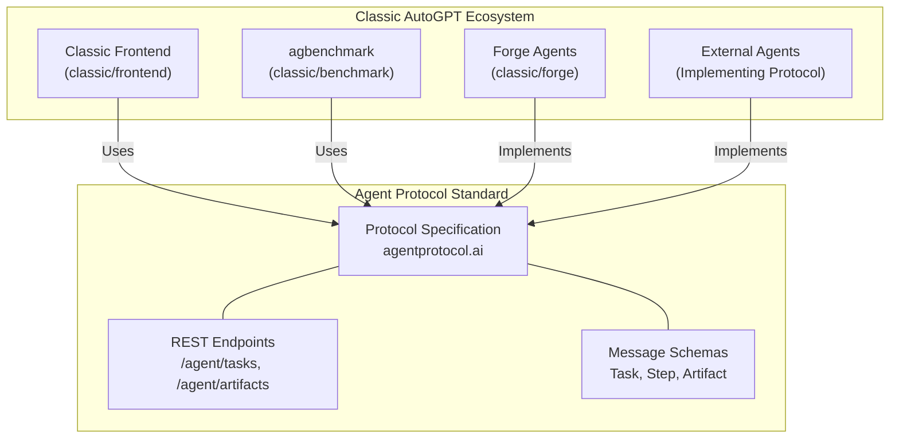
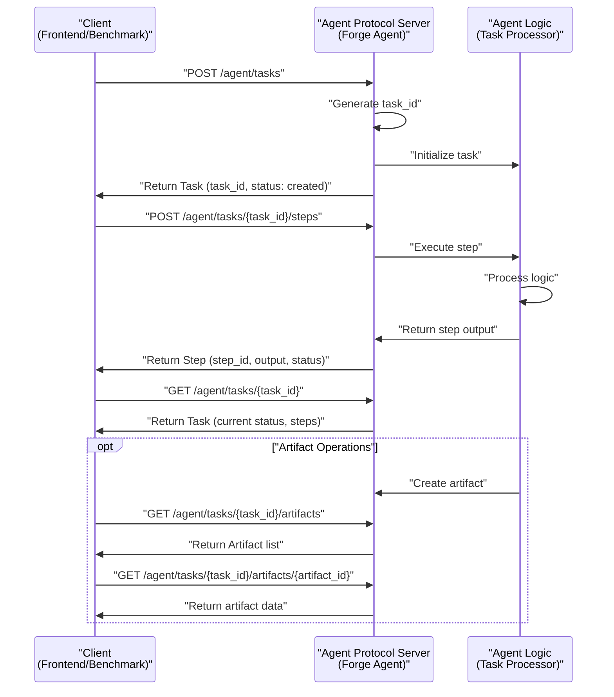
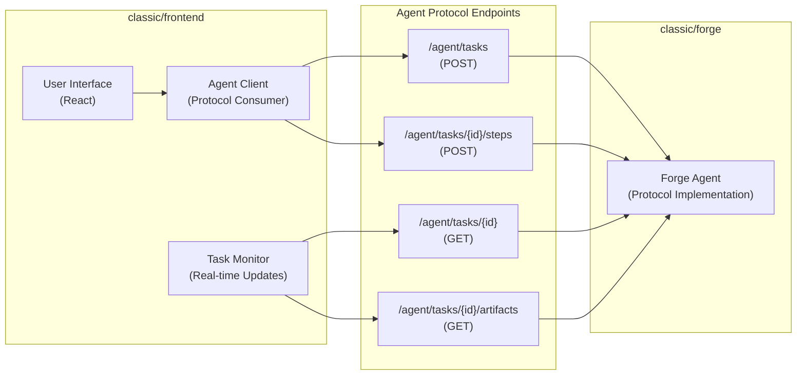
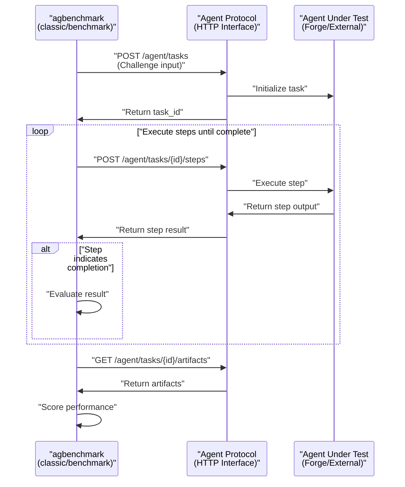
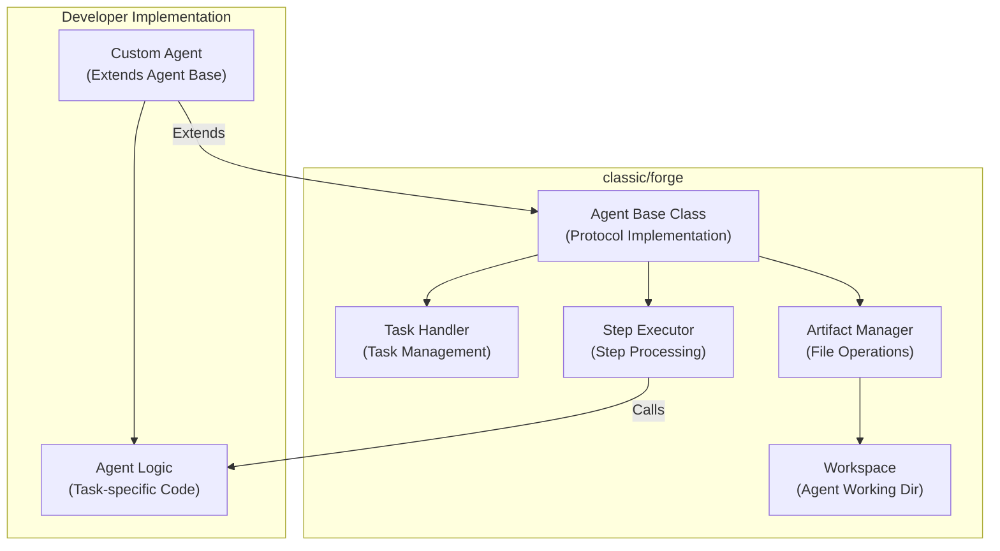

<!-- source: DeepWiki mcp.deepwiki.com · repo Significant-Gravitas/AutoGPT · page 7.3 Agent Protocol · fetched 2026-10-26 -->

# Agent Protocol

<details>
<summary>Relevant source files</summary>

The following files were used as context for generating this wiki page:

- [.github/ISSUE_TEMPLATE/1.bug.yml](.github/ISSUE_TEMPLATE/1.bug.yml)
- [.github/ISSUE_TEMPLATE/2.feature.yml](.github/ISSUE_TEMPLATE/2.feature.yml)
- [.github/PULL_REQUEST_TEMPLATE.md](.github/PULL_REQUEST_TEMPLATE.md)
- [.gitignore](.gitignore)
- [CODE_OF_CONDUCT.md](CODE_OF_CONDUCT.md)
- [CONTRIBUTING.md](CONTRIBUTING.md)
- [LICENSE](LICENSE)
- [README.md](README.md)
- [autogpt_platform/backend/backend/api/conftest.py](autogpt_platform/backend/backend/api/conftest.py)
- [autogpt_platform/backend/backend/api/external/fastapi_app.py](autogpt_platform/backend/backend/api/external/fastapi_app.py)
- [autogpt_platform/backend/backend/api/external/v1/routes.py](autogpt_platform/backend/backend/api/external/v1/routes.py)
- [autogpt_platform/backend/backend/api/external/v1/routes_test.py](autogpt_platform/backend/backend/api/external/v1/routes_test.py)
- [autogpt_platform/backend/backend/api/features/admin/diagnostics_admin_routes.py](autogpt_platform/backend/backend/api/features/admin/diagnostics_admin_routes.py)
- [autogpt_platform/backend/backend/api/features/library/routes/presets.py](autogpt_platform/backend/backend/api/features/library/routes/presets.py)
- [autogpt_platform/backend/backend/api/rest_api.py](autogpt_platform/backend/backend/api/rest_api.py)
- [docs/content/code-of-conduct.md](docs/content/code-of-conduct.md)
- [docs/content/contributing.md](docs/content/contributing.md)

</details>


The Agent Protocol is a standardized REST API specification created by the [AI Engineer Foundation](https://agentprotocol.ai/) that defines a uniform interface for agent communication. In the AutoGPT repository, this protocol is primarily implemented and used by **Classic AutoGPT** components, including Forge-based agents, the agbenchmark testing framework, and the Classic Frontend UI.

> **Note**: The modern **AutoGPT Platform** (located in `autogpt_platform/`) uses its own REST and WebSocket APIs, which are documented separately in pages [7.1]() (REST API) and [7.2]() (WebSocket API). While the platform's external API [autogpt_platform/backend/backend/api/external/v1/routes.py:36-40]() provides similar primitives (blocks, graphs, executions), it is not a direct implementation of the AI Engineer Foundation's Agent Protocol.

## 1. Overview and Purpose

The Agent Protocol establishes a uniform standard for agent communication, enabling seamless compatibility between different AI agent implementations and tools. In Classic AutoGPT, it serves as the communication layer between:

- **Agent implementations**: Forge-based agents and external agents that implement the protocol [LICENSE:15-16]()
- **Classic Frontend**: The legacy GUI for controlling and monitoring agents [LICENSE:17]()
- **agbenchmark**: The performance testing framework for autonomous agents [LICENSE:16]()
- **External tools**: Any third-party application that supports the protocol

By adhering to this protocol, agents become portable and interoperable—they can be tested with agbenchmark, controlled via the Classic Frontend, or integrated with external applications without modification to their core logic.

### Classic AutoGPT Components Using Agent Protocol



Sources: [LICENSE:12-17](), [README.md:132-133]()

## 2. Protocol Architecture

The Agent Protocol is designed as a REST API specification that defines standardized endpoints and message formats for agent communication. The protocol uses a **task-based model** where work is organized into tasks that can be broken down into individual steps.

### Core Concepts

| Concept | Description |
|---------|-------------|
| **Task** | A unit of work with a specific goal or input. Tasks have a unique ID and lifecycle (created → running → completed/failed) |
| **Step** | An individual action or execution phase within a task. Agents process tasks by executing steps sequentially or iteratively |
| **Artifact** | Files or data objects created during task execution (e.g., output files, logs, generated content) |
| **Agent** | The server implementation that receives task requests and executes them according to its logic |
| **Client** | Applications that interact with agents via the protocol (e.g., Classic Frontend, agbenchmark) |

### Agent Protocol Communication Flow



Sources: [README.md:132-133](), [LICENSE:12-17]()

## 3. Protocol Endpoints

The Agent Protocol defines a standardized set of REST endpoints that all conforming agents must implement. These endpoints are organized into three main categories:

### 3.1 Task Management Endpoints

Tasks are the primary unit of work. Each task has a unique identifier and represents a goal or objective for the agent.

| Endpoint | Method | Description | Request Body | Response |
|----------|--------|-------------|--------------|----------|
| `/agent/tasks` | POST | Create a new task | `{"input": string, "additional_input": object}` | `Task` object |
| `/agent/tasks` | GET | List all tasks | - | Array of `Task` objects |
| `/agent/tasks/{task_id}` | GET | Get details of a specific task | - | `Task` object |

### 3.2 Step Execution Endpoints

Steps represent individual execution phases within a task. Agents process tasks by executing steps.

| Endpoint | Method | Description | Request Body | Response |
|----------|--------|-------------|--------------|----------|
| `/agent/tasks/{task_id}/steps` | GET | List all steps for a task | - | Array of `Step` objects |
| `/agent/tasks/{task_id}/steps` | POST | Execute the next step in a task | `{"input": string, "additional_input": object}` | `Step` object |
| `/agent/tasks/{task_id}/steps/{step_id}` | GET | Get details of a specific step | - | `Step` object |

### 3.3 Artifact Management Endpoints

Artifacts are files or data objects created during task execution (e.g., generated files, logs, outputs).

| Endpoint | Method | Description | Request Body | Response |
|----------|--------|-------------|--------------|----------|
| `/agent/tasks/{task_id}/artifacts` | GET | List all artifacts for a task | - | Array of `Artifact` objects |
| `/agent/tasks/{task_id}/artifacts` | POST | Upload a new artifact | Multipart form data (file) | `Artifact` object |
| `/agent/tasks/{task_id}/artifacts/{artifact_id}` | GET | Download a specific artifact | - | File data (binary) |

## 4. Data Schemas

The protocol defines standard JSON schemas for communication:

### Task Schema

```json
{
  "task_id": "string (UUID)",
  "input": "string (task description/goal)",
  "additional_input": {},
  "artifacts": [],
  "steps": []
}
```

### Step Schema

```json
{
  "task_id": "string (UUID)",
  "step_id": "string (UUID)",
  "name": "string (optional step name)",
  "input": "string (step input)",
  "additional_input": {},
  "artifacts": [],
  "is_last": false,
  "output": "string (step output/result)"
}
```

### Artifact Schema

```json
{
  "artifact_id": "string (UUID)",
  "agent_created": true,
  "file_name": "string",
  "relative_path": "string (path relative to workspace)",
  "created_at": "string (ISO 8601 datetime)"
}
```

Sources: [LICENSE:12-17]()

## 5. Integration with Classic AutoGPT Components

The Agent Protocol enables interoperability between different Classic AutoGPT components. Each component acts as either a client (consuming the protocol) or a server (implementing the protocol).

### 5.1 Classic Frontend Integration

The Classic Frontend (`classic/frontend/`) uses the Agent Protocol to communicate with any agent that implements the standard, allowing users to control agents through a graphical interface.

#### Classic Frontend → Agent Communication



Sources: [LICENSE:17](), [README.md:132-133]()

### 5.2 agbenchmark Integration

The agbenchmark testing framework (`classic/benchmark/`) leverages the Agent Protocol to test any conforming agent implementation. This ensures fair, standardized testing across different agents.

#### Benchmark Testing Flow



The benchmark can test any agent that exposes the Agent Protocol endpoints, making it implementation-agnostic.

Sources: [LICENSE:16](), [README.md:132-133]()

### 5.3 Forge Agent Implementation

Forge (`classic/forge/`) provides tooling to build agents that implement the Agent Protocol. Forge handles the boilerplate code for protocol compliance, allowing developers to focus on agent logic.

#### Forge Agent Structure



Sources: [LICENSE:15](), [README.md:132-133]()

## 6. Compatibility with AutoGPT Platform

While the modern platform uses a different architecture based on Agent Graphs [autogpt_platform/backend/backend/api/external/v1/routes.py:133-156](), it provides external API routes that offer similar functionality to the Agent Protocol:

| Agent Protocol Feature | AutoGPT Platform Equivalent (v1 API) | Source |
|------------------------|---------------------------------------|--------|
| Create Task | `POST /graphs/{graph_id}/execute/{version}` | [autogpt_platform/backend/backend/api/external/v1/routes.py:158-161]() |
| Execute Step | Execution Manager internal queue | [autogpt_platform/backend/backend/api/external/v1/routes.py:175-181]() |
| Get Results | `GET /graphs/{graph_id}/executions/{id}/results` | [autogpt_platform/backend/backend/api/external/v1/routes.py:206-210]() |
| List Blocks | `GET /blocks` | [autogpt_platform/backend/backend/api/external/v1/routes.py:71-76]() |

The platform's external API also enforces security and billing constraints, such as requiring specific permissions (`APIKeyPermission`) [autogpt_platform/backend/backend/api/external/v1/routes.py:166-168]() and checking user credit balance [autogpt_platform/backend/backend/api/external/v1/routes.py:107-113]().

Sources: [autogpt_platform/backend/backend/api/external/v1/routes.py:71-216]()

---

