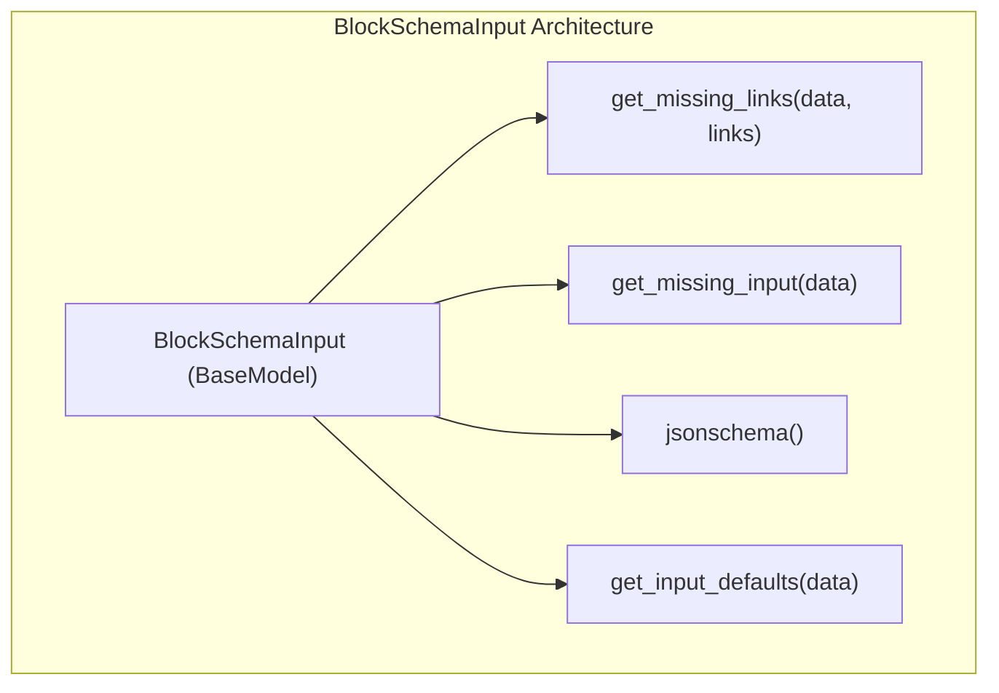
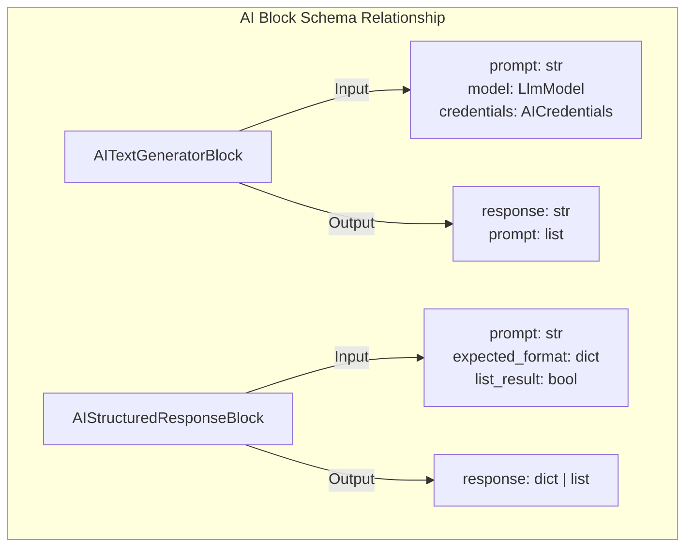
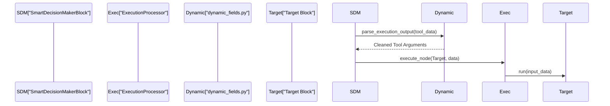

<!-- source: DeepWiki mcp.deepwiki.com · repo Significant-Gravitas/AutoGPT · page 7.4 Block Schemas · fetched 2026-10-26 -->

# Block Schemas

Relevant source files

The following files were used as context for generating this wiki page:

- [autogpt_platform/backend/backend/blocks/agent.py](autogpt_platform/backend/backend/blocks/agent.py)
- [autogpt_platform/backend/backend/blocks/basic.py](autogpt_platform/backend/backend/blocks/basic.py)
- [autogpt_platform/backend/backend/blocks/data_manipulation.py](autogpt_platform/backend/backend/blocks/data_manipulation.py)
- [autogpt_platform/backend/backend/blocks/io.py](autogpt_platform/backend/backend/blocks/io.py)
- [autogpt_platform/backend/backend/blocks/test/test_block.py](autogpt_platform/backend/backend/blocks/test/test_block.py)
- [autogpt_platform/backend/backend/blocks/text.py](autogpt_platform/backend/backend/blocks/text.py)
- [autogpt_platform/backend/backend/blocks/time_blocks.py](autogpt_platform/backend/backend/blocks/time_blocks.py)
- [autogpt_platform/backend/backend/data/block.py](autogpt_platform/backend/backend/data/block.py)
- [autogpt_platform/backend/backend/data/execution.py](autogpt_platform/backend/backend/data/execution.py)
- [autogpt_platform/backend/backend/data/graph.py](autogpt_platform/backend/backend/data/graph.py)
- [autogpt_platform/backend/backend/data/model.py](autogpt_platform/backend/backend/data/model.py)
- [autogpt_platform/backend/backend/executor/manager.py](autogpt_platform/backend/backend/executor/manager.py)
- [autogpt_platform/backend/backend/executor/manager_test.py](autogpt_platform/backend/backend/executor/manager_test.py)
- [autogpt_platform/backend/backend/executor/utils.py](autogpt_platform/backend/backend/executor/utils.py)
- [autogpt_platform/backend/backend/executor/utils_test.py](autogpt_platform/backend/backend/executor/utils_test.py)
- [autogpt_platform/backend/backend/util/exceptions.py](autogpt_platform/backend/backend/util/exceptions.py)
- [autogpt_platform/backend/backend/util/settings.py](autogpt_platform/backend/backend/util/settings.py)
- [autogpt_platform/backend/backend/util/text.py](autogpt_platform/backend/backend/util/text.py)
- [autogpt_platform/backend/load-tests/tests/api/graph-execution-test.js](autogpt_platform/backend/load-tests/tests/api/graph-execution-test.js)
- [autogpt_platform/backend/schema.prisma](autogpt_platform/backend/schema.prisma)
- [autogpt_platform/backend/test/blocks/test_list_concatenation.py](autogpt_platform/backend/test/blocks/test_list_concatenation.py)
- [autogpt_platform/frontend/src/lib/autogpt-server-api/types.ts](autogpt_platform/frontend/src/lib/autogpt-server-api/types.ts)
- [docs/CLAUDE.md](docs/CLAUDE.md)
- [docs/integrations/block-integrations/basic.md](docs/integrations/block-integrations/basic.md)

This page documents the input and output schemas that define the interface contract for all blocks in the AutoGPT Platform. Schemas specify the structure, types, validation rules, and metadata for data flowing into and out of blocks during graph execution.

For information about the block execution system, see [Block System](#3.2.6). For dynamic field naming conventions and data mapping between blocks, see [Dynamic Fields System](#3.2.11). For REST API block operations, see [REST API](#7.1).

---

## Schema Base Classes

All block schemas inherit from base classes that provide validation, serialization, and field metadata capabilities.

### BlockSchemaInput

The base class for all block input schemas, extending Pydantic's `BaseModel` with additional validation logic for handling missing data and link connections.

**Key Methods:**
- `get_missing_links(data, links)`: Returns set of field names that require connection via links [autogpt_platform/backend/backend/blocks/_base.py:50-55]().
- `get_missing_input(data)`: Returns set of field names that require input values [autogpt_platform/backend/backend/blocks/_base.py:57-62]().
- `jsonschema()`: Generates JSON schema representation for dynamic form rendering [autogpt_platform/backend/backend/blocks/_base.py:100-110]().

Sources: [autogpt_platform/backend/backend/blocks/_base.py:35-115](), [autogpt_platform/backend/backend/data/block.py:15-18]()

### BlockSchemaOutput

The base class for all block output schemas, defining the structure of data yielded during block execution. Output schemas are simpler since they specify field types and descriptions for documentation. The actual values are produced during `Block.run()` as `BlockOutput` (an `AsyncGenerator` of name-value tuples) [autogpt_platform/backend/backend/data/block.py:16-17]().

Sources: [autogpt_platform/backend/backend/blocks/_base.py:118-125](), [autogpt_platform/backend/backend/data/block.py:15-18]()

---

## SchemaField Configuration

Fields in block schemas are defined using the `SchemaField` function, which wraps Pydantic's `Field` with additional metadata for UI rendering and validation [autogpt_platform/backend/backend/data/model.py:25-30]().

### SchemaField Parameters

| Parameter | Type | Purpose |
|-----------|------|---------|
| `description` | `str` | Human-readable field description shown in UI [autogpt_platform/backend/backend/data/model.py:14-20]() |
| `placeholder` | `str` | Example value or hint text for input fields [autogpt_platform/backend/backend/data/model.py:14-20]() |
| `default` | `Any` | Default value if field is not provided [autogpt_platform/backend/backend/data/model.py:14-20]() |
| `advanced` | `bool` | If `True`, field is hidden in basic UI mode [autogpt_platform/backend/backend/data/model.py:14-20]() |
| `title` | `str` | Display name override [autogpt_platform/backend/backend/data/model.py:14-20]() |

Sources: [autogpt_platform/backend/backend/data/model.py:10-40](), [autogpt_platform/backend/backend/blocks/basic.py:20-28]()

---

## Common Field Types

### Primitive and Complex Types

Standard Python types are used directly, mapped to JSON Schema types in the frontend [autogpt_platform/frontend/src/lib/autogpt-server-api/types.ts:38-53]():

- `str`: Rendered as `short-text` or `long-text`.
- `int` / `float`: Rendered as `number`.
- `bool`: Rendered as `boolean`.
- `list` / `dict`: Rendered as `array` or `key-value` [autogpt_platform/frontend/src/lib/autogpt-server-api/types.ts:55-72]().
- `MediaFileType`: Specialized type for URLs, data URIs, or local paths [autogpt_platform/backend/backend/blocks/basic.py:20-22]().

### Credential Fields

Credential fields use `CredentialsMetaInput` to specify provider-specific authentication. The `discriminator` links credential selection to another field (e.g., `model`).

**Example Logic:**
- `discriminator="model"`: The UI changes required credentials based on the selected LLM [autogpt_platform/backend/backend/blocks/llm.py:68-76]().
- `credentials_provider`: List of valid providers (e.g., `["openai", "anthropic"]`) [autogpt_platform/frontend/src/lib/autogpt-server-api/types.ts:216-220]().

Sources: [autogpt_platform/backend/backend/data/model.py:42-48](), [autogpt_platform/frontend/src/lib/autogpt-server-api/types.ts:205-225]()

---

## Block Schema Examples by Category

### AI Block Schemas

AI blocks typically accept prompts and configuration, producing text or structured responses.

**AITextGeneratorBlock Input:**
- `prompt`: The text prompt for the LLM.
- `model`: Selection from `LlmModel` enum.
- `max_tokens`: (Advanced) Token limit for generation.

Sources: [autogpt_platform/backend/backend/blocks/llm.py:780-846](), [autogpt_platform/backend/backend/blocks/llm.py:1279-1371]()

### Control Flow and Data Manipulation

**StoreValueBlock Schema:**
- **Input**: `input` (trigger) and `data` (constant value).
- **Output**: `output` (returns `data` if set, else `input`) [autogpt_platform/backend/backend/blocks/basic.py:76-88]().
- **Static**: `static_output=True` ensures the value is cached [autogpt_platform/backend/backend/blocks/basic.py:105]().

**AgentExecutorBlock Schema:**
- This block allows nesting graphs. Its input schema is dynamic, taking `inputs`, `input_schema`, and `output_schema` to mirror the child graph's interface [autogpt_platform/backend/backend/blocks/agent.py:30-44]().

Sources: [autogpt_platform/backend/backend/blocks/basic.py:69-110](), [autogpt_platform/backend/backend/blocks/agent.py:24-81]()

---

## Dynamic Field Patterns

Dynamic fields allow blocks to connect to nested data structures or tool-orchestrated outputs using special naming conventions.

### Field Name Syntax

| Pattern | Syntax | Purpose | Example |
|---------|--------|---------|---------|
| Dictionary | `base_#_key` | Access dict value | `data_#_id` → `data['id']` |
| List | `base_$_index` | Access list item | `items_$_0` → `items[0]` |
| Tool Output | `tools_^_tool_field` | Tool orchestration | `tools_^_web_search_query` |

Sources: [autogpt_platform/backend/backend/data/dynamic_fields.py:1-50](), [autogpt_platform/backend/backend/executor/manager.py:27-28]()

### Tool Orchestration Flow

Sources: [autogpt_platform/backend/backend/executor/manager.py:142-205](), [autogpt_platform/backend/backend/blocks/smart_decision_maker.py:376-461]()

---

## Schema Metadata and UI Rendering

The backend synchronizes block schemas to the database during initialization [autogpt_platform/backend/backend/data/block.py:21-26](). The frontend fetches these via the API and uses them to build the graph editor UI.

- **`AgentBlock` Model**: Stores `inputSchema` and `outputSchema` as JSON strings in the database [autogpt_platform/backend/schema.prisma:1040-1050]().
- **RJSF Integration**: The frontend uses `BlockIORootSchema` to generate forms [autogpt_platform/frontend/src/lib/autogpt-server-api/types.ts:31-36]().

Sources: [autogpt_platform/backend/backend/data/block.py:21-65](), [autogpt_platform/backend/schema.prisma:1030-1060]()

---

## Cost Configuration Schemas

Block costs are defined in `BLOCK_COSTS` and associated with block types. Costs can be based on:
- `RUN`: Fixed cost per execution.
- `BYTE`: Cost based on data size.
- `SECOND`: Cost based on execution time [autogpt_platform/backend/backend/executor/utils.py:162-183]().

**Pre-flight Estimates**: Before execution, the system uses `get_preflight_estimate` to predict costs for UI display [autogpt_platform/backend/backend/executor/utils.py:173-174]().

Sources: [autogpt_platform/backend/backend/executor/utils.py:123-150](), [autogpt_platform/backend/backend/data/block_cost_config.py:10-50]()

---

## SafeJson and PostgreSQL Compatibility

All schema data persisted to the database is wrapped in `SafeJson` to sanitize control characters (like `\x00`) that are incompatible with PostgreSQL's `jsonb` type [autogpt_platform/backend/backend/util/json.py:135-145]().

Sources: [autogpt_platform/backend/backend/util/json.py:135-162](), [autogpt_platform/backend/backend/data/graph.py:34-39]()

---

