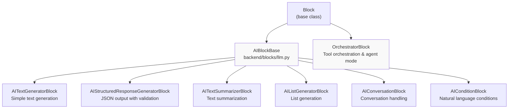
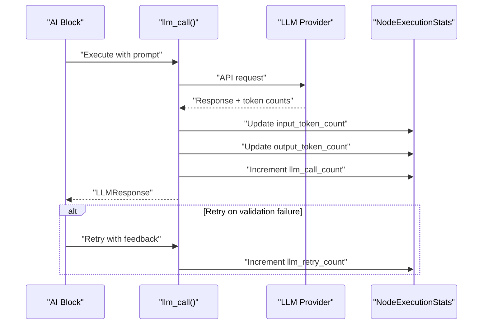
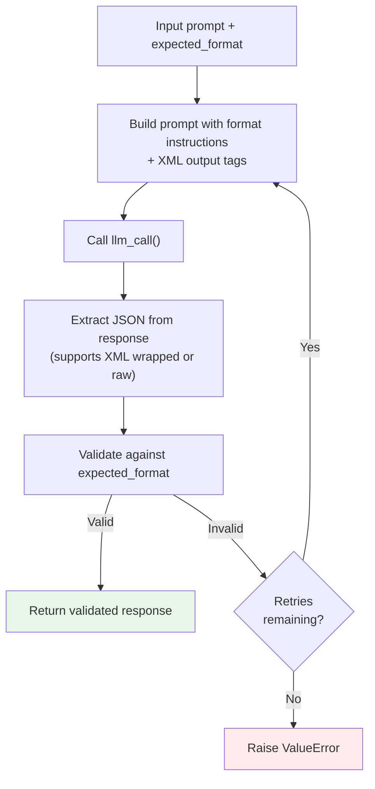
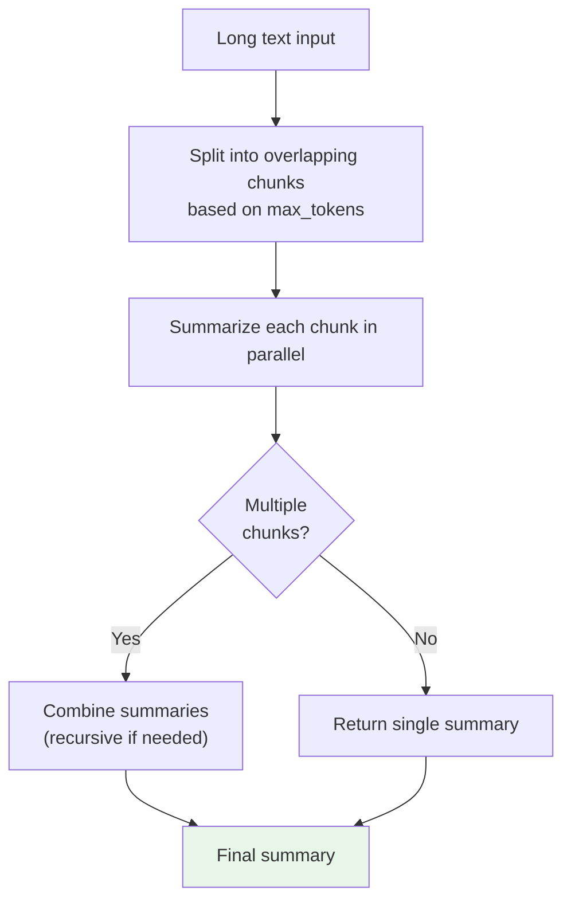
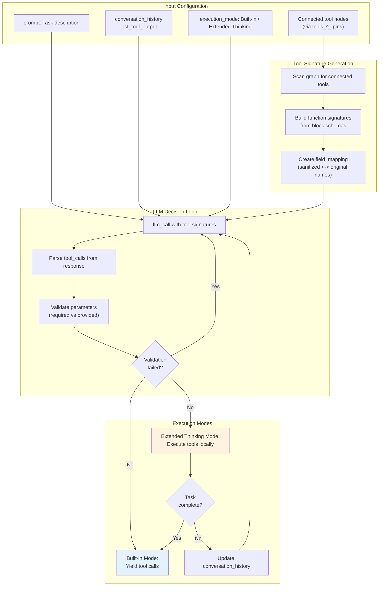
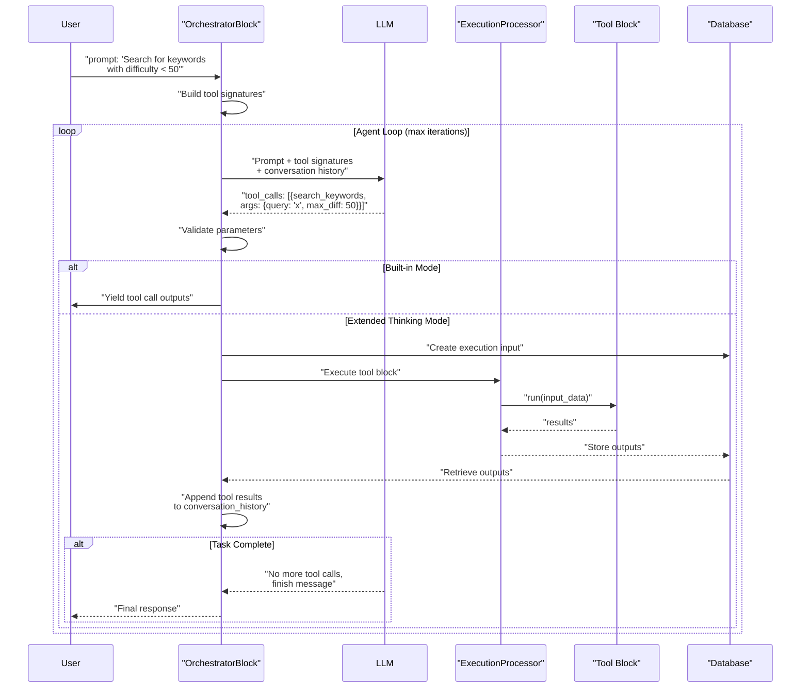
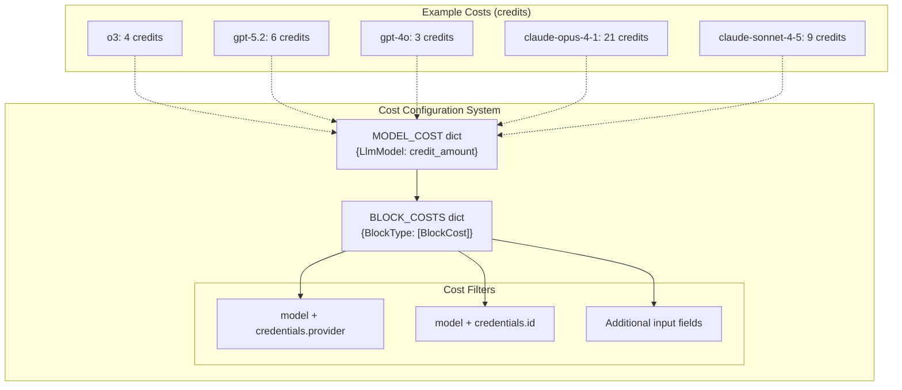

<!-- source: DeepWiki mcp.deepwiki.com · repo Significant-Gravitas/AutoGPT · extra page AI Blocks · fetched 2026-10-26 -->

# AI Blocks

<details>
<summary>Relevant source files</summary>

The following files were used as context for generating this wiki page:

- [autogpt_platform/backend/backend/blocks/ai_condition.py](autogpt_platform/backend/backend/blocks/ai_condition.py)
- [autogpt_platform/backend/backend/blocks/ai_condition_test.py](autogpt_platform/backend/backend/blocks/ai_condition_test.py)
- [autogpt_platform/backend/backend/blocks/llm.py](autogpt_platform/backend/backend/blocks/llm.py)
- [autogpt_platform/backend/backend/blocks/orchestrator.py](autogpt_platform/backend/backend/blocks/orchestrator.py)
- [autogpt_platform/backend/backend/blocks/test/test_blocks_dos_vulnerability.py](autogpt_platform/backend/backend/blocks/test/test_blocks_dos_vulnerability.py)
- [autogpt_platform/backend/backend/blocks/test/test_llm.py](autogpt_platform/backend/backend/blocks/test/test_llm.py)
- [autogpt_platform/backend/backend/blocks/test/test_orchestrator.py](autogpt_platform/backend/backend/blocks/test/test_orchestrator.py)
- [autogpt_platform/backend/backend/blocks/test/test_orchestrator_dynamic_fields.py](autogpt_platform/backend/backend/blocks/test/test_orchestrator_dynamic_fields.py)
- [autogpt_platform/backend/backend/blocks/test/test_orchestrator_responses_api.py](autogpt_platform/backend/backend/blocks/test/test_orchestrator_responses_api.py)
- [autogpt_platform/backend/backend/blocks/test/test_orchestrator_tool_dedup.py](autogpt_platform/backend/backend/blocks/test/test_orchestrator_tool_dedup.py)
- [autogpt_platform/backend/backend/blocks/xml_parser.py](autogpt_platform/backend/backend/blocks/xml_parser.py)
- [autogpt_platform/backend/backend/copilot/tools/run_block.py](autogpt_platform/backend/backend/copilot/tools/run_block.py)
- [autogpt_platform/backend/backend/copilot/tools/run_block_test.py](autogpt_platform/backend/backend/copilot/tools/run_block_test.py)
- [autogpt_platform/backend/backend/copilot/tools/test_dry_run.py](autogpt_platform/backend/backend/copilot/tools/test_dry_run.py)
- [autogpt_platform/backend/backend/data/block_cost_config.py](autogpt_platform/backend/backend/data/block_cost_config.py)
- [autogpt_platform/backend/backend/data/dynamic_fields.py](autogpt_platform/backend/backend/data/dynamic_fields.py)
- [autogpt_platform/backend/backend/data/workspace.py](autogpt_platform/backend/backend/data/workspace.py)
- [autogpt_platform/backend/backend/executor/simulator.py](autogpt_platform/backend/backend/executor/simulator.py)
- [autogpt_platform/backend/backend/executor/simulator_test.py](autogpt_platform/backend/backend/executor/simulator_test.py)
- [autogpt_platform/backend/backend/util/clients.py](autogpt_platform/backend/backend/util/clients.py)
- [autogpt_platform/backend/backend/util/clients_test.py](autogpt_platform/backend/backend/util/clients_test.py)
- [autogpt_platform/backend/backend/util/metrics.py](autogpt_platform/backend/backend/util/metrics.py)
- [autogpt_platform/backend/backend/util/security.py](autogpt_platform/backend/backend/util/security.py)
- [autogpt_platform/frontend/.prettierignore](autogpt_platform/frontend/.prettierignore)
- [autogpt_platform/frontend/instrumentation-client.ts](autogpt_platform/frontend/instrumentation-client.ts)
- [autogpt_platform/frontend/sentry.edge.config.ts](autogpt_platform/frontend/sentry.edge.config.ts)
- [autogpt_platform/frontend/sentry.server.config.ts](autogpt_platform/frontend/sentry.server.config.ts)
- [autogpt_platform/frontend/src/app/(platform)/build/components/NewControlPanel/NewSearchGraph/GraphMenuSearchBar/useGraphMenuSearchBarComponent.ts](autogpt_platform/frontend/src/app/(platform)/build/components/NewControlPanel/NewSearchGraph/GraphMenuSearchBar/useGraphMenuSearchBarComponent.ts)
- [docs/integrations/block-integrations/llm.md](docs/integrations/block-integrations/llm.md)
- [docs/integrations/block-integrations/misc.md](docs/integrations/block-integrations/misc.md)

</details>


This page documents the AI-powered blocks in the AutoGPT Platform. These blocks leverage Large Language Models (LLMs) to perform intelligent tasks such as text generation, structured data extraction, summarization, and autonomous decision-making. For information about the underlying LLM integration layer (providers, `llm_call` function, model metadata), see [LLM Integration](#3.2.7). For the general block architecture and base classes, see [Block System](#3.2.6).

## Overview

AI Blocks are specialized blocks that inherit from `AIBlockBase` and use LLM providers (OpenAI, Anthropic, Groq, etc.) to process natural language inputs and generate intelligent outputs. All AI blocks automatically track token usage statistics and support retry logic, prompt templating, and conversation history.

### AI Block Hierarchy



**Sources:** [autogpt_platform/backend/backend/blocks/llm.py:770-778](), [autogpt_platform/backend/backend/blocks/ai_condition.py:23-30](), [autogpt_platform/backend/backend/blocks/orchestrator.py:26-33]()

## AIBlockBase Architecture

`AIBlockBase` is the foundation for all AI-powered blocks, providing common functionality for LLM interactions and statistics tracking.

### Core Features

| Feature | Description |
|---------|-------------|
| **Statistics Tracking** | Automatically tracks `input_token_count`, `output_token_count`, `llm_call_count`, and `llm_retry_count` via `NodeExecutionStats` |
| **Prompt Management** | Stores the last prompt sent to the LLM in `self.prompt` for debugging and conversation history |
| **Stats Merging** | `merge_llm_stats()` method allows blocks to aggregate statistics from delegated LLM calls |
| **Credentials** | Uses `AICredentials` field with provider discrimination based on selected model |

**Sources:** [autogpt_platform/backend/backend/blocks/llm.py:770-778](), [autogpt_platform/backend/backend/data/model.py:26-33]()

### Statistics Tracking Pattern

All AI blocks inherit automatic token tracking through the `llm_call` function. Each LLM response includes token counts that are accumulated in `NodeExecutionStats`:



**Sources:** [autogpt_platform/backend/backend/blocks/llm.py:410-767](), [autogpt_platform/backend/backend/data/model.py:26-33](), [autogpt_platform/backend/backend/blocks/test/test_llm.py:8-254]()

## Text Generation Blocks

### AITextGeneratorBlock

The simplest AI block for generating freeform text responses. Delegates to `AIStructuredResponseGeneratorBlock` internally.

**Input Schema:**
- `prompt` - The text prompt to send to the LLM
- `prompt_values` - Dictionary for template variable substitution (e.g., `{{variable_name}}`)
- `model` - LLM model selection (defaults to `DEFAULT_LLM_MODEL`)
- `credentials` - LLM provider credentials
- `sys_prompt` - System prompt for additional context
- `conversation_history` - List of previous messages for context
- `max_tokens` - Maximum response length
- `compress_prompt_to_fit` - Auto-compress prompt if exceeds context window

**Output Schema:**
- `response` - Generated text string
- `prompt` - Full prompt sent to LLM (for debugging)

**Example Usage:**
```python
input_data = AITextGeneratorBlock.Input(
    prompt="Write a haiku about {{topic}}",
    prompt_values={"topic": "automation"},
    model=LlmModel.GPT4O,
    credentials=credentials
)
# Output: response = "Code flows like rivers..."
```

**Sources:** [autogpt_platform/backend/backend/blocks/llm.py:1192-1264]()

### AIStructuredResponseGeneratorBlock

Generates responses conforming to a specified JSON schema with automatic validation and retry logic.

**Input Schema:**
- `prompt` - The text prompt
- `expected_format` - Dictionary defining expected response fields and descriptions
- `list_result` - If `True`, expects a list of objects matching `expected_format`
- `force_json_output` - Restricts LLM to pure JSON (no reasoning text)
- `retry` - Number of validation retry attempts (default: 3)
- All common AI block inputs (model, credentials, etc.)

**Output Schema:**
- `response` - Validated dictionary or list of dictionaries matching `expected_format`
- `prompt` - Full prompt sent to LLM

**Validation & Retry Flow:**



**Key Methods:**
- `response_format_instructions()` - Generates detailed format instructions for the LLM
- `get_collision_proof_output_tag_id()` - Creates unique XML tag ID to prevent conflicts with user content
- `extract_json_with_retry()` - Extracts and validates JSON, retrying on failure with error feedback

**Sources:** [autogpt_platform/backend/backend/blocks/llm.py:780-1190](), [autogpt_platform/backend/backend/blocks/test/test_llm.py:42-89]()

## Text Processing Blocks

### AITextSummarizerBlock

Summarizes long text by chunking, summarizing each chunk, then combining summaries recursively. Supports multiple summary styles.

**Input Schema:**
- `text` - Text to summarize (can be very long)
- `style` - Enum: `PARAGRAPH`, `BULLET_POINTS`, `KEY_TAKEAWAYS`, `EXECUTIVE_SUMMARY`
- `max_tokens` - Max tokens per chunk (default: 4096)
- `chunk_overlap` - Token overlap between chunks (default: 512)
- `model`, `credentials` - Standard LLM parameters

**Output Schema:**
- `summary` - Final combined summary string
- `chunk_summaries` - Individual chunk summaries (for debugging)

**Chunking & Summarization Strategy:**



**Important:** The block validates that summaries are strings, not lists. This prevents LLMs from returning bullet points as arrays when the user expects formatted text.

**Sources:** [autogpt_platform/backend/backend/blocks/llm.py:1508-1794](), [autogpt_platform/backend/backend/blocks/test/test_llm.py:195-254](), [autogpt_platform/backend/backend/blocks/test/test_llm.py:496-592]()

### AIListGeneratorBlock

Generates lists of items based on a focus/topic, optionally filtered by additional criteria.

**Input Schema:**
- `focus` - What to generate a list about (e.g., "vacation destinations in Europe")
- `filtering_criteria` - Optional filtering rules (e.g., "under $1000 per person")
- `expected_item_count` - Target number of items (default: 5)
- `expected_output_format` - Description of desired item format
- `max_retries` - Retry limit for validation (default: 3)

**Output Schema:**
- `generated_list` - Complete list of items
- `list_item` - Individual items (yielded iteratively)
- `prompt` - Prompt sent to LLM

**Generation Process:**
The block uses `AIStructuredResponseGeneratorBlock` with `list_result=True` to ensure structured output. Items are validated to have the expected count and format, with automatic retries if validation fails.

**Sources:** [autogpt_platform/backend/backend/blocks/llm.py:1796-1944](), [autogpt_platform/backend/backend/blocks/test/test_llm.py:368-415]()

## Conversation Block

### AIConversationBlock

Maintains conversation history and generates contextual responses. Designed for multi-turn interactions.

**Input Schema:**
- `messages` - List of conversation messages (role + content dicts)
- `model`, `credentials` - Standard LLM parameters
- `max_tokens` - Maximum response tokens
- `compress_prompt_to_fit` - Auto-compress if exceeds context window

**Output Schema:**
- `response` - Generated response string
- `updated_messages` - Messages list with new assistant response appended

**Message Format:**
```python
messages = [
    {"role": "system", "content": "You are a helpful assistant."},
    {"role": "user", "content": "What is the weather?"},
    {"role": "assistant", "content": "I don't have access to weather data."},
    {"role": "user", "content": "Can you tell me a joke?"}
]
```

**Sources:** [autogpt_platform/backend/backend/blocks/llm.py:1266-1370]()

## Advanced AI Blocks

### OrchestratorBlock

The most sophisticated AI block, enabling autonomous tool selection and execution. Supports two modes:

1.  **Built-in Mode** (`execution_mode="built_in"`): Single LLM call, yields tool calls for external execution. This mode supports all LLM providers.
2.  **Extended Thinking Mode** (`execution_mode="extended_thinking"`): LLM autonomously selects and executes tools in a loop until task completion. This mode delegates the tool-calling loop to an external Agent SDK (currently supports Anthropic-compatible providers via the Claude Agent SDK).

**Architecture Overview:**



**Sources:** [autogpt_platform/backend/backend/blocks/orchestrator.py:26-33](), [autogpt_platform/backend/backend/blocks/orchestrator.py:958-1149]()

#### Tool Signature Generation

The block dynamically creates OpenAI-compatible function signatures for connected tools:

**For regular blocks:**
```python
{
    "type": "function",
    "function": {
        "name": "sanitized_block_name",
        "description": "Block description",
        "parameters": {
            "type": "object",
            "properties": {
                "param1": {"type": "string", "description": "..."},
                "param2": {"type": "integer", "description": "..."}
            },
            "required": ["param1"]
        },
        "_field_mapping": {"param1": "original_field_name"},
        "_sink_node_id": "target_node_id"
    }
}
```

**For AgentExecutorBlock (sub-graphs):**
Function signatures are created from the sub-graph's input schema, allowing nested agent execution.

**Sources:** [autogpt_platform/backend/backend/blocks/orchestrator.py:376-532]()

#### Dynamic Field Handling

The block supports dynamic fields (dictionary keys, list indices, object attributes) using special delimiters:

| Delimiter | Purpose | Example |
|-----------|---------|---------|
| `_#_` | Dictionary key | `values_#_name` → `values["name"]` |
| `_$_` | List index | `items_$_0` → `items[0]` |
| `_@_` | Object attribute | `obj_@_attr` → `obj.attr` |

Field names are sanitized for LLM consumption (special chars → underscores), then mapped back to original names during execution.

**Sources:** [autogpt_platform/backend/backend/blocks/orchestrator.py:376-461](), [autogpt_platform/backend/backend/data/dynamic_fields.py:1-93](), [autogpt_platform/backend/backend/blocks/test/test_orchestrator_dynamic_fields.py:1-469]()

#### Parameter Validation

The block validates tool call arguments against expected signatures with retry logic:

**Validation Checks:**
1.  **Unknown parameters** - Detects typos in parameter names
2.  **Missing required parameters** - Ensures all required args are provided
3.  **Optional parameters** - Allows missing optional args (does not require them)

**Error Feedback Loop:**
When validation fails, the error message is appended to the conversation history and the LLM is prompted to try again with corrected parameters.

**Sources:** [autogpt_platform/backend/backend/blocks/orchestrator.py:585-684](), [autogpt_platform/backend/backend/blocks/test/test_orchestrator.py:277-501]()

#### Extended Thinking Mode Execution

When `execution_mode="extended_thinking"`, the block autonomously executes tools:



**Sources:** [autogpt_platform/backend/backend/blocks/orchestrator.py:958-1149](), [autogpt_platform/backend/backend/blocks/test/test_orchestrator.py:58-108]()

### AIConditionBlock

Evaluates natural language conditions using AI, providing if/then branching based on semantic understanding rather than exact string matches.

**Input Schema:**
- `input_value` - Value to evaluate (any type)
- `condition` - Natural language condition (e.g., "the input is an email address")
- `yes_value` - Output if condition is true (defaults to `input_value`)
- `no_value` - Output if condition is false (defaults to `input_value`)
- `model`, `credentials` - Standard LLM parameters

**Output Schema:**
- `result` - Boolean evaluation result
- `yes_output` - Value to use when true
- `no_output` - Value to use when false
- `error` - Error message if evaluation fails or is uncertain

**Evaluation Process:**
1.  Convert `input_value` to string representation
2.  Send prompt asking LLM to respond with only "true" or "false"
3.  Parse response (case-insensitive, strips whitespace)
4.  Yield appropriate output pin based on result

**Example Conditions:**
- `"the input is an email address"`
- `"the input is a city in the USA"`
- `"the input is an error message"`
- `"the input contains positive sentiment"`

**Sources:** [autogpt_platform/backend/backend/blocks/ai_condition.py:23-178](), [docs/integrations/block-integrations/llm.md:48-70]()

## Cost Configuration

All AI blocks track credits consumed based on model and provider. Cost mappings are defined in `BLOCK_COSTS`.

### Model Cost Mapping



**Sources:** [autogpt_platform/backend/backend/data/block_cost_config.py:58-262]()

### AI Block Cost Examples

| Block | Filter Criteria | Credits |
|-------|----------------|---------|
| AITextGeneratorBlock | `model=gpt-4o, provider=openai` | 3 |
| AIStructuredResponseGeneratorBlock | `model=claude-sonnet-4-5, provider=anthropic` | 9 |
| OrchestratorBlock | `model=o3, provider=openai` | 4 |
| AIConversationBlock | `model=gpt-4o-mini, provider=openai` | 1 |

Cost is charged per block execution, not per token. Token usage is tracked separately in `NodeExecutionStats` for analytics but does not directly affect credit deduction.

**Sources:** [autogpt_platform/backend/backend/data/block_cost_config.py:265-270](), [autogpt_platform/backend/backend/data/block.py:39-56]()

## Testing AI Blocks

All AI blocks include comprehensive test coverage using mocked LLM responses.

### Test Patterns

**Mock LLM Call Pattern:**
```python
async def mock_llm_call(*args, **kwargs):
    return LLMResponse(
        raw_response="",
        prompt=[],
        response='{"key": "value"}',
        tool_calls=None,
        prompt_tokens=50,
        completion_tokens=25,
        reasoning=None
    )

block.llm_call = mock_llm_call  # Replace real call with mock
```

**Statistics Verification:**
```python
assert block.execution_stats.input_token_count == 50
assert block.execution_stats.output_token_count == 25
assert block.execution_stats.llm_call_count == 1
assert block.execution_stats.llm_retry_count == 0
```

**Retry Logic Testing:**
Tests verify that blocks correctly accumulate stats across multiple LLM calls when retries occur due to validation failures.

**Sources:** [autogpt_platform/backend/backend/blocks/test/test_llm.py:8-592](), [autogpt_platform/backend/backend/blocks/test/test_orchestrator.py:201-501]()

### Key Test Files

-   [autogpt_platform/backend/backend/blocks/test/test_llm.py:1-592]() - Comprehensive AI block tests including stats tracking, retry logic, and validation
-   [autogpt_platform/backend/backend/blocks/test/test_orchestrator.py:1-1082]() - OrchestratorBlock tests including tool signature generation and agent mode
-   [autogpt_platform/backend/backend/blocks/test/test_orchestrator_dynamic_fields.py:1-469]() - Dynamic field handling tests

**Sources:** [autogpt_platform/backend/backend/blocks/test/test_llm.py:8-592](), [autogpt_platform/backend/backend/blocks/test/test_orchestrator.py:1-1082](), [autogpt_platform/backend/backend/blocks/test/test_orchestrator_dynamic_fields.py:1-469]()

---

