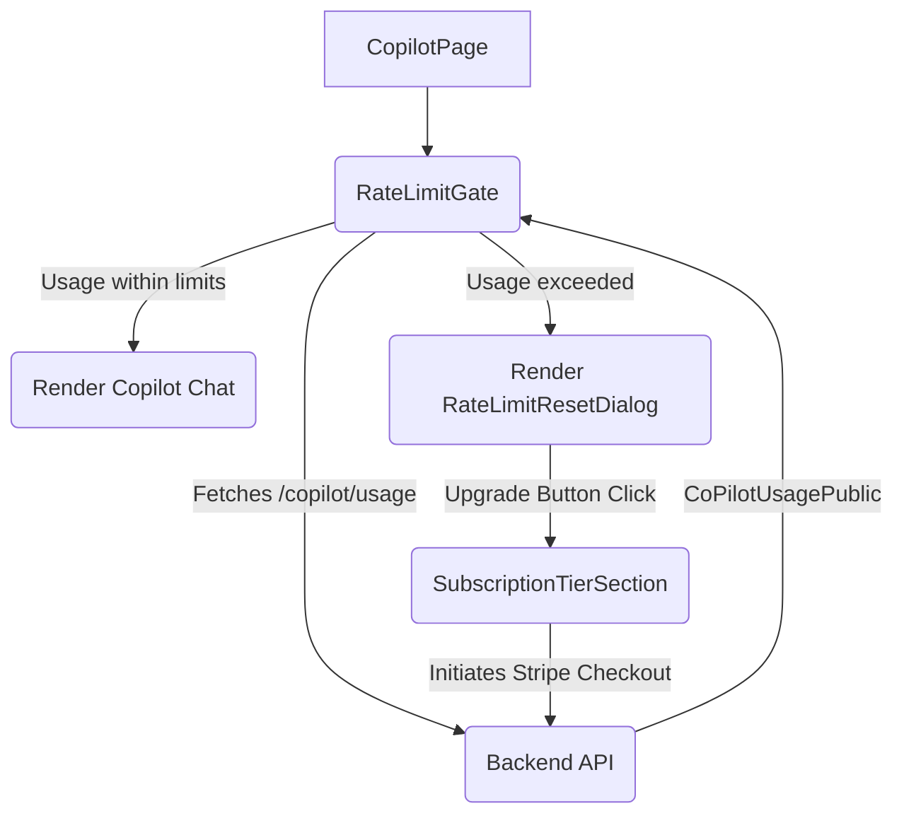

<!-- source: DeepWiki mcp.deepwiki.com · repo Significant-Gravitas/AutoGPT · extra page Copilot Rate Limiting and Usage · fetched 2026-10-26 -->

# Copilot Rate Limiting and Usage

<details>
<summary>Relevant source files</summary>

The following files were used as context for generating this wiki page:

- [autogpt_platform/backend/backend/api/features/admin/platform_cost_routes.py](autogpt_platform/backend/backend/api/features/admin/platform_cost_routes.py)
- [autogpt_platform/backend/backend/api/features/admin/platform_cost_routes_test.py](autogpt_platform/backend/backend/api/features/admin/platform_cost_routes_test.py)
- [autogpt_platform/backend/backend/api/features/subscription_routes_test.py](autogpt_platform/backend/backend/api/features/subscription_routes_test.py)
- [autogpt_platform/backend/backend/api/features/v1.py](autogpt_platform/backend/backend/api/features/v1.py)
- [autogpt_platform/backend/backend/copilot/rate_limit.py](autogpt_platform/backend/backend/copilot/rate_limit.py)
- [autogpt_platform/backend/backend/copilot/rate_limit_test.py](autogpt_platform/backend/backend/copilot/rate_limit_test.py)
- [autogpt_platform/backend/backend/copilot/token_tracking.py](autogpt_platform/backend/backend/copilot/token_tracking.py)
- [autogpt_platform/backend/backend/data/credit.py](autogpt_platform/backend/backend/data/credit.py)
- [autogpt_platform/backend/backend/data/credit_subscription_test.py](autogpt_platform/backend/backend/data/credit_subscription_test.py)
- [autogpt_platform/backend/backend/data/platform_cost.py](autogpt_platform/backend/backend/data/platform_cost.py)
- [autogpt_platform/backend/backend/data/platform_cost_integration_test.py](autogpt_platform/backend/backend/data/platform_cost_integration_test.py)
- [autogpt_platform/backend/backend/data/platform_cost_test.py](autogpt_platform/backend/backend/data/platform_cost_test.py)
- [autogpt_platform/backend/backend/executor/activity_status_generator.py](autogpt_platform/backend/backend/executor/activity_status_generator.py)
- [autogpt_platform/backend/backend/executor/activity_status_generator_test.py](autogpt_platform/backend/backend/executor/activity_status_generator_test.py)
- [autogpt_platform/backend/backend/executor/cost_tracking.py](autogpt_platform/backend/backend/executor/cost_tracking.py)
- [autogpt_platform/backend/backend/util/feature_flag.py](autogpt_platform/backend/backend/util/feature_flag.py)
- [autogpt_platform/frontend/src/app/(platform)/admin/platform-costs/__tests__/PlatformCostContent.test.tsx](autogpt_platform/frontend/src/app/(platform)/admin/platform-costs/__tests__/PlatformCostContent.test.tsx)
- [autogpt_platform/frontend/src/app/(platform)/admin/platform-costs/__tests__/helpers.test.ts](autogpt_platform/frontend/src/app/(platform)/admin/platform-costs/__tests__/helpers.test.ts)
- [autogpt_platform/frontend/src/app/(platform)/admin/platform-costs/components/LogsTable.tsx](autogpt_platform/frontend/src/app/(platform)/admin/platform-costs/components/LogsTable.tsx)
- [autogpt_platform/frontend/src/app/(platform)/admin/platform-costs/components/PlatformCostContent.tsx](autogpt_platform/frontend/src/app/(platform)/admin/platform-costs/components/PlatformCostContent.tsx)
- [autogpt_platform/frontend/src/app/(platform)/admin/platform-costs/components/ProviderTable.tsx](autogpt_platform/frontend/src/app/(platform)/admin/platform-costs/components/ProviderTable.tsx)
- [autogpt_platform/frontend/src/app/(platform)/admin/platform-costs/components/UserTable.tsx](autogpt_platform/frontend/src/app/(platform)/admin/platform-costs/components/UserTable.tsx)
- [autogpt_platform/frontend/src/app/(platform)/admin/platform-costs/components/usePlatformCostContent.ts](autogpt_platform/frontend/src/app/(platform)/admin/platform-costs/components/usePlatformCostContent.ts)
- [autogpt_platform/frontend/src/app/(platform)/admin/platform-costs/helpers.ts](autogpt_platform/frontend/src/app/(platform)/admin/platform-costs/helpers.ts)
- [autogpt_platform/frontend/src/app/(platform)/admin/platform-costs/page.tsx](autogpt_platform/frontend/src/app/(platform)/admin/platform-costs/page.tsx)
- [autogpt_platform/frontend/src/app/(platform)/copilot/components/RateLimitResetDialog/RateLimitGate.tsx](autogpt_platform/frontend/src/app/(platform)/copilot/components/RateLimitResetDialog/RateLimitGate.tsx)
- [autogpt_platform/frontend/src/app/(platform)/copilot/components/RateLimitResetDialog/RateLimitResetDialog.tsx](autogpt_platform/frontend/src/app/(platform)/copilot/components/RateLimitResetDialog/RateLimitResetDialog.tsx)
- [autogpt_platform/frontend/src/app/(platform)/copilot/components/RateLimitResetDialog/__tests__/RateLimitGate.test.tsx](autogpt_platform/frontend/src/app/(platform)/copilot/components/RateLimitResetDialog/__tests__/RateLimitGate.test.tsx)
- [autogpt_platform/frontend/src/app/(platform)/copilot/components/RateLimitResetDialog/__tests__/RateLimitResetDialog.test.tsx](autogpt_platform/frontend/src/app/(platform)/copilot/components/RateLimitResetDialog/__tests__/RateLimitResetDialog.test.tsx)
- [autogpt_platform/frontend/src/app/(platform)/profile/(user)/credits/components/SubscriptionTierSection/SubscriptionTierSection.tsx](autogpt_platform/frontend/src/app/(platform)/profile/(user)/credits/components/SubscriptionTierSection/SubscriptionTierSection.tsx)
- [autogpt_platform/frontend/src/app/(platform)/profile/(user)/credits/components/SubscriptionTierSection/__tests__/SubscriptionTierSection.test.tsx](autogpt_platform/frontend/src/app/(platform)/profile/(user)/credits/components/SubscriptionTierSection/__tests__/SubscriptionTierSection.test.tsx)
- [autogpt_platform/frontend/src/app/(platform)/profile/(user)/credits/components/SubscriptionTierSection/helpers.ts](autogpt_platform/frontend/src/app/(platform)/profile/(user)/credits/components/SubscriptionTierSection/helpers.ts)
- [autogpt_platform/frontend/src/app/(platform)/profile/(user)/credits/components/SubscriptionTierSection/useSubscriptionTierSection.ts](autogpt_platform/frontend/src/app/(platform)/profile/(user)/credits/components/SubscriptionTierSection/useSubscriptionTierSection.ts)
- [autogpt_platform/frontend/src/app/(platform)/profile/(user)/credits/page.tsx](autogpt_platform/frontend/src/app/(platform)/profile/(user)/credits/page.tsx)

</details>


This page details the microdollar-based rate limiting system implemented for the AutoGPT Copilot. It covers the daily and weekly usage windows, how subscription tiers influence these limits through multipliers, the fail-closed policy for enforcement, and the `RateLimitGate` frontend component that provides user feedback.

The Copilot rate limiting system is designed to manage the infrastructure costs associated with LLM interactions and other tools used by the Copilot. It operates independently of the credit system, which tracks user-purchased credits for block executions.

## Microdollar-Based Rate Limiting

The Copilot rate limiting tracks usage in microdollars, which are one-millionth of a USD. This unit is chosen to accurately reflect the real model pricing, including any discounts or surcharges, as reported by LLM providers like OpenRouter or the Claude Agent SDK [autogpt_platform/backend/backend/copilot/rate_limit.py:27-48](). This approach means the rate limiting system does not need to maintain its own pricing tables; it directly uses the reported costs.

The system distinguishes between two types of costs:
*   **Credits**: User-facing prepaid wallet for block invocations. Every block with a `BlockCost` entry decrements credits. This is what users purchase and see on their billing page [autogpt_platform/backend/backend/copilot/rate_limit.py:33-37]().
*   **Microdollars**: AutoGPT's operator-side infrastructure cost for the Copilot LLM turn itself, web search tool calls, and prompt simulation. These costs gate the chat loop to prevent a single user from consuming excessive infrastructure resources, regardless of their credit balance [autogpt_platform/backend/backend/copilot/rate_limit.py:39-45]().

BYOK (Bring Your Own Key) runs, where users provide their own API keys, do not decrement the microdollar counter as the user is directly paying the provider [autogpt_platform/backend/backend/copilot/rate_limit.py:45-47]().

Sources:
*   [autogpt_platform/backend/backend/copilot/rate_limit.py:27-48]()

### Usage Windows and Limits

Copilot usage is tracked across two fixed windows:
*   **Daily Window**: Resets at midnight UTC [autogpt_platform/backend/backend/copilot/rate_limit.py:5-6]().
*   **Weekly Window**: Resets at the ISO week boundary (Monday 00:00 UTC) [autogpt_platform/backend/backend/copilot/rate_limit.py:6-7]().

These limits are configured via LaunchDarkly feature flags, specifically `Flag.COPILOT_COST_LIMITS` [autogpt_platform/backend/backend/copilot/rate_limit.py:146-147](). The `get_global_rate_limits` function retrieves these base limits and applies tier-specific multipliers [autogpt_platform/backend/backend/copilot/rate_limit.py:300-301]().

Sources:
*   [autogpt_platform/backend/backend/copilot/rate_limit.py:5-7]()
*   [autogpt_platform/backend/backend/copilot/rate_limit.py:146-147]()
*   [autogpt_platform/backend/backend/copilot/rate_limit.py:300-301]()

### Subscription Tiers and Multipliers

The rate limits are dynamically adjusted based on the user's `SubscriptionTier`. Each tier has a multiplier that is applied to the base daily and weekly cost limits [autogpt_platform/backend/backend/copilot/rate_limit.py:100-106]().

The `_DEFAULT_TIER_MULTIPLIERS` dictionary defines these default multipliers:
*   `NO_TIER`: `0.0` (effectively disables rate-limited routes, acting as a paywall) [autogpt_platform/backend/backend/copilot/rate_limit.py:115-118]()
*   `BASIC`: `1.0`
*   `PRO`: `5.0`
*   `MAX`: `20.0`
*   `BUSINESS`: `60.0`
*   `ENTERPRISE`: `60.0` [autogpt_platform/backend/backend/copilot/rate_limit.py:115-121]()

These multipliers can be overridden by the `copilot-tier-multipliers` LaunchDarkly flag [autogpt_platform/backend/backend/copilot/rate_limit.py:102-103](). The `get_tier_multipliers` function fetches and parses this flag, merging it with the defaults [autogpt_platform/backend/backend/copilot/rate_limit.py:200-201]().

Sources:
*   [autogpt_platform/backend/backend/copilot/rate_limit.py:100-106]()
*   [autogpt_platform/backend/backend/copilot/rate_limit.py:115-121]()
*   [autogpt_platform/backend/backend/copilot/rate_limit.py:102-103]()
*   [autogpt_platform/backend/backend/copilot/rate_limit.py:200-201]()

### Fail-Closed Policy

The rate limiting enforcement path, primarily `check_rate_limit` [autogpt_platform/backend/backend/copilot/rate_limit.py:10](), operates under a **fail-closed** policy. If the Redis instance (which stores usage counters) is unreachable, a `RateLimitUnavailable` exception is raised [autogpt_platform/backend/backend/copilot/rate_limit.py:10-13](). This ensures that users cannot bypass their limits due to a system outage.

Conversely, observability paths (e.g., `get_usage_status`, `record_cost_usage`) adopt a fail-open/best-effort approach, prioritizing system availability over perfect tracking in case of Redis issues [autogpt_platform/backend/backend/copilot/rate_limit.py:14-18]().

Sources:
*   [autogpt_platform/backend/backend/copilot/rate_limit.py:10]()
*   [autogpt_platform/backend/backend/copilot/rate_limit.py:10-13]()
*   [autogpt_platform/backend/backend/copilot/rate_limit.py:14-18]()

## Implementation Details

### Redis Usage Tracking

Usage is tracked using Redis fixed-window counters. The keys are prefixed with `copilot:cost` [autogpt_platform/backend/backend/copilot/rate_limit.py:75]().
*   `_daily_key(user_id)`: Generates the Redis key for daily usage [autogpt_platform/backend/backend/copilot/rate_limit.py:220]().
*   `_weekly_key(user_id)`: Generates the Redis key for weekly usage [autogpt_platform/backend/backend/copilot/rate_limit.py:221]().

The `record_cost_usage` function increments these counters and sets their expiration times to align with the daily/weekly reset boundaries [autogpt_platform/backend/backend/copilot/rate_limit.py:330-349]().

Sources:
*   [autogpt_platform/backend/backend/copilot/rate_limit.py:75]()
*   [autogpt_platform/backend/backend/copilot/rate_limit.py:220]()
*   [autogpt_platform/backend/backend/copilot/rate_limit.py:221]()
*   [autogpt_platform/backend/backend/copilot/rate_limit.py:330-349]()

### Key Functions and Classes

#### `SubscriptionTier` Enum
Defines the available subscription tiers, mirroring the `prisma.enums.SubscriptionTier` [autogpt_platform/backend/backend/copilot/rate_limit.py:83-97]().

Sources:
*   [autogpt_platform/backend/backend/copilot/rate_limit.py:83-97]()

#### `RateLimitExceeded` Exception
Raised when a user exceeds their allocated microdollar budget for a given window. It includes the `window` (daily/weekly) and `resets_at` timestamp [autogpt_platform/backend/backend/copilot/rate_limit.py:500-504]().

Sources:
*   [autogpt_platform/backend/backend/copilot/rate_limit.py:500-504]()

#### `RateLimitUnavailable` Exception
Raised when the Redis backend is unreachable, enforcing the fail-closed policy [autogpt_platform/backend/backend/copilot/rate_limit.py:507-508]().

Sources:
*   [autogpt_platform/backend/backend/copilot/rate_limit.py:507-508]()

#### `get_user_tier(user_id: str)`
Retrieves the `SubscriptionTier` for a given user from the database [autogpt_platform/backend/backend/copilot/rate_limit.py:250-251](). It uses a cache to reduce database load [autogpt_platform/backend/backend/copilot/rate_limit.py:249]().

Sources:
*   [autogpt_platform/backend/backend/copilot/rate_limit.py:250-251]()
*   [autogpt_platform/backend/backend/copilot/rate_limit.py:249]()

#### `get_tier_multipliers()`
Fetches and parses the `copilot-tier-multipliers` LaunchDarkly flag, returning a dictionary of `SubscriptionTier` to float multipliers. It falls back to `_DEFAULT_TIER_MULTIPLIERS` if the flag is unset or invalid [autogpt_platform/backend/backend/copilot/rate_limit.py:200-201]().

Sources:
*   [autogpt_platform/backend/backend/copilot/rate_limit.py:200-201]()

#### `get_global_rate_limits()`
Determines the effective daily and weekly microdollar limits for a given user by applying the tier multipliers to the base limits (fetched from `Flag.COPILOT_COST_LIMITS` LaunchDarkly flag) [autogpt_platform/backend/backend/copilot/rate_limit.py:300-301]().

Sources:
*   [autogpt_platform/backend/backend/copilot/rate_limit.py:300-301]()

#### `check_rate_limit(user_id: str, cost_microdollars: int)`
The core enforcement function. It retrieves the user's current usage and limits, then checks if adding `cost_microdollars` would exceed either the daily or weekly limit. If a limit is exceeded, it raises `RateLimitExceeded` [autogpt_platform/backend/backend/copilot/rate_limit.py:360-387]().

Sources:
*   [autogpt_platform/backend/backend/copilot/rate_limit.py:360-387]()

#### `record_cost_usage(user_id: str, cost_microdollars: int)`
Increments the daily and weekly usage counters in Redis for the specified user and cost. It also sets/updates the TTL for these keys [autogpt_platform/backend/backend/copilot/rate_limit.py:330-349]().

Sources:
*   [autogpt_platform/backend/backend/copilot/rate_limit.py:330-349]()

#### `get_usage_status(user_id: str, daily_cost_limit: int, weekly_cost_limit: int)`
Returns the current usage status for a user, including used and remaining microdollars for both daily and weekly windows, along with their reset times [autogpt_platform/backend/backend/copilot/rate_limit.py:400-430]().

Sources:
*   [autogpt_platform/backend/backend/copilot/rate_limit.py:400-430]()

#### `reset_user_usage(user_id: str)`
Resets both daily and weekly usage counters for a specific user. This is typically used for administrative purposes or when a user's tier changes [autogpt_platform/backend/backend/copilot/rate_limit.py:440-447]().

Sources:
*   [autogpt_platform/backend/backend/copilot/rate_limit.py:440-447]()

### Data Flow for Rate Limiting

The following diagram illustrates the data flow for Copilot rate limiting:

```mermaid
graph TD
    subgraph "Frontend"
        A[User Interaction] --> B(Copilot Chat UI)
        B --> C{RateLimitGate Component}
        C -- "Display Usage / Block Interaction" --> B
    end

    subgraph "Backend (FastAPI)"
        D(API Endpoint) -- "User ID, Cost" --> E{check_rate_limit}
        E -- "RateLimitExceeded" --> D
        E -- "RateLimitUnavailable" --> D
        E -- "OK" --> F(Process Request)
        F -- "Cost Log" --> G(record_cost_usage)
        D -- "GET /copilot/usage" --> H(get_usage_status)
    end

    subgraph "Data Stores"
        I[Redis] -- "Usage Counters (copilot:cost:user_id:daily/weekly)" --> E
        I -- "Usage Counters (copilot:cost:user_id:daily/weekly)" --> G
        J[PostgreSQL (Prisma)] -- "User.subscriptionTier" --> K(get_user_tier)
        K --> E
        K --> H
    end

    subgraph "Configuration"
        L[LaunchDarkly] -- "Flag.COPILOT_COST_LIMITS" --> M(get_global_rate_limits)
        L -- "Flag.COPILOT_TIER_MULTIPLIERS" --> N(get_tier_multipliers)
        M --> E
        M --> H
        N --> M
    end

    style A fill:#f9f,stroke:#333,stroke-width:2px
    style B fill:#bbf,stroke:#333,stroke-width:2px
    style C fill:#bbf,stroke:#333,stroke-width:2px
    style D fill:#fbb,stroke:#333,stroke-width:2px
    style E fill:#fbb,stroke:#333,stroke-width:2px
    style F fill:#fbb,stroke:#333,stroke-width:2px
    style G fill:#fbb,stroke:#333,stroke-width:2px
    style H fill:#fbb,stroke:#333,stroke-width:2px
    style I fill:#ccf,stroke:#333,stroke-width:2px
    style J fill:#ccf,stroke:#333,stroke-width:2px
    style K fill:#ccf,stroke:#333,stroke-width:2px
    style L fill:#cfc,stroke:#333,stroke-width:2px
    style M fill:#cfc,stroke:#333,stroke-width:2px
    style N fill:#cfc,stroke:#333,stroke-width:2px
```

Sources:
*   [autogpt_platform/backend/backend/copilot/rate_limit.py]()
*   [autogpt_platform/backend/backend/data/db_accessors.py]()
*   [autogpt_platform/backend/backend/util/feature_flag.py]()

## Frontend Component: `RateLimitGate`

The `RateLimitGate` React component [autogpt_platform/frontend/src/app/(platform)/copilot/components/RateLimitResetDialog/RateLimitGate.tsx]() is responsible for displaying the user's Copilot usage status and blocking interactions if limits are exceeded.

### Purpose
*   **Display Usage**: Shows the user their current daily and weekly microdollar usage against their limits.
*   **Block Interaction**: Prevents users from initiating new Copilot interactions if they have exceeded their limits.
*   **Provide Feedback**: Informs the user when their limits will reset and offers options to upgrade their subscription tier.

### Integration
The `RateLimitGate` component typically wraps the Copilot chat interface. It fetches the user's usage status via the `/copilot/usage` API endpoint [autogpt_platform/backend/backend/api/features/v1.py:52]().

### `RateLimitResetDialog`
When a user hits a rate limit, the `RateLimitGate` component renders the `RateLimitResetDialog` [autogpt_platform/frontend/src/app/(platform)/copilot/components/RateLimitResetDialog/RateLimitResetDialog.tsx](). This dialog provides:
*   A clear message indicating which limit (daily/weekly) has been exceeded.
*   The exact time the limit will reset.
*   A call to action to upgrade their subscription tier to increase limits.

Sources:
*   [autogpt_platform/frontend/src/app/(platform)/copilot/components/RateLimitResetDialog/RateLimitGate.tsx]()
*   [autogpt_platform/frontend/src/app/(platform)/copilot/components/RateLimitResetDialog/RateLimitResetDialog.tsx]()
*   [autogpt_platform/backend/backend/api/features/v1.py:52]()

### Frontend Data Flow



Sources:
*   [autogpt_platform/frontend/src/app/(platform)/copilot/components/RateLimitResetDialog/RateLimitGate.tsx]()
*   [autogpt_platform/frontend/src/app/(platform)/copilot/components/RateLimitResetDialog/RateLimitResetDialog.tsx]()
*   [autogpt_platform/frontend/src/app/(platform)/profile/(user)/credits/components/SubscriptionTierSection/SubscriptionTierSection.tsx]()
*   [autogpt_platform/frontend/src/app/(platform)/profile/(user)/credits/components/SubscriptionTierSection/useSubscriptionTierSection.ts]()

---

