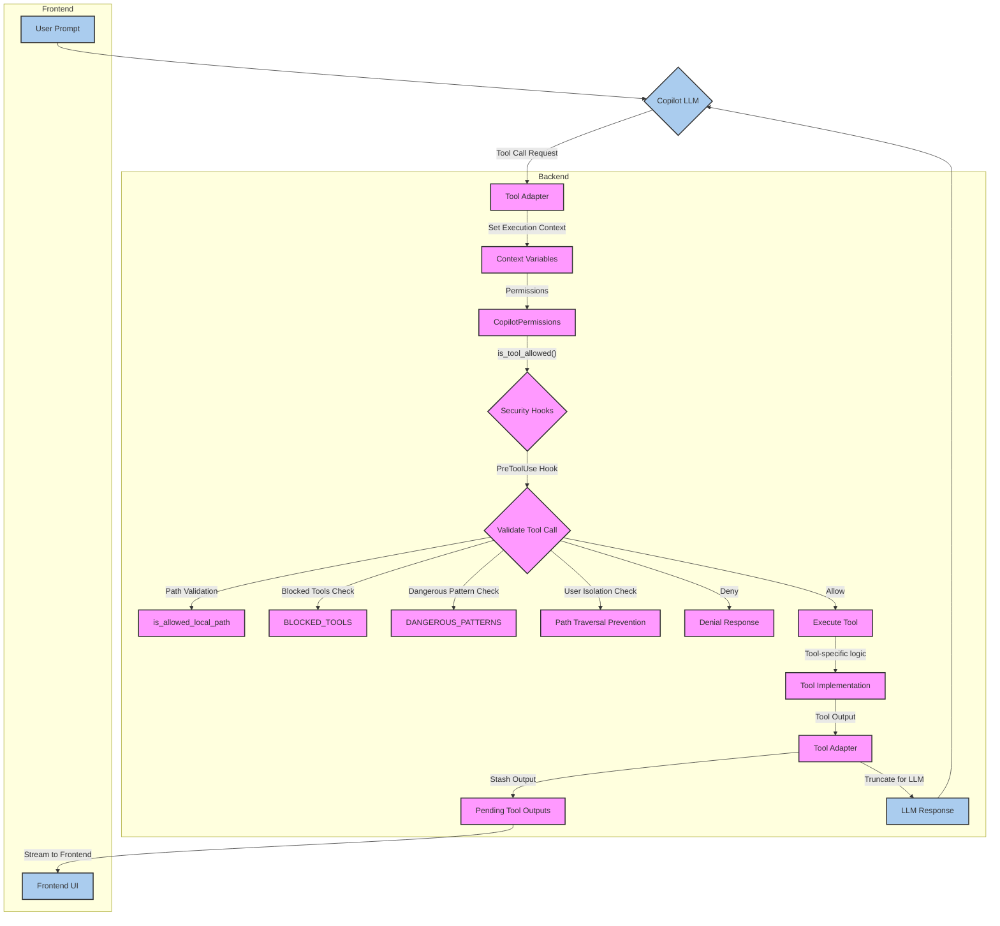

<!-- source: DeepWiki mcp.deepwiki.com · repo Significant-Gravitas/AutoGPT · extra page Copilot Tools · fetched 2026-10-26 -->

# Copilot Tools

<details>
<summary>Relevant source files</summary>

The following files were used as context for generating this wiki page:

- [autogpt_platform/backend/backend/copilot/context.py](autogpt_platform/backend/backend/copilot/context.py)
- [autogpt_platform/backend/backend/copilot/context_test.py](autogpt_platform/backend/backend/copilot/context_test.py)
- [autogpt_platform/backend/backend/copilot/permissions.py](autogpt_platform/backend/backend/copilot/permissions.py)
- [autogpt_platform/backend/backend/copilot/permissions_test.py](autogpt_platform/backend/backend/copilot/permissions_test.py)
- [autogpt_platform/backend/backend/copilot/prompt_cache_test.py](autogpt_platform/backend/backend/copilot/prompt_cache_test.py)
- [autogpt_platform/backend/backend/copilot/prompting.py](autogpt_platform/backend/backend/copilot/prompting.py)
- [autogpt_platform/backend/backend/copilot/prompting_test.py](autogpt_platform/backend/backend/copilot/prompting_test.py)
- [autogpt_platform/backend/backend/copilot/sdk/agent_generation_guide.md](autogpt_platform/backend/backend/copilot/sdk/agent_generation_guide.md)
- [autogpt_platform/backend/backend/copilot/sdk/e2b_file_tools.py](autogpt_platform/backend/backend/copilot/sdk/e2b_file_tools.py)
- [autogpt_platform/backend/backend/copilot/sdk/e2b_file_tools_test.py](autogpt_platform/backend/backend/copilot/sdk/e2b_file_tools_test.py)
- [autogpt_platform/backend/backend/copilot/sdk/file_ref_integration_test.py](autogpt_platform/backend/backend/copilot/sdk/file_ref_integration_test.py)
- [autogpt_platform/backend/backend/copilot/sdk/security_hooks.py](autogpt_platform/backend/backend/copilot/sdk/security_hooks.py)
- [autogpt_platform/backend/backend/copilot/sdk/security_hooks_test.py](autogpt_platform/backend/backend/copilot/sdk/security_hooks_test.py)
- [autogpt_platform/backend/backend/copilot/sdk/tool_adapter.py](autogpt_platform/backend/backend/copilot/sdk/tool_adapter.py)
- [autogpt_platform/backend/backend/copilot/sdk/tool_adapter_test.py](autogpt_platform/backend/backend/copilot/sdk/tool_adapter_test.py)
- [autogpt_platform/backend/backend/copilot/tools/__init__.py](autogpt_platform/backend/backend/copilot/tools/__init__.py)
- [autogpt_platform/backend/backend/copilot/tools/add_understanding.py](autogpt_platform/backend/backend/copilot/tools/add_understanding.py)
- [autogpt_platform/backend/backend/copilot/tools/agent_generator/core.py](autogpt_platform/backend/backend/copilot/tools/agent_generator/core.py)
- [autogpt_platform/backend/backend/copilot/tools/agent_output.py](autogpt_platform/backend/backend/copilot/tools/agent_output.py)
- [autogpt_platform/backend/backend/copilot/tools/agent_search.py](autogpt_platform/backend/backend/copilot/tools/agent_search.py)
- [autogpt_platform/backend/backend/copilot/tools/agent_search_test.py](autogpt_platform/backend/backend/copilot/tools/agent_search_test.py)
- [autogpt_platform/backend/backend/copilot/tools/ask_question.py](autogpt_platform/backend/backend/copilot/tools/ask_question.py)
- [autogpt_platform/backend/backend/copilot/tools/ask_question_test.py](autogpt_platform/backend/backend/copilot/tools/ask_question_test.py)
- [autogpt_platform/backend/backend/copilot/tools/base.py](autogpt_platform/backend/backend/copilot/tools/base.py)
- [autogpt_platform/backend/backend/copilot/tools/base_test.py](autogpt_platform/backend/backend/copilot/tools/base_test.py)
- [autogpt_platform/backend/backend/copilot/tools/create_agent.py](autogpt_platform/backend/backend/copilot/tools/create_agent.py)
- [autogpt_platform/backend/backend/copilot/tools/customize_agent.py](autogpt_platform/backend/backend/copilot/tools/customize_agent.py)
- [autogpt_platform/backend/backend/copilot/tools/edit_agent.py](autogpt_platform/backend/backend/copilot/tools/edit_agent.py)
- [autogpt_platform/backend/backend/copilot/tools/execution_utils.py](autogpt_platform/backend/backend/copilot/tools/execution_utils.py)
- [autogpt_platform/backend/backend/copilot/tools/feature_requests.py](autogpt_platform/backend/backend/copilot/tools/feature_requests.py)
- [autogpt_platform/backend/backend/copilot/tools/feature_requests_test.py](autogpt_platform/backend/backend/copilot/tools/feature_requests_test.py)
- [autogpt_platform/backend/backend/copilot/tools/find_agent.py](autogpt_platform/backend/backend/copilot/tools/find_agent.py)
- [autogpt_platform/backend/backend/copilot/tools/find_block.py](autogpt_platform/backend/backend/copilot/tools/find_block.py)
- [autogpt_platform/backend/backend/copilot/tools/find_block_test.py](autogpt_platform/backend/backend/copilot/tools/find_block_test.py)
- [autogpt_platform/backend/backend/copilot/tools/find_library_agent.py](autogpt_platform/backend/backend/copilot/tools/find_library_agent.py)
- [autogpt_platform/backend/backend/copilot/tools/fix_agent.py](autogpt_platform/backend/backend/copilot/tools/fix_agent.py)
- [autogpt_platform/backend/backend/copilot/tools/get_doc_page.py](autogpt_platform/backend/backend/copilot/tools/get_doc_page.py)
- [autogpt_platform/backend/backend/copilot/tools/http_credentials_test.py](autogpt_platform/backend/backend/copilot/tools/http_credentials_test.py)
- [autogpt_platform/backend/backend/copilot/tools/manage_folders.py](autogpt_platform/backend/backend/copilot/tools/manage_folders.py)
- [autogpt_platform/backend/backend/copilot/tools/manage_folders_test.py](autogpt_platform/backend/backend/copilot/tools/manage_folders_test.py)
- [autogpt_platform/backend/backend/copilot/tools/models.py](autogpt_platform/backend/backend/copilot/tools/models.py)
- [autogpt_platform/backend/backend/copilot/tools/run_agent.py](autogpt_platform/backend/backend/copilot/tools/run_agent.py)
- [autogpt_platform/backend/backend/copilot/tools/run_agent_test.py](autogpt_platform/backend/backend/copilot/tools/run_agent_test.py)
- [autogpt_platform/backend/backend/copilot/tools/tool_schema_test.py](autogpt_platform/backend/backend/copilot/tools/tool_schema_test.py)
- [autogpt_platform/backend/backend/copilot/tools/utils.py](autogpt_platform/backend/backend/copilot/tools/utils.py)
- [autogpt_platform/backend/backend/copilot/tools/validate_agent.py](autogpt_platform/backend/backend/copilot/tools/validate_agent.py)
- [autogpt_platform/backend/backend/copilot/tools/workspace_files.py](autogpt_platform/backend/backend/copilot/tools/workspace_files.py)
- [autogpt_platform/backend/backend/copilot/tools/workspace_files_test.py](autogpt_platform/backend/backend/copilot/tools/workspace_files_test.py)
- [autogpt_platform/backend/test/copilot/dry_run_loop_test.py](autogpt_platform/backend/test/copilot/dry_run_loop_test.py)
- [autogpt_platform/frontend/components.json](autogpt_platform/frontend/components.json)
- [autogpt_platform/frontend/src/app/(platform)/copilot/components/ClarificationQuestionsCard/ClarificationQuestionsCard.tsx](autogpt_platform/frontend/src/app/(platform)/copilot/components/ClarificationQuestionsCard/ClarificationQuestionsCard.tsx)
- [autogpt_platform/frontend/src/app/(platform)/copilot/tools/AskQuestion/AskQuestion.tsx](autogpt_platform/frontend/src/app/(platform)/copilot/tools/AskQuestion/AskQuestion.tsx)
- [autogpt_platform/frontend/src/app/(platform)/copilot/tools/AskQuestion/helpers.ts](autogpt_platform/frontend/src/app/(platform)/copilot/tools/AskQuestion/helpers.ts)

</details>


This page details the tool system within the AutoGPT Copilot, which enables the AI to interact with the platform, manage files, execute code, and gather information. It covers the various categories of tools available, their implementation, and the security model governing their use.

## Tool Categories and Functionality

The Copilot system provides a rich set of tools, categorized by their function:

*   **Agent Management:** Tools for creating, editing, validating, fixing, and running agent graphs.
*   **Block Execution:** Tools to discover and execute individual blocks within the AutoGPT platform.
*   **Workspace File Management:** Tools for listing, reading, writing, and deleting files in the user's workspace.
*   **Bash Execution:** A tool to execute shell commands, optionally within an E2B sandbox.
*   **E2B Sandbox Interaction:** Tools for managing files within the E2B sandbox environment.
*   **Web Interaction:** Tools for performing web searches and fetching web content.
*   **Human-in-the-Loop (HITL):** The `ask_question` tool to gather clarifying information from the user.
*   **Integration Management:** Tools to connect and manage external service integrations.
*   **Memory Management:** Tools for storing, searching, and forgetting information in the agent's long-term memory.
*   **Documentation and Information Retrieval:** Tools to access platform documentation and guides.

All Copilot tools are registered in `TOOL_REGISTRY` [backend/backend/copilot/tools/__init__.py:67-128]().

### Agent Creation, Editing, and Running Tools

The Copilot can programmatically interact with agent graphs, allowing it to build, modify, and execute agents. This is a core capability for autonomous agent development.

**Key Tools:**

*   `create_agent`: Creates a new agent graph [backend/backend/copilot/tools/create_agent.py]().
*   `edit_agent`: Modifies an existing agent graph [backend/backend/copilot/tools/edit_agent.py]().
*   `validate_agent_graph`: Checks an agent graph for structural and logical errors [backend/backend/copilot/tools/validate_agent.py]().
*   `fix_agent_graph`: Attempts to automatically correct common issues in an agent graph [backend/backend/copilot/tools/fix_agent.py]().
*   `run_agent`: Initiates an execution of an agent graph [backend/backend/copilot/tools/run_agent.py]().
*   `find_agent`, `find_library_agent`: Discover agents in the user's library or the marketplace [backend/backend/copilot/tools/find_agent.py](), [backend/backend/copilot/tools/find_library_agent.py]().
*   `customize_agent`: Allows for customization of an agent [backend/backend/copilot/tools/customize_agent.py]().

The process for agent generation and modification is detailed in the `Agent Generation Guide` [backend/backend/copilot/sdk/agent_generation_guide.md](). It emphasizes discovering blocks, generating/modifying agent JSON, validating, fixing, and dry-running.

**Agent JSON Structure:**

Agents are defined by a JSON structure containing `nodes` and `links`.
[backend/backend/copilot/sdk/agent_generation_guide.md:45-77]()

```json
{
  "id": "<UUID v4>",
  "version": 1,
  "is_active": true,
  "name": "Agent Name",
  "description": "What the agent does",
  "nodes": [
    {
      "id": "<UUID v4>",
      "block_id": "<block UUID from find_block>",
      "input_default": {
        "field_name": "design-time value"
      },
      "metadata": {
        "position": {"x": 0, "y": 0},
        "customized_name": "Optional display name"
      }
    }
  ],
  "links": [
    {
      "id": "<UUID v4>",
      "source_id": "<source node UUID>",
      "source_name": "output_field_name",
      "sink_id": "<sink node UUID>",
      "sink_name": "input_field_name",
      "is_static": false
    }
  ]
}
```

**Agent Input/Output:**
Every agent must include at least one `AgentInputBlock` and one `AgentOutputBlock` to define its interface. Specialized input blocks like `AgentDropdownInputBlock` are also available.
[backend/backend/copilot/sdk/agent_generation_guide.md:80-116]()

Sources:
* [backend/backend/copilot/sdk/agent_generation_guide.md]()
* [backend/backend/copilot/tools/__init__.py:67-128]()
* [backend/backend/copilot/tools/create_agent.py]()
* [backend/backend/copilot/tools/customize_agent.py]()
* [backend/backend/copilot/tools/edit_agent.py]()
* [backend/backend/copilot/tools/find_agent.py]()
* [backend/backend/copilot/tools/find_library_agent.py]()
* [backend/backend/copilot/tools/fix_agent.py]()
* [backend/backend/copilot/tools/run_agent.py]()
* [backend/backend/copilot/tools/validate_agent.py]()

### Block Execution Tools

The Copilot can directly interact with and execute individual blocks registered in the AutoGPT platform.

**Key Tools:**

*   `find_block`: Discovers available blocks based on a query, optionally including their schemas [backend/backend/copilot/tools/find_block.py]().
*   `run_block`: Executes a specific block with provided inputs.
*   `continue_run_block`: Continues a previously initiated block execution.

The `find_block` tool is crucial for the AI to discover capabilities. The system prompt explicitly instructs the AI to use `find_block` before concluding that an integration does not exist [backend/backend/copilot/prompting.py:134-141]().

Sources:
* [backend/backend/copilot/prompting.py:134-141]()
* [backend/backend/copilot/tools/find_block.py]()

### Workspace File Management Tools

These tools allow the Copilot to manage files within the user's persistent workspace, which is crucial for data persistence and sharing between tasks.

**Key Tools:**

*   `list_workspace_files`: Lists files and folders in the workspace.
*   `read_workspace_file`: Reads the content of a file from the workspace.
*   `write_workspace_file`: Writes content to a file in the workspace.
*   `delete_workspace_file`: Deletes a file from the workspace.
*   `create_folder`, `delete_folder`, `move_folder`, `update_folder`: Manage workspace folders [backend/backend/copilot/tools/manage_folders.py]().

The `_resolve_write_content` function [backend/backend/copilot/tools/workspace_files.py:39-94]() handles resolving file content from text, base64, or a source path. The `_save_to_path` function [backend/backend/copilot/tools/workspace_files.py:151-189]() writes content to either the E2B sandbox or the local ephemeral directory.

**File References (`@@agptfile:`):**
The system supports `@@agptfile:` references for passing large file content between tools, avoiding token limits and ensuring data integrity [backend/backend/copilot/prompting.py:30-55](). This mechanism allows the AI to refer to files by their URI (e.g., `workspace://<file_id>`) or absolute path.

**Binary Data Handling:**
When tool outputs contain base64-encoded binary data, the AI is instructed to save it to the workspace using `write_workspace_file` and then show the result via a Markdown download URL [backend/backend/copilot/prompting.py:30-55]().

**Writing Large Files:**
The system provides critical guidance on writing large files, advising against writing entire documents in a single tool call due to API output-token limits. Instead, it recommends composing from file references or writing section-by-section using `bash_exec` [backend/backend/copilot/prompting.py:81-120]().

Sources:
* [backend/backend/copilot/prompting.py:30-55]()
* [backend/backend/copilot/prompting.py:81-120]()
* [backend/backend/copilot/tools/manage_folders.py]()
* [backend/backend/copilot/tools/workspace_files.py:39-94]()
* [backend/backend/copilot/tools/workspace_files.py:151-189]()

### Bash Execution Tool

The `bash_exec` tool allows the Copilot to execute shell commands. This is a powerful capability, especially when combined with the E2B sandbox.

**Key Tool:**

*   `bash_exec`: Executes a bash command.

**E2B Sandbox Integration:**
When an E2B sandbox is active, `bash_exec` commands are routed to the sandbox environment [backend/backend/copilot/context.py:44-47](). This provides a secure and isolated environment for code execution. The `_validate_ephemeral_path` function [backend/backend/copilot/tools/workspace_files.py:192-205]() ensures that local file operations stay within the session's ephemeral directory, preventing path traversal attacks.

Sources:
* [backend/backend/copilot/context.py:44-47]()
* [backend/backend/copilot/tools/workspace_files.py:192-205]()

### E2B Sandbox File Tools

The E2B sandbox provides a secure environment for executing code. The Copilot interacts with the sandbox filesystem through specialized tools.

**Key Tools:**

*   `read_file`: Reads a file from the E2B sandbox.
*   `write_file`: Writes a file to the E2B sandbox.
*   `edit_file`: Edits a file in the E2B sandbox.

These tools are implemented in `e2b_file_tools.py` [backend/backend/copilot/sdk/e2b_file_tools.py]() and are bridged and annotated for use with the Claude Agent SDK [backend/backend/copilot/sdk/e2b_file_tools.py:53-56](). The `E2B_WORKDIR` and `E2B_ALLOWED_DIRS` constants define the permissible directories within the sandbox [backend/backend/copilot/context.py:106-107]().

Sources:
* [backend/backend/copilot/context.py:106-107]()
* [backend/backend/copilot/sdk/e2b_file_tools.py]()
* [backend/backend/copilot/sdk/e2b_file_tools.py:53-56]()

### Web Search and Fetch Tools

The Copilot can perform web searches and fetch content from URLs.

**Key Tools:**

*   `web_search`: Performs a web search.
*   `web_fetch`: Fetches content from a given URL.

**Web Search Best Practices:**
The system prompt includes guidelines for effective web searching, such as preferring fewer, well-targeted searches and concluding when data is not publicly available after a few attempts [backend/backend/copilot/prompting.py:126-132]().

Sources:
* [backend/backend/copilot/prompting.py:126-132]()

### Ask Question (Human-in-the-Loop) Tool

The `ask_question` tool allows the Copilot to ask clarifying questions to the user, enabling human intervention when the AI needs more information.

**Key Tool:**

*   `ask_question`: Asks one or more clarifying questions to the user [backend/backend/copilot/tools/ask_question.py]().

The `AskQuestionTool` [backend/backend/copilot/tools/ask_question.py:14-34]() takes a list of questions, each with optional options and a keyword. The `_execute` method [backend/backend/copilot/tools/ask_question.py:75-95]() processes these questions and returns a `ClarificationNeededResponse` [backend/backend/copilot/tools/models.py:300-305](). The frontend then renders these questions to the user.

**Example Usage:**
[backend/backend/copilot/tools/ask_question_test.py:23-30]()

```python
await tool._execute(
    user_id=None,
    session=session,
    questions=[{"question": "Which channel?", "keyword": "channel"}],
)
```

Sources:
* [backend/backend/copilot/tools/ask_question.py]()
* [backend/backend/copilot/tools/ask_question.py:14-34]()
* [backend/backend/copilot/tools/ask_question.py:75-95]()
* [backend/backend/copilot/tools/ask_question_test.py:23-30]()
* [backend/backend/copilot/tools/models.py:300-305]()

### Tool Permission Model

The Copilot employs a robust permission model to control which tools and blocks the AI can access, ensuring security and multi-user isolation.

**`CopilotPermissions` Model:**
The `CopilotPermissions` class [backend/backend/copilot/permissions.py:192-201]() defines the capability filter for a Copilot execution. It specifies `tools` and `blocks` that are either allowed or denied, based on `tools_exclude` and `blocks_exclude` flags.

**Tool Naming:**
Tools are referenced by their short names (e.g., `run_block`, `web_fetch`) or as SDK built-ins (e.g., `Read`, `Task`). These are mapped to the full SDK format (e.g., `mcp__copilot__run_block`) internally [backend/backend/copilot/permissions.py:18-21]().

**Block Identifiers:**
Blocks can be identified by their full UUID, partial UUID (first 8 hex characters), or case-insensitive name [backend/backend/copilot/permissions.py:22-27](). The `_block_matches` function [backend/backend/copilot/permissions.py:171-184]() handles this resolution.

**Semantics (Blacklist/Whitelist):**
*   `tools_exclude=True` (default): `tools` acts as a **blacklist**. Listed tools are denied, others allowed.
*   `tools_exclude=False`: `tools` acts as a **whitelist**. Only listed tools are allowed.
The same semantics apply to `blocks` and `blocks_exclude` [backend/backend/copilot/permissions.py:33-41]().

**Recursion Inheritance:**
When sub-agents are invoked, permissions are merged using `merged_with_parent` [backend/backend/copilot/permissions.py:43-48](). This ensures that child agents can only be *more* restrictive, never more permissive, than their parents.

**Security Hooks:**
The `create_security_hooks` function [backend/backend/copilot/sdk/security_hooks.py:184-190]() creates security hooks for the Claude Agent SDK integration. These hooks validate tool calls before execution.

**Validation Checks:**
*   **Workspace Path Validation:** `_validate_workspace_path` [backend/backend/copilot/sdk/security_hooks.py:76-116]() ensures that workspace-scoped tools (like `Read`, `Glob`, `Grep`) only access allowed paths. For the native `Read` tool, only SDK artifact paths (`tool-results/`, `tool-outputs/`) are permitted.
*   **Blocked Tools:** `_validate_tool_access` [backend/backend/copilot/sdk/security_hooks.py:119-158]() checks against a list of `BLOCKED_TOOLS` [backend/backend/copilot/sdk/tool_adapter.py:300-301]().
*   **Dangerous Patterns:** Tool inputs are scanned for dangerous patterns using regular expressions [backend/backend/copilot/sdk/security_hooks.py:146-158]().
*   **User Isolation:** `_validate_user_isolation` [backend/backend/copilot/sdk/security_hooks.py:160-182]() prevents path traversal attempts (e.g., `..` in paths) to maintain user isolation.

**Context Variables:**
The `set_execution_context` function [backend/backend/copilot/context.py:70-84]() sets context variables like `user_id`, `session`, `sandbox`, `sdk_cwd`, and `permissions` for each tool call. These are accessed via `ContextVar` [backend/backend/copilot/context.py:38-52]().

**Diagram: Copilot Tool Execution Flow with Permissions**


Title: Copilot Tool Execution Flow

Sources:
* [backend/backend/copilot/context.py:38-52]()
* [backend/backend/copilot/context.py:70-84]()
* [backend/backend/copilot/permissions.py:18-21]()
* [backend/backend/copilot/permissions.py:22-27]()
* [backend/backend/copilot/permissions.py:33-41]()
* [backend/backend/copilot/permissions.py:43-48]()
* [backend/backend/copilot/permissions.py:171-184]()
* [backend/backend/copilot/permissions.py:192-201]()
* [backend/backend/copilot/sdk/security_hooks.py:76-116]()
* [backend/backend/copilot/sdk/security_hooks.py:119-158]()
* [backend/backend/copilot/sdk/security_hooks.py:146-158]()
* [backend/backend/copilot/sdk/security_hooks.py:160-182]()
* [backend/backend/copilot/sdk/security_hooks.py:184-190]()
* [backend/backend/copilot/sdk/tool_adapter.py:300-301]()

### Tool Adapter and SDK Integration

The `tool_adapter.py` module [backend/backend/copilot/sdk/tool_adapter.py]() is responsible for wrapping existing Copilot tools as Claude Agent SDK MCP (Multi-Capability Protocol) tools. This allows the Copilot to leverage the SDK's capabilities, including its execution environment and security features.

**Key Components:**

*   `set_execution_context`: Initializes context variables for tool calls, including `user_id`, `session`, `sandbox`, `sdk_cwd`, and `permissions` [backend/backend/copilot/sdk/tool_adapter.py:123-151]().
*   `_MCP_MAX_CHARS`: Defines the maximum character limit for MCP tool responses to prevent truncation issues with the Claude CLI [backend/backend/copilot/sdk/tool_adapter.py:83]().
*   `_pending_tool_outputs`: A `ContextVar` used to stash full tool outputs before potential truncation by the SDK, ensuring the frontend receives complete data [backend/backend/copilot/sdk/tool_adapter.py:99-102]().
*   `_stash_event`: An `asyncio.Event` used to signal when new tool outputs are stashed, allowing the streaming loop to wait for `PostToolUse` hooks to complete [backend/backend/copilot/sdk/tool_adapter.py:107-111]().
*   `pop_pending_tool_output`: Retrieves stashed tool outputs in FIFO order [backend/backend/copilot/sdk/tool_adapter.py:176-183]().
*   `reset_stash_event`: Clears any stale stash signals at the start of a retry attempt [backend/backend/copilot/sdk/tool_adapter.py:153-165]().
*   `reset_tool_failure_counters`: Resets circuit breaker counters for tool failures [backend/backend/copilot/sdk/tool_adapter.py:167-174]().

**Diagram: Tool Adapter Data Flow**

```mermaid
graph TD
    A[Copilot LLM] -- Tool Call --> B[Tool Adapter (tool_adapter.py)]
    B -- "set_execution_context()" --> C[Context Variables]
    C -- "user_id, session, sandbox, sdk_cwd, permissions" --> D[Tool Handler]
    D -- "Execute Tool Logic" --> E[BaseTool Implementation]
    E -- "Raw Tool Output" --> F[Tool Adapter]
    F -- "stash_pending_tool_output()" --> G[Pending Tool Outputs (ContextVar)]
    F -- "Signal _stash_event" --> H[Asyncio Event]
    F -- "Strip _STRIP_FROM_LLM fields" --> I[LLM-formatted Output]
    I -- "Truncate to _MCP_MAX_CHARS" --> J[Final LLM Output]
    J --> A
    G -- "pop_pending_tool_output()" --> K[Response Adapter]
    K -- "StreamToolOutputAvailable" --> L[Frontend UI]

    subgraph "Backend"
        B
        C
        D
        E
        F
        G
        H
        I
        J
        K
    end

    subgraph "Frontend"
        A
        L
    end

    style A fill:#ace,stroke:#333,stroke-width:2px
    style B fill:#f9f,stroke:#333,stroke-width:2px
    style C fill:#f9f,stroke:#333,stroke-width:2px
    style D fill:#f9f,stroke:#333,stroke-width:2px
    style E fill:#f9f,stroke:#333,stroke-width:2px
    style F fill:#f9f,stroke:#333,stroke-width:2px
    style G fill:#f9f,stroke:#333,stroke-width:2px
    style H fill:#f9f,stroke:#333,stroke-width:2px
    style I fill:#f9f,stroke:#333,stroke-width:2px
    style J fill:#ace,stroke:#333,stroke-width:2px
    style K fill:#f9f,stroke:#333,stroke-width:2px
    style L fill:#ace,stroke:#333,stroke-width:2px
```
Title: Tool Adapter Data Flow

Sources:
* [backend/backend/copilot/sdk/tool_adapter.py]()
* [backend/backend/copilot/sdk/tool_adapter.py:83]()
* [backend/backend/copilot/sdk/tool_adapter.py:99-102]()
* [backend/backend/copilot/sdk/tool_adapter.py:107-111]()
* [backend/backend/copilot/sdk/tool_adapter.py:123-151]()
* [backend/backend/copilot/sdk/tool_adapter.py:153-165]()
* [backend/backend/copilot/sdk/tool_adapter.py:167-174]()
* [backend/backend/copilot/sdk/tool_adapter.py:176-183]()
* [backend/backend/copilot/sdk/tool_adapter_test.py:105-139]()
* [backend/backend/copilot/sdk/tool_adapter_test.py:146-201]()

---

