<!-- source: DeepWiki mcp.deepwiki.com · repo Significant-Gravitas/AutoGPT · extra page Credit System · fetched 2026-10-26 -->

# Credit System

<details>
<summary>Relevant source files</summary>

The following files were used as context for generating this wiki page:

- [autogpt_platform/backend/backend/api/features/admin/block_cost_admin_routes.py](autogpt_platform/backend/backend/api/features/admin/block_cost_admin_routes.py)
- [autogpt_platform/backend/backend/api/features/subscription_routes_test.py](autogpt_platform/backend/backend/api/features/subscription_routes_test.py)
- [autogpt_platform/backend/backend/api/features/v1.py](autogpt_platform/backend/backend/api/features/v1.py)
- [autogpt_platform/backend/backend/blocks/claude_code_cost_test.py](autogpt_platform/backend/backend/blocks/claude_code_cost_test.py)
- [autogpt_platform/backend/backend/copilot/rate_limit.py](autogpt_platform/backend/backend/copilot/rate_limit.py)
- [autogpt_platform/backend/backend/copilot/rate_limit_test.py](autogpt_platform/backend/backend/copilot/rate_limit_test.py)
- [autogpt_platform/backend/backend/data/block_cost_analytics.py](autogpt_platform/backend/backend/data/block_cost_analytics.py)
- [autogpt_platform/backend/backend/data/block_cost_analytics_test.py](autogpt_platform/backend/backend/data/block_cost_analytics_test.py)
- [autogpt_platform/backend/backend/data/block_preflight_estimates.json](autogpt_platform/backend/backend/data/block_preflight_estimates.json)
- [autogpt_platform/backend/backend/data/block_preflight_estimates.py](autogpt_platform/backend/backend/data/block_preflight_estimates.py)
- [autogpt_platform/backend/backend/data/block_preflight_estimates_test.py](autogpt_platform/backend/backend/data/block_preflight_estimates_test.py)
- [autogpt_platform/backend/backend/data/credit.py](autogpt_platform/backend/backend/data/credit.py)
- [autogpt_platform/backend/backend/data/credit_subscription_test.py](autogpt_platform/backend/backend/data/credit_subscription_test.py)
- [autogpt_platform/backend/backend/executor/billing.py](autogpt_platform/backend/backend/executor/billing.py)
- [autogpt_platform/backend/backend/executor/billing_reconciliation_test.py](autogpt_platform/backend/backend/executor/billing_reconciliation_test.py)
- [autogpt_platform/backend/backend/executor/manager_insufficient_funds_test.py](autogpt_platform/backend/backend/executor/manager_insufficient_funds_test.py)
- [autogpt_platform/backend/backend/util/feature_flag.py](autogpt_platform/backend/backend/util/feature_flag.py)
- [autogpt_platform/frontend/src/app/(platform)/profile/(user)/credits/components/SubscriptionTierSection/SubscriptionTierSection.tsx](autogpt_platform/frontend/src/app/(platform)/profile/(user)/credits/components/SubscriptionTierSection/SubscriptionTierSection.tsx)
- [autogpt_platform/frontend/src/app/(platform)/profile/(user)/credits/components/SubscriptionTierSection/__tests__/SubscriptionTierSection.test.tsx](autogpt_platform/frontend/src/app/(platform)/profile/(user)/credits/components/SubscriptionTierSection/__tests__/SubscriptionTierSection.test.tsx)
- [autogpt_platform/frontend/src/app/(platform)/profile/(user)/credits/components/SubscriptionTierSection/helpers.ts](autogpt_platform/frontend/src/app/(platform)/profile/(user)/credits/components/SubscriptionTierSection/helpers.ts)
- [autogpt_platform/frontend/src/app/(platform)/profile/(user)/credits/components/SubscriptionTierSection/useSubscriptionTierSection.ts](autogpt_platform/frontend/src/app/(platform)/profile/(user)/credits/components/SubscriptionTierSection/useSubscriptionTierSection.ts)
- [autogpt_platform/frontend/src/app/(platform)/profile/(user)/credits/page.tsx](autogpt_platform/frontend/src/app/(platform)/profile/(user)/credits/page.tsx)
- [autogpt_platform/frontend/src/app/(platform)/settings/billing/__tests__/billing-cards.test.tsx](autogpt_platform/frontend/src/app/(platform)/settings/billing/__tests__/billing-cards.test.tsx)
- [autogpt_platform/frontend/src/app/(platform)/settings/billing/components/AutomationCreditsTab/AutoRefillCard/AutoRefillCard.tsx](autogpt_platform/frontend/src/app/(platform)/settings/billing/components/AutomationCreditsTab/AutoRefillCard/AutoRefillCard.tsx)
- [autogpt_platform/frontend/src/app/(platform)/settings/billing/components/AutomationCreditsTab/BalanceCard/BalanceCard.tsx](autogpt_platform/frontend/src/app/(platform)/settings/billing/components/AutomationCreditsTab/BalanceCard/BalanceCard.tsx)
- [autogpt_platform/frontend/src/app/(platform)/settings/billing/components/AutomationCreditsTab/TransactionHistoryCard/TransactionHistoryCard.tsx](autogpt_platform/frontend/src/app/(platform)/settings/billing/components/AutomationCreditsTab/TransactionHistoryCard/TransactionHistoryCard.tsx)
- [autogpt_platform/frontend/src/app/(platform)/settings/billing/components/AutomationCreditsTab/UsageCard/UsageCard.tsx](autogpt_platform/frontend/src/app/(platform)/settings/billing/components/AutomationCreditsTab/UsageCard/UsageCard.tsx)
- [autogpt_platform/frontend/src/app/(platform)/settings/billing/components/SubscriptionTab/AutopilotUsageCard/AutopilotUsageCard.tsx](autogpt_platform/frontend/src/app/(platform)/settings/billing/components/SubscriptionTab/AutopilotUsageCard/AutopilotUsageCard.tsx)
- [autogpt_platform/frontend/src/app/(platform)/settings/billing/components/SubscriptionTab/InvoicesCard/InvoicesCard.tsx](autogpt_platform/frontend/src/app/(platform)/settings/billing/components/SubscriptionTab/InvoicesCard/InvoicesCard.tsx)
- [autogpt_platform/frontend/src/app/(platform)/settings/billing/components/SubscriptionTab/InvoicesCard/useInvoicesCard.ts](autogpt_platform/frontend/src/app/(platform)/settings/billing/components/SubscriptionTab/InvoicesCard/useInvoicesCard.ts)
- [autogpt_platform/frontend/src/app/(platform)/settings/billing/components/SubscriptionTab/PaymentMethodCard/PaymentMethodCard.tsx](autogpt_platform/frontend/src/app/(platform)/settings/billing/components/SubscriptionTab/PaymentMethodCard/PaymentMethodCard.tsx)
- [autogpt_platform/frontend/src/app/(platform)/settings/billing/components/SubscriptionTab/YourPlanCard/SwitchCycleDialog.tsx](autogpt_platform/frontend/src/app/(platform)/settings/billing/components/SubscriptionTab/YourPlanCard/SwitchCycleDialog.tsx)
- [autogpt_platform/frontend/src/app/(platform)/settings/billing/components/SubscriptionTab/YourPlanCard/YourPlanCard.tsx](autogpt_platform/frontend/src/app/(platform)/settings/billing/components/SubscriptionTab/YourPlanCard/YourPlanCard.tsx)
- [autogpt_platform/frontend/src/app/(platform)/settings/billing/components/SubscriptionTab/YourPlanCard/useYourPlanCard.ts](autogpt_platform/frontend/src/app/(platform)/settings/billing/components/SubscriptionTab/YourPlanCard/useYourPlanCard.ts)
- [autogpt_platform/frontend/src/app/(platform)/settings/billing/helpers.ts](autogpt_platform/frontend/src/app/(platform)/settings/billing/helpers.ts)

</details>


## Purpose and Scope

The Credit System manages the financial aspects of agent execution on the AutoGPT Platform. It tracks user balances, charges for block executions, handles payments via Stripe, and manages refunds. Credits serve as the internal currency where 100 credits = $1 USD.

This document covers:
- Credit balance tracking and transaction management
- Cost calculation for block and graph executions
- Integration with the Execution System for charging during runtime
- Payment processing and refund workflows
- Subscription tiers and auto top-up functionality

For information about graph execution mechanics, see [Execution System](#3.2.2). For billing notifications, see [Notification System](#3.2.12).

---

## Core Concepts

### Credits as Currency

Credits are the platform's internal currency unit:
- **Denomination**: 100 credits = $1 USD (1 credit = 1 cent)
- **Balance**: Each user has a balance tracked in the `UserBalance` table
- **Transactions**: All credit changes are recorded as `CreditTransaction` records

### Transaction Types

The system supports multiple transaction types defined in the database schema:

| Transaction Type | Direction | Purpose |
|-----------------|-----------|---------|
| `TOPUP` | Credit | User purchases credits via Stripe |
| `USAGE` | Debit | Credits consumed during block execution |
| `ONBOARDING_REWARD` | Credit | Free credits for completing onboarding steps |
| `REFUND` | Credit | Credits returned to user |
| `AUTO_TOPUP` | Credit | Automatic balance replenishment |
| `ADMIN_ADJUSTMENT` | Either | Manual adjustments by administrators |
| `BETA_MONTHLY_CREDIT` | Credit | Monthly free credits during beta |
| `DEDUCT` | Debit | Credits removed due to disputes/chargebacks |
| `GRANT` | Credit | Non-purchased credits granted (e.g., in-app refunds, beta top-ups) |

**Sources**: [autogpt_platform/backend/backend/data/credit.py:18](), [autogpt_platform/backend/backend/data/credit.py:196-198]()

### Balance Tracking

The system uses a dual-table approach for efficient balance queries:

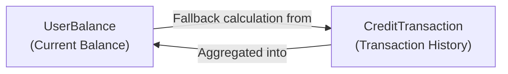

**Sources**: [autogpt_platform/backend/backend/data/credit.py:241-265]()

---

## Credit Architecture

### UserCreditBase Interface

The credit system is abstracted through the `UserCreditBase` class, allowing different implementations (e.g., beta vs. production behavior):

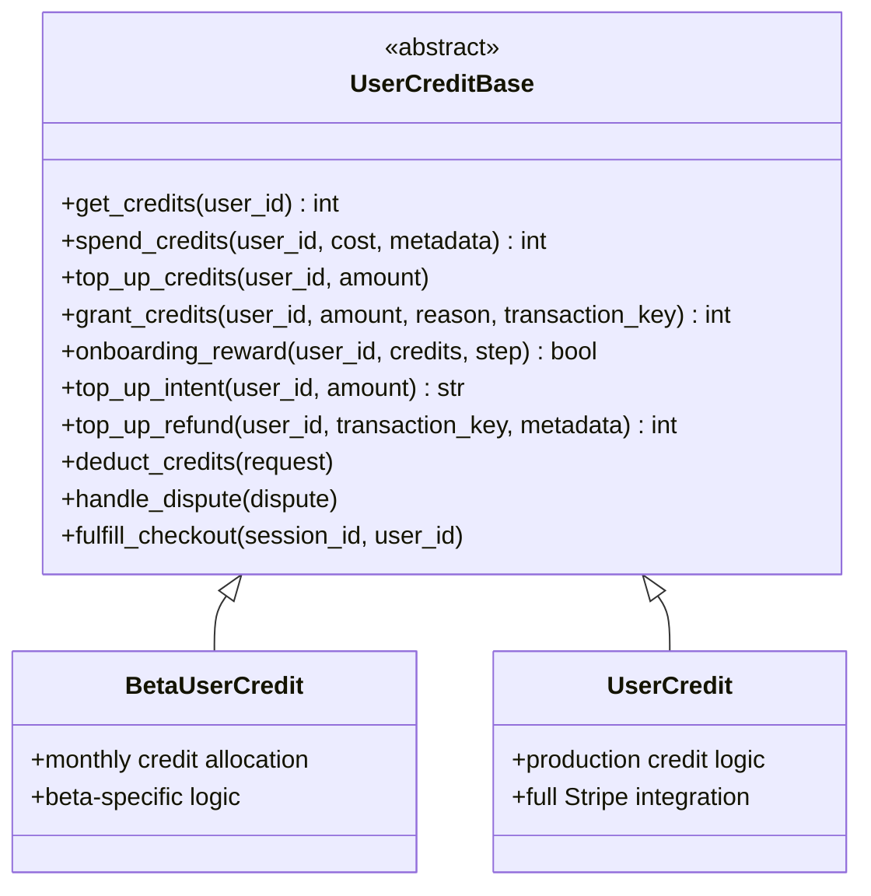

The `grant_credits` method is used for non-purchased credit movements, such as in-app refunds or beta-tester top-ups, distinct from `TOPUP` transactions which are tied to Stripe checkouts [autogpt_platform/backend/backend/data/credit.py:184-198]().

**Sources**: [autogpt_platform/backend/backend/data/credit.py:99-232]()

### Transaction Management

All credit changes are atomic operations managed through database transactions:

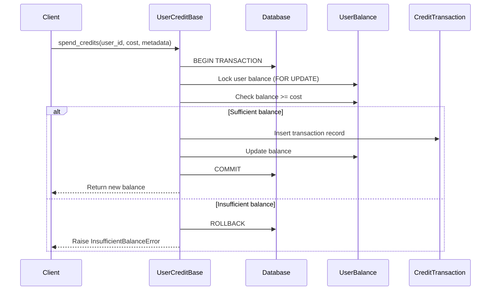

**Sources**: [autogpt_platform/backend/backend/data/credit.py:267-391](), [autogpt_platform/backend/backend/util/exceptions.py:66-87]()

### Balance Calculation Methods

The system uses two methods for balance retrieval:

1. **Primary**: Direct read from `UserBalance` table (fast)
2. **Fallback**: Aggregate from `CreditTransaction` history (accurate but slower)

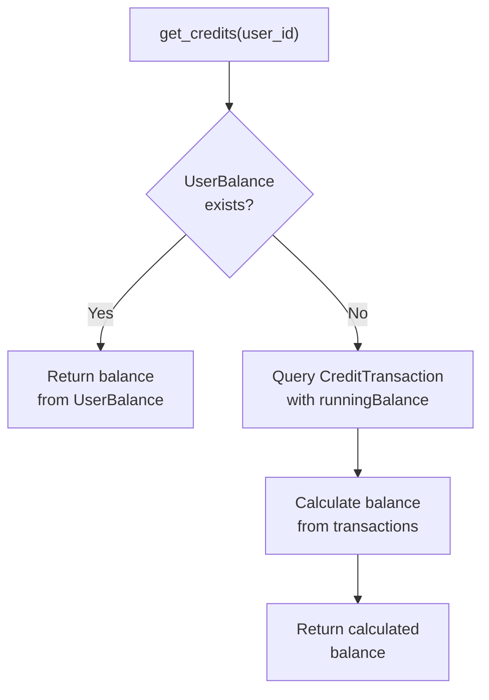

**Sources**: [autogpt_platform/backend/backend/data/credit.py:241-265]()

---

## Cost Calculation

### Block Cost Types

Blocks can be charged using three different cost types defined by `BlockCostType`:

| Cost Type | Unit | Calculation | Use Case |
|-----------|------|-------------|----------|
| `RUN` | Per execution | Fixed cost per block run | Most blocks (e.g., AI generation, API calls) |
| `BYTE` | Per byte | `data_size * cost_amount` | File processing blocks |
| `SECOND` | Per second | `run_time * cost_amount` | Long-running operations |
| `ITEMS` | Per item | `num_items * cost_amount` | Blocks processing lists of items |
| `COST_USD` | Per microdollar | `cost_microdollars * cost_amount` | Blocks with external USD costs (e.g., LLM calls) |

**Sources**: [autogpt_platform/backend/backend/blocks/_base.py:104-108](), [autogpt_platform/backend/backend/executor/utils.py:117-159]()

### Block Cost Configuration

Block costs are configured in `BLOCK_COSTS` mapping with cost filters for granular pricing. The `BLOCK_COSTS` dictionary is defined in [autogpt_platform/backend/backend/data/block_cost_config.py]().

```python
# Example structure (not actual code)
BLOCK_COSTS = {
    AITextGeneratorBlock: [
        BlockCost(
            cost_amount=10,  # 10 credits per run
            cost_type=BlockCostType.RUN,
            cost_filter={"model": "gpt-4"}  # Only for GPT-4
        ),
        BlockCost(
            cost_amount=5,
            cost_type=BlockCostType.RUN,
            cost_filter={"model": "gpt-3.5-turbo"}  # Cheaper for GPT-3.5
        )
    ]
}
```

The `block_usage_cost()` function matches input data against cost filters:

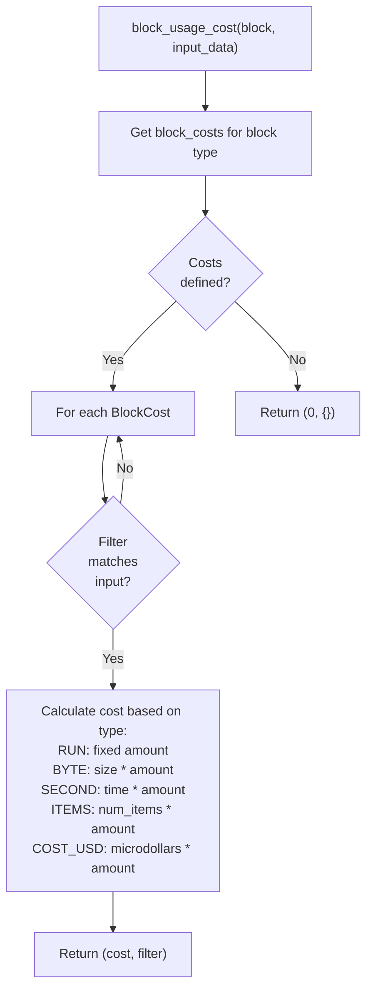

**Sources**: [autogpt_platform/backend/backend/data/block_cost_config.py](), [autogpt_platform/backend/backend/executor/utils.py:117-176]()

### Execution Overhead Costs

In addition to block costs, the system charges for graph execution overhead:

```python
# Charge every N block executions (e.g., every 100 blocks)
execution_cost_count_threshold = 100
execution_cost_per_threshold = 1  # 1 credit per 100 blocks
```

The `execution_usage_cost()` function determines when to charge:

**Sources**: [autogpt_platform/backend/backend/executor/utils.py:97-114](), [autogpt_platform/backend/backend/util/settings.py:144-151]()

---

## Credit Operations

### Spending Credits Flow

Credits are spent during graph execution with the following flow:

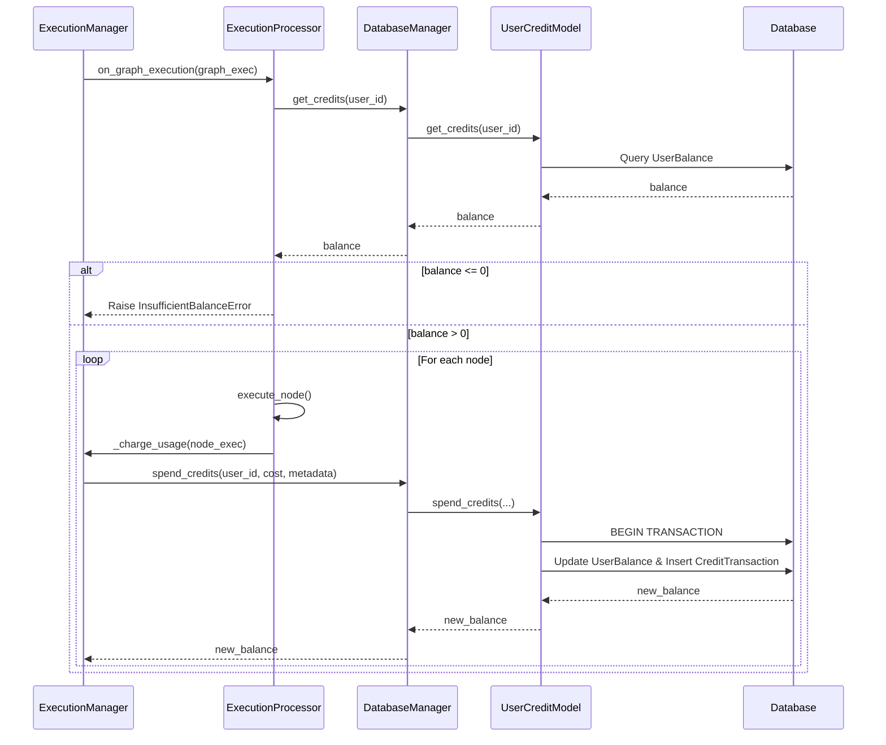

**Sources**: [autogpt_platform/backend/backend/executor/manager.py:823-873](), [autogpt_platform/backend/backend/executor/manager.py:906-915]()

### Top-Up System

Users can purchase credits via Stripe Checkout:

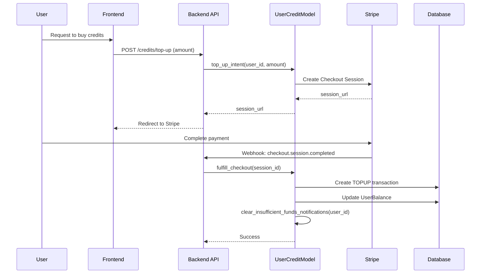

**Sources**: [autogpt_platform/backend/backend/data/credit.py:159-232](), [autogpt_platform/backend/backend/api/features/v1.py:44]()

### Refund System

The platform supports both automatic and manual refunds:

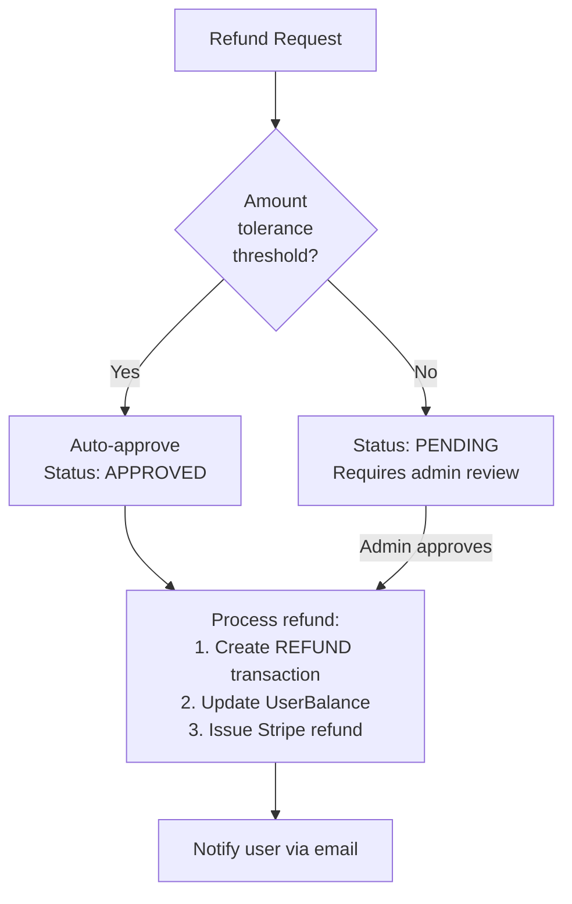

Configuration:
- `refund_credit_tolerance_threshold`: Maximum auto-approve amount (default: 500 credits = $5)
- `refund_request_time_key_format`: Time-based rate limiting (e.g., weekly)

**Sources**: [autogpt_platform/backend/backend/data/credit.py:478-606](), [autogpt_platform/backend/backend/util/settings.py:128-143]()

### Auto Top-Up

Users can configure automatic balance replenishment. The `AutoTopUpConfig` model defines the settings for this feature.

```typescript
type AutoTopUpConfig = {
  enabled: boolean;
  threshold: number;     // Trigger when balance drops below
  amount: number;        // Amount to top up
  max_per_month: number; // Monthly spending cap
}
```

The system monitors balance after each transaction and triggers top-ups when needed.

**Sources**: [autogpt_platform/backend/backend/data/model.py:29-31](), [autogpt_platform/backend/backend/data/credit.py:30-31]()

### Onboarding Rewards

New users receive free credits for completing onboarding steps:

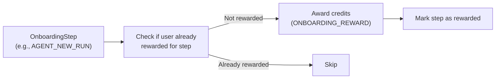

**Sources**: [autogpt_platform/backend/backend/data/credit.py:143-156](), [autogpt_platform/backend/backend/data/credit.py:18]()

---

## Subscription Tiers

The platform offers different subscription tiers, each with varying benefits and credit multipliers. These tiers are managed through Stripe subscriptions.

### SubscriptionTier Enum

The `SubscriptionTier` enum defines the available tiers:

```python
enum SubscriptionTier {
  NO_TIER
  BASIC
  PRO
  MAX
  BUSINESS
  ENTERPRISE
}
```

`NO_TIER` represents users without an active paid subscription.

**Sources**: [autogpt_platform/backend/backend/copilot/rate_limit.py:91-97]()

### Tier Multipliers

Each subscription tier has a multiplier that affects the effective cost limits for certain features, such as Copilot usage. These multipliers can be configured via LaunchDarkly feature flags.

```python
_DEFAULT_TIER_MULTIPLIERS: dict[SubscriptionTier, float] = {
    SubscriptionTier.NO_TIER: 0.0,
    SubscriptionTier.BASIC: 1.0,
    SubscriptionTier.PRO: 5.0,
    SubscriptionTier.MAX: 20.0,
    SubscriptionTier.BUSINESS: 60.0,
    SubscriptionTier.ENTERPRISE: 60.0,
}
```

The `get_tier_multipliers()` function retrieves the current multipliers, prioritizing LaunchDarkly overrides [autogpt_platform/backend/backend/copilot/rate_limit.py:144-157]().

**Sources**: [autogpt_platform/backend/backend/copilot/rate_limit.py:107-121]()

### Stripe Integration for Subscriptions

Subscription management is tightly integrated with Stripe:

- **Checkout Sessions**: `create_subscription_checkout()` initiates a Stripe Checkout session for new subscriptions or upgrades [autogpt_platform/backend/backend/data/credit.py:608-640]().
- **Subscription Modification**: `modify_stripe_subscription_for_tier()` handles changes to existing subscriptions (e.g., upgrades, downgrades) [autogpt_platform/backend/backend/data/credit.py:642-709]().
- **Webhook Handling**: Stripe webhooks (`customer.subscription.updated`, `customer.subscription.deleted`, `invoice.payment_succeeded`, `invoice.payment_failed`) are used to synchronize subscription status with the backend database [autogpt_platform/backend/backend/data/credit.py:711-809]().
- **Pending Changes**: The system supports scheduling subscription changes to take effect at the end of the current billing period, managed by `get_pending_subscription_change()` and `release_pending_subscription_schedule()` [autogpt_platform/backend/backend/data/credit.py:811-870]().
- **Proration**: `get_proration_credit_cents()` calculates the credit due for subscription changes [autogpt_platform/backend/backend/data/credit.py:872-909]().

The frontend component `SubscriptionTierSection` ([autogpt_platform/frontend/src/app/(platform)/profile/(user)/credits/components/SubscriptionTierSection/SubscriptionTierSection.tsx]()) allows users to view and change their subscription tier, interacting with the backend via `useUpdateSubscriptionTier()` [autogpt_platform/frontend/src/app/(platform)/profile/(user)/credits/components/SubscriptionTierSection/useSubscriptionTierSection.ts:43]().

**Sources**: [autogpt_platform/backend/backend/data/credit.py:608-909](), [autogpt_platform/frontend/src/app/(platform)/profile/(user)/credits/components/SubscriptionTierSection/SubscriptionTierSection.tsx](), [autogpt_platform/frontend/src/app/(platform)/profile/(user)/credits/components/SubscriptionTierSection/useSubscriptionTierSection.ts]()

---

## Integration with Execution

### Pre-Execution Balance Check

Before starting a graph execution, the system verifies sufficient balance:

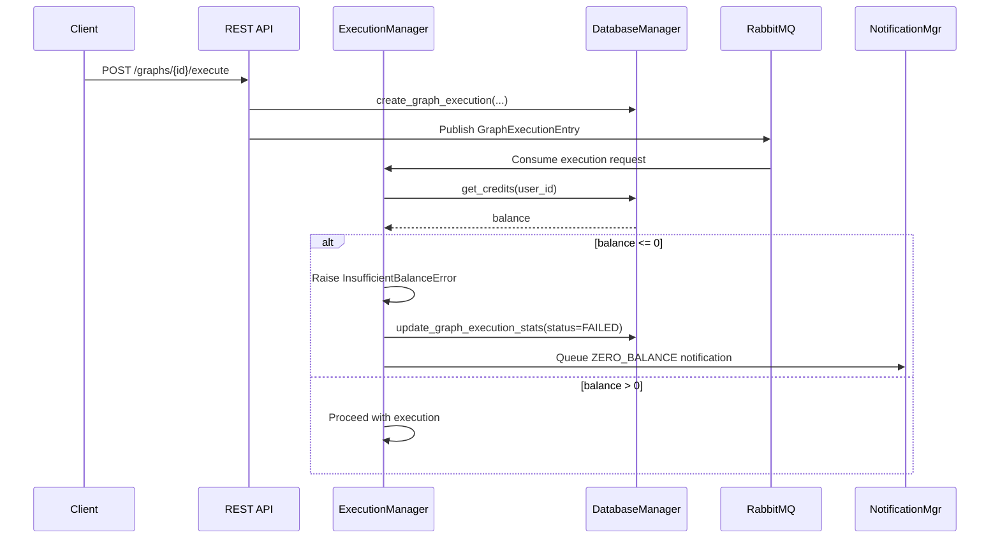

**Sources**: [autogpt_platform/backend/backend/executor/manager.py:906-915]()

### Cost Charging During Execution

Credits are charged atomically before each node execution:

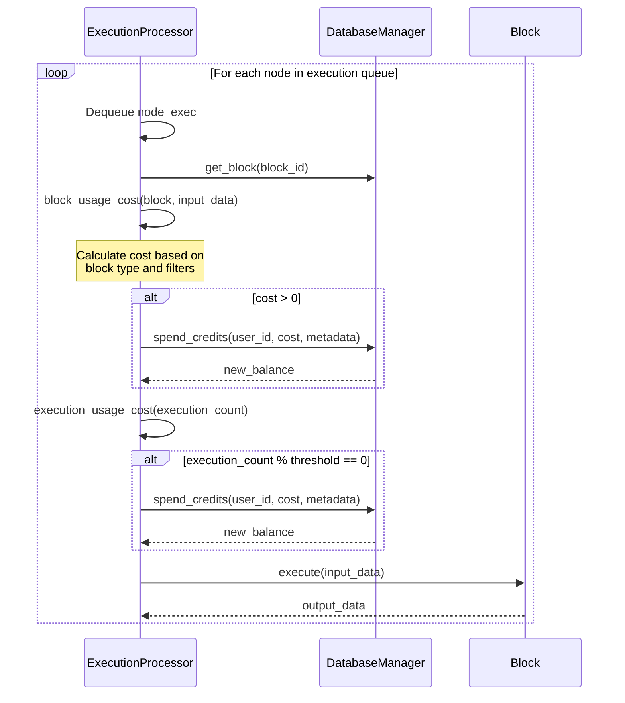

Key metadata tracked in `UsageTransactionMetadata`:
- `graph_exec_id`: Execution identifier
- `node_exec_id`: Specific node execution
- `block_id`: Block being executed
- `input`: Cost filter that matched
- `reason`: Human-readable description

**Sources**: [autogpt_platform/backend/backend/executor/billing.py:118-173](), [autogpt_platform/backend/backend/data/credit.py:64-73]()

### Insufficient Balance Handling

When balance is exhausted during execution:

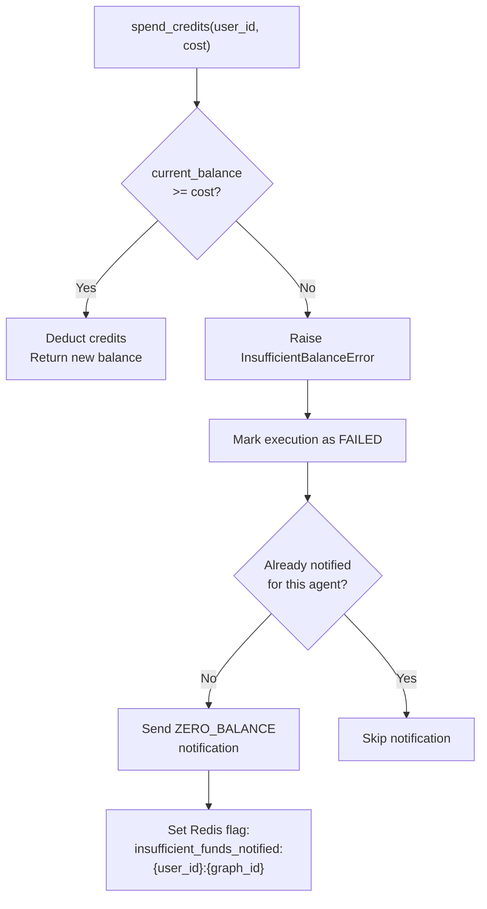

The system uses Redis flags to prevent notification spam:
- Key pattern: `insufficient_funds_notified:{user_id}:{graph_id}`
- TTL: 30 days
- Cleared on credit top-up via `clear_insufficient_funds_notifications()` [autogpt_platform/backend/backend/executor/billing.py:50-78]().

**Sources**: [autogpt_platform/backend/backend/executor/billing.py:160-173](), [autogpt_platform/backend/backend/util/exceptions.py:66-87]()

---

## Stripe Integration

### Payment Flow Architecture

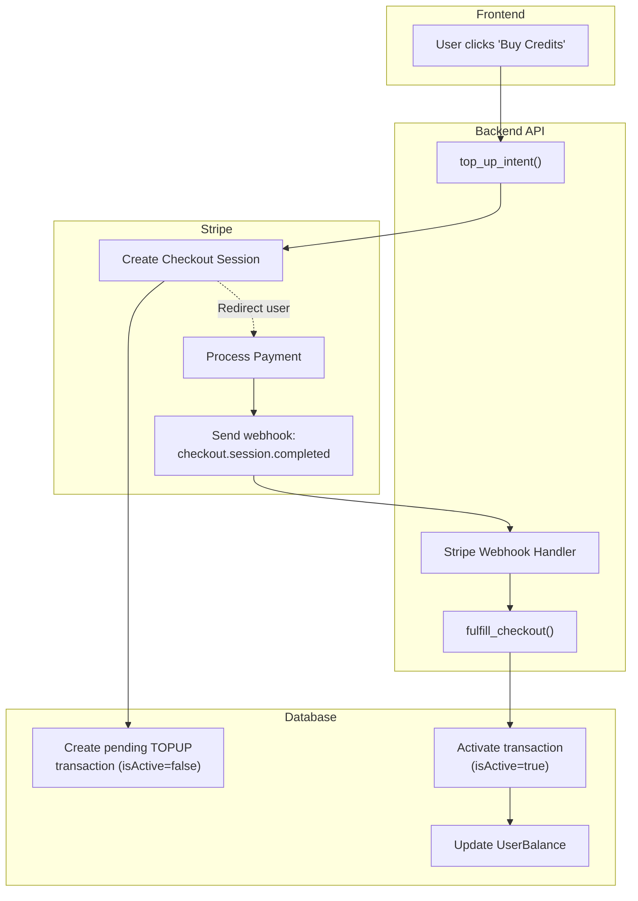

**Sources**: [autogpt_platform/backend/backend/data/credit.py:160-232]()

### Transaction Lifecycle

Stripe transactions follow a two-phase commit pattern:

1. **Phase 1 - Intent Creation**: Create inactive transaction with `transactionKey = session_id`
2. **Phase 2 - Webhook Fulfillment**: Activate transaction after payment confirmation

```sql
-- Phase 1: Create pending transaction
INSERT INTO "CreditTransaction" (
    "transactionKey",
    "userId",
    "amount",
    "type",
    "isActive"  -- false
) VALUES ($1, $2, $3, 'TOPUP', false);

-- Phase 2: Activate on webhook
UPDATE "CreditTransaction"
SET "isActive" = true
WHERE "transactionKey" = $1;

-- Update UserBalance atomically
INSERT INTO "UserBalance" ("userId", "balance")
VALUES ($1, (SELECT balance FROM "UserBalance" WHERE "userId" = $1) + $2)
ON CONFLICT ("userId") 
DO UPDATE SET "balance" = "UserBalance"."balance" + EXCLUDED."balance";
```

**Sources**: [autogpt_platform/backend/backend/data/credit.py:267-326]()

### Webhook Event Handling

The system handles multiple Stripe webhook events:

| Event | Handler | Action |
|-------|---------|--------|
| `checkout.session.completed` | `fulfill_checkout()` | Activate TOPUP transaction |
| `charge.refunded` | `deduct_credits()` | Create DEDUCT transaction |
| `charge.dispute.created` | `handle_dispute()` | Freeze disputed amount |
| `charge.dispute.closed` | `handle_dispute()` | Resolve dispute (refund or restore) |
| `customer.subscription.updated` | `sync_subscription_from_stripe()` | Update user's subscription tier in DB |
| `customer.subscription.deleted` | `sync_subscription_from_stripe()` | Set user's subscription tier to `NO_TIER` |
| `invoice.payment_succeeded` | `handle_subscription_payment_success()` | Record successful payment, clear pending changes |
| `invoice.payment_failed` | `handle_subscription_payment_failure()` | Record failed payment, notify user |

**Sources**: [autogpt_platform/backend/backend/data/credit.py:189-232](), [autogpt_platform/backend/backend/data/credit.py:711-809]()

---

## Database Schema

### Core Tables

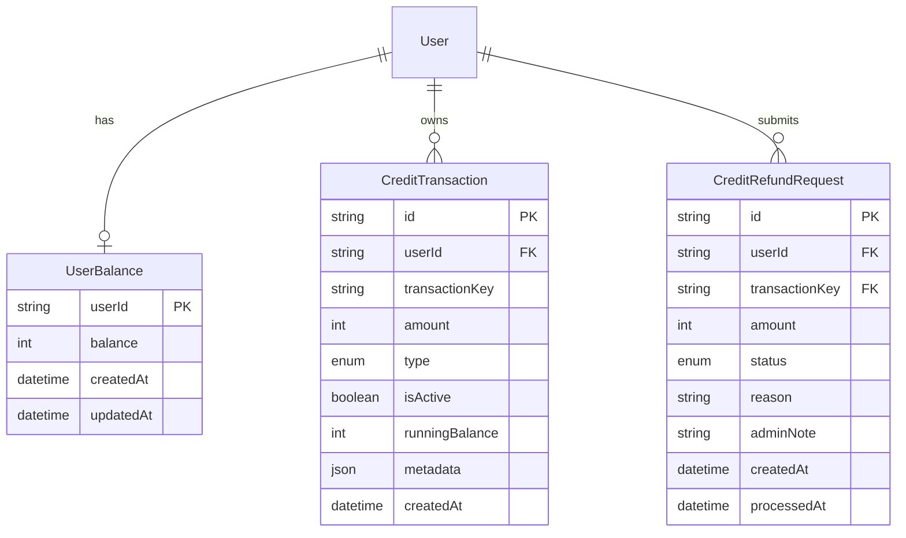

**Sources**: [autogpt_platform/backend/backend/data/credit.py:21]()

### UserBalance Table

Optimized for fast balance lookups:

- **Purpose**: Cache current balance to avoid aggregating transaction history
- **Constraints**: One row per user (`userId` is primary key)
- **Updates**: Modified atomically with each transaction
- **Fallback**: If missing, balance is computed from `CreditTransaction` table

**Sources**: [autogpt_platform/backend/backend/data/credit.py:21]()

### CreditTransaction Table

Complete audit trail of all credit movements:

```typescript
type CreditTransaction = {
  id: string;
  userId: string;
  transactionKey: string;    // Stripe session ID or other reference
  amount: number;            // Positive for credits, negative for debits
  type: CreditTransactionType;
  isActive: boolean;         // false for pending Stripe payments
  runningBalance: number;    // Balance after this transaction
  metadata: SafeJson;        // UsageTransactionMetadata for USAGE type
  createdAt: DateTime;
}
```

**Indexes**:
- `(userId, createdAt)` - Fast balance computation
- `(transactionKey, userId)` - Stripe fulfillment lookup
- `(userId, type, isActive)` - Transaction filtering

**Sources**: [autogpt_platform/backend/backend/data/credit.py:21]()

### CreditRefundRequest Table

Tracks refund requests requiring admin approval:

```typescript
type CreditRefundRequest = {
  id: string;
  userId: string;
  transactionKey: string;    // References CreditTransaction
  amount: number;
  status: RefundRequestStatus; // PENDING, APPROVED, REJECTED
  reason: string;            // User-provided reason
  adminNote?: string;        // Admin review notes
  createdAt: DateTime;
  processedAt?: DateTime;
}
```

**Sources**: [autogpt_platform/backend/backend/data/credit.py:21]()

---

## Configuration

### Settings Overview

Credit system behavior is controlled by configuration in `Settings.Config`:

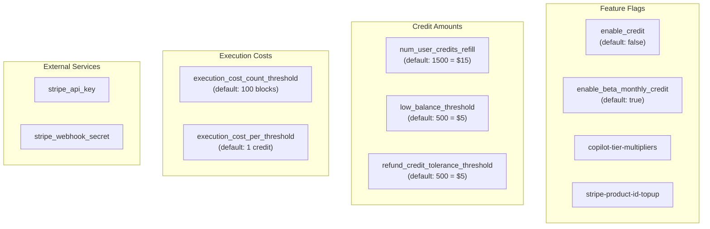

**Sources**: [autogpt_platform/backend/backend/util/settings.py:116-151](), [autogpt_platform/backend/backend/util/feature_flag.py:46-56]()

### Key Configuration Options

| Setting | Default | Description |
|---------|---------|-------------|
| `enable_credit` | `false` | Master toggle for credit system |
| `enable_beta_monthly_credit` | `true` | Beta monthly credit allocation |
| `num_user_credits_refill` | `1500` | Default refill amount (100 = $1) |
| `low_balance_threshold` | `500` | Trigger low balance notification |
| `refund_credit_tolerance_threshold` | `500` | Auto-approve refunds below this |
| `execution_cost_count_threshold` | `100` | Charge every N block executions |
| `execution_cost_per_threshold` | `1` | Cost per threshold unit |
| `COPILOT_TIER_MULTIPLIERS` | (JSON) | LaunchDarkly flag for Copilot usage multipliers per tier |
| `STRIPE_PRODUCT_ID_TOPUP` | (None) | Stripe Product ID for top-up Checkout sessions |

**Environment Variables**:
```bash
# Enable credit system
ENABLE_CREDIT=true

# Stripe credentials
STRIPE_API_KEY=sk_test_...
STRIPE_WEBHOOK_SECRET=whsec_...

# Credit amounts (in cents)
NUM_USER_CREDITS_REFILL=1500
LOW_BALANCE_THRESHOLD=500

# LaunchDarkly flag for Copilot tier multipliers
# Example: {"PRO": 5.0, "BUSINESS": 60.0}
LAUNCH_DARKLY_COPILOT_TIER_MULTIPLIERS='{"PRO": 5.0}' 
```

**Sources**: [autogpt_platform/backend/backend/util/settings.py:116-151](), [autogpt_platform/backend/backend/util/settings.py:640-641](), [autogpt_platform/backend/backend/util/feature_flag.py:46-56]()

---

## Error Handling

### InsufficientBalanceError

Raised when user lacks sufficient credits for an operation:

```python
class InsufficientBalanceError(ValueError):
    def __init__(
        self,
        user_id: str,
        message: str,
        balance: int,
        amount: int,
    ):
        self.user_id = user_id
        self.balance = balance
        self.amount = amount
        super().__init__(message)
```

**Handling**:
1. Execution is immediately terminated
2. Graph status set to `FAILED`
3. User receives `ZERO_BALANCE` or `LOW_BALANCE` notification
4. Notification deduplication via Redis flags

**Sources**: [autogpt_platform/backend/backend/util/exceptions.py:66-87](), [autogpt_platform/backend/backend/executor/billing.py:160-173]()

### Transaction Conflicts

Database-level safeguards prevent race conditions:

- **Row-level locking**: `SELECT ... FOR UPDATE` on `UserBalance`
- **Atomic updates**: All balance changes in single transaction
- **Retry logic**: `@func_retry` decorator for transient failures [autogpt_platform/backend/backend/data/credit.py:43]()
- **Unique constraints**: `transactionKey` prevents duplicate Stripe fulfillments

**Sources**: [autogpt_platform/backend/backend/data/credit.py:267-391]()

---

**Document Sources Summary**:
- [autogpt_platform/backend/backend/data/credit.py]() - Core credit system implementation
- [autogpt_platform/backend/backend/executor/billing.py]() - Credit charging during execution
- [autogpt_platform/backend/backend/executor/utils.py]() - Cost calculation utilities
- [autogpt_platform/backend/backend/util/settings.py]() - Configuration options
- [autogpt_platform/backend/backend/copilot/rate_limit.py]() - Subscription tier definitions and multipliers
- [autogpt_platform/backend/backend/util/feature_flag.py]() - Feature flag definitions
- [autogpt_platform/frontend/src/app/(platform)/profile/(user)/credits/components/SubscriptionTierSection/SubscriptionTierSection.tsx]() - Frontend subscription tier UI
- [autogpt_platform/frontend/src/app/(platform)/profile/(user)/credits/components/SubscriptionTierSection/useSubscriptionTierSection.ts]() - Frontend subscription tier logic
- [autogpt_platform/backend/backend/api/features/v1.py]() - Backend API routes for credits and subscriptions
- [autogpt_platform/backend/backend/data/model.py]() - Data models
- [autogpt_platform/backend/backend/blocks/_base.py]() - Block cost types
- [autogpt_platform/backend/backend/data/block_cost_config.py]() - Block cost configuration
- [autogpt_platform/backend/backend/util/exceptions.py]() - Error types

---

