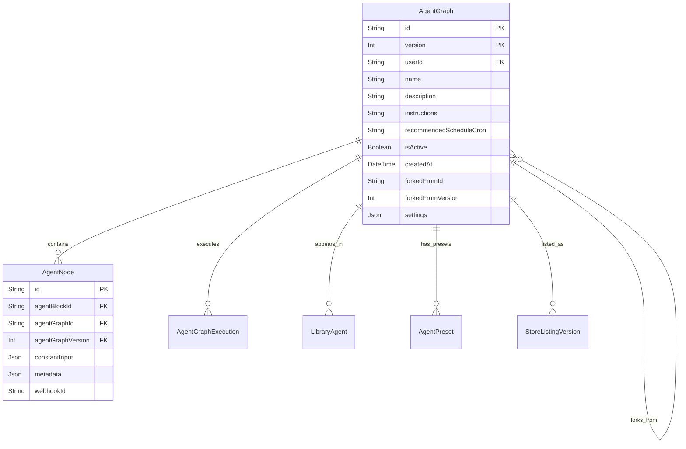
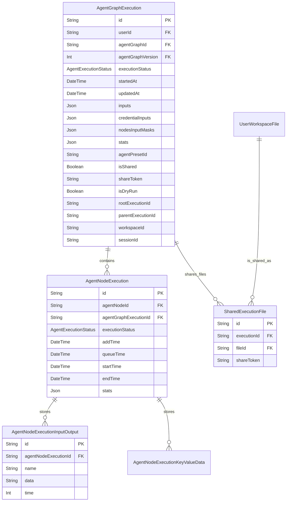
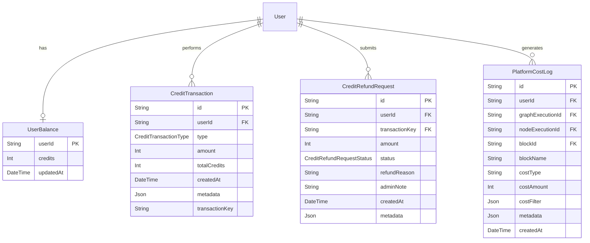
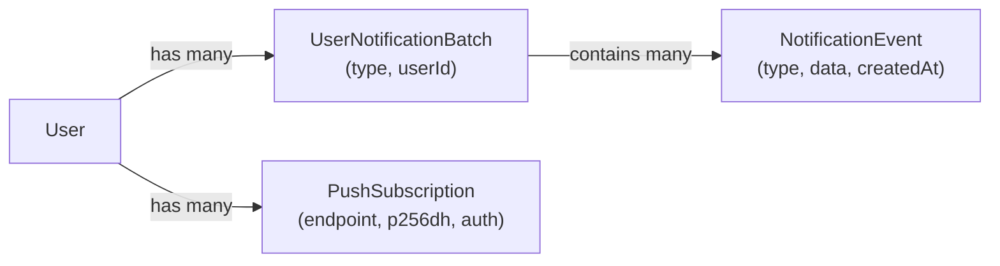

<!-- source: DeepWiki mcp.deepwiki.com · repo Significant-Gravitas/AutoGPT · extra page Data Models and Database · fetched 2026-10-26 -->

# Data Models and Database

<details>
<summary>Relevant source files</summary>

The following files were used as context for generating this wiki page:

- [autogpt_platform/backend/backend/api/features/store/content_handlers.py](autogpt_platform/backend/backend/api/features/store/content_handlers.py)
- [autogpt_platform/backend/backend/api/features/store/content_handlers_test.py](autogpt_platform/backend/backend/api/features/store/content_handlers_test.py)
- [autogpt_platform/backend/backend/api/features/store/embeddings.py](autogpt_platform/backend/backend/api/features/store/embeddings.py)
- [autogpt_platform/backend/backend/api/features/store/embeddings_schema_test.py](autogpt_platform/backend/backend/api/features/store/embeddings_schema_test.py)
- [autogpt_platform/backend/backend/api/features/store/embeddings_test.py](autogpt_platform/backend/backend/api/features/store/embeddings_test.py)
- [autogpt_platform/backend/backend/api/features/store/hybrid_search.py](autogpt_platform/backend/backend/api/features/store/hybrid_search.py)
- [autogpt_platform/backend/backend/api/features/store/hybrid_search_test.py](autogpt_platform/backend/backend/api/features/store/hybrid_search_test.py)
- [autogpt_platform/backend/backend/api/features/store/text_utils.py](autogpt_platform/backend/backend/api/features/store/text_utils.py)
- [autogpt_platform/backend/backend/api/features/store/text_utils_test.py](autogpt_platform/backend/backend/api/features/store/text_utils_test.py)
- [autogpt_platform/backend/backend/blocks/agent.py](autogpt_platform/backend/backend/blocks/agent.py)
- [autogpt_platform/backend/backend/data/block.py](autogpt_platform/backend/backend/data/block.py)
- [autogpt_platform/backend/backend/data/db.py](autogpt_platform/backend/backend/data/db.py)
- [autogpt_platform/backend/backend/data/execution.py](autogpt_platform/backend/backend/data/execution.py)
- [autogpt_platform/backend/backend/data/graph.py](autogpt_platform/backend/backend/data/graph.py)
- [autogpt_platform/backend/backend/data/model.py](autogpt_platform/backend/backend/data/model.py)
- [autogpt_platform/backend/backend/executor/manager.py](autogpt_platform/backend/backend/executor/manager.py)
- [autogpt_platform/backend/backend/executor/utils.py](autogpt_platform/backend/backend/executor/utils.py)
- [autogpt_platform/backend/backend/executor/utils_test.py](autogpt_platform/backend/backend/executor/utils_test.py)
- [autogpt_platform/backend/backend/util/exceptions.py](autogpt_platform/backend/backend/util/exceptions.py)
- [autogpt_platform/backend/backend/util/settings.py](autogpt_platform/backend/backend/util/settings.py)
- [autogpt_platform/backend/migrations/20260109181714_add_docs_embedding/migration.sql](autogpt_platform/backend/migrations/20260109181714_add_docs_embedding/migration.sql)
- [autogpt_platform/backend/schema.prisma](autogpt_platform/backend/schema.prisma)
- [autogpt_platform/frontend/src/lib/autogpt-server-api/types.ts](autogpt_platform/frontend/src/lib/autogpt-server-api/types.ts)

</details>


This page documents the database schema, data models, and persistence layer for the AutoGPT Platform backend. It covers the Prisma schema definitions, core database models, relationships between entities, and the separation between database and application layers.

For information about how these models are used in the execution system, see [Execution System](#3.2.2). For details on the credit system implementation, see [Credit System](#3.2.4).

---

## Database Technology Stack

The AutoGPT Platform uses **PostgreSQL** as its primary database, accessed through **Prisma** as the ORM layer. The schema is defined in [schema.prisma:1-875]() and generates both synchronous and asynchronous Python clients for database access.

**Key Configuration:**
- **Prisma Client**: Generated with `asyncio` interface for async operations
- **Connection**: Uses `DATABASE_URL` (connection pooling) and `DIRECT_URL` (migrations)
- **Preview Features**: Full-text search, database views, recursive types

Sources: [autogpt_platform/backend/schema.prisma:1-14]()

---

## Schema Architecture

```mermaid
graph TB
    subgraph "User Layer"
        USER["User<br/>(id, email, metadata)"]
        USER_BALANCE["UserBalance<br/>(credits)"]
        USER_ONBOARDING["UserOnboarding<br/>(progress tracking)"]
        COPILOT_UNDERSTANDING["CoPilotUnderstanding<br/>(AI context)"]
        BUILDER_SEARCH_HISTORY["BuilderSearchHistory<br/>(user searches)"]
    end
    
    subgraph "Agent Definition"
        AGENT_GRAPH["AgentGraph<br/>(id, version, name)"]
        AGENT_NODE["AgentNode<br/>(id, agentBlockId)"]
        AGENT_NODE_LINK["AgentNodeLink<br/>(source → sink)"]
        AGENT_BLOCK["AgentBlock<br/>(block definition)"]
    end
    
    subgraph "Execution Runtime"
        GRAPH_EXEC["AgentGraphExecution<br/>(executionStatus, stats)"]
        NODE_EXEC["AgentNodeExecution<br/>(executionStatus)"]
        NODE_IO["AgentNodeExecutionInputOutput<br/>(data storage)"]
        NODE_KV["AgentNodeExecutionKeyValueData<br/>(key-value pairs)"]
        SHARED_EXEC_FILE["SharedExecutionFile<br/>(shared workspace files)"]
        USER_WORKSPACE["UserWorkspace<br/>(user's file storage)"]
        USER_WORKSPACE_FILE["UserWorkspaceFile<br/>(individual files)"]
    end
    
    subgraph "Library & Store"
        LIBRARY_AGENT["LibraryAgent<br/>(user's agent list)"]
        AGENT_PRESET["AgentPreset<br/>(saved configs)"]
        STORE_LISTING["StoreListing<br/>(marketplace)"]
        STORE_LISTING_VERSION["StoreListingVersion<br/>(versioned listings)"]
        STORE_LISTING_REVIEW["StoreListingReview<br/>(user reviews)"]
    end
    
    subgraph "Credits & Billing"
        CREDIT_TRANS["CreditTransaction<br/>(type, amount, metadata)"]
        REFUND_REQ["CreditRefundRequest<br/>(status, amount)"]
        PLATFORM_COST_LOG["PlatformCostLog<br/>(detailed cost logs)"]
    end
    
    subgraph "Integrations"
        INTEGRATION_CREDS["IntegrationCredentials<br/>(provider, tokens)"]
        INTEGRATION_WEBHOOK["IntegrationWebhook<br/>(triggers)"]
    end

    subgraph "Notifications"
        USER_NOTIFICATION_BATCH["UserNotificationBatch<br/>(batched notifications)"]
        NOTIFICATION_EVENT["NotificationEvent<br/>(individual events)"]
        PUSH_SUBSCRIPTION["PushSubscription<br/>(web push tokens)"]
    end

    subgraph "OAuth"
        OAUTH_APP["OAuthApplication"]
        OAUTH_AUTH_CODE["OAuthAuthorizationCode"]
        OAUTH_ACCESS_TOKEN["OAuthAccessToken"]
        OAUTH_REFRESH_TOKEN["OAuthRefreshToken"]
    end

    subgraph "Platform Linking"
        PLATFORM_LINK["PlatformLink"]
        PLATFORM_USER_LINK["PlatformUserLink"]
    end

    subgraph "Analytics"
        ANALYTICS_DETAILS["AnalyticsDetails"]
        ANALYTICS_METRICS["AnalyticsMetrics"]
    end
    
    USER --> USER_BALANCE
    USER --> USER_ONBOARDING
    USER --> COPILOT_UNDERSTANDING
    USER --> BUILDER_SEARCH_HISTORY
    USER --> AGENT_GRAPH
    USER --> GRAPH_EXEC
    USER --> LIBRARY_AGENT
    USER --> AGENT_PRESET
    USER --> CREDIT_TRANS
    USER --> REFUND_REQ
    USER --> INTEGRATION_CREDS
    USER --> INTEGRATION_WEBHOOK
    USER --> USER_NOTIFICATION_BATCH
    USER --> PUSH_SUBSCRIPTION
    USER --> OAUTH_APP
    USER --> PLATFORM_LINK
    USER --> PLATFORM_USER_LINK
    USER --> ANALYTICS_DETAILS
    USER --> ANALYTICS_METRICS
    USER --> PLATFORM_COST_LOG
    USER --> STORE_LISTING_REVIEW
    USER --> STORE_LISTING_VERSION

    AGENT_GRAPH --> AGENT_NODE
    AGENT_GRAPH --> GRAPH_EXEC
    AGENT_GRAPH --> LIBRARY_AGENT
    AGENT_GRAPH --> AGENT_PRESET
    AGENT_GRAPH --> STORE_LISTING
    
    AGENT_NODE --> AGENT_BLOCK
    AGENT_NODE --> AGENT_NODE_LINK
    AGENT_NODE --> NODE_EXEC
    AGENT_NODE --> INTEGRATION_WEBHOOK
    
    GRAPH_EXEC --> NODE_EXEC
    GRAPH_EXEC --> AGENT_PRESET
    GRAPH_EXEC --> SHARED_EXEC_FILE
    
    NODE_EXEC --> NODE_IO
    NODE_EXEC --> NODE_KV
    
    USER_WORKSPACE --> USER_WORKSPACE_FILE
    USER_WORKSPACE_FILE --> SHARED_EXEC_FILE

    LIBRARY_AGENT --> AGENT_GRAPH
    AGENT_PRESET --> AGENT_GRAPH
    AGENT_PRESET --> INTEGRATION_WEBHOOK
    AGENT_PRESET --> NODE_IO

    STORE_LISTING --> STORE_LISTING_VERSION
    STORE_LISTING --> STORE_LISTING_REVIEW
    STORE_LISTING_VERSION --> AGENT_GRAPH

    USER_NOTIFICATION_BATCH --> NOTIFICATION_EVENT
```



**Diagram: Database Schema Overview - Core Models and Relationships**

The schema is organized into distinct functional domains with clear separation of concerns. All models use UUIDs for primary keys and include timestamp fields for audit tracking.

Sources: [autogpt_platform/backend/schema.prisma:1-875]()

---

## Core Models

### User Model

The `User` model mirrors Supabase authentication users and extends them with platform-specific data.

| Field | Type | Description |
|-------|------|-------------|
| `id` | String | Primary key (matches Supabase user ID) |
| `email` | String (unique) | User email address |
| `emailVerified` | Boolean | Email verification status |
| `createdAt` | DateTime | Account creation timestamp |
| `metadata` | Json | Extensible user metadata |
| `stripeCustomerId` | String? | Stripe customer ID for billing |
| `topUpConfig` | Json? | Auto top-up configuration |
| `subscriptionTier` | SubscriptionTier | User's subscription level |

**Notification Preferences:**
```
notifyOnAgentRun: Boolean
notifyOnZeroBalance: Boolean
notifyOnLowBalance: Boolean
notifyOnBlockExecutionFailed: Boolean
notifyOnContinuousAgentError: Boolean
notifyOnDailySummary: Boolean
notifyOnWeeklySummary: Boolean
notifyOnMonthlySummary: Boolean
notifyOnAgentApproved: Boolean
notifyOnAgentRejected: Boolean
maxEmailsPerDay: Int (default: 3)
timezone: String (default: "not-set")
```

**Key Relations:**
- `AgentGraphs`: One-to-many (graphs created by user)
- `AgentGraphExecutions`: One-to-many (execution history)
- `UserBalance`: One-to-one (credit balance)
- `CreditTransactions`: One-to-many (transaction history)
- `LibraryAgents`: One-to-many (saved agents)
- `UserWorkspace`: One-to-one (user's file storage)
- `CoPilotUnderstanding`: One-to-one (Copilot's understanding of user)

Sources: [autogpt_platform/backend/schema.prisma:16-82](), [autogpt_platform/backend/backend/data/model.py:52-107]()

---

### AgentGraph Model

The `AgentGraph` model represents a workflow/agent definition. It uses a composite primary key `(id, version)` to support versioning.



**Diagram: AgentGraph Entity Relationships**

**Composite Primary Key Pattern:**
- Primary Key: `@@id(name: "graphVersionId", [id, version])`
- Allows multiple versions of the same graph to coexist
- Active version tracked via `isActive` flag

**Indexes:**
```
@@index([userId, isActive, id, version])
@@index([forkedFromId, forkedFromVersion])
```

**Fork Relationships:**
The self-referential `forkedFrom` relationship enables tracking graph lineage:
```typescript
forkedFrom: AgentGraph? @relation("AgentGraphForks", 
                                   fields: [forkedFromId, forkedFromVersion])
forks: AgentGraph[] @relation("AgentGraphForks")
```

**Application Model:**
The database model is converted to `GraphModel` [autogpt_platform/backend/backend/data/graph.py:423-502]() which adds:
- `starting_nodes`: Computed list of entry points
- `validate_graph()`: Structural validation
- `reassign_ids()`: ID remapping for duplication

Sources: [autogpt_platform/backend/schema.prisma:138-173](), [autogpt_platform/backend/backend/data/graph.py:90-189]()

---

### AgentNode and AgentNodeLink

These models define the graph structure - nodes represent blocks, links represent data flow.

**AgentNode:**
```prisma
model AgentNode {
  id                String @id @default(uuid())
  agentBlockId      String
  agentGraphId      String
  agentGraphVersion Int
  constantInput     Json @default("{}")  // Static input values
  metadata          Json @default("{}")  // UI position, etc.
  webhookId         String?
  
  Input             AgentNodeLink[] @relation("AgentNodeSink")
  Output            AgentNodeLink[] @relation("AgentNodeSource")
  Executions        AgentNodeExecution[]
}
```

**AgentNodeLink:**
```prisma
model AgentNodeLink {
  id                String @id @default(uuid())
  agentNodeSourceId String
  sourceName        String  // Output pin name
  agentNodeSinkId   String
  sinkName          String  // Input pin name
  isStatic          Boolean @default(false)  // Reusable vs consumed-once
}
```

**Link Types:**
- **Dynamic Links** (`isStatic: false`): Data consumed once per execution
- **Static Links** (`isStatic: true`): Data reused across executions (e.g., configuration)

**Application Model:**
The `Link` model [autogpt_platform/backend/backend/data/graph.py:81-103]() and `Node` model [autogpt_platform/backend/backend/data/graph.py:105-136]() provide:
- Bidirectional link traversal
- Block schema validation
- Input/output schema generation

Sources: [autogpt_platform/backend/schema.prisma:303-353](), [autogpt_platform/backend/backend/data/graph.py:81-136]()

---

### AgentBlock Model

Stores block definitions (schemas) referenced by nodes.

```prisma
model AgentBlock {
  id           String @id @default(uuid())
  name         String @unique
  inputSchema  String  // Serialized JSON schema
  outputSchema String  // Serialized JSON schema
  description  String?
  optimizedDescription String? // LLM-generated description
  
  ReferencedByAgentNode AgentNode[]
}
```

**Schema Format:**
Schemas are serialized JSON Schema (Draft 7) objects with top-level properties as pin names:
```json
{
  "type": "object",
  "properties": {
    "text_input": { "type": "string", "title": "Input Text" },
    "model": { "type": "string", "enum": ["gpt-4", "gpt-3.5-turbo"] }
  },
  "required": ["text_input"]
}
```

**Block Registration:**
Blocks are auto-registered from Python classes via `initialize_blocks()` [autogpt_platform/backend/backend/data/block.py:21-103]() during application startup. This function also syncs block definitions to the `AgentBlock` table and loads optimized descriptions.

Sources: [autogpt_platform/backend/schema.prisma:356-367](), [autogpt_platform/backend/backend/data/block.py:21-103]()

---

### Execution Models



**Diagram: Execution Model Relationships**

#### AgentGraphExecution

Tracks the execution state of an entire graph run.

**Status Enum:**
```typescript
enum AgentExecutionStatus {
  INCOMPLETE  // Partial input data
  QUEUED      // Waiting for worker
  RUNNING     // In progress
  COMPLETED   // Successfully finished
  TERMINATED  // Manually stopped or canceled
  FAILED      // Error occurred
  REVIEW      // Awaiting human review
}
```

**Status Transition Rules:**
Valid transitions defined in [autogpt_platform/backend/backend/data/execution.py:134-165]():
```python
VALID_STATUS_TRANSITIONS = {
    ExecutionStatus.QUEUED: [
        ExecutionStatus.INCOMPLETE,
        ExecutionStatus.TERMINATED,  # For resuming halted execution
        ExecutionStatus.REVIEW,  # For resuming after review
    ],
    ExecutionStatus.RUNNING: [
        ExecutionStatus.INCOMPLETE,
        ExecutionStatus.QUEUED,
        ExecutionStatus.TERMINATED,  # For resuming halted execution
        ExecutionStatus.REVIEW,  # For resuming after review
    ],
    ExecutionStatus.COMPLETED: [
        ExecutionStatus.RUNNING,
    ],
    ExecutionStatus.FAILED: [
        ExecutionStatus.INCOMPLETE,
        ExecutionStatus.QUEUED,
        ExecutionStatus.RUNNING,
        ExecutionStatus.REVIEW,
    ],
    ExecutionStatus.TERMINATED: [
        ExecutionStatus.INCOMPLETE,
        ExecutionStatus.QUEUED,
        ExecutionStatus.RUNNING,
        ExecutionStatus.REVIEW,
    ],
    ExecutionStatus.REVIEW: [
        ExecutionStatus.RUNNING,
    ],
}
```

**Statistics Structure:**
```typescript
stats: {
  cost: number;              // Cents
  duration: number;          // Seconds (wall time)
  duration_cpu_only: number; // CPU seconds
  node_exec_time: number;    // Total node runtime
  node_exec_time_cpu_only: number;
  node_exec_count: number;
  node_error_count: number;
  error?: string;
  activity_status?: string;  // AI-generated summary
  correctness_score?: number; // 0.0-1.0
}
```

**Key Indexes:**
```
@@index([userId, executionStatus, createdAt])
@@index([agentGraphId, agentGraphVersion])
@@index([executionStatus, updatedAt])
```

Sources: [autogpt_platform/backend/schema.prisma:381-443](), [autogpt_platform/backend/backend/data/execution.py:168-291]()

#### AgentNodeExecution

Tracks individual node execution within a graph run.

```prisma
model AgentNodeExecution {
  id                      String @id @default(uuid())
  agentNodeId             String
  agentGraphExecutionId   String
  executionStatus         AgentExecutionStatus
  
  // Timing breakdown
  addTime   DateTime  // When added to queue
  queueTime DateTime? // When picked up for execution
  startTime DateTime? // When execution started
  endTime   DateTime? // When execution completed
  
  stats Json?  // NodeExecutionStats
  
  InputData  AgentNodeExecutionInputOutput[] @relation("NodeInputData")
  OutputData AgentNodeExecutionInputOutput[] @relation("NodeOutputData")
}
```

**NodeExecutionStats Structure:**
```python
class NodeExecutionStats(BaseModel):
    input_size: int = 0       # Bytes
    output_size: int = 0      # Bytes
    walltime: float = 0       # Seconds
    cputime: float = 0        # CPU seconds
    
    # LLM-specific metrics
    llm_input_tokens: int = 0
    llm_output_tokens: int = 0
    llm_total_cost: float = 0
    llm_requests: int = 0
    extra_steps: int = 0      # For agent blocks
    extra_cost: int = 0       # Additional charges
    
    error: str | Exception | None = None
```

Sources: [autogpt_platform/backend/schema.prisma:445-492](), [autogpt_platform/backend/backend/data/model.py:900-958]()

#### AgentNodeExecutionInputOutput

Stores actual input/output data for node executions.

```prisma
model AgentNodeExecutionInputOutput {
  id                     String @id @default(uuid())
  agentNodeExecutionId   String
  agentPresetId          String? // For preset inputs
  
  name String  // Pin name
  data String  // JSON-serialized value
  time Int     // Sequence number for ordering
  
  NodeExecution AgentNodeExecution? @relation("NodeOutputData")
  NodeInput     AgentNodeExecution? @relation("NodeInputData")
  AgentPreset   AgentPreset?       @relation("AgentPresetsInputData")
}
```

**Data Storage Pattern:**
- Each input/output pin produces one or more records
- `time` field orders multiple outputs from same pin
- Large data stored as JSON strings (potential optimization target)

**Indexes:**
```
@@index([agentNodeExecutionId, referencedByInputExecId])
@@index([agentPresetId])
```

Sources: [autogpt_platform/backend/schema.prisma:494-530](), [autogpt_platform/backend/backend/data/execution.py:452-568]()

#### AgentNodeExecutionKeyValueData

Provides key-value storage for execution context (like Redis but persisted).

```prisma
model AgentNodeExecutionKeyValueData {
  id                     String @id @default(uuid())
  agentNodeExecutionId   String
  key                    String
  value                  String
  
  @@unique([agentNodeExecutionId, key])
}
```

Used for:
- Storing intermediate state in iterative blocks
- Caching data between node executions
- Maintaining execution context across async operations

Sources: [autogpt_platform/backend/schema.prisma:532-544](), [autogpt_platform/backend/backend/data/execution.py:630-680]()

#### UserWorkspace and UserWorkspaceFile

These models manage user's persistent file storage.

```prisma
model UserWorkspace {
  id        String   @id @default(uuid())
  createdAt DateTime @default(now())
  updatedAt DateTime @updatedAt

  userId String @unique
  User   User   @relation(fields: [userId], references: [id], onDelete: Cascade)

  Files UserWorkspaceFile[]

  @@index([userId])
}

model UserWorkspaceFile {
  id        String   @id @default(uuid())
  createdAt DateTime @default(now())
  updatedAt DateTime @updatedAt

  workspaceId String
  Workspace   UserWorkspace @relation(fields: [workspaceId], references: [id], onDelete: Cascade)

  name        String // User-visible filename
  path        String // Virtual path (e.g., "/documents/report.pdf")
  storagePath String // Actual GCS or local storage path
  mimeType    String
  sizeBytes   BigInt
  checksum    String? // SHA256 for integrity

  isDeleted Boolean   @default(false)
  deletedAt DateTime?

  metadata Json @default("{}")

  SharedExecutionFiles SharedExecutionFile[]

  @@unique([workspaceId, path])
  @@index([workspaceId, isDeleted])
}
```

Sources: [autogpt_platform/backend/schema.prisma:172-212]()

#### SharedExecutionFile

Tracks which workspace files are exposed via a shared execution.

```prisma
model SharedExecutionFile {
  id        String   @id @default(uuid())
  createdAt DateTime @default(now())

  executionId String
  Execution   AgentGraphExecution @relation(fields: [executionId], references: [id], onDelete: Cascade)

  fileId String
  File   UserWorkspaceFile @relation(fields: [fileId], references: [id], onDelete: Cascade)

  shareToken String

  @@unique([shareToken, fileId])
  @@index([executionId])
}
```

Sources: [autogpt_platform/backend/schema.prisma:214-230]()

---

### Credit System Models



**Diagram: Credit System Model Relationships**

#### UserBalance

Tracks current credit balance (100 credits = $1 USD).

```prisma
model UserBalance {
  userId  String   @id
  credits Int      @default(0)
  updatedAt DateTime @default(now()) @updatedAt
  User    User     @relation(fields: [userId], references: [id])
}
```

**Invariants:**
- Always up-to-date via atomic updates
- Must not go negative (enforced by `spend_credits()` logic)
- Backed by `CreditTransaction` audit trail

#### CreditTransaction

Immutable audit log of all credit movements.

```prisma
enum CreditTransactionType {
  TOP_UP               // Paid purchase
  USAGE                // Block execution cost
  REFUND               // Manual refund
  DISPUTE_DEDUCTION    // Chargeback
  ONBOARDING_REWARD    // Free credits
  BETA_MONTHLY_CREDIT  // Beta program credits
  REVERT               // Admin correction
}

model CreditTransaction {
  id             String @id @default(uuid())
  userId         String
  type           CreditTransactionType
  amount         Int      // Positive or negative
  totalCredits   Int      // Balance after transaction
  transactionKey String?  // External reference (Stripe ID)
  createdAt      DateTime @default(now())
  metadata       Json     @default("{}")
  
  @@index([userId, createdAt(sort: Desc)])
  @@index([transactionKey])
}
```

**Metadata Structure:**
```typescript
// For USAGE transactions
{
  graph_exec_id: string;
  graph_id: string;
  node_id: string;
  node_exec_id: string;
  block_id: string;
  block: string;
  input: Record<string, any>;
  reason: string;
}

// For TOP_UP transactions
{
  stripe_payment_intent_id: string;
  amount_usd: number;
}
```

**Transaction Key:**
- For `TOP_UP`: Stripe Payment Intent ID
- For `USAGE`: `{graph_exec_id}:{node_exec_id}`
- Used for idempotency and refund tracking

Sources: [autogpt_platform/backend/schema.prisma:697-734](), [autogpt_platform/backend/backend/executor/utils.py:26-27](), [autogpt_platform/backend/backend/data/credit.py:53-238]()

#### CreditRefundRequest

Manages refund request workflow.

```prisma
enum CreditRefundRequestStatus {
  PENDING
  APPROVED
  REJECTED
  PROCESSED
}

model CreditRefundRequest {
  id             String @id @default(uuid())
  userId         String
  transactionKey String  // References CreditTransaction
  Int amount
  CreditRefundRequestStatus status
  String refundReason
  String? adminNote
  DateTime createdAt
  Json metadata
  
  @@unique([userId, transactionKey])
  @@index([userId, status])
}
```

**Refund Approval Rules:**
- Auto-approved if `amount <= config.refund_credit_tolerance_threshold` [autogpt_platform/backend/backend/util/settings.py:143-146]()
- Otherwise requires admin review
- Prevents duplicate refunds via unique constraint on `(userId, transactionKey)`

Sources: [autogpt_platform/backend/schema.prisma:736-768](), [autogpt_platform/backend/backend/util/settings.py:143-146]()

#### PlatformCostLog

Detailed log of costs incurred by block executions.

```prisma
model PlatformCostLog {
  id             String   @id @default(uuid())
  userId         String
  graphExecutionId String?
  nodeExecutionId  String?
  blockId        String
  blockName      String
  costType       String
  costAmount     Int
  costFilter     Json
  metadata       Json     @default("{}")
  createdAt      DateTime @default(now())

  User          User                @relation(fields: [userId], references: [id], onDelete: Cascade)
  GraphExecution AgentGraphExecution? @relation(fields: [graphExecutionId], references: [id], onDelete: SetNull)
  NodeExecution  AgentNodeExecution?  @relation(fields: [nodeExecutionId], references: [id], onDelete: SetNull)

  @@index([userId, createdAt])
  @@index([graphExecutionId])
  @@index([nodeExecutionId])
}
```

This model provides granular cost tracking for each block execution, which is crucial for billing and analytics.

Sources: [autogpt_platform/backend/schema.prisma:770-790]()

---

## Library and Store Models

### LibraryAgent

User's personal library of agents (pinned/saved agents).

```prisma
model LibraryAgent {
  id        String @id @default(uuid())
  userId    String
  agentGraphId      String
  agentGraphVersion Int
  creatorId String?
  
  imageUrl String?
  useGraphIsActiveVersion Boolean @default(false)
  
  isFavorite      Boolean @default(false)
  isCreatedByUser Boolean @default(false)
  isArchived      Boolean @default(false)
  isDeleted       Boolean @default(false)
  
  settings Json @default("{}")
  
  @@unique([userId, agentGraphId, agentGraphVersion])
}
```

**Behavior Flags:**
- `useGraphIsActiveVersion`: Auto-update to latest version
- `isCreatedByUser`: Track user's own agents separately
- `isArchived`/`isDeleted`: Soft delete pattern

Sources: [autogpt_platform/backend/schema.prisma:265-294]()

### AgentPreset

Saved configuration for an agent (inputs + credentials).

```prisma
model AgentPreset {
  id        String @id @default(uuid())
  userId    String
  agentGraphId      String
  agentGraphVersion Int
  
  name        String
  description String
  isActive    Boolean @default(true)  // Enable/disable scheduled runs
  isDeleted   Boolean @default(false)
  
  InputPresets AgentNodeExecutionInputOutput[] // Saved input values
  Executions   AgentGraphExecution[]
  webhookId    String?  // For webhook-triggered presets
}
```

**Use Cases:**
- Scheduled agent runs (via cron)
- Webhook-triggered agents
- Quick re-run with saved configuration
- Template configurations

Sources: [autogpt_platform/backend/schema.prisma:185-216]()

### StoreListing and StoreListingVersion

Marketplace agents with versioning and review workflow.

```prisma
model StoreListing {
  id          String @id @default(uuid())
  agentId     String
  agentVersion Int
  creatorId   String
  isApproved  Boolean @default(false)
  isDeleted   Boolean @default(false)
  isFeatured  Boolean @default(false)
  
  Versions    StoreListingVersion[]
  Reviews     StoreListingReview[]
}

model StoreListingVersion {
  id          String @id @default(uuid())
  storeListingId String
  agentId     String
  agentVersion Int
  
  slug          String @unique
  name          String
  description   String
  imageUrls     String[]
  categories    String[]
  
  submissionStatus SubmissionStatus @default(PENDING)
  reviewComments   String?
  
  runs      Int @default(0)
  rating    Float @default(0)
  
  @@unique([agentId, agentVersion])
}

enum SubmissionStatus {
  DRAFT
  PENDING
  APPROVED
  REJECTED
}
```

**Review Workflow:**
1. Creator submits (PENDING)
2. Admin reviews → APPROVED/REJECTED
3. Only APPROVED visible in marketplace
4. Each version reviewed independently

Sources: [autogpt_platform/backend/schema.prisma:792-875]()

---

## Integration Models

### IntegrationCredentials

Stores OAuth tokens and API keys for external services.

```prisma
model IntegrationCredentials {
  id         String @id @default(uuid())
  userId     String
  provider   String  // ProviderName enum
  credentialId String @unique
  
  credentials    Json     // Encrypted tokens/keys
  scopes         String[] // OAuth scopes
  
  title       String?
  expiresAt   DateTime?
  
  @@index([userId, provider])
}
```

**Encryption:**
- Credentials encrypted at rest using `backend.util.settings.Secrets.encryption_key`
- Decryption happens in `IntegrationCredentialsManager` [autogpt_platform/backend/backend/integrations/creds_manager.py:1-500]()

**Credential Types:**
```typescript
type CredentialValue = 
  | APIKeyCredentials       // { api_key: string }
  | OAuth2Credentials       // { access_token, refresh_token, ... }
  | UserPasswordCredentials // { username, password }
  | HostScopedCredentials  // { host, credentials }
```

Sources: [autogpt_platform/backend/schema.prisma:546-582](), [autogpt_platform/backend/backend/data/model.py:100-350]()

### IntegrationWebhook

Manages webhook subscriptions for external triggers.

```prisma
model IntegrationWebhook {
  id          String @id @default(uuid())
  userId      String
  provider    String
  webhookId   String @unique
  
  credentials IntegrationCredentials
  resource    String   // Resource type being watched
  events      String[] // Event types subscribed to
  config      Json     // Provider-specific config
  
  AgentNodes   AgentNode[]
  AgentPresets AgentPreset[]
  
  @@index([provider, resource])
}
```

**Webhook Flow:**
1. User configures webhook trigger block
2. System registers webhook with provider
3. Provider sends events to platform webhook endpoint
4. Platform routes to appropriate graph execution

Sources: [autogpt_platform/backend/schema.prisma:584-621]()

---

## Notification System Models



**Diagram: Notification Model Structure**

### UserNotificationBatch

Groups notifications for batched delivery.

```prisma
model UserNotificationBatch {
  id        String @id @default(uuid())
  userId    String
  type      NotificationType
  
  Notifications NotificationEvent[]
  
  @@unique([userId, type])  // One batch per type per user
}
```

### NotificationEvent

Individual notification records.

```prisma
enum NotificationType {
  AGENT_RUN
  ZERO_BALANCE
  LOW_BALANCE
  BLOCK_EXECUTION_FAILED
  CONTINUOUS_AGENT_ERROR
  DAILY_SUMMARY
  WEEKLY_SUMMARY
  MONTHLY_SUMMARY
  REFUND_REQUEST
  REFUND_PROCESSED
  AGENT_APPROVED
  AGENT_REJECTED
}

model NotificationEvent {
  id        String @id @default(uuid())
  type      NotificationType
  data      Json  // Typed notification data
  createdAt DateTime @default(now())
  
  userNotificationBatchId String?
  UserNotificationBatch   UserNotificationBatch?
}
```

**Batching Strategy:**
- Immediate: Sent right away (ZERO_BALANCE, REFUND_PROCESSED)
- Batched: Collected and sent periodically (AGENT_RUN, BLOCK_EXECUTION_FAILED)
- Summary: Aggregated reports (DAILY_SUMMARY, WEEKLY_SUMMARY)

Sources: [autogpt_platform/backend/schema.prisma:232-261](), [autogpt_platform/backend/backend/data/notifications.py:1-500]()

### PushSubscription

Stores web push subscription details for sending notifications to browsers.

```prisma
model PushSubscription {
  id        String   @id @default(uuid())
  userId    String
  endpoint  String   @unique
  p256dh    String
  auth      String
  createdAt DateTime @default(now())
  updatedAt DateTime @updatedAt

  User User @relation(fields: [userId], references: [id], onDelete: Cascade)

  @@index([userId])
}
```

Sources: [autogpt_platform/backend/schema.prisma:623-636]()

---

## Database Access Patterns

### Two-Layer Architecture

The codebase maintains strict separation between database models and application models:

```mermaid
graph TB
    subgraph "Application Layer"
        APP_GRAPH["GraphModel<br/>(graph.py)"]
        APP_EXEC["GraphExecution<br/>(execution.py)"]
        APP_USER["User<br/>(model.py)"]
        APP_BLOCK["Block<br/>(_base.py)"]
    end
    
    subgraph "ORM Layer"
        PRISMA_GRAPH["AgentGraph<br/>(Prisma model)"]
        PRISMA_EXEC["AgentGraphExecution<br/>(Prisma model)"]
        PRISMA_USER["User<br/>(Prisma model)"]
        PRISMA_BLOCK["AgentBlock<br/>(Prisma model)"]
    end
    
    subgraph "Database"
        DB[(PostgreSQL)]
    end
    
    APP_GRAPH -.->|from_db()| PRISMA_GRAPH
    APP_EXEC -.->|from_db()| PRISMA_EXEC
    APP_USER -.->|from_db()| PRISMA_USER
    APP_BLOCK -.->|sync_block_to_db()| PRISMA_BLOCK
    
    PRISMA_GRAPH --> DB
    PRISMA_EXEC --> DB
    PRISMA_USER --> DB
    PRISMA_BLOCK --> DB
```

**Diagram: Two-Layer Data Model Architecture**

**Conversion Pattern:**
```python
# Database → Application
prisma_user = await prisma.user.find_unique(where={"id": user_id})
app_user = User.from_db(prisma_user)

# Application models are NEVER returned directly from Prisma
# Always convert via from_db() static methods
```

**Validation:**
The codebase enforces this via [autogpt_platform/backend/backend/util/service.py:54-78]():
```python
def _validate_no_prisma_objects(obj: Any, path: str = "result") -> None:
    """
    Recursively validate that no Prisma objects are being returned 
    from service methods. This enforces proper separation of layers.
    """
    if hasattr(obj, "__class__") and "prisma.models" in obj.__class__.__module__:
        raise ValueError(
            f"Prisma object {obj.__class__.__name__} found in {path}. "
            "Service methods must return application models."
        )
```

Sources: [autogpt_platform/backend/backend/util/service.py:54-78](), [autogpt_platform/backend/backend/data/graph.py:423-650]()

### Query Patterns

#### Basic CRUD Operations

```python
# Create with include
graph = await prisma.agentgraph.create(
    data=AgentGraphCreateInput(...),
    include=AGENT_GRAPH_INCLUDE  # Nested relations
)

# Update with where clause
await prisma.agentgraphexecution.update(
    where={"id": execution_id},
    data={"executionStatus": ExecutionStatus.RUNNING}
)

# Find with complex filters
executions = await prisma.agentgraphexecution.find_many(
    where={
        "userId": user_id,
        "executionStatus": {"in": [ExecutionStatus.RUNNING, ExecutionStatus.QUEUED]}
    },
    order={"createdAt": "desc"},
    take=50
)
```

#### Transaction Pattern

```python
from backend.data.db import transaction

async with transaction() as tx:
    # Atomic credit deduction
    user_balance = await tx.userbalance.update(
        where={"userId": user_id},
        data={"credits": {"decrement": cost}}
    )
    
    # Record transaction
    await tx.credittransaction.create(
        data={
            "userId": user_id,
            "type": CreditTransactionType.USAGE,
            "amount": -cost,
            "totalCredits": user_balance.credits,
            "metadata": metadata
        }
    )
```

Sources: [autogpt_platform/backend/backend/data/db.py:1-250]()

#### Include Patterns

Pre-defined include configurations optimize query performance:

```python
# From backend/data/includes.py
AGENT_GRAPH_INCLUDE = {
    "Nodes": {
        "include": {
            "Input": True,
            "Output": True,
            "Webhook": True
        }
    }
}

GRAPH_EXECUTION_INCLUDE = {
    "NodeExecutions": {
        "include": {
            "InputData": True,
            "OutputData": True
        },
        "order": {"addTime": "asc"}
    }
}
```

**Usage:**
```python
graph_exec = await prisma.agentgraphexecution.find_unique(
    where={"id": execution_id},
    include=GRAPH_EXECUTION_INCLUDE
)
```

Sources: [autogpt_platform/backend/backend/data/includes.py:1-150]()

---

## Indexes and Performance

### Critical Indexes

**Execution Queries:**
```
AgentGraphExecution:
  @@index([userId, executionStatus, createdAt])
  @@index([agentGraphId, agentGraphVersion])
  @@index([executionStatus, updatedAt])

AgentNodeExecution:
  @@index([agentNodeId, agentGraphExecutionId])
  @@index([executionStatus])
```

**User Queries:**
```
CreditTransaction:
  @@index([userId, createdAt(sort: Desc)])
  @@index([transactionKey])

LibraryAgent:
  @@index([userId, isDeleted, isArchived])
  @@index([agentGraphId, agentGraphVersion])
```

**Graph Queries:**
```
AgentGraph:
  @@index([userId, isActive, id, version])
  @@index([forkedFromId, forkedFromVersion])

AgentNode:
  @@index([agentGraphId, agentGraphVersion])
  @@index([agentBlockId])
```

Sources: [autogpt_platform/backend/schema.prisma:1-875]()

### Unique Constraints

**Business Logic Constraints:**
```
User:
  @@unique([email])

UserBalance:
  @@id([userId])  // One balance per user

UserNotificationBatch:
  @@unique([userId, type])  // One batch per type per user

LibraryAgent:
  @@unique([userId, agentGraphId, agentGraphVersion])

CreditRefundRequest:
  @@unique([userId, transactionKey])  // One refund per transaction

UserWorkspace:
  @@unique([userId])

UserWorkspaceFile:
  @@unique([workspaceId, path])

SharedExecutionFile:
  @@unique([shareToken, fileId])

PushSubscription:
  @@unique([endpoint])
```

**Composite Primary Keys:**
```
AgentGraph:
  @@id([id, version])  // Version control

StoreListingVersion:
  @@unique([agentId, agentVersion])  // One listing per version
```

Sources: [autogpt_platform/backend/schema.prisma:1-875]()

### Query Optimization Strategies

1. **Pagination:** All list endpoints use cursor-based pagination [autogpt_platform/backend/backend/util/models.py:1-50]()
2. **Lazy Loading:** Relations loaded only when needed via includes
3. **Connection Pooling:** Prisma manages pool with `DATABASE_URL`
4. **Raw Queries:** Performance-critical queries use `query_raw_with_schema()` [autogpt_platform/backend/backend/data/db.py:100-200]()

Sources: [autogpt_platform/backend/backend/data/db.py:1-250](), [autogpt_platform/backend/backend/util/models.py:1-50]()

---

## Database Migrations

Migrations are managed via Prisma CLI:

```bash
# Generate migration
prisma migrate dev --name add_new_field

# Apply migrations (production)
prisma migrate deploy

# Reset database (development only)
prisma migrate reset
```

**Migration Files:** Stored in `autogpt_platform/backend/migrations/`

**Schema Changes:**
1. Update `schema.prisma`
2. Run `prisma migrate dev`
3. Regenerate Python client: `prisma generate`
4. Update application models (`.from_db()` methods)

**Client Generation:**
```bash
prisma generate
```

Generates:
- `prisma/client.py` - Main client interface
- `prisma/models.py` - Model classes
- `prisma/types.py` - Type definitions
- `prisma/enums.py` - Enum types

Sources: [autogpt_platform/backend/schema.prisma:1-14](), [autogpt_platform/backend/pyproject.toml:107-119]()

---

## Summary

The AutoGPT Platform database architecture provides:

1.  **Clear Separation:** Database models (Prisma) vs Application models (Pydantic)
2.  **Versioning Support:** Composite keys for graph versions, store listings
3.  **Audit Trails:** Immutable transaction logs, execution history
4.  **Flexible Storage:** JSON fields for extensibility, typed via Pydantic
5.  **Performance:** Strategic indexes, connection pooling, include patterns
6.  **Data Integrity:** Unique constraints, foreign keys, status transitions

The schema supports the platform's core workflows:
- Graph creation and execution
- Credit-based billing with audit trail
- User library and marketplace
- Integration credential management
- Notification batching and delivery

Sources: [autogpt_platform/backend/schema.prisma:1-875](), [autogpt_platform/backend/backend/data/graph.py:1-1000](), [autogpt_platform/backend/backend/data/execution.py:1-1500](), [autogpt_platform/backend/backend/data/credit.py:1-1000]()

---

