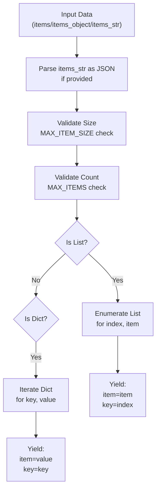
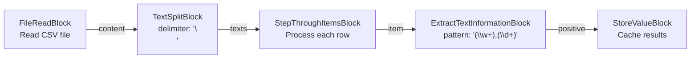
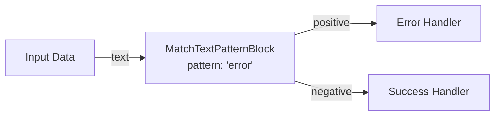
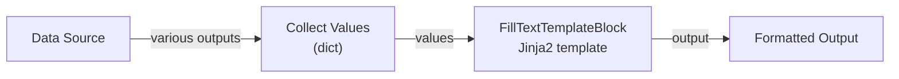

<!-- source: DeepWiki mcp.deepwiki.com · repo Significant-Gravitas/AutoGPT · extra page Data and Control Flow Blocks · fetched 2026-10-26 -->

# Data and Control Flow Blocks

<details>
<summary>Relevant source files</summary>

The following files were used as context for generating this wiki page:

- [autogpt_platform/backend/backend/blocks/apollo/_api.py](autogpt_platform/backend/backend/blocks/apollo/_api.py)
- [autogpt_platform/backend/backend/blocks/apollo/_auth.py](autogpt_platform/backend/backend/blocks/apollo/_auth.py)
- [autogpt_platform/backend/backend/blocks/apollo/models.py](autogpt_platform/backend/backend/blocks/apollo/models.py)
- [autogpt_platform/backend/backend/blocks/apollo/organization.py](autogpt_platform/backend/backend/blocks/apollo/organization.py)
- [autogpt_platform/backend/backend/blocks/apollo/people.py](autogpt_platform/backend/backend/blocks/apollo/people.py)
- [autogpt_platform/backend/backend/blocks/apollo/person.py](autogpt_platform/backend/backend/blocks/apollo/person.py)
- [autogpt_platform/backend/backend/blocks/basic.py](autogpt_platform/backend/backend/blocks/basic.py)
- [autogpt_platform/backend/backend/blocks/branching.py](autogpt_platform/backend/backend/blocks/branching.py)
- [autogpt_platform/backend/backend/blocks/data_manipulation.py](autogpt_platform/backend/backend/blocks/data_manipulation.py)
- [autogpt_platform/backend/backend/blocks/io.py](autogpt_platform/backend/backend/blocks/io.py)
- [autogpt_platform/backend/backend/blocks/smartlead/_api.py](autogpt_platform/backend/backend/blocks/smartlead/_api.py)
- [autogpt_platform/backend/backend/blocks/smartlead/_auth.py](autogpt_platform/backend/backend/blocks/smartlead/_auth.py)
- [autogpt_platform/backend/backend/blocks/smartlead/campaign.py](autogpt_platform/backend/backend/blocks/smartlead/campaign.py)
- [autogpt_platform/backend/backend/blocks/test/test_block.py](autogpt_platform/backend/backend/blocks/test/test_block.py)
- [autogpt_platform/backend/backend/blocks/text.py](autogpt_platform/backend/backend/blocks/text.py)
- [autogpt_platform/backend/backend/blocks/time_blocks.py](autogpt_platform/backend/backend/blocks/time_blocks.py)
- [autogpt_platform/backend/backend/blocks/zerobounce/_api.py](autogpt_platform/backend/backend/blocks/zerobounce/_api.py)
- [autogpt_platform/backend/backend/data/model_test.py](autogpt_platform/backend/backend/data/model_test.py)
- [autogpt_platform/backend/backend/executor/manager_test.py](autogpt_platform/backend/backend/executor/manager_test.py)
- [autogpt_platform/backend/backend/util/text.py](autogpt_platform/backend/backend/util/text.py)
- [autogpt_platform/backend/load-tests/tests/api/graph-execution-test.js](autogpt_platform/backend/load-tests/tests/api/graph-execution-test.js)
- [autogpt_platform/backend/test/blocks/test_list_concatenation.py](autogpt_platform/backend/test/blocks/test_list_concatenation.py)
- [autogpt_platform/frontend/src/components/contextual/CredentialsInput/components/HotScopedCredentialsModal/HotScopedCredentialsModal.tsx](autogpt_platform/frontend/src/components/contextual/CredentialsInput/components/HotScopedCredentialsModal/HotScopedCredentialsModal.tsx)
- [docs/CLAUDE.md](docs/CLAUDE.md)
- [docs/integrations/block-integrations/basic.md](docs/integrations/block-integrations/basic.md)

</details>


This document covers utility blocks that handle data manipulation, transformation, storage, iteration, and control flow in the AutoGPT Platform. These blocks provide essential building blocks for constructing agent graphs, including text processing, file operations, list iteration, timing operations, and debugging tools.

For blocks that interact with external services (HTTP requests, email, social media), see [Integration Blocks](#3.2.9). For AI-powered reasoning blocks, see [AI Blocks](#3.2.8). For the overall block architecture, see [Block System](#3.2.6).

## Overview

Data and control flow blocks are categorized into four main groups:

1. **Basic Blocks** - Value storage, type conversion, file storage, and debugging
2. **Data Manipulation Blocks** - Dictionary, List, CSV, and JSON operations
3. **Text Blocks** - Pattern matching, extraction, formatting, and transformation
4. **Logic Blocks** - Iteration and conditional routing
5. **Time Blocks** - Date/time operations and timers

All blocks extend the `Block` base class [backend/blocks/_base.py]() and follow the same execution model described in [Block System](#3.2.6).

**Diagram: Data and Control Flow Block Hierarchy**

```mermaid
graph TB
    Block["Block Base Class"]
    
    subgraph "Basic Blocks (BlockCategory.BASIC)"
        FileStore["FileStoreBlock<br/>id: cbb50872..."]
        StoreValue["StoreValueBlock<br/>id: 1ff065e9..."]
        PrintConsole["PrintToConsoleBlock<br/>id: f3b1c1b2..."]
        Note["NoteBlock<br/>id: cc10ff7b...<br/>BlockType.NOTE"]
        TypeConv["UniversalTypeConverterBlock<br/>id: 95d1b990..."]
        ReverseList["ReverseListOrderBlock<br/>id: 422cb708..."]
    end
    
    subgraph "Data Manipulation Blocks (BlockCategory.DATA)"
        CreateDict["CreateDictionaryBlock<br/>id: b924ddf4..."]
        AddDict["AddToDictionaryBlock<br/>id: 31d1064e..."]
        FindDict["FindInDictionaryBlock<br/>id: 0e50422c..."]
        RemoveDict["RemoveFromDictionaryBlock<br/>id: 8e7f6d5c..."]
        CreateList["CreateListBlock<br/>id: 7a8b9c0d..."]
        AddList["AddToListBlock<br/>id: 1a2b3c4d..."]
        FindList["FindInListBlock<br/>id: 5e6f7a8b..."]
        RemoveList["RemoveFromListBlock<br/>id: 9a8b7c6d..."]
        CSVToDict["CSVToDictionaryListBlock<br/>id: 2b3c4d5e..."]
        DictToCSV["DictionaryListToCSVBlock<br/>id: 6c7d8e9f..."]
        JSONToDict["JSONToDictionaryBlock<br/>id: 0f1e2d3c..."]
        DictToJSON["DictionaryToJSONBlock<br/>id: 4a5b6c7d..."]
    end

    subgraph "Text Blocks (BlockCategory.TEXT)"
        MatchPattern["MatchTextPatternBlock<br/>id: 3060088f..."]
        ExtractText["ExtractTextInformationBlock<br/>id: 3146e4fe..."]
        FillTemplate["FillTextTemplateBlock<br/>id: db7d8f02..."]
        CombineText["CombineTextsBlock<br/>id: e30a4d42..."]
        TextSplit["TextSplitBlock<br/>id: d5ea33c8..."]
        TextReplace["TextReplaceBlock<br/>id: 7e7c87ab..."]
        FileRead["FileReadBlock<br/>id: 3735a31f..."]
    end
    
    subgraph "Logic Blocks (BlockCategory.LOGIC)"
        StepThrough["StepThroughItemsBlock<br/>id: f66a3543..."]
        Condition["ConditionBlock<br/>id: 715696a0..."]
        IfInputMatches["IfInputMatchesBlock<br/>id: 6dbbc4b3..."]
    end
    
    subgraph "Time Blocks (BlockCategory.TEXT)"
        GetTime["GetCurrentTimeBlock<br/>id: a892b8d9..."]
        GetDate["GetCurrentDateBlock<br/>id: b29c1b50..."]
        GetDateTime["GetCurrentDateAndTimeBlock<br/>id: 716a67b3..."]
        CountdownTimer["CountdownTimerBlock<br/>id: d67a9c52..."]
    end
    
    Block --> FileStore
    Block --> StoreValue
    Block --> PrintConsole
    Block --> Note
    Block --> TypeConv
    Block --> ReverseList

    Block --> CreateDict
    Block --> AddDict
    Block --> FindDict
    Block --> RemoveDict
    Block --> CreateList
    Block --> AddList
    Block --> FindList
    Block --> RemoveList
    Block --> CSVToDict
    Block --> DictToCSV
    Block --> JSONToDict
    Block --> DictToJSON

    Block --> MatchPattern
    Block --> ExtractText
    Block --> FillTemplate
    Block --> CombineText
    Block --> TextSplit
    Block --> TextReplace
    Block --> FileRead
    
    Block --> StepThrough
    Block --> Condition
    Block --> IfInputMatches

    Block --> GetTime
    Block --> GetDate
    Block --> GetDateTime
    Block --> CountdownTimer
```



Sources: [backend/blocks/basic.py:1-225](), [backend/blocks/data_manipulation.py:1-51999](), [backend/blocks/text.py:1-519](), [backend/blocks/iteration.py:1-103](), [backend/blocks/branching.py:1-209](), [backend/blocks/time_blocks.py:1-484]()

## Basic Data Blocks

### StoreValueBlock

Provides a constant value as a block output, allowing reuse without change. This block enables stateless value storage within a graph.

**Schema:**
- **Input:**
  - `input: Any` - Trigger to produce output; used when `data` is None
  - `data: Any` - Constant data to retain (default: None)
- **Output:**
  - `output: Any` - The stored data

**Behavior:** Returns `data` if provided, otherwise returns `input`. The output is marked as `static_output=True`, meaning it can be consumed multiple times without re-execution.

**Example Usage:**
```
input: "Hello, World!"  →  output: "Hello, World!"
input: "Hello, World!", data: "Existing Data"  →  output: "Existing Data"
```

Sources: [autogpt_platform/backend/backend/blocks/basic.py:69-110]()

### FileStoreBlock

Stores a file in the temporary execution directory. Accepts URLs, data URIs, or local paths as input.

**Schema:**
- **Input:**
  - `file_in: MediaFileType` - File to store (URL, data URI, or local path)
  - `base_64: bool` - Produce base64 output (default: False, advanced)
- **Output:**
  - `file_out: MediaFileType` - Reference to the stored file. In CoPilot: `workspace://` URI. In graphs: data URI.

**Behavior:** Uses `store_media_file` utility [autogpt_platform/backend/backend/util/file.py]() to normalize and store the file. Files are organized by `graph_exec_id` and `user_id`.

Sources: [autogpt_platform/backend/backend/blocks/basic.py:18-67]()

### PrintToConsoleBlock

Debugging utility that prints data to console output.

**Schema:**
- **Input:**
  - `text: Any` - Data to print
- **Output:**
  - `output: Any` - The data printed
  - `status: str` - Status message ("printed")

**Usage:** Useful for debugging graph execution by observing intermediate values. This block is `disabled=True` by default [autogpt_platform/backend/backend/blocks/basic.py:129]().

Sources: [autogpt_platform/backend/backend/blocks/basic.py:112-139]()

### NoteBlock

Displays a sticky note with text. This block has `block_type=BlockType.NOTE`, indicating it's a visual annotation element rather than a functional block.

**Schema:**
- **Input:**
  - `text: str` - Text to display
- **Output:**
  - `output: str` - The same text

Sources: [autogpt_platform/backend/backend/blocks/basic.py:141-164]()

### UniversalTypeConverterBlock

Converts values between universal types using the `convert` utility function.

**Schema:**
- **Input:**
  - `value: Any` - Value to convert
  - `type: TypeOptions` - Target type (string, number, boolean, list, dictionary)
- **Output:**
  - `value: Any` - Converted value
  - `error: str` - Error message on failure

**Supported Types:** (from `TypeOptions` enum [autogpt_platform/backend/backend/blocks/basic.py:166-172]())
- `STRING` → `str`
- `NUMBER` → `float`
- `BOOLEAN` → `bool`
- `LIST` → `list`
- `DICTIONARY` → `dict`

Sources: [autogpt_platform/backend/backend/blocks/basic.py:174-197]()

### ReverseListOrderBlock

Reverses the order of elements in a list.

**Schema:**
- **Input:**
  - `input_list: list[Any]` - List to reverse
- **Output:**
  - `reversed_list: list[Any]` - List in reversed order

**Example:**
```
[1, 2, 3, 4, 5]  →  [5, 4, 3, 2, 1]
```

Sources: [autogpt_platform/backend/backend/blocks/basic.py:199-225]()

## Data Manipulation Blocks

These blocks are located in `backend/blocks/data_manipulation.py`.

### CreateDictionaryBlock

Creates a dictionary with specified key-value pairs.

**Schema:**
- **Input:**
  - `values: dict[str, Any]` - Key-value pairs to create the dictionary.
- **Output:**
  - `dictionary: dict[str, Any]` - The created dictionary.
  - `error: str` - Error message if creation failed.

**Behavior:** Directly uses the `values` input to form the output dictionary.

Sources: [autogpt_platform/backend/backend/blocks/data_manipulation.py:20-68]()

### AddToDictionaryBlock

Adds a new key-value pair (or multiple entries) to an existing dictionary. If no dictionary is provided, a new one is created.

**Schema:**
- **Input:**
  - `dictionary: dict[Any, Any]` - The dictionary to add to (default: new dict).
  - `key: str` - Key for a single new entry.
  - `value: Any` - Value for a single new entry.
  - `entries: dict[Any, Any]` - Batch entries to add.
- **Output:**
  - `updated_dictionary: dict` - The dictionary with new entries.

**Behavior:** Creates a copy of the input dictionary and adds the specified `key`/`value` or `entries`.

Sources: [autogpt_platform/backend/backend/blocks/data_manipulation.py:70-146]()

### FindInDictionaryBlock

Looks up a value in a dictionary, list, or object by key or index.

**Schema:**
- **Input:**
  - `input: Any` - Dictionary, list, or object to search.
  - `key: str | int` - Key (for dict/object) or index (for list) to lookup.
- **Output:**
  - `output: Any` - Value found for the given key/index.
  - `missing: Any` - The original input if the key/index is not found.

**Behavior:**
- If `input` is a dictionary, it attempts to retrieve `input[key]`.
- If `input` is a list, it attempts to retrieve `input[int(key)]`.
- If `input` is an object (e.g., `MockObject`), it attempts to retrieve `getattr(input, key)`.
- If `input` is a list of dictionaries, it collects all values where `key` exists in any dictionary.

Sources: [autogpt_platform/backend/backend/blocks/data_manipulation.py:148-200]()

### RemoveFromDictionaryBlock

Removes a key-value pair from a dictionary.

**Schema:**
- **Input:**
  - `dictionary: dict[Any, Any]` - The dictionary to modify.
  - `key: str` - The key to remove.
- **Output:**
  - `updated_dictionary: dict` - The dictionary after removal.
  - `removed_value: Any` - The value that was removed.
  - `error: str` - Error message if key not found.

Sources: [autogpt_platform/backend/backend/blocks/data_manipulation.py:202-250]()

### CreateListBlock

Creates a list from provided entries.

**Schema:**
- **Input:**
  - `entries: list[Any]` - Items to include in the list.
- **Output:**
  - `list: list[Any]` - The created list.
  - `error: str` - Error message if creation failed.

Sources: [autogpt_platform/backend/backend/blocks/data_manipulation.py:252-290]()

### AddToListBlock

Adds an entry (or multiple entries) to a list. If no list is provided, a new one is created. Supports insertion at a specific position.

**Schema:**
- **Input:**
  - `list: list[Any]` - The list to add to (default: new list).
  - `entry: Any` - A single entry to add.
  - `entries: list[Any]` - Batch entries to add.
  - `position: int` - Position to insert (default: append).
- **Output:**
  - `updated_list: list[Any]` - The list with new entries.

Sources: [autogpt_platform/backend/backend/blocks/data_manipulation.py:292-360]()

### FindInListBlock

Finds an item in a list based on a value or a key-value pair within dictionary items.

**Schema:**
- **Input:**
  - `input_list: list[Any]` - The list to search.
  - `value: Any` - The value to find.
  - `key: str` - Optional key to search within dictionary items.
- **Output:**
  - `found_item: Any` - The first item found.
  - `found_index: int` - Index of the first found item.
  - `all_found_items: list[Any]` - All items found.
  - `all_found_indices: list[int]` - All indices found.
  - `not_found: list[Any]` - Original list if no items found.

Sources: [autogpt_platform/backend/backend/blocks/data_manipulation.py:362-446]()

### RemoveFromListBlock

Removes an item from a list by value or index.

**Schema:**
- **Input:**
  - `input_list: list[Any]` - The list to modify.
  - `value: Any` - Value to remove.
  - `index: int` - Index to remove.
  - `remove_all: bool` - Remove all occurrences of `value` (default: False).
- **Output:**
  - `updated_list: list[Any]` - The list after removal.
  - `removed_item: Any` - The item(s) that were removed.
  - `error: str` - Error message if item/index not found.

Sources: [autogpt_platform/backend/backend/blocks/data_manipulation.py:448-529]()

### CSVToDictionaryListBlock

Converts CSV text into a list of dictionaries.

**Schema:**
- **Input:**
  - `csv_text: str` - CSV data as a string.
  - `delimiter: str` - CSV delimiter (default: ",").
  - `quotechar: str` - Quote character (default: '"').
- **Output:**
  - `dictionary_list: list[dict]` - List of dictionaries.
  - `error: str` - Error message on failure.

Sources: [autogpt_platform/backend/backend/blocks/data_manipulation.py:531-579]()

### DictionaryListToCSVBlock

Converts a list of dictionaries into CSV text.

**Schema:**
- **Input:**
  - `dictionary_list: list[dict]` - List of dictionaries.
  - `delimiter: str` - CSV delimiter (default: ",").
  - `quotechar: str` - Quote character (default: '"').
- **Output:**
  - `csv_text: str` - CSV data as a string.
  - `error: str` - Error message on failure.

Sources: [autogpt_platform/backend/backend/blocks/data_manipulation.py:581-629]()

### JSONToDictionaryBlock

Parses a JSON string into a Python dictionary or list.

**Schema:**
- **Input:**
  - `json_string: str` - JSON data as a string.
- **Output:**
  - `output: Any` - The parsed Python object (dict or list).
  - `error: str` - Error message on failure.

Sources: [autogpt_platform/backend/backend/blocks/data_manipulation.py:631-669]()

### DictionaryToJSONBlock

Converts a Python dictionary or list into a JSON string.

**Schema:**
- **Input:**
  - `input: Any` - The Python object (dict or list) to convert.
  - `indent: int` - Indentation level for pretty-printing (default: 2).
- **Output:**
  - `json_string: str` - The JSON string.
  - `error: str` - Error message on failure.

Sources: [autogpt_platform/backend/backend/blocks/data_manipulation.py:671-709]()

## Text Manipulation Blocks

Text blocks leverage the `TextFormatter` utility [autogpt_platform/backend/backend/util/text.py:27-157]() for Jinja2 template rendering with sandboxed execution.

### MatchTextPatternBlock

Matches text against a regex pattern and routes data to positive or negative output based on match result.

**Schema:**
- **Input:**
  - `text: Any` - Text to match (converted to JSON if not string)
  - `match: str` - Regex pattern
  - `data: Any` - Data to forward (defaults to `text` if None)
  - `case_sensitive: bool` - Case-sensitive matching (default: True)
  - `dot_all: bool` - Dot matches all including newlines (default: True)
- **Output:**
  - `positive: Any` - Output if match found
  - `negative: Any` - Output if match not found

**Behavior:** Uses `re.search()` with configurable flags. This enables conditional branching in graphs based on text patterns.

**Example:**
```
text: "ABC", match: "ab", case_sensitive: False  →  positive: "ABC"
text: "ABC", match: "ab", case_sensitive: True   →  negative: "ABC"
```

Sources: [autogpt_platform/backend/backend/blocks/text.py:24-75]()

### ExtractTextInformationBlock

Extracts text using regex patterns with group capture and optional find-all mode.

**Schema:**
- **Input:**
  - `text: Any` - Text to parse
  - `pattern: str` - Regex pattern
  - `group: int` - Group number to extract (default: 0)
  - `case_sensitive: bool` - Case-sensitive match (default: True)
  - `dot_all: bool` - Dot matches all (default: True)
  - `find_all: bool` - Find all matches (default: False)
- **Output:**
  - `positive: str` - Extracted text (yielded for each match)
  - `negative: str` - Original text if no match
  - `matched_results: list[str]` - List of all matches
  - `matched_count: int` - Number of matches

**Security Features:** Includes ReDoS (Regular Expression Denial of Service) protection:
- `MAX_TEXT_LENGTH = 1_000_000` - Text size limit [autogpt_platform/backend/backend/blocks/text.py:150]()
- `MAX_MATCHES = 1000` - Maximum number of matches [autogpt_platform/backend/backend/blocks/text.py:151]()
- `MAX_MATCH_LENGTH = 10_000` - Maximum length per match [autogpt_platform/backend/backend/blocks/text.py:152]()
- Dangerous pattern detection for nested quantifiers [autogpt_platform/backend/backend/blocks/text.py:171-185]()
- 5-second timeout using `regex` module for dangerous patterns [autogpt_platform/backend/backend/blocks/text.py:197-198]()

Sources: [autogpt_platform/backend/backend/blocks/text.py:77-245](), [autogpt_platform/backend/backend/blocks/test/test_block.py:64-139]()

### FillTextTemplateBlock

Formats text using Jinja2 templates with value substitution.

**Schema:**
- **Input:**
  - `values: dict[str, Any]` - Values to substitute (accessible via `{{key}}`)
  - `format: str` - Jinja2 template string
  - `escape_html: bool` - Escape HTML special characters (default: False, advanced)
- **Output:**
  - `output: str` - Formatted text

**Templating Engine:** Uses `TextFormatter` with `SandboxedEnvironment` [autogpt_platform/backend/backend/util/text.py:27-157]() for safe template execution. Supports:
- Variable substitution: `{{ variable_name }}`
- Control structures: `...`
- Conditional logic: `...`
- Variable assignment: ``

**Example:**
```
values: {"name": "Alice", "hello": "Hello", "world": "World!"}
format: "{{hello}}, {{ world }} {{name}}"
→ output: "Hello, World! Alice"
```

Sources: [autogpt_platform/backend/backend/blocks/text.py:247-295](), [autogpt_platform/backend/backend/util/text.py:116-123]()

### CombineTextsBlock

Concatenates multiple text inputs with an optional delimiter.

**Schema:**
- **Input:**
  - `input: list[str]` - Text inputs to combine
  - `delimiter: str` - Delimiter between texts (default: "")
- **Output:**
  - `output: str` - Combined text

**Example:**
```
input: ["Hello world I like ", "cake and to go for walks"]
→ output: "Hello world I like cake and to go for walks"

input: ["This is a test", "Hi!"], delimiter: "! "
→ output: "This is a test! Hi!"
```

Sources: [autogpt_platform/backend/backend/blocks/text.py:297-327]()

### TextSplitBlock

Splits text into a list of strings using a delimiter.

**Schema:**
- **Input:**
  - `text: str` - Text to split
  - `delimiter: str` - Delimiter to split by
  - `strip: bool` - Strip whitespace from results (default: True)
- **Output:**
  - `texts: list[str]` - Split text list

**Example:**
```
text: "Hello, World!", delimiter: ","
→ texts: ["Hello", "World!"]

text: "Hello, World!", delimiter: ",", strip: False
→ texts: ["Hello", " World!"]
```

Sources: [autogpt_platform/backend/backend/blocks/text.py:329-367]()

### TextReplaceBlock

Replaces all occurrences of a substring with a new substring.

**Schema:**
- **Input:**
  - `text: str` - Text to process
  - `old: str` - Substring to replace
  - `new: str` - Replacement substring
- **Output:**
  - `output: str` - Text with replacements

Uses Python's `str.replace()` method [autogpt_platform/backend/backend/blocks/text.py:394]().

Sources: [autogpt_platform/backend/backend/blocks/text.py:369-395]()

### FileReadBlock

Reads file content with support for chunking, row limiting, and skipping.

**Schema:**
- **Input:**
  - `file_input: MediaFileType` - File to read (URL, data URI, or local path)
  - `delimiter: str` - Delimiter to split content (default: "", advanced)
  - `size_limit: int` - Max bytes per chunk (0 = no limit, default: 0, advanced)
  - `row_limit: int` - Max rows to process (0 = no limit, default: 0, advanced)
  - `skip_size: int` - Characters to skip from beginning (default: 0, advanced)
  - `skip_rows: int` - Rows to skip from beginning (default: 0, advanced)
- **Output:**
  - `content: str` - File content (yielded as chunks if limits applied)

**Behavior:**
1. Store file via `store_media_file` [autogpt_platform/backend/backend/blocks/text.py:452-457]()
2. Read with UTF-8 encoding, fallback to latin-1 [autogpt_platform/backend/backend/blocks/text.py:467-475]()
3. Apply `skip_size` (character-level) [autogpt_platform/backend/backend/blocks/text.py:478-479]()
4. Split by delimiter if provided [autogpt_platform/backend/backend/blocks/text.py:482-484]()
5. Apply `skip_rows` and `row_limit` (item-level) [autogpt_platform/backend/backend/blocks/text.py:487-492]()
6. Create chunks based on `size_limit` [autogpt_platform/backend/backend/blocks/text.py:495-505]()

Sources: [autogpt_platform/backend/backend/blocks/text.py:397-521]()

## Iteration and Control Flow

### StepThroughItemsBlock

Iterates over a list or dictionary, yielding each item and its key/index.

**Schema:**
- **Input:**
  - `items: list` - List or dict to iterate (default: [])
  - `items_object: dict` - Alternative dict input (default: {})
  - `items_str: str` - JSON string input (default: "")
- **Output:**
  - `item: Any` - Current item in iteration (yielded multiple times)
  - `key: Any` - Key (dict) or index (list) of current item

**Behavior:**
- Accepts input from any of the three input fields (first non-empty used)
- Parses `items_str` as JSON if provided [autogpt_platform/backend/backend/blocks/iteration.py:77]()
- For dictionaries: yields `(item, key)` pairs [autogpt_platform/backend/backend/blocks/iteration.py:88-94]()
- For lists: yields `(item, index)` pairs [autogpt_platform/backend/backend/blocks/iteration.py:97-102]()

**Security Features:**
- `MAX_ITEMS = 10_000` - Maximum items to iterate [autogpt_platform/backend/backend/blocks/iteration.py:64]()
- `MAX_ITEM_SIZE = 1MB` - Maximum string input size [autogpt_platform/backend/backend/blocks/iteration.py:65]()
- Validates input size before parsing [autogpt_platform/backend/backend/blocks/iteration.py:72-76]()
- Enforces item count limit during iteration [autogpt_platform/backend/backend/blocks/iteration.py:83-84]()

**Example:**
```
items: [1, 2, 3]
→ Yields:
  item: 1, key: 0
  item: 2, key: 1
  item: 3, key: 2

items: {"key1": "value1", "key2": "value2"}
→ Yields:
  item: "value1", key: "key1"
  item: "value2", key: "key2"
```

**Diagram: StepThroughItemsBlock Execution Flow**



Sources: [autogpt_platform/backend/backend/blocks/iteration.py:1-103](), [autogpt_platform/backend/backend/blocks/test/test_block.py:141-182]()

### ConditionBlock

Handles conditional logic based on comparison operators.

**Schema:**
- **Input:**
  - `value1: Any` - First value for comparison.
  - `operator: ComparisonOperator` - Comparison operator (e.g., `==`, `!=`, `>`, `<`).
  - `value2: Any` - Second value for comparison.
  - `yes_value: Any` - Value to output if true (default: `value1`).
  - `no_value: Any` - Value to output if false (default: `value2`).
- **Output:**
  - `result: bool` - Result of the condition (True/False).
  - `yes_output: Any` - Output if condition is true.
  - `no_output: Any` - Output if condition is false.

**Behavior:** Compares `value1` and `value2` using the specified `operator`. Attempts to convert string values to floats for numerical comparison.

Sources: [autogpt_platform/backend/backend/blocks/branching.py:15-120]()

### IfInputMatchesBlock

Provides conditional output based on whether an input matches a specified value.

**Schema:**
- **Input:**
  - `input: Any` - The input to match against.
  - `value: Any` - The value to compare `input` with.
  - `yes_value: Any` - Value to output if `input` matches `value`.
  - `no_value: Any` - Value to output if `input` does not match `value`.
- **Output:**
  - `result: bool` - Result of the condition (True/False).
  - `yes_output: Any` - Output if condition is true.
  - `no_output: Any` - Output if condition is false.

**Behavior:** Compares `input` and `value`. If they don't match and `input` is a string, it attempts to convert `value` to the type of `input` for comparison.

Sources: [autogpt_platform/backend/backend/blocks/branching.py:122-209]()

## Time and Date Blocks

Time blocks support multiple output formats and timezone handling. All blocks use the `TimezoneLiteral` type defining 40+ timezones [autogpt_platform/backend/backend/blocks/time_blocks.py:21-60]().

### Common Features

All time/date blocks share:
- **Format Types:** Strftime (custom format string) or ISO8601 (standard format)
- **Timezone Support:** Specified timezone or user's profile timezone [autogpt_platform/backend/backend/blocks/time_blocks.py:65-85]()
- **User Timezone Override:** `use_user_timezone` flag overrides specified timezone with `execution_context.user_timezone`

**Timezone Resolution Logic:**
```python
def _get_timezone(format_type, user_timezone):
    if format_type.use_user_timezone and user_timezone:
        return ZoneInfo(user_timezone)
    else:
        return ZoneInfo(format_type.timezone)
```

Sources: [autogpt_platform/backend/backend/blocks/time_blocks.py:65-85]()

### GetCurrentTimeBlock

Outputs the current time in specified format.

**Schema:**
- **Input:**
  - `trigger: str` - Any data to trigger output
  - `format_type: Union[TimeStrftimeFormat, TimeISO8601Format]` - Format configuration (discriminated union)
- **Output:**
  - `time: str` - Current time

**Format Types:**

| Format | Fields | Example Output |
|--------|--------|----------------|
| `TimeStrftimeFormat` | `format: str` (default: "%H:%M:%S")<br/>`timezone: TimezoneLiteral` (default: "UTC")<br/>`use_user_timezone: bool` (default: False) | "14:30:45" |
| `TimeISO8601Format` | `timezone: TimezoneLiteral` (default: "UTC")<br/>`use_user_timezone: bool` (default: False)<br/>`include_microseconds: bool` (default: False) | "T14:30:45+00:00" |

Sources: [autogpt_platform/backend/backend/blocks/time_blocks.py:139-211]()

### GetCurrentDateBlock

Outputs the current date with optional offset.

**Schema:**
- **Input:**
  - `trigger: str` - Trigger output
  - `offset: Union[int, str]` - Days offset from current date (default: 0)
  - `format_type: Union[DateStrftimeFormat, DateISO8601Format]` - Format configuration
- **Output:**
  - `date: str` - Current date (adjusted by offset)

**Format Types:**

| Format | Fields | Example Output |
|--------|--------|----------------|
| `DateStrftimeFormat` | `format: str` (default: "%Y-%m-%d")<br/>`timezone: TimezoneLiteral`<br/>`use_user_timezone: bool` | "2024-01-15" |
| `DateISO8601Format` | `timezone: TimezoneLiteral`<br/>`use_user_timezone: bool` | "2024-01-15" |

**Offset Behavior:** The offset is subtracted from the current date [autogpt_platform/backend/backend/blocks/time_blocks.py:312](). Positive offset = past date.

Sources: [autogpt_platform/backend/backend/blocks/time_blocks.py:213-321]()

### GetCurrentDateAndTimeBlock

Outputs the current date and time together.

**Schema:**
- **Input:**
  - `trigger: str` - Trigger output
  - `format_type: Union[StrftimeFormat, ISO8601Format]` - Format configuration
- **Output:**
  - `date_time: str` - Current date and time

**Format Types:**

| Format | Fields | Example Output |
|--------|--------|----------------|
| `StrftimeFormat` | `format: str` (default: "%Y-%m-%d %H:%M:%S")<br/>`timezone: TimezoneLiteral`<br/>`use_user_timezone: bool` | "2024-01-15 14:30:45" |
| `ISO8601Format` | `timezone: TimezoneLiteral`<br/>`use_user_timezone: bool`<br/>`include_microseconds: bool` | "2024-01-15T14:30:45+00:00" |

Sources: [autogpt_platform/backend/backend/blocks/time_blocks.py:323-424]()

### CountdownTimerBlock

Triggers output after a specified duration, with optional repeat.

**Schema:**
- **Input:**
  - `input_message: Any` - Message to output (default: "timer finished")
  - `seconds: Union[int, str]` - Duration seconds (default: 0)
  - `minutes: Union[int, str]` - Duration minutes (default: 0)
  - `hours: Union[int, str]` - Duration hours (default: 0)
  - `days: Union[int, str]` - Duration days (default: 0)
  - `repeat: int` - Repeat count (default: 1)
- **Output:**
  - `output_message: Any` - Message after timer finishes

**Behavior:**
1. Calculate total seconds: `seconds + minutes*60 + hours*3600 + days*86400` [autogpt_platform/backend/backend/blocks/time_blocks.py:478]()
2. For each repeat:
   - Sleep for total seconds using `asyncio.sleep()` [autogpt_platform/backend/backend/blocks/time_blocks.py:482]()
   - Yield output message [autogpt_platform/backend/backend/blocks/time_blocks.py:483]()

Sources: [autogpt_platform/backend/backend/blocks/time_blocks.py:426-484]()

## Security Considerations

Several blocks implement DoS (Denial of Service) protection against malicious inputs:

### ReDoS Protection

`ExtractTextInformationBlock` protects against Regular Expression Denial of Service attacks:

**Limits:**
- Text length: 1MB maximum [autogpt_platform/backend/backend/blocks/text.py:150]()
- Match count: 1000 maximum [autogpt_platform/backend/backend/blocks/text.py:151]()
- Match length: 10KB maximum per match [autogpt_platform/backend/backend/blocks/text.py:152]()

**Dangerous Pattern Detection:**
Identifies nested quantifiers that can cause exponential backtracking [autogpt_platform/backend/backend/blocks/text.py:171-185]():
- `.*\+.*\+` - Nested + quantifiers
- `.*\*.*\*` - Nested * quantifiers
- `(?=.*\+)` - Lookahead with quantifier
- `\(.+\)\+` - Group with nested quantifier

**Timeout Mechanism:**
Uses `regex` module with 5-second timeout for dangerous patterns [autogpt_platform/backend/backend/blocks/text.py:197-198](). Safe patterns use standard `re` module for better compatibility.

Sources: [autogpt_platform/backend/backend/blocks/text.py:149-245](), [autogpt_platform/backend/backend/blocks/test/test_block.py:64-139]()

### Iteration Limits

`StepThroughItemsBlock` enforces limits to prevent memory exhaustion:
- Maximum items: 10,000 [autogpt_platform/backend/backend/blocks/iteration.py:64]()
- Maximum input string size: 1MB [autogpt_platform/backend/backend/blocks/iteration.py:65]()

Sources: [autogpt_platform/backend/backend/blocks/iteration.py:63-85](), [autogpt_platform/backend/backend/blocks/test/test_block.py:141-182]()

### File Size Limits

File operations include size restrictions:
- `store_media_file`: 100MB file size limit [autogpt_platform/backend/backend/util/file.py]()
- `FileReadBlock`: Configurable per-chunk size limits [autogpt_platform/backend/backend/blocks/text.py:408-411]()

Sources: [autogpt_platform/backend/backend/blocks/test/test_block.py:209-271]()

## Common Usage Patterns

**Diagram: Data Transformation Pipeline Example**



Sources: [autogpt_platform/backend/backend/blocks/text.py:397-521](), [autogpt_platform/backend/backend/blocks/text.py:329-367](), [autogpt_platform/backend/backend/blocks/iteration.py:1-103](), [autogpt_platform/backend/backend/blocks/text.py:77-245](), [autogpt_platform/backend/backend/blocks/basic.py:69-110]()

**Conditional Routing Pattern:**



Sources: [autogpt_platform/backend/backend/blocks/text.py:24-75]()

**Template Formatting Pattern:**



Sources: [autogpt_platform/backend/backend/blocks/text.py:247-295]()

---

