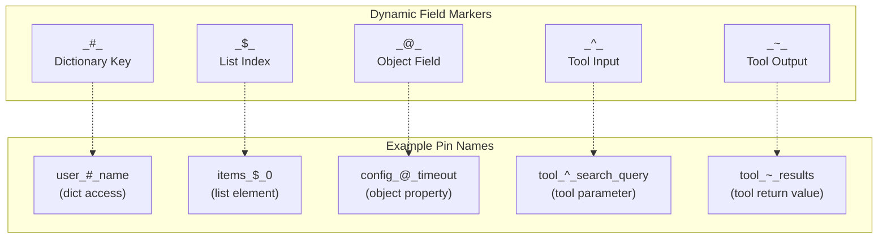
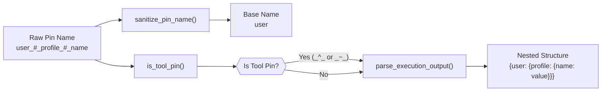
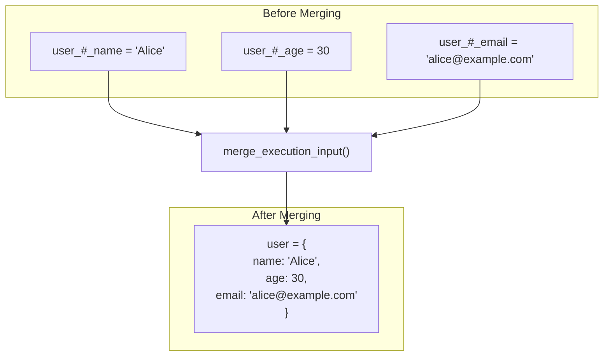
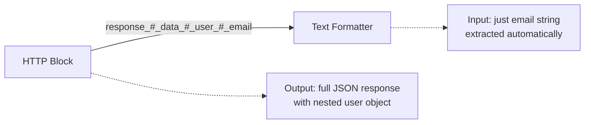
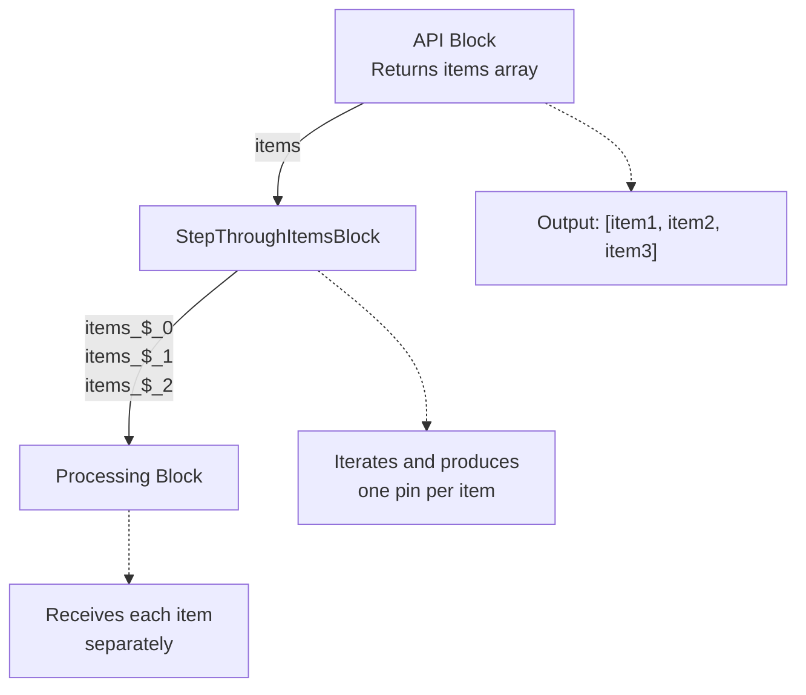
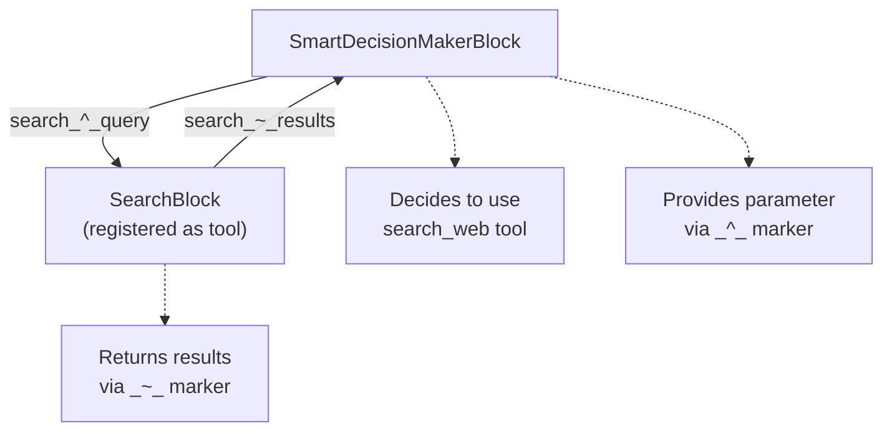
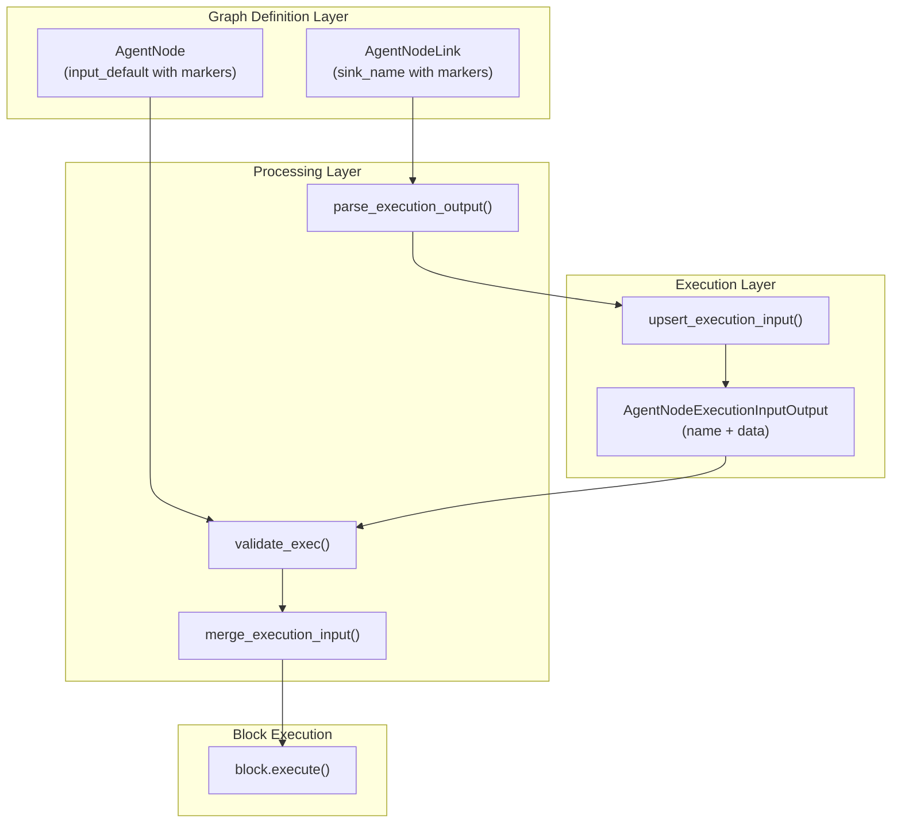

<!-- source: DeepWiki mcp.deepwiki.com · repo Significant-Gravitas/AutoGPT · extra page Dynamic Fields System · fetched 2026-10-26 -->

# Dynamic Fields System

<details>
<summary>Relevant source files</summary>

The following files were used as context for generating this wiki page:

- [autogpt_platform/backend/backend/blocks/agent.py](autogpt_platform/backend/backend/blocks/agent.py)
- [autogpt_platform/backend/backend/blocks/ai_condition.py](autogpt_platform/backend/backend/blocks/ai_condition.py)
- [autogpt_platform/backend/backend/blocks/ai_condition_test.py](autogpt_platform/backend/backend/blocks/ai_condition_test.py)
- [autogpt_platform/backend/backend/blocks/test/test_blocks_dos_vulnerability.py](autogpt_platform/backend/backend/blocks/test/test_blocks_dos_vulnerability.py)
- [autogpt_platform/backend/backend/blocks/xml_parser.py](autogpt_platform/backend/backend/blocks/xml_parser.py)
- [autogpt_platform/backend/backend/data/block.py](autogpt_platform/backend/backend/data/block.py)
- [autogpt_platform/backend/backend/data/dynamic_fields.py](autogpt_platform/backend/backend/data/dynamic_fields.py)
- [autogpt_platform/backend/backend/data/execution.py](autogpt_platform/backend/backend/data/execution.py)
- [autogpt_platform/backend/backend/data/graph.py](autogpt_platform/backend/backend/data/graph.py)
- [autogpt_platform/backend/backend/data/model.py](autogpt_platform/backend/backend/data/model.py)
- [autogpt_platform/backend/backend/data/workspace.py](autogpt_platform/backend/backend/data/workspace.py)
- [autogpt_platform/backend/backend/executor/manager.py](autogpt_platform/backend/backend/executor/manager.py)
- [autogpt_platform/backend/backend/executor/utils.py](autogpt_platform/backend/backend/executor/utils.py)
- [autogpt_platform/backend/backend/executor/utils_test.py](autogpt_platform/backend/backend/executor/utils_test.py)
- [autogpt_platform/backend/backend/util/exceptions.py](autogpt_platform/backend/backend/util/exceptions.py)
- [autogpt_platform/backend/backend/util/metrics.py](autogpt_platform/backend/backend/util/metrics.py)
- [autogpt_platform/backend/backend/util/settings.py](autogpt_platform/backend/backend/util/settings.py)
- [autogpt_platform/backend/schema.prisma](autogpt_platform/backend/schema.prisma)
- [autogpt_platform/frontend/.prettierignore](autogpt_platform/frontend/.prettierignore)
- [autogpt_platform/frontend/instrumentation-client.ts](autogpt_platform/frontend/instrumentation-client.ts)
- [autogpt_platform/frontend/sentry.edge.config.ts](autogpt_platform/frontend/sentry.edge.config.ts)
- [autogpt_platform/frontend/sentry.server.config.ts](autogpt_platform/frontend/sentry.server.config.ts)
- [autogpt_platform/frontend/src/app/(platform)/build/components/NewControlPanel/NewSearchGraph/GraphMenuSearchBar/useGraphMenuSearchBarComponent.ts](autogpt_platform/frontend/src/app/(platform)/build/components/NewControlPanel/NewSearchGraph/GraphMenuSearchBar/useGraphMenuSearchBarComponent.ts)
- [autogpt_platform/frontend/src/lib/autogpt-server-api/types.ts](autogpt_platform/frontend/src/lib/autogpt-server-api/types.ts)

</details>


The Dynamic Fields System enables AutoGPT Platform blocks to work with complex, nested data structures by using special naming conventions for input and output pins. This system allows blocks to dynamically generate and connect pins at runtime based on the structure of data flowing through the graph, supporting dictionaries, lists, objects, and dynamic tool invocations.

For information about the Block System architecture that uses dynamic fields, see [Block System](#3.2.6). For details on how blocks execute with dynamic fields, see [Execution System](#3.2.2).

---

## Overview

The Dynamic Fields System solves the challenge of connecting blocks that produce or consume structured data. Rather than requiring users to manually wire dozens of pins for each field in a nested object, the system uses naming conventions to automatically flatten and reconstruct complex data structures as they flow between nodes.

### Key Concepts

| Concept | Description | Example |
|---------|-------------|---------|
| **Pin Name** | The named input or output port on a block | `"user_data"` |
| **Dynamic Pin** | A pin with special naming that represents nested data | `"user_#_name"` (dict field) |
| **Sanitized Name** | Base pin name with special markers removed | `"user"` from `"user_#_name"` |
| **Field Parsing** | Process of splitting dynamic pin names into components | `"data_#_items_$_0"` → dict key + list index |
| **Field Merging** | Reconstructing nested structures from flat pin data | Multiple `"obj_#_*"` pins → single dict |

**Sources:** [autogpt_platform/backend/backend/data/graph.py:30](), [autogpt_platform/backend/backend/executor/utils.py:28](), [autogpt_platform/backend/backend/executor/manager.py:27]()

---

## Naming Conventions

Dynamic fields use special marker patterns in pin names to indicate how data should be structured:



### Dictionary Fields (`_#_`)

Dictionary field markers allow accessing nested dictionary values:

- **Pattern:** `base_name_#_key_name`
- **Example:** `user_#_email` accesses `user["email"]`
- **Nested:** `data_#_user_#_profile_#_age` accesses `data["user"]["profile"]["age"]`

### List Fields (`_$_`)

List field markers allow accessing array elements by index:

- **Pattern:** `base_name_$_index`
- **Example:** `items_$_0` accesses `items[0]`
- **Nested:** `matrix_$_0_$_1` accesses `matrix[0][1]`

### Object Fields (`_@_`)

Object field markers represent object properties (semantically similar to dict fields but used for structured types):

- **Pattern:** `object_name_@_property`
- **Example:** `response_@_status_code`
- **Usage:** Typically used for strongly-typed objects vs free-form dicts

### Tool Fields (`_^_` and `_~_`)

Tool markers are used by the `SmartDecisionMakerBlock` for dynamic tool invocations:

- **Input Pattern:** `tool_name_^_parameter_name`
- **Output Pattern:** `tool_name_~_return_field`
- **Example:** A tool `search_web` with parameter `query` becomes `search_web_^_query`

**Sources:** [autogpt_platform/backend/backend/data/graph.py:40](), [autogpt_platform/backend/backend/data/dynamic_fields.py:10]()

---

## Field Parsing and Sanitization



### `sanitize_pin_name(name: str) -> str`

Removes dynamic field markers to extract the base pin name:

- **Purpose:** Get the root identifier from a dynamic pin name
- **Implementation:** Splits on `_#_`, `_$_`, `_@_`, `_^_`, `_~_` and returns first segment
- **Usage:** Validation and matching pins across blocks

**Example:**
```
"user_#_profile_#_name" → "user"
"items_$_0_#_id" → "items"
"tool_^_search_query" → "tool"
```

**Sources:** [autogpt_platform/backend/backend/data/dynamic_fields.py:10-16]()

### `is_tool_pin(name: str) -> bool`

Checks if a pin name contains tool markers:

- **Purpose:** Identify pins used for dynamic tool invocations
- **Detection:** Returns `True` if name contains `_^_` or `_~_`
- **Usage:** `MCPToolBlock` uses this to route tool calls [autogpt_platform/backend/backend/executor/manager.py:204]()

**Sources:** [autogpt_platform/backend/backend/data/dynamic_fields.py:18-20]()

### `parse_execution_output(output, output_name, next_node_id, input_name)`

Extracts relevant data from block output for the next node:

- **Purpose:** Determine what data to pass to downstream nodes
- **Process:** Matches output pin names against expected input pin names using dynamic field parsing
- **Returns:** Data to populate the input pin, or `None` if no match

**Flow:**
1. Check if `output_name` matches `next_output_name` (exact or sanitized)
2. If dynamic fields present, parse nested structure
3. Extract the specific field needed by the next node
4. Return structured data ready for input

**Sources:** [autogpt_platform/backend/backend/data/dynamic_fields.py:23-100]()

---

## Field Merging During Execution



### `merge_execution_input(data: BlockInput) -> BlockInput`

Reconstructs nested data structures from flat dynamic field pins:

- **Purpose:** Convert flat pin names back into proper nested objects/arrays
- **Process:** Groups pins by base name and marker type, then builds hierarchical structure
- **Timing:** Called during node execution validation, before passing to block

**Algorithm:**
1. Scan all keys in input data for dynamic markers
2. Group by base name (sanitized)
3. For each group:
   - Sort by marker type (`_#_`, `_$_`, etc.)
   - Build nested structure recursively
   - Replace flat keys with single nested object

**Example:**
```python
# Input (flat)
{
    "user_#_name": "Alice",
    "user_#_profile_#_bio": "Developer",
    "items_$_0": "apple",
    "items_$_1": "banana"
}

# Output (nested)
{
    "user": {
        "name": "Alice",
        "profile": {
            "bio": "Developer"
        }
    },
    "items": ["apple", "banana"]
}
```

**Sources:** [autogpt_platform/backend/backend/data/dynamic_fields.py:103-180]()

---

## Integration with Block Execution

```mermaid
sequenceDiagram
    participant Node as Node (Producer)
    participant ParseOut as parse_execution_output
    participant Link as Graph Link
    participant Validate as validate_exec
    participant Merge as merge_execution_input
    participant NextNode as Node (Consumer)
    
    Node->>Node: Execute block
    Node->>Node: Produce output with dynamic pins
    Note over Node: output_data = {<br/>  "user_#_name": "Alice",<br/>  "user_#_age": 30<br/>}
    
    Node->>ParseOut: Register next nodes
    ParseOut->>ParseOut: Match output pin to input pin
    ParseOut->>ParseOut: Extract relevant nested data
    ParseOut->>Link: Add data to link
    
    Link->>Validate: Prepare for next execution
    Validate->>Validate: Check required fields
    Validate->>Merge: Resolve dynamic pins
    
    Merge->>Merge: Group by base name
    Merge->>Merge: Reconstruct nested structure
    Note over Merge: {<br/>  "user": {<br/>    "name": "Alice",<br/>    "age": 30<br/>  }<br/>}
    
    Merge->>NextNode: Pass merged input
    NextNode->>NextNode: Execute with nested data
```

### Execution Flow with Dynamic Fields

1.  **Output Generation** (Producer Block)
    *   Block executes and yields output with dynamic field names.
    *   Output names like `"result_#_user_#_name"` are produced.
    *   Stored in `AgentNodeExecutionInputOutput` table.

2.  **Output Parsing** (Link Resolution)
    *   `parse_execution_output` [autogpt_platform/backend/backend/data/dynamic_fields.py:23-100]() matches producer output to consumer input.
    *   Handles partial matches (e.g., `"result_#_user"` can match `"data"` input expecting user object).
    *   Returns appropriate nested data.

3.  **Input Validation** (Consumer Block Preparation)
    *   `validate_exec` [autogpt_platform/backend/backend/executor/utils.py:216-217]() checks if all required inputs are present.
    *   Uses `sanitize_pin_name` [autogpt_platform/backend/backend/data/dynamic_fields.py:10-16]() to match dynamic pins to schema fields.
    *   Calls `merge_execution_input` [autogpt_platform/backend/backend/data/dynamic_fields.py:103-180]() if `resolve_input=True`.

4.  **Input Merging** (Before Block Execution)
    *   Flat dynamic pins converted to nested structures.
    *   Block receives clean, structured data matching its schema.

5.  **Block Execution** (Consumer Block)
    *   Block executes with properly structured input.
    *   May produce its own dynamic field outputs, continuing the cycle.

**Sources:** [autogpt_platform/backend/backend/executor/manager.py:187-194](), [autogpt_platform/backend/backend/executor/utils.py:216-217]()

---

## Use Cases and Examples

### Use Case 1: Dictionary Traversal

**Scenario:** An HTTP block fetches user data, and a downstream block needs just the email.



**Dynamic Fields:**
- HTTP output: `response_#_data_#_user` (nested object)
- Downstream input: `user_email` (expects string)
- Parsing extracts: `response["data"]["user"]["email"]`

### Use Case 2: List Iteration

**Scenario:** Process each item in a list returned by an API.



**Dynamic Fields:**
- Iterator output: `items_$_0`, `items_$_1`, `items_$_2`, etc.
- Each represents one array element
- Processing block receives them as separate executions

### Use Case 3: Tool Invocation (SmartDecisionMakerBlock)

**Scenario:** AI agent dynamically calls a search tool based on user query.



**Dynamic Fields:**
- Tool input: `search_web_^_query` (parameter to tool)
- Tool output: `search_web_~_results` (return value from tool)
- SDM uses `is_tool_pin` [autogpt_platform/backend/backend/data/dynamic_fields.py:18-20]() to identify and route these

**Sources:** [autogpt_platform/backend/backend/blocks/llm.py]() (SmartDecisionMakerBlock implementation)

---

## Validation and Error Handling

### Pin Validation During Graph Validation

When a graph is validated before execution, the system checks dynamic field compatibility:

```python
# From validate_exec function
node_block = get_block(node.block_id)
schema = node_block.input_schema

# Check if all inputs (including dynamic ones) are satisfied
provided_inputs = set(
    [sanitize_pin_name(name) for name in node.input_default]
    + [sanitize_pin_name(link.sink_name) for link in input_links.get(node.id, [])]
)

# Validate against required fields
if missing_input := schema.get_missing_input(data):
    return None, f"missing input {missing_input}"
```

**Validation Steps:**
1.  **Sanitize all pin names** to get base identifiers.
2.  **Check required fields** from block schema against provided pins.
3.  **Allow flexible matching** - `user_#_name` satisfies `user` requirement.
4.  **Reject invalid structures** - mismatched types or missing required nested fields.

**Sources:** [autogpt_platform/backend/backend/executor/utils.py:216-217](), [autogpt_platform/backend/backend/data/graph.py:188-193]()

### Runtime Parsing Errors

If dynamic field parsing fails during execution:

-   **ValueError raised** if marker syntax is malformed.
-   **None returned** from `parse_execution_output` [autogpt_platform/backend/backend/data/dynamic_fields.py:23-100]() if no matching data found.
-   **Execution marked INCOMPLETE** if input cannot be resolved.
-   **Error logged** with sanitized pin names for debugging.

**Error Example:**
```
Skip execution, input validation error: Input data missing or mismatch 
for `TextFormatterBlock`: missing input ['user_email']
```

**Sources:** [autogpt_platform/backend/backend/executor/manager.py:190-193]()

---

## Technical Implementation Details

### Data Flow Architecture



### Database Representation

Dynamic fields are stored as flat key-value pairs in the database:

| Table | Field | Purpose |
|-------|-------|---------|
| `AgentNodeLink` | `sourceName` | Output pin name (may contain markers) |
| `AgentNodeLink` | `sinkName` | Input pin name (may contain markers) |
| `AgentNode` | `constantInput` | JSON with dynamic field keys |
| `AgentNodeExecutionInputOutput` | `name` | Pin name used during execution |
| `AgentNodeExecutionInputOutput` | `data` | Actual data value (already extracted) |

**Note:** The merging happens in-memory during execution; the database stores flattened representations.

**Sources:** [autogpt_platform/backend/backend/data/graph.py:83-86](), [autogpt_platform/backend/backend/data/execution.py:27-28]()

### Performance Considerations

-   **Sanitization is cached** during validation to avoid repeated string operations.
-   **Merging is lazy** - only performed when `resolve_input=True` in validation.
-   **Parsing is memoized** per execution context to avoid redundant work.
-   **Tool pin detection** is fast O(1) substring check.

**Sources:** [autogpt_platform/backend/backend/executor/utils.py:216-217]()

---

## Frontend Integration

The frontend must understand dynamic fields to:

1.  **Display nested data structures** in the Flow Editor.
2.  **Allow users to connect** complex output pins to input pins.
3.  **Validate connections** before saving the graph.

### TypeScript Types for Dynamic Fields

The frontend types mirror the backend structure:

```typescript
// From types.ts
export type Link = {
  source_name: string;  // May contain _#_, _$_, etc.
  sink_name: string;    // May contain _#_, _$_, etc.
};

export type Node = {
  input_default: Record<string, any>;  // Keys may use dynamic markers
};
```

**Sources:** [autogpt_platform/frontend/src/lib/autogpt-server-api/types.ts:299-310]()

### Pin Visualization

When rendering nodes in the Flow Editor:

-   **Sanitize pin names** for display (remove markers).
-   **Show nested structure** as tree in node UI.
-   **Highlight dynamic connections** differently than static ones.
-   **Allow drill-down** into nested object structures.

**Implementation Location:** Frontend CustomNode component

---

## Best Practices

### For Block Developers

1.  **Use descriptive base names** before markers: `api_response_#_data` not `a_#_b`.
2.  **Document expected structure** in block schema description.
3.  **Validate input structure** explicitly in block code if critical.
4.  **Prefer _#_ for dicts** and _$_ for lists consistently.
5.  **Reserve _^_/_~_ exclusively** for `MCPToolBlock` integration.

### For Graph Builders

1.  **Check pin compatibility** - ensure output structure matches input expectations.
2.  **Use intermediate transformation blocks** if structures don't align.
3.  **Test with sample data** before scheduling recurring executions.
4.  **Avoid deep nesting** (>3 levels) - makes debugging difficult.
5.  **Name blocks clearly** to identify data flow sources.

### For Platform Maintainers

1.  **Keep parsing logic centralized** in `autogpt_platform/backend/backend/data/dynamic_fields.py`.
2.  **Add tests for new marker types** before introducing them.
3.  **Document marker semantics** clearly in block schema.
4.  **Monitor parse failures** in execution logs.
5.  **Validate marker syntax** during graph save, not just execution.

**Sources:** [autogpt_platform/backend/backend/executor/utils.py:216-217](), [autogpt_platform/backend/backend/data/graph.py:188-193]()

---

## Future Enhancements

Potential improvements to the Dynamic Fields System:

-   **Marker aliases:** Allow `user.name` in addition to `user_#_name` for better readability.
-   **Type inference:** Automatically detect if data is dict/list and apply correct marker.
-   **Visual nesting:** Tree-like connection visualization in Flow Editor.
-   **Smart suggestions:** Auto-complete nested field names based on output schema.
-   **Bidirectional mapping:** Allow blocks to specify both flattened and nested views.

**Sources:** Discussion based on current implementation patterns

---

