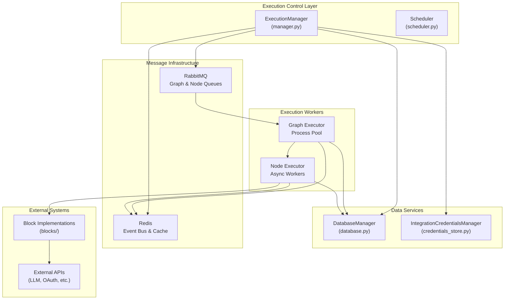
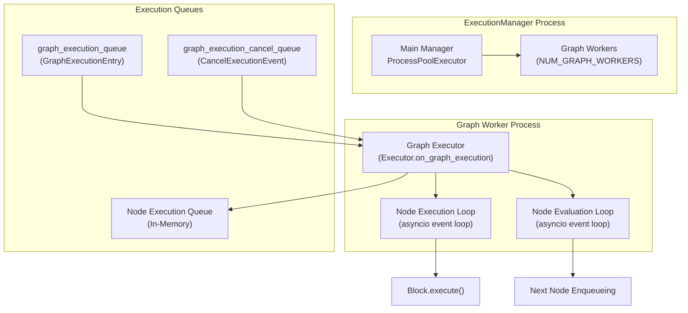
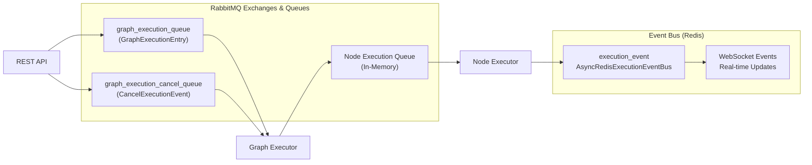
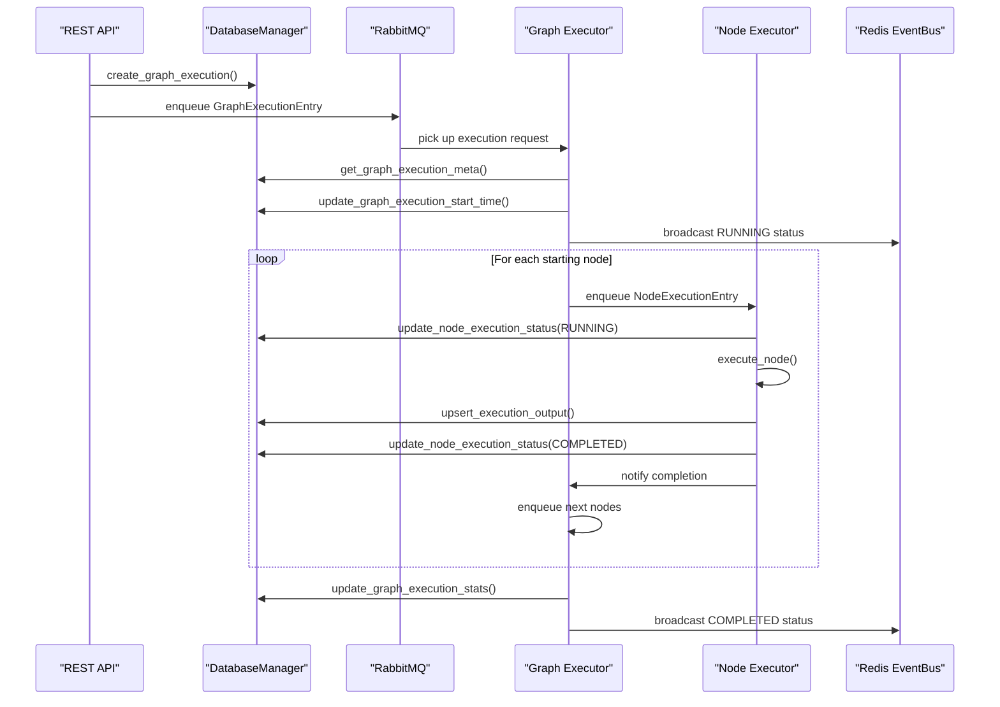
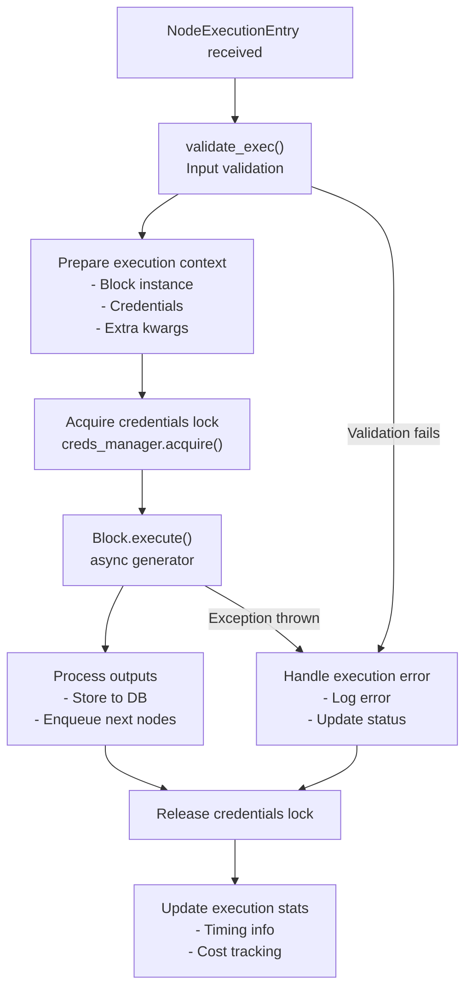
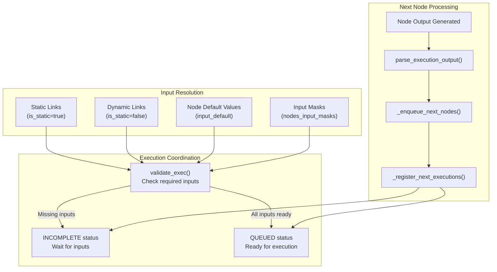
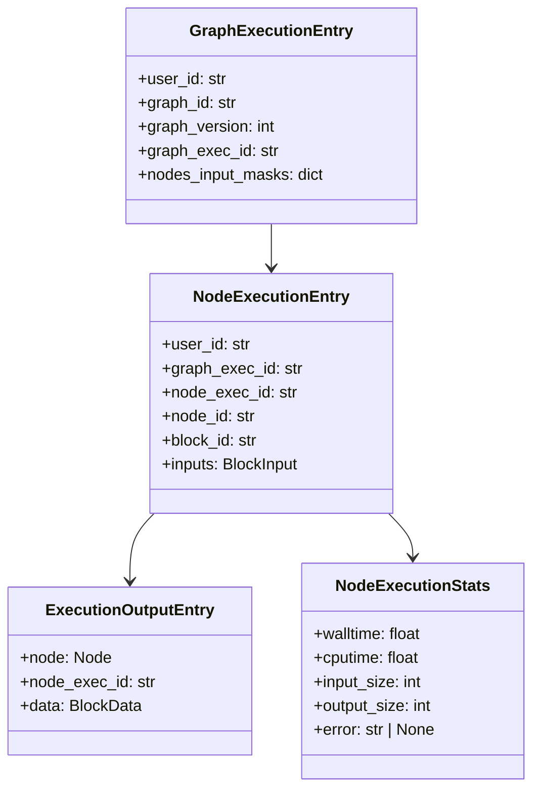
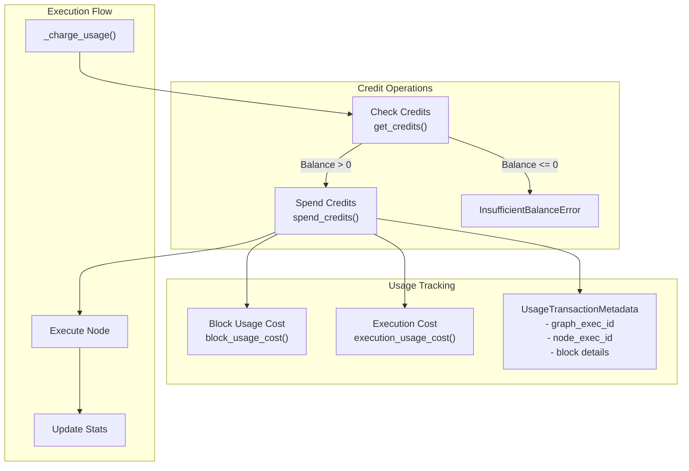
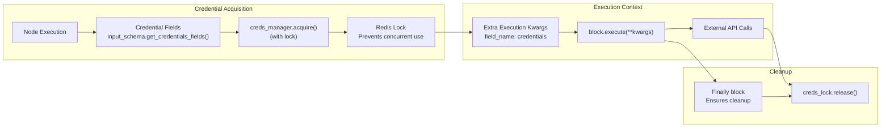
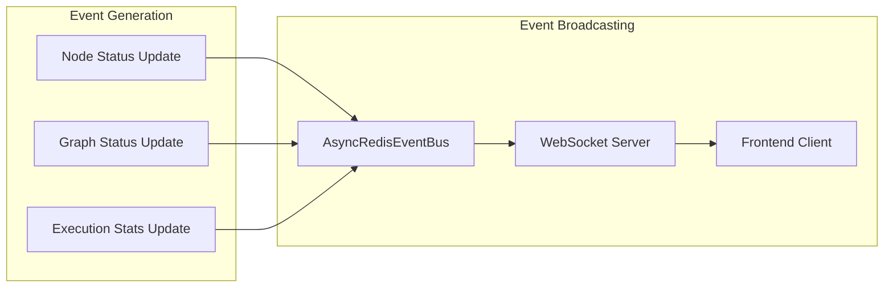

<!-- source: DeepWiki mcp.deepwiki.com · repo Significant-Gravitas/AutoGPT · extra page Execution System · fetched 2026-10-26 -->

# Execution System

Relevant source files

The following files were used as context for generating this wiki page:

- [autogpt_platform/backend/backend/blocks/agent.py](autogpt_platform/backend/backend/blocks/agent.py)
- [autogpt_platform/backend/backend/data/block.py](autogpt_platform/backend/backend/data/block.py)
- [autogpt_platform/backend/backend/data/credit_ceiling_test.py](autogpt_platform/backend/backend/data/credit_ceiling_test.py)
- [autogpt_platform/backend/backend/data/credit_concurrency_test.py](autogpt_platform/backend/backend/data/credit_concurrency_test.py)
- [autogpt_platform/backend/backend/data/credit_integration_test.py](autogpt_platform/backend/backend/data/credit_integration_test.py)
- [autogpt_platform/backend/backend/data/credit_metadata_test.py](autogpt_platform/backend/backend/data/credit_metadata_test.py)
- [autogpt_platform/backend/backend/data/credit_refund_test.py](autogpt_platform/backend/backend/data/credit_refund_test.py)
- [autogpt_platform/backend/backend/data/credit_test.py](autogpt_platform/backend/backend/data/credit_test.py)
- [autogpt_platform/backend/backend/data/credit_underflow_test.py](autogpt_platform/backend/backend/data/credit_underflow_test.py)
- [autogpt_platform/backend/backend/data/credit_user_balance_migration_test.py](autogpt_platform/backend/backend/data/credit_user_balance_migration_test.py)
- [autogpt_platform/backend/backend/data/execution.py](autogpt_platform/backend/backend/data/execution.py)
- [autogpt_platform/backend/backend/data/execution_io_cap_test.py](autogpt_platform/backend/backend/data/execution_io_cap_test.py)
- [autogpt_platform/backend/backend/data/generate_data.py](autogpt_platform/backend/backend/data/generate_data.py)
- [autogpt_platform/backend/backend/data/graph.py](autogpt_platform/backend/backend/data/graph.py)
- [autogpt_platform/backend/backend/data/graph_test.py](autogpt_platform/backend/backend/data/graph_test.py)
- [autogpt_platform/backend/backend/data/includes.py](autogpt_platform/backend/backend/data/includes.py)
- [autogpt_platform/backend/backend/data/model.py](autogpt_platform/backend/backend/data/model.py)
- [autogpt_platform/backend/backend/executor/manager.py](autogpt_platform/backend/backend/executor/manager.py)
- [autogpt_platform/backend/backend/executor/utils.py](autogpt_platform/backend/backend/executor/utils.py)
- [autogpt_platform/backend/backend/executor/utils_test.py](autogpt_platform/backend/backend/executor/utils_test.py)
- [autogpt_platform/backend/backend/util/exceptions.py](autogpt_platform/backend/backend/util/exceptions.py)
- [autogpt_platform/backend/backend/util/settings.py](autogpt_platform/backend/backend/util/settings.py)
- [autogpt_platform/backend/schema.prisma](autogpt_platform/backend/schema.prisma)
- [autogpt_platform/frontend/src/lib/autogpt-server-api/types.ts](autogpt_platform/frontend/src/lib/autogpt-server-api/types.ts)

## Purpose and Scope

The Execution System is responsible for orchestrating and managing the execution of agent graphs (workflows) in the AutoGPT Platform. It handles the scheduling, queuing, execution, and monitoring of individual nodes within agent graphs, ensuring proper dependency management, resource allocation, and status tracking throughout the execution lifecycle.

This document covers the core execution engine and orchestration components. For information about the graph structure and node definitions, see [Block System](). For API endpoints that trigger executions, see [API System]().

## Architecture Overview

The Execution System follows a distributed, event-driven architecture with multiple cooperating services:

### High-Level Component Architecture

Sources: [autogpt_platform/backend/backend/executor/manager.py:1-887](), [autogpt_platform/backend/backend/executor/database.py:1-124](), [autogpt_platform/backend/backend/executor/utils.py:1-773]()

## Core Components

### ExecutionManager

The `ExecutionManager` is the central orchestrator that manages the lifecycle of graph executions. It operates as a multi-process system with separate worker pools for graph and node execution.

Sources: [autogpt_platform/backend/backend/executor/manager.py:400-887](), [autogpt_platform/backend/backend/executor/manager.py:513-529]()

### Database Manager

The `DatabaseManager` provides a service-oriented interface to all database operations required during execution, including execution tracking, node status updates, and user metadata management.

Key database operations:
- `get_graph_execution()` / `create_graph_execution()` - Graph execution lifecycle
- `get_node_execution()` / `update_node_execution_status()` - Node status tracking  
- `upsert_execution_input()` / `upsert_execution_output()` - Node I/O persistence
- `spend_credits()` / `get_credits()` - Usage billing

Sources: [autogpt_platform/backend/backend/executor/database.py:65-124]()

### Message Queuing System

The system uses RabbitMQ for reliable message delivery between execution components:

Sources: [autogpt_platform/backend/backend/executor/utils.py:69-86](), [autogpt_platform/backend/backend/data/execution.py:58-59]()

## Execution Flow

### Graph Execution Lifecycle

The execution of an agent graph follows this sequence:

Sources: [autogpt_platform/backend/backend/executor/manager.py:532-887](), [autogpt_platform/backend/backend/executor/manager.py:424-511]()

### Node Execution Process

Individual node execution involves block instantiation, input validation, credential acquisition, and output processing:

Sources: [autogpt_platform/backend/backend/executor/manager.py:133-243](), [autogpt_platform/backend/backend/executor/manager.py:463-511]()

### Node Dependency Resolution

The system handles complex node dependencies and ensures proper execution ordering:

Sources: [autogpt_platform/backend/backend/executor/manager.py:245-397](), [autogpt_platform/backend/backend/executor/utils.py:254-290]()

## Data Models

### Execution Status Management

The system tracks execution progress through well-defined status transitions:

| Status | Description | Transitions To |
|--------|-------------|----------------|
| `INCOMPLETE` | Node waiting for input data | `QUEUED` |
| `QUEUED` | Ready for execution, in queue | `RUNNING` |
| `RUNNING` | Currently executing | `COMPLETED`, `FAILED` |
| `COMPLETED` | Successfully finished | N/A |
| `FAILED` | Execution failed with error | N/A |
| `TERMINATED` | Cancelled by user/system | N/A |
| `REVIEW` | Execution paused for human review | `QUEUED`, `RUNNING`, `TERMINATED`, `FAILED` |

Sources: [autogpt_platform/backend/backend/data/execution.py:69-70](), [autogpt_platform/frontend/src/lib/autogpt-server-api/types.ts:375-381](), [autogpt_platform/backend/backend/data/execution.py:134-165]()

### Core Data Structures

Sources: [autogpt_platform/backend/backend/executor/utils.py:129-178](), [autogpt_platform/backend/backend/data/execution.py:278-333](), [autogpt_platform/backend/backend/data/model.py:454-478]()

## Resource Management

### Cost Tracking and Credits

The execution system integrates with the credit system to track and bill for resource usage:

Sources: [autogpt_platform/backend/backend/executor/manager.py:594-642](), [autogpt_platform/backend/backend/executor/utils.py:502-526](), [autogpt_platform/backend/backend/data/credit.py:49-58]()

### Credentials Management

The system provides secure credential management for external service integrations:

Sources: [autogpt_platform/backend/backend/executor/manager.py:200-235](), [autogpt_platform/backend/backend/integrations/creds_manager.py:1-492]()

## Error Handling and Monitoring

### Error Recovery and Status Updates

The system provides comprehensive error handling with proper state management:

- **Validation Errors**: Input validation failures are logged and marked as errors
- **Execution Errors**: Block execution exceptions are caught and recorded
- **Credit Errors**: Insufficient balance errors halt execution gracefully  
- **Infrastructure Errors**: Network/service failures are retried with exponential backoff

Sources: [autogpt_platform/backend/backend/executor/manager.py:186-193](), [autogpt_platform/backend/backend/executor/manager.py:609-612](), [autogpt_platform/backend/backend/util/exceptions.py:77-94]()

### Real-time Monitoring

Execution progress is broadcast in real-time through Redis event bus:

The system also exposes Prometheus metrics for operational monitoring:
- `execution_manager_active_runs` - Number of active graph executions
- `execution_manager_pool_size` - Maximum number of graph workers
- `execution_manager_utilization_ratio` - Worker utilization percentage

Sources: [autogpt_platform/backend/backend/executor/manager.py:89-98](), [autogpt_platform/backend/backend/data/execution.py:58-59](), [autogpt_platform/backend/backend/executor/utils.py:186-225]()

---

