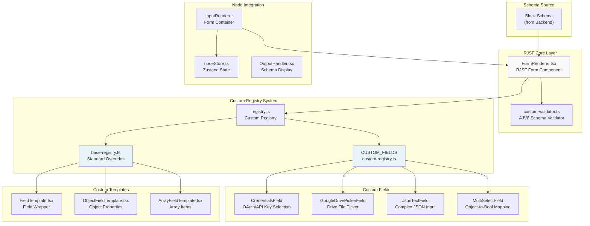
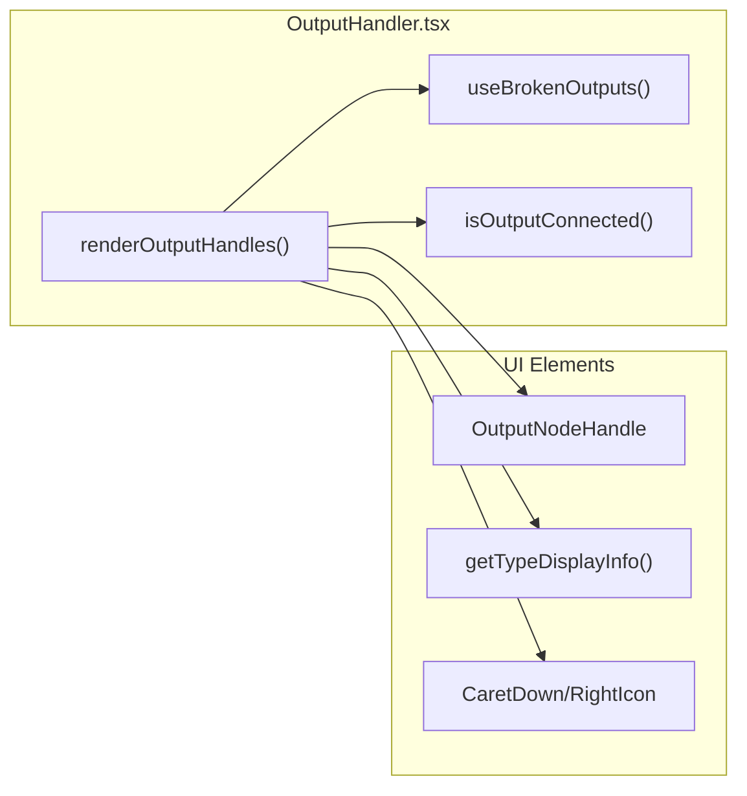
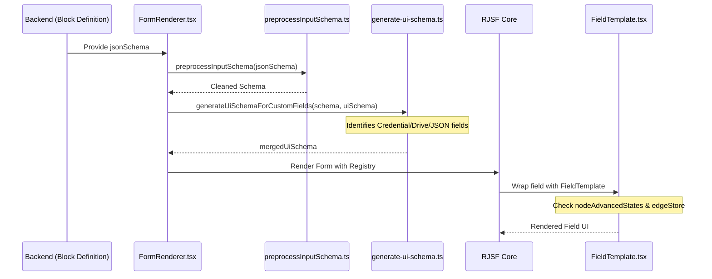

<!-- source: DeepWiki mcp.deepwiki.com · repo Significant-Gravitas/AutoGPT · extra page Form System (RJSF) · fetched 2026-10-26 -->

# Form System (RJSF)

Relevant source files

The following files were used as context for generating this wiki page:

- [autogpt_platform/frontend/src/app/(platform)/build/components/FlowEditor/nodes/CustomNode/components/NodeAdvancedToggle.tsx](autogpt_platform/frontend/src/app/(platform)/build/components/FlowEditor/nodes/CustomNode/components/NodeAdvancedToggle.tsx)
- [autogpt_platform/frontend/src/app/(platform)/build/components/FlowEditor/nodes/OutputHandler.tsx](autogpt_platform/frontend/src/app/(platform)/build/components/FlowEditor/nodes/OutputHandler.tsx)
- [autogpt_platform/frontend/src/components/atoms/DateInput/DateInput.tsx](autogpt_platform/frontend/src/components/atoms/DateInput/DateInput.tsx)
- [autogpt_platform/frontend/src/components/atoms/DateTimeInput/DateTimeInput.tsx](autogpt_platform/frontend/src/components/atoms/DateTimeInput/DateTimeInput.tsx)
- [autogpt_platform/frontend/src/components/atoms/Input/Input.stories.tsx](autogpt_platform/frontend/src/components/atoms/Input/Input.stories.tsx)
- [autogpt_platform/frontend/src/components/atoms/Input/Input.tsx](autogpt_platform/frontend/src/components/atoms/Input/Input.tsx)
- [autogpt_platform/frontend/src/components/atoms/Input/helpers.ts](autogpt_platform/frontend/src/components/atoms/Input/helpers.ts)
- [autogpt_platform/frontend/src/components/atoms/Input/useInput.ts](autogpt_platform/frontend/src/components/atoms/Input/useInput.ts)
- [autogpt_platform/frontend/src/components/atoms/Select/Select.stories.tsx](autogpt_platform/frontend/src/components/atoms/Select/Select.stories.tsx)
- [autogpt_platform/frontend/src/components/atoms/Select/Select.tsx](autogpt_platform/frontend/src/components/atoms/Select/Select.tsx)
- [autogpt_platform/frontend/src/components/atoms/TimeInput/TimeInput.tsx](autogpt_platform/frontend/src/components/atoms/TimeInput/TimeInput.tsx)
- [autogpt_platform/frontend/src/components/renderers/InputRenderer/FormRenderer.tsx](autogpt_platform/frontend/src/components/renderers/InputRenderer/FormRenderer.tsx)
- [autogpt_platform/frontend/src/components/renderers/InputRenderer/base/anyof/useAnyOfField.ts](autogpt_platform/frontend/src/components/renderers/InputRenderer/base/anyof/useAnyOfField.ts)
- [autogpt_platform/frontend/src/components/renderers/InputRenderer/base/array/ArrayFieldTemplate.tsx](autogpt_platform/frontend/src/components/renderers/InputRenderer/base/array/ArrayFieldTemplate.tsx)
- [autogpt_platform/frontend/src/components/renderers/InputRenderer/base/base-registry.ts](autogpt_platform/frontend/src/components/renderers/InputRenderer/base/base-registry.ts)
- [autogpt_platform/frontend/src/components/renderers/InputRenderer/base/object/ObjectFieldTemplate.tsx](autogpt_platform/frontend/src/components/renderers/InputRenderer/base/object/ObjectFieldTemplate.tsx)
- [autogpt_platform/frontend/src/components/renderers/InputRenderer/base/oneof/OneOfField.tsx](autogpt_platform/frontend/src/components/renderers/InputRenderer/base/oneof/OneOfField.tsx)
- [autogpt_platform/frontend/src/components/renderers/InputRenderer/base/standard/FieldTemplate.tsx](autogpt_platform/frontend/src/components/renderers/InputRenderer/base/standard/FieldTemplate.tsx)
- [autogpt_platform/frontend/src/components/renderers/InputRenderer/base/standard/TitleField.tsx](autogpt_platform/frontend/src/components/renderers/InputRenderer/base/standard/TitleField.tsx)
- [autogpt_platform/frontend/src/components/renderers/InputRenderer/base/standard/widgets/TextInput/TextInputExpanderModal.tsx](autogpt_platform/frontend/src/components/renderers/InputRenderer/base/standard/widgets/TextInput/TextInputExpanderModal.tsx)
- [autogpt_platform/frontend/src/components/renderers/InputRenderer/custom/GoogleDrivePickerField/GoogleDrivePickerField.tsx](autogpt_platform/frontend/src/components/renderers/InputRenderer/custom/GoogleDrivePickerField/GoogleDrivePickerField.tsx)
- [autogpt_platform/frontend/src/components/renderers/InputRenderer/custom/JsonTextField/JsonTextField.tsx](autogpt_platform/frontend/src/components/renderers/InputRenderer/custom/JsonTextField/JsonTextField.tsx)
- [autogpt_platform/frontend/src/components/renderers/InputRenderer/custom/JsonTextField/helpers.ts](autogpt_platform/frontend/src/components/renderers/InputRenderer/custom/JsonTextField/helpers.ts)
- [autogpt_platform/frontend/src/components/renderers/InputRenderer/custom/JsonTextField/useJsonTextField.ts](autogpt_platform/frontend/src/components/renderers/InputRenderer/custom/JsonTextField/useJsonTextField.ts)
- [autogpt_platform/frontend/src/components/renderers/InputRenderer/custom/custom-registry.ts](autogpt_platform/frontend/src/components/renderers/InputRenderer/custom/custom-registry.ts)
- [autogpt_platform/frontend/src/components/renderers/InputRenderer/utils/generate-ui-schema.ts](autogpt_platform/frontend/src/components/renderers/InputRenderer/utils/generate-ui-schema.ts)
- [autogpt_platform/frontend/src/components/renderers/InputRenderer/utils/input-schema-pre-processor.ts](autogpt_platform/frontend/src/components/renderers/InputRenderer/utils/input-schema-pre-processor.ts)
- [autogpt_platform/frontend/src/components/renderers/InputRenderer/utils/schema-utils.ts](autogpt_platform/frontend/src/components/renderers/InputRenderer/utils/schema-utils.ts)

The Form System provides dynamic form rendering capabilities throughout the AutoGPT Platform frontend, specifically within the Flow Editor for configuring block inputs. Built on React JSON Schema Form (RJSF) v6.1.2, this system automatically generates user interfaces from JSON schemas defined by backend blocks, enabling a schema-driven approach to block configuration.

For information about block schemas themselves, see [Block Schemas](#7.4). For details on the Flow Editor that hosts these forms, see [Agent Builder (Flow Editor)](#3.1.1).

## System Purpose and Architecture

The RJSF integration serves as the primary input configuration mechanism in the Platform, translating block schemas into interactive forms. The system employs a custom registry pattern to extend RJSF with domain-specific widgets, fields, and templates tailored to the Platform's needs.

Sources: [autogpt_platform/frontend/src/components/renderers/InputRenderer/FormRenderer.tsx:19-51](), [autogpt_platform/frontend/src/components/renderers/InputRenderer/custom/custom-registry.ts:22-70](), [autogpt_platform/frontend/src/components/renderers/InputRenderer/base/base-registry.ts:1-72]()

## Registry System and Custom Fields

The registry system allows the platform to override standard RJSF behavior with custom components based on schema patterns. This is managed through `CUSTOM_FIELDS` and the `generateCustomFields` utility [autogpt_platform/frontend/src/components/renderers/InputRenderer/custom/custom-registry.ts:81-89]().

### Custom Field Matchers

The system uses "matchers" to automatically assign custom components to schema properties based on their structure [autogpt_platform/frontend/src/components/renderers/InputRenderer/custom/custom-registry.ts:72-79]().

| Field ID | Matcher Logic | Component |
|----------|---------------|-----------|
| `custom/credential_field` | Has `credentials_provider` property | `CredentialsField` |
| `custom/google_drive_picker_field` | Matches `isGoogleDrivePickerSchema` | `GoogleDrivePickerField` |
| `custom/json_text_field` | Explicitly assigned for nested complex types | `JsonTextField` |
| `custom/multi_select_field` | Object where all properties are booleans | `MultiSelectField` |
| `custom/table_field` | Array with `format: "table"` | `TableField` |
| `custom/llm_model_field` | Has `llm_model` property | `LlmModelField` |

Sources: [autogpt_platform/frontend/src/components/renderers/InputRenderer/custom/custom-registry.ts:22-70](), [autogpt_platform/frontend/src/components/renderers/InputRenderer/utils/schema-utils.ts:79-100]()

### Complex Type Handling (JsonTextField)

To prevent deeply nested and unreadable form UIs, the platform employs a "Complex Type Flattening" strategy. When a complex type (object or array) is found nested inside another complex type, the `generateUiSchemaForCustomFields` utility assigns the `JsonTextField` [autogpt_platform/frontend/src/components/renderers/InputRenderer/utils/generate-ui-schema.ts:65-73](). This forces the user to input raw JSON for that specific sub-field instead of rendering recursive form sections.

## Field Templates and Layout

Templates define the layout structure and wrapping elements for different schema patterns.

### FieldTemplate.tsx

The `FieldTemplate` is the primary wrapper for every form field. It handles:
- **Advanced Visibility**: Hides fields marked as `advanced: true` unless the "Advanced" toggle is active in the node UI [autogpt_platform/frontend/src/components/renderers/InputRenderer/base/standard/FieldTemplate.tsx:98-101]().
- **Connection State**: Detects if an input is connected to another node's output via `isInputConnected` from `edgeStore` [autogpt_platform/frontend/src/components/renderers/InputRenderer/base/standard/FieldTemplate.tsx:84-84]().
- **Dynamic Hiding**: If an input is connected to an edge, the form children are hidden to prevent manual value overrides while maintaining the label and connection handle [autogpt_platform/frontend/src/components/renderers/InputRenderer/base/standard/FieldTemplate.tsx:92-96]().

### Node Advanced Toggle

Nodes include a `NodeAdvancedToggle` component that updates the `nodeAdvancedStates` in the `nodeStore` [autogpt_platform/frontend/src/app/(platform)/build/components/FlowEditor/nodes/CustomNode/components/NodeAdvancedToggle.tsx:13-22](). This state is consumed by the `FieldTemplate` to determine whether to render advanced configuration options [autogpt_platform/frontend/src/components/renderers/InputRenderer/base/standard/FieldTemplate.tsx:50-52]().

Sources: [autogpt_platform/frontend/src/components/renderers/InputRenderer/base/standard/FieldTemplate.tsx:26-145](), [autogpt_platform/frontend/src/app/(platform)/build/stores/nodeStore.ts:1-100]()

## Output Schema Rendering

While RJSF handles inputs, the platform uses a specialized `OutputHandler` to render the block's output schema as a tree of connection handles.

**Key Features:**
- **Recursive Rendering**: The `renderOutputHandles` function recursively traverses the output schema properties to build nested handles [autogpt_platform/frontend/src/app/(platform)/build/components/FlowEditor/nodes/OutputHandler.tsx:63-172]().
- **Broken State Detection**: Uses `useBrokenOutputs` to visually flag handles that are connected but no longer exist in the updated schema [autogpt_platform/frontend/src/app/(platform)/build/components/FlowEditor/nodes/OutputHandler.tsx:32-32]().
- **Type Information**: Displays the data type (e.g., `string`, `number`) and applies color coding based on the schema via `getTypeDisplayInfo` [autogpt_platform/frontend/src/app/(platform)/build/components/FlowEditor/nodes/OutputHandler.tsx:86-87]().

Sources: [autogpt_platform/frontend/src/app/(platform)/build/components/FlowEditor/nodes/OutputHandler.tsx:20-199]()

## Input Components (Atoms)

The form system utilizes a suite of "Atom" components that provide a consistent design language and specialized behavior.

| Component | Features | Source |
|-----------|----------|--------|
| `Input` | Supports `text`, `password` (with toggle), `amount` (currency formatting), and `textarea` | [atoms/Input/Input.tsx]() |
| `Select` | Custom trigger styles and icon support in options | [atoms/Select/Select.tsx]() |
| `DateInput` | Popover calendar for `YYYY-MM-DD` formatting | [atoms/DateInput/DateInput.tsx]() |
| `DateTimeInput` | Combined calendar and time input for ISO strings | [atoms/DateTimeInput/DateTimeInput.tsx]() |
| `TimeInput` | Standardized `HH:MM` input | [atoms/TimeInput/TimeInput.tsx]() |

### Input.tsx Implementation
The `Input` component uses a custom hook `useInput` to handle different change events for standard text vs. currency (amount) inputs [autogpt_platform/frontend/src/components/atoms/Input/Input.tsx:65-70](). It provides a "press and hold to show" password toggle [autogpt_platform/frontend/src/components/atoms/Input/Input.tsx:208-220]().

Sources: [autogpt_platform/frontend/src/components/atoms/Input/Input.tsx:45-203](), [autogpt_platform/frontend/src/components/atoms/Select/Select.tsx:47-168]()

## Data Flow: Schema to UI

The following diagram illustrates the lifecycle of a block schema as it is transformed into a functional form.

Sources: [autogpt_platform/frontend/src/components/renderers/InputRenderer/FormRenderer.tsx:19-51](), [autogpt_platform/frontend/src/components/renderers/InputRenderer/utils/generate-ui-schema.ts:33-37](), [autogpt_platform/frontend/src/components/renderers/InputRenderer/base/standard/FieldTemplate.tsx:26-52]()

---

