<!-- source: DeepWiki mcp.deepwiki.com · repo Significant-Gravitas/AutoGPT · extra page API Client · fetched 2026-10-26 -->

# API Client

<details>
<summary>Relevant source files</summary>

The following files were used as context for generating this wiki page:

- [autogpt_platform/backend/backend/blocks/http.py](autogpt_platform/backend/backend/blocks/http.py)
- [autogpt_platform/backend/backend/blocks/iteration.py](autogpt_platform/backend/backend/blocks/iteration.py)
- [autogpt_platform/backend/backend/util/file.py](autogpt_platform/backend/backend/util/file.py)
- [autogpt_platform/backend/backend/util/file_test.py](autogpt_platform/backend/backend/util/file_test.py)
- [autogpt_platform/backend/backend/util/json.py](autogpt_platform/backend/backend/util/json.py)
- [autogpt_platform/backend/backend/util/request.py](autogpt_platform/backend/backend/util/request.py)
- [autogpt_platform/backend/backend/util/request_test.py](autogpt_platform/backend/backend/util/request_test.py)
- [autogpt_platform/backend/backend/util/test_json.py](autogpt_platform/backend/backend/util/test_json.py)
- [autogpt_platform/frontend/src/app/(platform)/copilot/__tests__/helpers.test.ts](autogpt_platform/frontend/src/app/(platform)/copilot/__tests__/helpers.test.ts)
- [autogpt_platform/frontend/src/app/(platform)/copilot/components/ChatMessagesContainer/useMessageFeedback.ts](autogpt_platform/frontend/src/app/(platform)/copilot/components/ChatMessagesContainer/useMessageFeedback.ts)
- [autogpt_platform/frontend/src/app/(platform)/copilot/helpers.ts](autogpt_platform/frontend/src/app/(platform)/copilot/helpers.ts)
- [autogpt_platform/frontend/src/app/(platform)/copilot/page.tsx](autogpt_platform/frontend/src/app/(platform)/copilot/page.tsx)
- [autogpt_platform/frontend/src/app/(platform)/copilot/useCopilotStream.ts](autogpt_platform/frontend/src/app/(platform)/copilot/useCopilotStream.ts)
- [autogpt_platform/frontend/src/app/api/mutators/__tests__/custom-mutator.test.ts](autogpt_platform/frontend/src/app/api/mutators/__tests__/custom-mutator.test.ts)
- [autogpt_platform/frontend/src/app/api/mutators/custom-mutator.ts](autogpt_platform/frontend/src/app/api/mutators/custom-mutator.ts)
- [autogpt_platform/frontend/src/app/api/proxy/[...path]/__tests__/route.test.ts](autogpt_platform/frontend/src/app/api/proxy/[...path]/__tests__/route.test.ts)
- [autogpt_platform/frontend/src/app/api/proxy/[...path]/route.ts](autogpt_platform/frontend/src/app/api/proxy/[...path]/route.ts)
- [autogpt_platform/frontend/src/app/api/transcribe/route.ts](autogpt_platform/frontend/src/app/api/transcribe/route.ts)
- [autogpt_platform/frontend/src/app/api/workspace/files/upload/route.ts](autogpt_platform/frontend/src/app/api/workspace/files/upload/route.ts)
- [autogpt_platform/frontend/src/lib/__tests__/impersonation.test.ts](autogpt_platform/frontend/src/lib/__tests__/impersonation.test.ts)
- [autogpt_platform/frontend/src/lib/autogpt-server-api/__tests__/client.test.ts](autogpt_platform/frontend/src/lib/autogpt-server-api/__tests__/client.test.ts)
- [autogpt_platform/frontend/src/lib/autogpt-server-api/__tests__/helpers.test.ts](autogpt_platform/frontend/src/lib/autogpt-server-api/__tests__/helpers.test.ts)
- [autogpt_platform/frontend/src/lib/autogpt-server-api/client.ts](autogpt_platform/frontend/src/lib/autogpt-server-api/client.ts)
- [autogpt_platform/frontend/src/lib/autogpt-server-api/helpers.ts](autogpt_platform/frontend/src/lib/autogpt-server-api/helpers.ts)
- [autogpt_platform/frontend/src/lib/supabase/actions.ts](autogpt_platform/frontend/src/lib/supabase/actions.ts)
- [autogpt_platform/frontend/src/lib/supabase/helpers.ts](autogpt_platform/frontend/src/lib/supabase/helpers.ts)
- [autogpt_platform/frontend/src/lib/supabase/hooks/useSupabase.ts](autogpt_platform/frontend/src/lib/supabase/hooks/useSupabase.ts)
- [autogpt_platform/frontend/src/lib/supabase/hooks/useSupabaseStore.ts](autogpt_platform/frontend/src/lib/supabase/hooks/useSupabaseStore.ts)
- [autogpt_platform/frontend/src/lib/supabase/middleware.ts](autogpt_platform/frontend/src/lib/supabase/middleware.ts)
- [autogpt_platform/frontend/src/lib/supabase/server/getServerSupabase.ts](autogpt_platform/frontend/src/lib/supabase/server/getServerSupabase.ts)
- [autogpt_platform/frontend/src/lib/withRoleAccess.ts](autogpt_platform/frontend/src/lib/withRoleAccess.ts)
- [autogpt_platform/frontend/src/middleware.ts](autogpt_platform/frontend/src/middleware.ts)
- [autogpt_platform/frontend/src/playwright/utils/signup.ts](autogpt_platform/frontend/src/playwright/utils/signup.ts)

</details>


## Purpose and Scope

The API Client provides a unified interface for the frontend to communicate with the AutoGPT Platform backend services. It handles HTTP requests, WebSocket connections, authentication, file uploads, and error management. This document covers the `BackendAPI` class and its supporting infrastructure.

For information about the backend REST endpoints themselves, see [REST API](#7.1). For WebSocket protocol details, see [WebSocket API](#7.2).

---

## Architecture Overview

The API Client employs a dual-path architecture to handle requests differently depending on whether code is executing client-side (in the browser) or server-side (during Next.js SSR/SSG).

**Dual-Path Request Architecture**

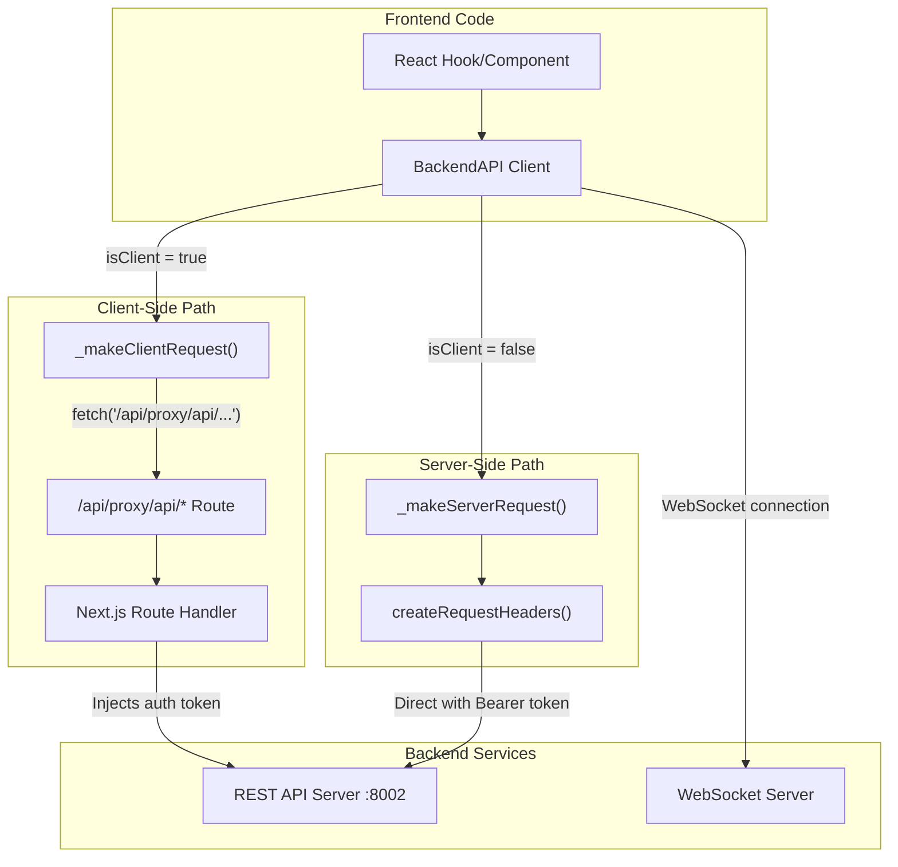

Sources: [autogpt_platform/frontend/src/lib/autogpt-server-api/client.ts:60](), [autogpt_platform/frontend/src/lib/autogpt-server-api/client.ts:973-1072]()

### Why Dual Paths?

| Concern | Client-Side | Server-Side |
|---------|-------------|-------------|
| **Authentication** | Uses httpOnly cookies via proxy | Gets session token from Supabase |
| **Token Access** | Cannot read httpOnly cookies | Can access session via `getServerSupabase()` |
| **Request Flow** | Browser → Next.js API Proxy → Backend | Next.js Server → Backend |
| **CORS** | Not applicable (same-origin via proxy) | Not applicable (server-to-server) |
| **Impersonation** | Header from sessionStorage | Header from server-side cookies |

Sources: [autogpt_platform/frontend/src/lib/autogpt-server-api/client.ts:989-1044](), [autogpt_platform/frontend/src/lib/autogpt-server-api/client.ts:1047-1072]()

---

## BackendAPI Class

The `BackendAPI` class is the primary interface for all backend communication.

**Class Structure**

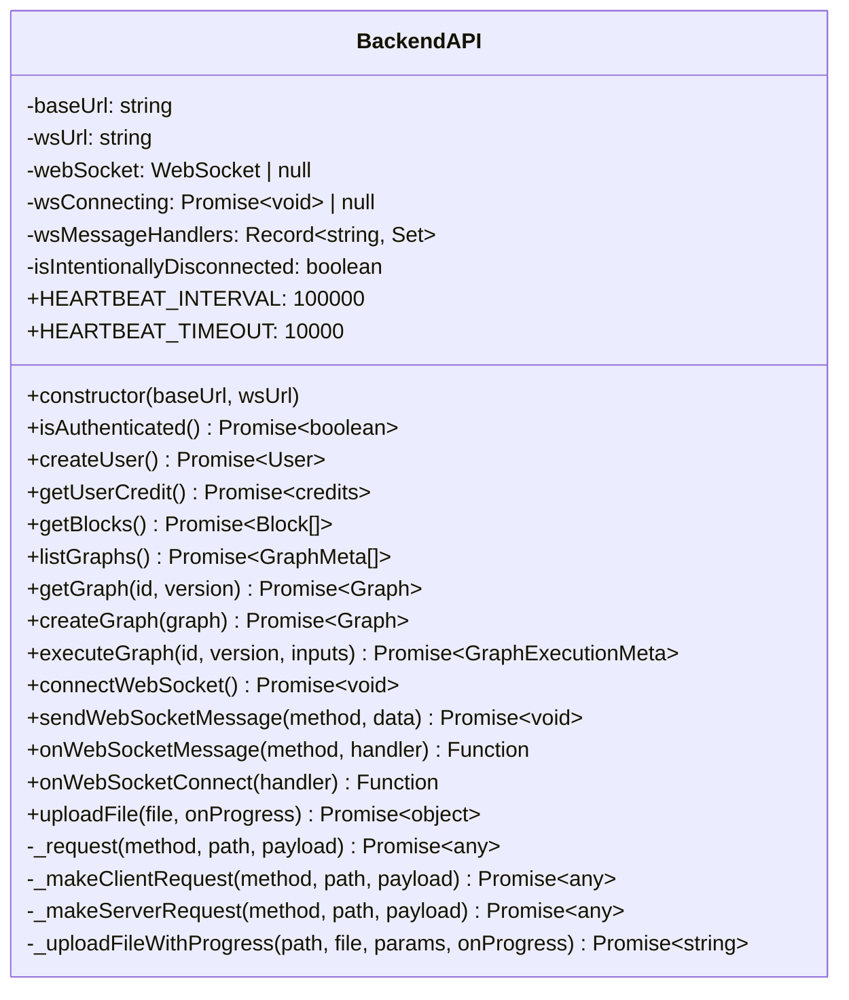

Sources: [autogpt_platform/frontend/src/lib/autogpt-server-api/client.ts:92-113](), [autogpt_platform/frontend/src/lib/autogpt-server-api/client.ts:119-789]()

### Initialization

The client is initialized with backend URLs from the environment:

```typescript
const api = new BackendAPI(
  environment.getAGPTServerApiUrl(),  // e.g., http://localhost:8002
  environment.getAGPTWsServerUrl()    // e.g., ws://localhost:8001/ws
);
```

Sources: [autogpt_platform/frontend/src/lib/autogpt-server-api/client.ts:107-112]()

### Authentication Check

The client can verify authentication status by checking for a valid Supabase session:

```typescript
async isAuthenticated(): Promise<boolean> {
  const supabaseClient = await this.getSupabaseClient();
  const { data: { session } } = await supabaseClient.auth.getSession();
  return session != null;
}
```

Sources: [autogpt_platform/frontend/src/lib/autogpt-server-api/client.ts:119-126]()

---

## Request Handling

### Request Flow

**Client-Side Request Flow**

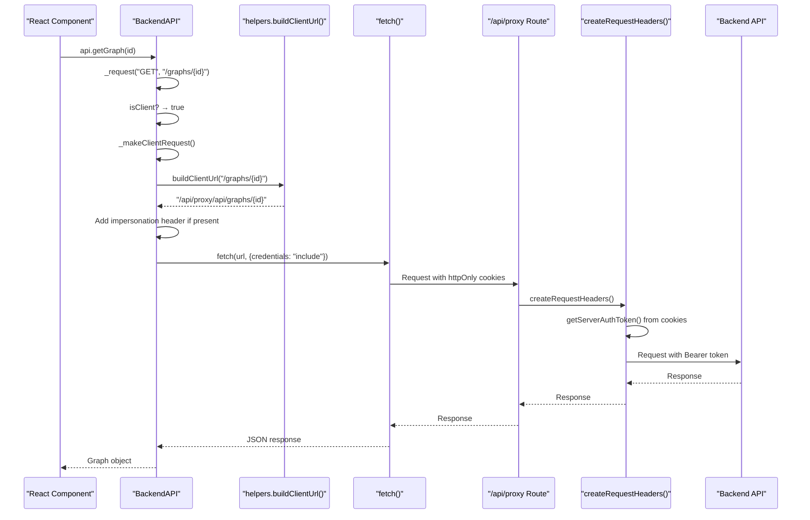

Sources: [autogpt_platform/frontend/src/lib/autogpt-server-api/client.ts:989-1044](), [autogpt_platform/frontend/src/app/api/proxy/[...path]/route.ts:165-204]()

### HTTP Methods

The client supports all standard HTTP methods through the `_request` method:

| Method | Query Params | Request Body | Use Case |
|--------|--------------|--------------|----------|
| GET | ✅ (in URL) | ❌ | Fetch resources |
| POST | ❌ | ✅ (JSON) | Create resources |
| PUT | ❌ | ✅ (JSON) | Update resources |
| PATCH | ❌ | ✅ (JSON) | Partial update |
| DELETE | ✅ (in URL) | ❌ | Delete resources |

Sources: [autogpt_platform/frontend/src/lib/autogpt-server-api/client.ts:973-987]()

### Authentication Injection

**Server-Side Authentication Flow**

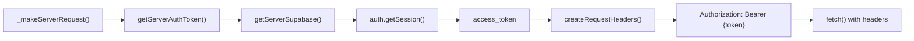

Sources: [autogpt_platform/frontend/src/lib/autogpt-server-api/helpers.ts:112-134](), [autogpt_platform/frontend/src/lib/autogpt-server-api/helpers.ts:136-169]()

### Admin Impersonation

The client supports admin impersonation through the `X-Act-As-User-Id` header:

**Client-Side Impersonation:**
```typescript
const impersonatedUserId = ImpersonationState.get();
if (impersonatedUserId) {
  headers[IMPERSONATION_HEADER_NAME] = impersonatedUserId;
}
```

Sources: [autogpt_platform/frontend/src/lib/autogpt-server-api/client.ts:1017-1020](), [autogpt_platform/frontend/src/lib/constants.ts:1]()

**Server-Side Impersonation:**
```typescript
const impersonationUserId = await ImpersonationState.getServerSide();
const fakeRequest = impersonationUserId
  ? new Request(url, {
      headers: { "X-Act-As-User-Id": impersonationUserId }
    })
  : undefined;
```

Sources: [autogpt_platform/frontend/src/lib/autogpt-server-api/client.ts:1058-1063]()

### Error Handling

The client provides structured error handling through the `ApiError` class:

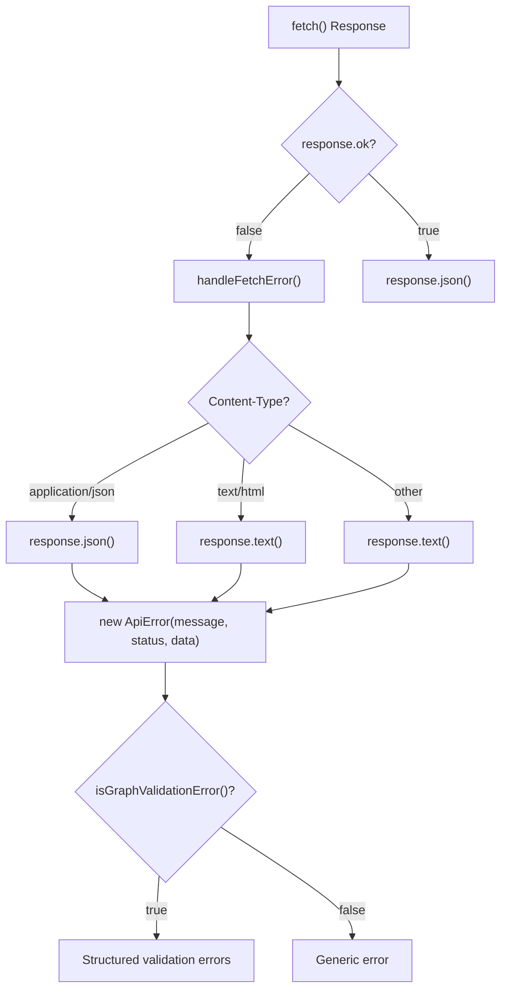

Sources: [autogpt_platform/frontend/src/lib/autogpt-server-api/helpers.ts:88-111](), [autogpt_platform/frontend/src/lib/autogpt-server-api/helpers.ts:11-39]()

### Graph Validation Errors

The client recognizes structured validation errors from graph execution:

```typescript
class ApiError {
  isGraphValidationError(): this is ApiError<GraphValidationErrorResponse> {
    return (
      this.response?.detail?.type === "validation_error" &&
      "node_errors" in this.response.detail
    );
  }
}
```

When detected, these errors provide node-specific error messages:

```typescript
if (error.isGraphValidationError()) {
  const errorData = error.response.detail;
  // errorData.node_errors[node_id] contains validation issues
}
```

Sources: [autogpt_platform/frontend/src/lib/autogpt-server-api/helpers.ts:22-39]()

---

## WebSocket Communication

### Connection Management

The WebSocket connection is managed through lazy initialization:

**WebSocket Lifecycle**

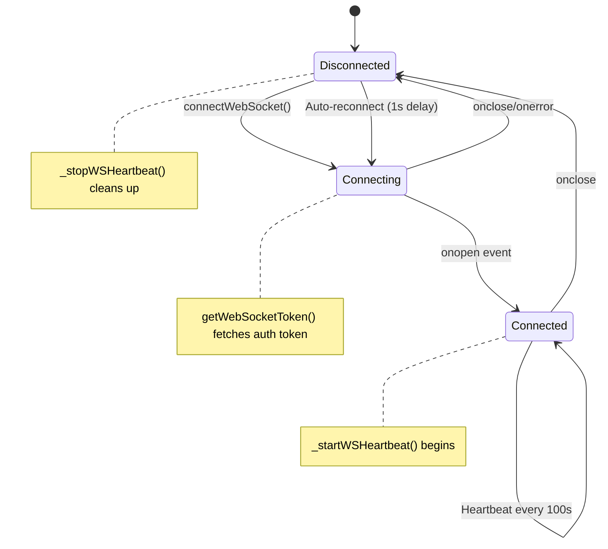

Sources: [autogpt_platform/frontend/src/lib/autogpt-server-api/client.ts:1156-1230]()

### Authentication Token

WebSocket connections require a token obtained from a server action:

```typescript
async connectWebSocket(): Promise<void> {
  const { token: serverToken, error } = await getWebSocketToken();
  if (!token) {
    console.info("[BackendAPI] Skipping WebSocket connect: no auth token available");
    return;
  }
  
  const wsUrlWithToken = `${this.wsUrl}?token=${token}`;
  this.webSocket = new WebSocket(wsUrlWithToken);
}
```

Sources: [autogpt_platform/frontend/src/lib/autogpt-server-api/client.ts:1166-1191]()

### Message Handling

**WebSocket Message System**

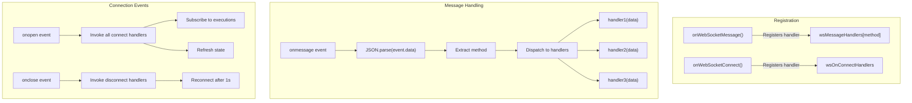

Sources: [autogpt_platform/frontend/src/lib/autogpt-server-api/client.ts:1237-1290](), [autogpt_platform/frontend/src/lib/autogpt-server-api/client.ts:1114-1154]()

### Subscription Methods

The client provides typed subscription methods:

| Method | Purpose | Message Type |
|--------|---------|--------------|
| `subscribeToGraphExecution(execID)` | Subscribe to specific execution updates | `subscribe_graph_execution` |
| `subscribeToGraphExecutions(graphID)` | Subscribe to all executions of a graph | `subscribe_graph_executions` |

Sources: [autogpt_platform/frontend/src/lib/autogpt-server-api/client.ts:1078-1088]()

### Message Handlers

Register handlers for specific message types:

```typescript
const detach = api.onWebSocketMessage("node_execution_event", (data) => {
  console.log("Node execution update:", data);
  // Update UI with node status
});

// Later: detach the handler
detach();
```

Sources: [autogpt_platform/frontend/src/lib/autogpt-server-api/client.ts:1114-1123]()

### Heartbeat System

The client implements a heartbeat mechanism to detect stale connections:

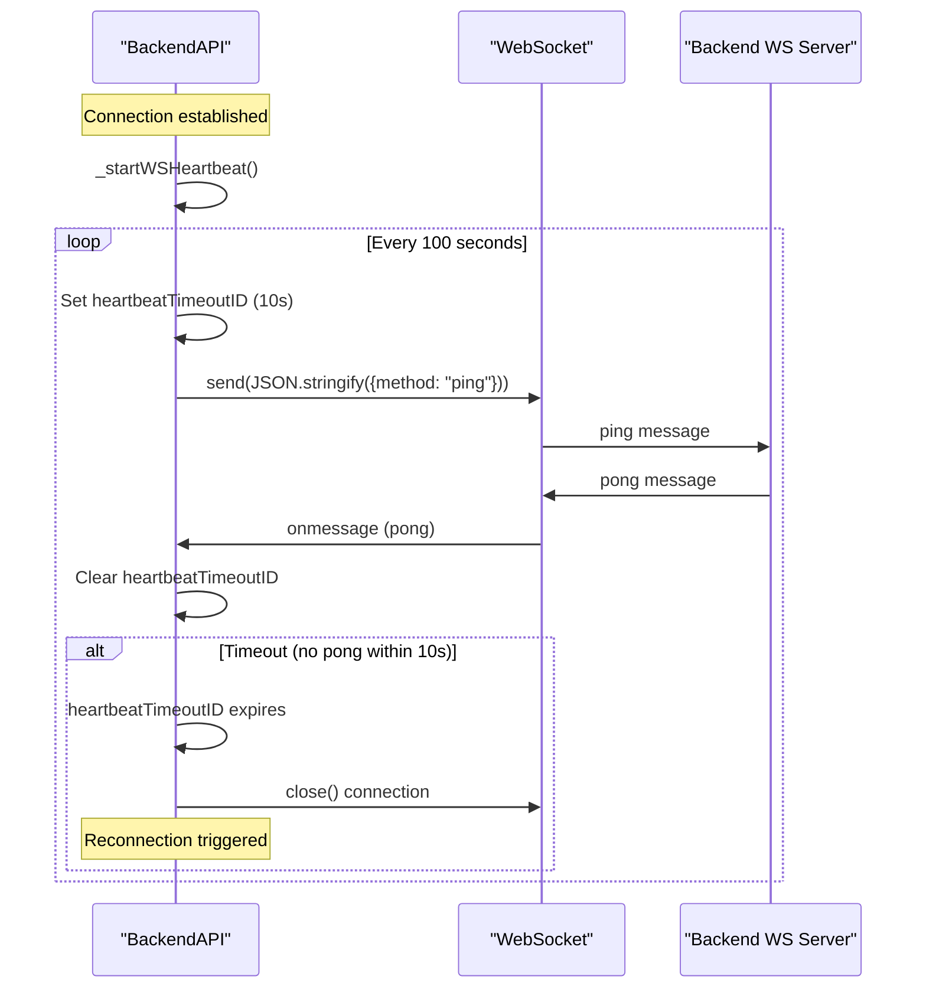

Sources: [autogpt_platform/frontend/src/lib/autogpt-server-api/client.ts:102-105](), [autogpt_platform/frontend/src/lib/autogpt-server-api/client.ts:1292-1327]()

### Reconnection Logic

Automatic reconnection occurs unless disconnection was intentional (e.g., during logout):

```typescript
this.webSocket.onclose = (event) => {
  this._stopWSHeartbeat();
  this.wsConnecting = null;
  
  const wasIntentional = this.isIntentionallyDisconnected || this._hasDisconnectIntent();
  
  if (!wasIntentional) {
    this.wsOnDisconnectHandlers.forEach((handler) => handler());
    setTimeout(() => this.connectWebSocket().then(resolve), 1000);
  }
};
```

Sources: [autogpt_platform/frontend/src/lib/autogpt-server-api/client.ts:1203-1230]()

---

## File Upload Support

### Standard File Upload

The client supports file uploads with automatic content-type detection:

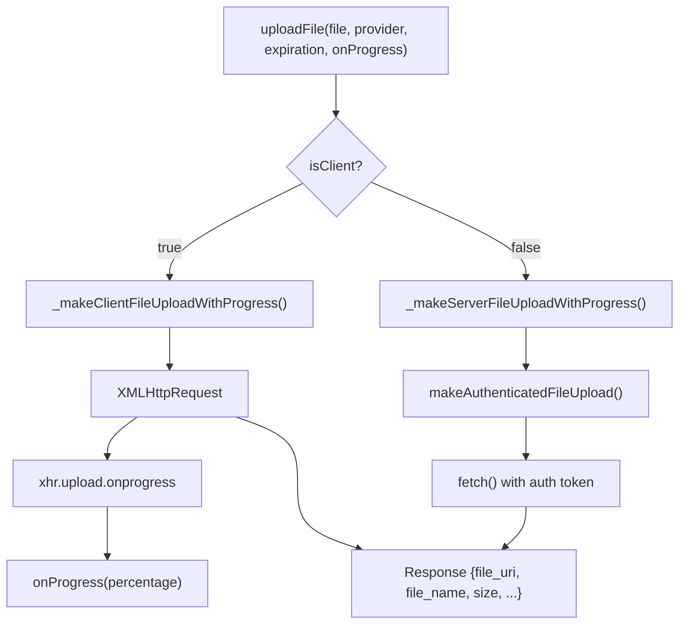

Sources: [autogpt_platform/frontend/src/lib/autogpt-server-api/client.ts:504-530](), [autogpt_platform/frontend/src/lib/autogpt-server-api/client.ts:823-971]()

### Progress Tracking

Client-side uploads support progress callbacks using `XMLHttpRequest`:

```typescript
api.uploadFile(file, "gcs", 24, (progress) => {
  console.log(`Upload progress: ${progress}%`);
  // Update progress bar UI
});
```

The progress callback receives a percentage (0-100) as uploads proceed:

```typescript
xhr.upload.addEventListener("progress", (e) => {
  if (e.lengthComputable) {
    const progress = (e.loaded / e.total) * 100;
    onProgress(progress);
  }
});
```

Sources: [autogpt_platform/frontend/src/lib/autogpt-server-api/client.ts:895-902]()

### File Size Limits

Uploads enforce a 256MB size limit with user-friendly error messages:

```typescript
if (xhr.status === 413) {
  reject(new Error("File is too large — max size is 256MB"));
  return;
}
```

Sources: [autogpt_platform/frontend/src/lib/autogpt-server-api/client.ts:914-917]()

### Store Submission Media

Specialized upload endpoint for marketplace submissions:

```typescript
uploadStoreSubmissionMedia(file: File): Promise<string> {
  return this._uploadFile("/store/submissions/media", file);
}
```

Sources: [autogpt_platform/frontend/src/lib/autogpt-server-api/client.ts:500-502]()

---

## Helper Functions

The `helpers.ts` module provides utility functions used by the API client.

### URL Construction

| Function | Purpose | Example |
|----------|---------|---------|
| `buildClientUrl(path)` | Client-side proxy URL | `/api/proxy/api/graphs` |
| `buildServerUrl(path)` | Direct backend URL | `http://localhost:8002/graphs` |
| `buildUrlWithQuery(url, params)` | Add query parameters | `/graphs?version=2&for_export=true` |

Sources: [autogpt_platform/frontend/src/lib/autogpt-server-api/helpers.ts:58-86]()

### Header Creation

The `createRequestHeaders` function constructs authentication and content-type headers:

```typescript
export function createRequestHeaders(
  token: string,
  hasRequestBody: boolean,
  contentType: string = "application/json",
  originalRequest?: Request,
): Record<string, string>
```

It handles:
- Bearer token authorization
- Content-Type for request bodies
- Admin impersonation header forwarding
- API key header forwarding

Sources: [autogpt_platform/frontend/src/lib/autogpt-server-api/helpers.ts:129-170]()

### Error Parsing

**Error Parsing Flow**

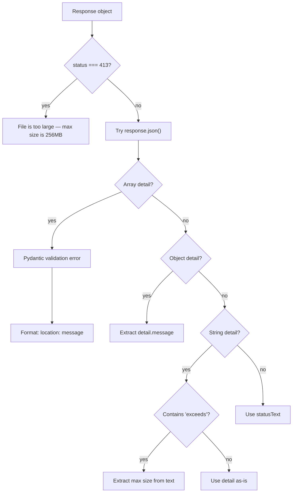

Sources: [autogpt_platform/frontend/src/lib/autogpt-server-api/helpers.ts:188-229]()

### Authentication Utilities

**`isLogoutInProgress()`**: Checks if logout is in progress to avoid error noise during cleanup:

```typescript
export function isLogoutInProgress(): boolean {
  const logoutTimestamp = storage.get(Key.LOGOUT);
  if (logoutTimestamp) {
    const timeDiff = Date.now() - parseInt(logoutTimestamp);
    return timeDiff < 5000; // 5 second grace period
  }
  return window.location.pathname.includes("/login") ||
         window.location.pathname.includes("/logout");
}
```

Sources: [autogpt_platform/frontend/src/lib/autogpt-server-api/client.ts:791-811]()

---

## API Endpoints

The `BackendAPI` class provides methods for all major backend operations:

### User and Credits

| Method | HTTP | Endpoint | Purpose |
|--------|------|----------|---------|
| `createUser()` | POST | `/auth/user` | Create user account |
| `updateUserEmail(email)` | POST | `/auth/user/email` | Update email address |
| `getUserCredit()` | GET | `/credits` | Get credit balance |
| `requestTopUp(amount)` | POST | `/credits` | Initiate Stripe checkout |
| `getTransactionHistory()` | GET | `/credits/transactions` | Fetch credit transactions |

Sources: [autogpt_platform/frontend/src/lib/autogpt-server-api/client.ts:128-205]()

### Graphs

| Method | HTTP | Endpoint | Purpose |
|--------|------|----------|---------|
| `getBlocks()` | GET | `/blocks` | List available blocks |
| `listGraphs()` | GET | `/graphs` | List user's graphs |
| `getGraph(id, version?)` | GET | `/graphs/{id}` | Get specific graph |
| `createGraph(graph, source?)` | POST | `/graphs` | Create new graph |
| `updateGraph(id, graph)` | PUT | `/graphs/{id}` | Update graph |
| `deleteGraph(id)` | DELETE | `/graphs/{id}` | Delete graph |
| `executeGraph(id, version, inputs)` | POST | `/graphs/{id}/execute/{version}` | Execute graph |

Sources: [autogpt_platform/frontend/src/lib/autogpt-server-api/client.ts:212-265]()

### Executions

| Method | HTTP | Endpoint | Purpose |
|--------|------|----------|---------|
| `getExecutions()` | GET | `/executions` | List all executions |
| `getGraphExecutions(graphID)` | GET | `/graphs/{id}/executions` | List graph's executions |
| `getGraphExecutionInfo(graphID, runID)` | GET | `/graphs/{id}/executions/{runID}` | Get execution details |
| `stopGraphExecution(graphID, runID)` | POST | `/graphs/{id}/executions/{runID}/stop` | Stop running execution |
| `deleteGraphExecution(runID)` | DELETE | `/executions/{runID}` | Delete execution record |

Sources: [autogpt_platform/frontend/src/lib/autogpt-server-api/client.ts:267-300]()

### Credentials

| Method | HTTP | Endpoint | Purpose |
|--------|------|----------|---------|
| `oAuthLogin(provider, scopes?)` | GET | `/integrations/{provider}/login` | Start OAuth flow |
| `oAuthCallback(provider, code, state)` | POST | `/integrations/{provider}/callback` | Complete OAuth flow |
| `createAPIKeyCredentials(creds)` | POST | `/integrations/{provider}/credentials` | Store API key |
| `listCredentials(provider?)` | GET | `/integrations/credentials` | List all credentials |
| `deleteCredentials(provider, id, force?)` | DELETE | `/integrations/{provider}/credentials/{id}` | Delete credentials |

Sources: [autogpt_platform/frontend/src/lib/autogpt-server-api/client.ts:302-379]()

### Store and Library

| Method | HTTP | Endpoint | Purpose |
|--------|------|----------|---------|
| `getStoreAgents(params)` | GET | `/store/agents` | Browse marketplace |
| `createStoreSubmission(submission)` | POST | `/store/submissions` | Submit agent to store |
| `reviewAgent(username, agentName, review)` | POST | `/store/agents/{username}/{name}/review` | Submit review |
| `listLibraryAgents(params)` | GET | `/library/agents` | List library agents |
| `updateLibraryAgent(id, params)` | PATCH | `/library/agents/{id}` | Update library agent |
| `listLibraryAgentPresets(params)` | GET | `/library/presets` | List presets |
| `executeLibraryAgentPreset(presetID, inputs)` | POST | `/library/presets/{presetID}/execute` | Execute preset |

Sources: [autogpt_platform/frontend/src/lib/autogpt-server-api/client.ts:432-748]()

### Schedules

| Method | HTTP | Endpoint | Purpose |
|--------|------|----------|---------|
| `createGraphExecutionSchedule(params)` | POST | `/graphs/{id}/schedules` | Create cron schedule |
| `listGraphExecutionSchedules(graphID)` | GET | `/graphs/{id}/schedules` | List graph schedules |
| `deleteGraphExecutionSchedule(scheduleID)` | DELETE | `/schedules/{scheduleID}` | Delete schedule |

Sources: [autogpt_platform/frontend/src/lib/autogpt-server-api/client.ts:754-781]()

---

## Proxy Route

The `/api/proxy` route handles client-side requests that need authentication.

**Proxy Request Handling**

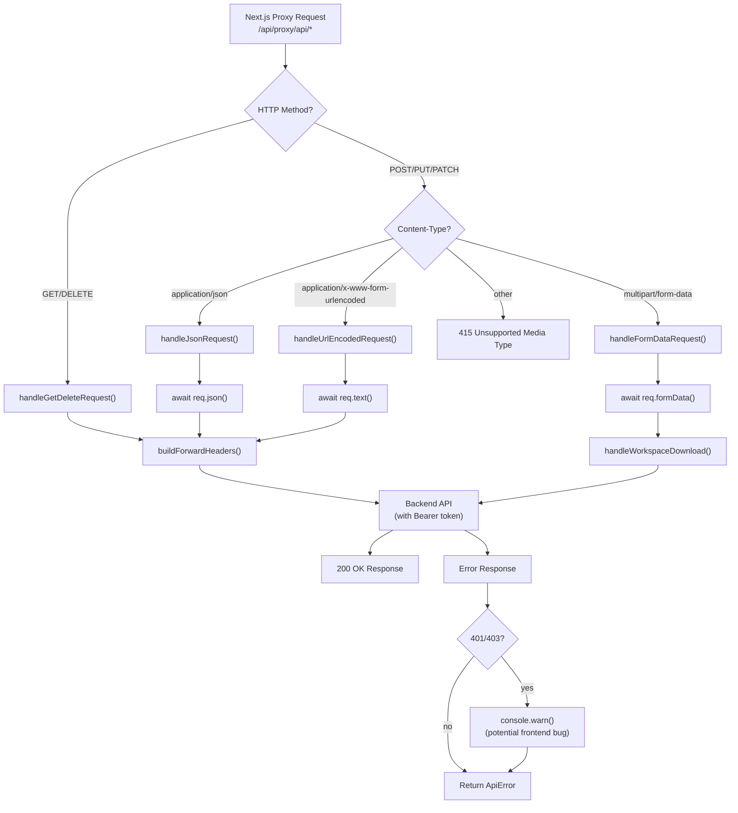

Sources: [autogpt_platform/frontend/src/app/api/proxy/[...path]/route.ts:165-204]()

### Configuration

The proxy route is configured with appropriate limits for large uploads:

```typescript
export const maxDuration = 300; // 5 minutes timeout
export const dynamic = "force-dynamic";
```

Sources: [autogpt_platform/frontend/src/app/api/proxy/[...path]/route.ts:15-16]()

### Error Response Handling

The proxy preserves backend error responses:

```typescript
if (error instanceof ApiError) {
  return NextResponse.json(error.response || { error: error.message }, {
    status: error.status,
  });
}
```

Sources: [autogpt_platform/frontend/src/app/api/proxy/[...path]/route.ts:214-218]()

---

## Usage Examples

### Basic Graph Operations

```typescript
import BackendAPI from "@/lib/autogpt-server-api/client";

const api = new BackendAPI();

// List available blocks
const blocks = await api.getBlocks();

// Get a specific graph
const graph = await api.getGraph("graph-123", 2);

// Execute the graph
const execution = await api.executeGraph(
  "graph-123",
  2,
  { input_field: "value" },
  { api_key: { id: "cred-456", provider: "openai" } },
  "builder"
);
```

Sources: [autogpt_platform/frontend/src/lib/autogpt-server-api/client.ts:212-265]()

### WebSocket Subscription

```typescript
const api = new BackendAPI();

// Subscribe to execution updates
const detachMessage = api.onWebSocketMessage("node_execution_event", (data) => {
  console.log(`Node ${data.node_id}: ${data.status}`);
  // Update UI with node execution status
});

// Subscribe to graph execution completion
const detachGraphMsg = api.onWebSocketMessage("graph_execution_event", (data) => {
  if (data.status === "COMPLETED") {
    console.log("Graph execution completed!");
  }
});

// Subscribe when WebSocket connects/reconnects
const detachConnect = api.onWebSocketConnect(() => {
  api.subscribeToGraphExecution(executionID);
});

// Later: cleanup
detachMessage();
detachGraphMsg();
detachConnect();
```

Sources: [autogpt_platform/frontend/src/lib/autogpt-server-api/client.ts:1078-1154]()

### File Upload with Progress

```typescript
const api = new BackendAPI();

const uploadFile = async (file: File) => {
  try {
    const result = await api.uploadFile(
      file,
      "gcs",
      24, // expiration in hours
      (progress) => {
        console.log(`Upload: ${progress.toFixed(1)}%`);
        setUploadProgress(progress);
      }
    );
    
    console.log("File uploaded:", result.file_uri);
    return result;
  } catch (error) {
    console.error("Upload failed:", error.message);
    throw error;
  }
};
```

Sources: [autogpt_platform/frontend/src/lib/autogpt-server-api/client.ts:504-530]()

### Handling Validation Errors

```typescript
try {
  await api.executeGraph(graphID, version, inputs, credInputs, "builder");
} catch (error) {
  if (error instanceof ApiError && error.isGraphValidationError()) {
    const errorData = error.response.detail;
    
    // errorData.node_errors is a map: node_id -> field_name -> error_message
    Object.entries(errorData.node_errors).forEach(([nodeId, errors]) => {
      console.log(`Node ${nodeId} errors:`, errors);
      // Update UI to show errors on specific nodes
    });
  } else {
    // Generic error handling
    console.error("Execution failed:", error.message);
  }
}
```

Sources: [autogpt_platform/frontend/src/lib/autogpt-server-api/helpers.ts:22-39]()

### Using with React Query

The platform uses a custom mutator with React Query for generated API methods:

```typescript
import { customMutator } from "@/app/api/mutators/custom-mutator";

// Custom mutator automatically handles:
// - Client vs server-side detection
// - Authentication token injection
// - Impersonation headers
// - Error transformation
// - Date object transformation

const response = await customMutator("/api/graphs", {
  method: "POST",
  body: JSON.stringify(graphData),
});
```

Sources: [autogpt_platform/frontend/src/app/api/mutators/custom-mutator.ts:49-166]()

---

## Summary

The API Client provides a robust abstraction layer for frontend-backend communication:

- **Dual-Path Architecture**: Handles client-side and server-side requests appropriately
- **Authentication Integration**: Seamlessly integrates with Supabase auth via httpOnly cookies
- **WebSocket Support**: Manages real-time connections with automatic reconnection
- **File Uploads**: Supports large file uploads with progress tracking
- **Error Handling**: Provides structured error responses with validation support
- **Type Safety**: Fully typed API with TypeScript interfaces
- **Admin Features**: Supports user impersonation and API key authentication

The client is used throughout the frontend, particularly in hooks like `useAgentGraph` for graph operations and in React Query integration via `customMutator`.

Sources: [autogpt_platform/frontend/src/lib/autogpt-server-api/client.ts:1-2043](), [autogpt_platform/frontend/src/lib/autogpt-server-api/helpers.ts:1-395](), [autogpt_platform/frontend/src/app/api/proxy/[...path]/route.ts:1-213]()

---

