<!-- source: DeepWiki mcp.deepwiki.com · repo Significant-Gravitas/AutoGPT · extra page Integration Blocks · fetched 2026-10-26 -->

# Integration Blocks

<details>
<summary>Relevant source files</summary>

The following files were used as context for generating this wiki page:

- [autogpt_platform/backend/backend/blocks/ai_shortform_video_block.py](autogpt_platform/backend/backend/blocks/ai_shortform_video_block.py)
- [autogpt_platform/backend/backend/blocks/airtable/__init__.py](autogpt_platform/backend/backend/blocks/airtable/__init__.py)
- [autogpt_platform/backend/backend/blocks/airtable/_api.py](autogpt_platform/backend/backend/blocks/airtable/_api.py)
- [autogpt_platform/backend/backend/blocks/airtable/_api_test.py](autogpt_platform/backend/backend/blocks/airtable/_api_test.py)
- [autogpt_platform/backend/backend/blocks/airtable/_config.py](autogpt_platform/backend/backend/blocks/airtable/_config.py)
- [autogpt_platform/backend/backend/blocks/airtable/_oauth.py](autogpt_platform/backend/backend/blocks/airtable/_oauth.py)
- [autogpt_platform/backend/backend/blocks/airtable/bases.py](autogpt_platform/backend/backend/blocks/airtable/bases.py)
- [autogpt_platform/backend/backend/blocks/airtable/records.py](autogpt_platform/backend/backend/blocks/airtable/records.py)
- [autogpt_platform/backend/backend/blocks/airtable/schema.py](autogpt_platform/backend/backend/blocks/airtable/schema.py)
- [autogpt_platform/backend/backend/blocks/airtable/triggers.py](autogpt_platform/backend/backend/blocks/airtable/triggers.py)
- [autogpt_platform/backend/backend/blocks/email_block.py](autogpt_platform/backend/backend/blocks/email_block.py)
- [autogpt_platform/backend/backend/blocks/exa/_webhook.py](autogpt_platform/backend/backend/blocks/exa/_webhook.py)
- [autogpt_platform/backend/backend/blocks/generic_webhook/_webhook.py](autogpt_platform/backend/backend/blocks/generic_webhook/_webhook.py)
- [autogpt_platform/backend/backend/blocks/github/_api.py](autogpt_platform/backend/backend/blocks/github/_api.py)
- [autogpt_platform/backend/backend/blocks/github/_auth.py](autogpt_platform/backend/backend/blocks/github/_auth.py)
- [autogpt_platform/backend/backend/blocks/github/_utils.py](autogpt_platform/backend/backend/blocks/github/_utils.py)
- [autogpt_platform/backend/backend/blocks/github/checks.py](autogpt_platform/backend/backend/blocks/github/checks.py)
- [autogpt_platform/backend/backend/blocks/github/commits.py](autogpt_platform/backend/backend/blocks/github/commits.py)
- [autogpt_platform/backend/backend/blocks/github/issues.py](autogpt_platform/backend/backend/blocks/github/issues.py)
- [autogpt_platform/backend/backend/blocks/github/pull_requests.py](autogpt_platform/backend/backend/blocks/github/pull_requests.py)
- [autogpt_platform/backend/backend/blocks/github/repo.py](autogpt_platform/backend/backend/blocks/github/repo.py)
- [autogpt_platform/backend/backend/blocks/github/repo_branches.py](autogpt_platform/backend/backend/blocks/github/repo_branches.py)
- [autogpt_platform/backend/backend/blocks/github/repo_files.py](autogpt_platform/backend/backend/blocks/github/repo_files.py)
- [autogpt_platform/backend/backend/blocks/github/statuses.py](autogpt_platform/backend/backend/blocks/github/statuses.py)
- [autogpt_platform/backend/backend/blocks/github/test_github_blocks.py](autogpt_platform/backend/backend/blocks/github/test_github_blocks.py)
- [autogpt_platform/backend/backend/blocks/google/_drive.py](autogpt_platform/backend/backend/blocks/google/_drive.py)
- [autogpt_platform/backend/backend/blocks/google/gmail.py](autogpt_platform/backend/backend/blocks/google/gmail.py)
- [autogpt_platform/backend/backend/blocks/google/sheets.py](autogpt_platform/backend/backend/blocks/google/sheets.py)
- [autogpt_platform/backend/backend/blocks/ideogram.py](autogpt_platform/backend/backend/blocks/ideogram.py)
- [autogpt_platform/backend/backend/blocks/jina/search.py](autogpt_platform/backend/backend/blocks/jina/search.py)
- [autogpt_platform/backend/backend/blocks/linear/_api.py](autogpt_platform/backend/backend/blocks/linear/_api.py)
- [autogpt_platform/backend/backend/blocks/linear/_config.py](autogpt_platform/backend/backend/blocks/linear/_config.py)
- [autogpt_platform/backend/backend/blocks/linear/_oauth.py](autogpt_platform/backend/backend/blocks/linear/_oauth.py)
- [autogpt_platform/backend/backend/blocks/linear/comment.py](autogpt_platform/backend/backend/blocks/linear/comment.py)
- [autogpt_platform/backend/backend/blocks/linear/issues.py](autogpt_platform/backend/backend/blocks/linear/issues.py)
- [autogpt_platform/backend/backend/blocks/linear/models.py](autogpt_platform/backend/backend/blocks/linear/models.py)
- [autogpt_platform/backend/backend/blocks/linear/projects.py](autogpt_platform/backend/backend/blocks/linear/projects.py)
- [autogpt_platform/backend/backend/blocks/medium.py](autogpt_platform/backend/backend/blocks/medium.py)
- [autogpt_platform/backend/backend/blocks/reddit.py](autogpt_platform/backend/backend/blocks/reddit.py)
- [autogpt_platform/backend/backend/blocks/rss.py](autogpt_platform/backend/backend/blocks/rss.py)
- [autogpt_platform/backend/backend/blocks/search.py](autogpt_platform/backend/backend/blocks/search.py)
- [autogpt_platform/backend/backend/blocks/talking_head.py](autogpt_platform/backend/backend/blocks/talking_head.py)
- [autogpt_platform/backend/backend/blocks/wordpress/_config.py](autogpt_platform/backend/backend/blocks/wordpress/_config.py)
- [autogpt_platform/backend/backend/blocks/youtube.py](autogpt_platform/backend/backend/blocks/youtube.py)
- [autogpt_platform/backend/backend/integrations/webhooks/_manual_base.py](autogpt_platform/backend/backend/integrations/webhooks/_manual_base.py)
- [autogpt_platform/backend/backend/sdk/__init__.py](autogpt_platform/backend/backend/sdk/__init__.py)
- [autogpt_platform/backend/backend/sdk/cost_integration.py](autogpt_platform/backend/backend/sdk/cost_integration.py)
- [autogpt_platform/backend/test/blocks/test_gmail.py](autogpt_platform/backend/test/blocks/test_gmail.py)
- [autogpt_platform/backend/test/blocks/test_jina_extract_website.py](autogpt_platform/backend/test/blocks/test_jina_extract_website.py)
- [autogpt_platform/backend/test/blocks/test_youtube.py](autogpt_platform/backend/test/blocks/test_youtube.py)
- [autogpt_platform/backend/test/sdk/test_sdk_webhooks.py](autogpt_platform/backend/test/sdk/test_sdk_webhooks.py)
- [autogpt_platform/frontend/src/app/(platform)/library/agents/[id]/components/NewAgentLibraryView/components/selected-views/OutputRenderers/renderers/MarkdownRenderer.tsx](autogpt_platform/frontend/src/app/(platform)/library/agents/[id]/components/NewAgentLibraryView/components/selected-views/OutputRenderers/renderers/MarkdownRenderer.tsx)
- [autogpt_platform/frontend/src/app/globals.css](autogpt_platform/frontend/src/app/globals.css)
- [autogpt_platform/frontend/src/components/__legacy__/ui/dialog.tsx](autogpt_platform/frontend/src/components/__legacy__/ui/dialog.tsx)
- [autogpt_platform/frontend/src/components/contextual/GoogleDrivePicker/GoogleDrivePicker.tsx](autogpt_platform/frontend/src/components/contextual/GoogleDrivePicker/GoogleDrivePicker.tsx)
- [autogpt_platform/frontend/src/components/contextual/GoogleDrivePicker/GoogleDrivePickerInput.tsx](autogpt_platform/frontend/src/components/contextual/GoogleDrivePicker/GoogleDrivePickerInput.tsx)
- [autogpt_platform/frontend/src/components/contextual/GoogleDrivePicker/useGoogleDrivePicker.ts](autogpt_platform/frontend/src/components/contextual/GoogleDrivePicker/useGoogleDrivePicker.ts)
- [autogpt_platform/frontend/src/components/contextual/OutputRenderers/renderers/MarkdownRenderer.tsx](autogpt_platform/frontend/src/components/contextual/OutputRenderers/renderers/MarkdownRenderer.tsx)

</details>


Integration blocks connect the AutoGPT Platform to a range of external services and APIs to enable agent graphs to interact with web services, social media platforms, email systems, and data feeds. This page provides a full technical overview of the implementation, data flow, key classes and functions, and security measures across HTTP requests, YouTube transcription, Discord, Email, RSS, GitHub, Google Sheets/Gmail, Slack, Airtable, Linear, and other integrations.

For AI-powered blocks leveraging LLMs, see [AI Blocks](#3.2.8). For utility data/control blocks, see [Data and Control Flow Blocks](#3.2.10). For block architecture, see [Block System](#3.2.6).

---

## Block Categories Overview

| Category      | Example Blocks                                                                | Purpose                                          |
|---------------|-------------------------------------------------------------------------------|-------------------------------------------------|
| **HTTP**      | `SendWebRequestBlock`, `SendAuthenticatedWebRequestBlock`                    | General HTTP/HTTPS API requests                   |
| **YouTube**   | `TranscribeYoutubeVideoBlock`                                                 | Transcribe YouTube video captions via proxy      |
| **Email**     | `SendEmailBlock`                                                              | Send emails over SMTP/TLS                         |
| **RSS**       | `ReadRSSFeedBlock`                                                            | Monitor and parse RSS and Atom feeds             |
| **GitHub**    | `GithubListPullRequestsBlock`, `GithubCommentBlock`, `GithubMakePullRequestBlock`, `GithubUpdateCommentBlock` | Manage PRs, comments, and issues                  |
| **Google**    | Google Sheets/Gmail blocks (e.g., Sheets read/write, Gmail sending/reading)   | Manipulate Google Sheets and Gmail integration   |
| **Slack, Discord, Airtable, Linear** | Various blocks integrating with messaging/work management APIs  | Interact with chat, tasking, and database services |
| **Other**     | `PublishToMediumBlock`, `IdeogramModelBlock`                                 | Social media publishing, AI multimodal integration|

All integration blocks extend the base `Block` class and are categorized primarily under `BlockCategory.INTEGRATION` or `BlockCategory.SOCIAL`.

---

## HTTP Integration Blocks

### Architecture Summary

HTTP blocks provide programmable HTTP(S) requests with security and retry layers. They include:

- `SendWebRequestBlock`: Basic HTTP requests with JSON, form data, file uploads.
- `SendAuthenticatedWebRequestBlock`: Extends basic requests injecting host-scoped credentials for authentication headers.

A dedicated `Requests` class handles request sending with SSRF protection, DNS rebinding mitigation, and retry logic.

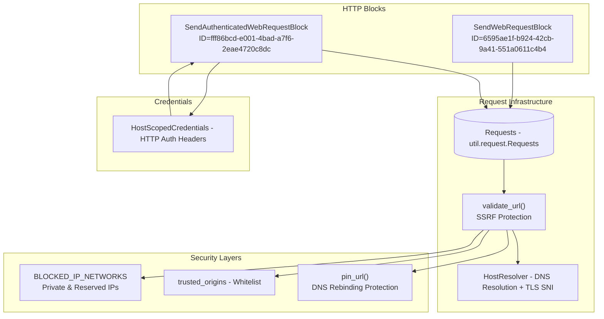

**Sources:** [backend/blocks/http.py:1-277](), [backend/util/request.py:1-580]()

---

### SendWebRequestBlock

This block implements customizable HTTP requests supporting JSON payloads, arbitrary headers, and file uploads.

- **Block ID:** `6595ae1f-b924-42cb-9a41-551a0611c4b4`
- **Input:** URL, HTTP method, headers, JSON or form body, files.
- **Output:** Routed by HTTP response code:
  - `response` for 2xx status
  - `client_error` for 4xx
  - `server_error` for 5xx
  - `error` for exceptions

#### Input Schema Snippet

```python
class Input(BlockSchemaInput):
    url: str  # Target URL
    method: HttpMethod  # GET, POST, PUT, DELETE, PATCH, OPTIONS, HEAD
    headers: dict[str, str]  # Optional HTTP headers
    json_format: bool  # If True, body sent as JSON, else form data
    body: dict | None  # Request payload
    files_name: str  # Form field name for files (default "file")
    files: list[MediaFileType]  # List of files for upload
```

**Request File Preparation Logic:**

- Uses async `store_media_file()` to locally persist incoming media files.
- Reads files via `aiofiles` asynchronously.
- Sets MIME type with `get_mime_type()`.
- Attaches files to a `files_payload` dictionary for multipart upload.

These steps ensure files are properly prepared and streamed in the request.

---

### SendAuthenticatedWebRequestBlock

Extends `SendWebRequestBlock` by integrating HTTP authentication headers bound to hostnames.

- **Block ID:** `fff86bcd-e001-4bad-a7f6-2eae4720c8dc`
- Accepts credentials of type `HostScopedCredentials` containing per-host authentication headers.
- During execution:
  1. Matches credentials to the request URL hostname.
  2. Extracts headers from credentials.
  3. Merges them with user-provided headers (user headers take precedence).
- Sends the HTTP request with combined headers.

This allows seamless authenticated API calls using stored credentials configured for specific hosts.

---

### Requests and Security Infrastructure

The underlying `Requests` class provides robust SSRF defense and retry handling:

#### SSRF Validation (`validate_url()`)

- Canonicalizes and parses the URL.
- Checks scheme enforcement (http/https only).
- IDNA encodes hostname.
- Checks if hostname in optional `trusted_origins` whitelist.
- Resolves hostname DNS to IP addresses.
- Verifies no resolved IP is in private/reserved/broadcast IP ranges as defined in `BLOCKED_IP_NETWORKS`.
- If invalidation occurs, raises `ValueError`.

#### Blocked IP Networks include:

- Private IPv4 ranges: `10.0.0.0/8`, `172.16.0.0/12`, `192.168.0.0/16`
- Loopback: `127.0.0.0/8`, `::1/128`
- Link-local addresses: `169.254.0.0/16`, `fe80::/10`
- Multicast and reserved IPv4/IPv6 ranges
- Other reserved-use addresses

#### DNS Rebinding Mitigation

- `pin_url()` replaces the hostname with a validated IP address.
- `HostResolver` manages connections to pinned IPs while preserving TLS SNI for certificate verification.
- Ensures that TLS hostname validation matches the original hostname, preventing MITM via DNS rebinding.

#### Retry Logic

- Implements automatic retries with exponential backoff and jitter for retryable HTTP status codes (`429, 500, 502, 503, 504, 408`).
- Uses the `tenacity` library's decorators to manage retry policy transparently.

---

### HTTP Request Execution Sequence

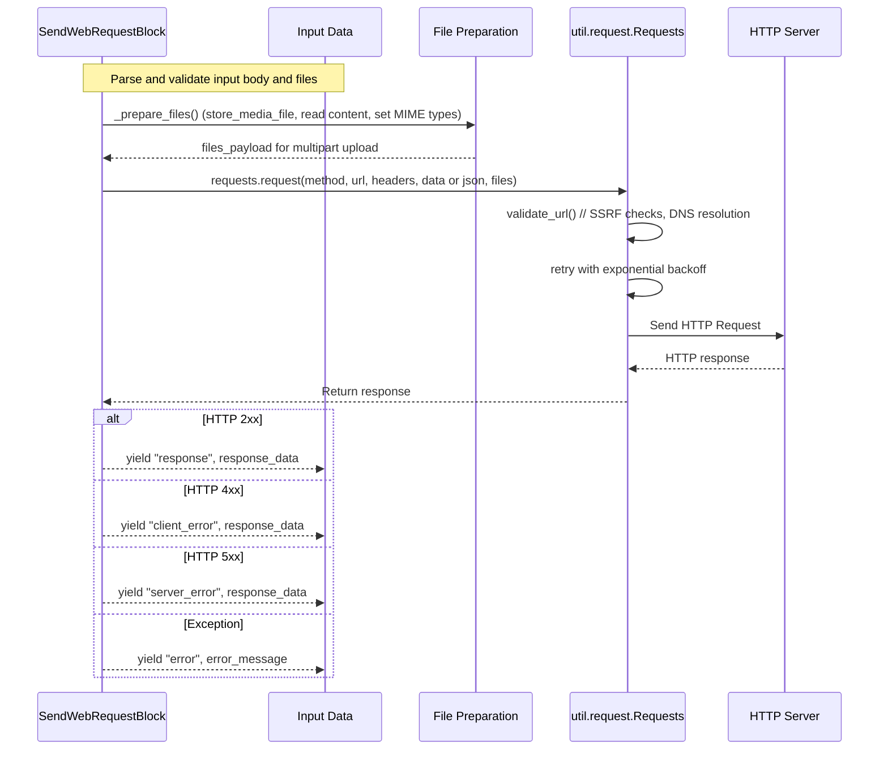

---

## YouTube Transcription Integration

### TranscribeYoutubeVideoBlock

Provides YouTube video transcription by fetching captions via the `youtube-transcript-api` library, optionally routed through proxies.

- **Block ID:** `f3a8f7e1-4b1d-4e5f-9f2a-7c3d5a2e6b4c`
- Accepts YouTube URL and proxy credentials (`WebshareProxyCredentials`).
- Extracts video ID from common YouTube URL formats.
- Fetches transcript preferring English language manually created captions.
- Falls back to any available generated transcript if English is unavailable.
- Formats transcript to plain text.

```mermaid
graph LR
    InputURL["Input YouTube URL"]
    ExtractID["extract_video_id()"]
    VideoID["Video ID"]
    ProxyConfig["WebshareProxyConfig from Credentials"]
    YouTubeAPI["YouTubeTranscriptApi"]
    FetchEnglish["api.fetch(video_id)"]
    NoTranscriptFound{"NoTranscriptFound?"}
    ListAll["List all transcripts"]
    ManualTranscripts["_manually_created_transcripts"]
    GeneratedTranscripts["_generated_transcripts"]
    SelectTranscript["Select first available"]
    Format["TextFormatter.format_transcript()"]
    Output["Yield video_id, transcript text"]

    InputURL --> ExtractID --> VideoID
    VideoID --> YouTubeAPI
    ProxyConfig --> YouTubeAPI
    YouTubeAPI --> FetchEnglish --> NoTranscriptFound
    NoTranscriptFound -- no --> SelectTranscript
    NoTranscriptFound -- yes --> ListAll --> ManualTranscripts
    ManualTranscripts --> SelectTranscript
    ListAll --> GeneratedTranscripts
    GeneratedTranscripts --> SelectTranscript
    SelectTranscript --> Format --> Output
```

---

### Key Implementation Details

- Video ID extraction supports URLs like:

  - Standard: `https://www.youtube.com/watch?v=VIDEO_ID`
  - Shortened: `https://youtu.be/VIDEO_ID`
  - Embed: `https://www.youtube.com/embed/VIDEO_ID`
  - Shorts: `https://www.youtube.com/shorts/VIDEO_ID`

```python
@staticmethod
def extract_video_id(url: str) -> str:
    parsed_url = urlparse(url)
    if parsed_url.netloc == "youtu.be":
        return parsed_url.path[1:]
    if parsed_url.netloc in ("www.youtube.com", "youtube.com"):
        if parsed_url.path == "/watch":
            p = parse_qs(parsed_url.query)
            return p["v"][0]
        if parsed_url.path.startswith("/embed/"):
            return parsed_url.path.split("/")[2]
        if parsed_url.path.startswith("/shorts/"):
            return parsed_url.path.split("/")[2]
    raise ValueError(f"Invalid YouTube URL: {url}")
```

- `WebshareProxyCredentials` specify proxy username/password used to configure `WebshareProxyConfig` for the API client.
- Transcript fetching consists of:

  - Try fetching English transcript (default language).
  - On `NoTranscriptFound` error, list available transcripts.
  - Prefer manually created over generated transcripts.
  - Fetch and return the first available transcript.

- Transcript formatting uses `TextFormatter` from `youtube_transcript_api`.

---

## Communication Blocks: Email

### SendEmailBlock

Sends emails via SMTP with TLS encryption and supports attachments.

- **Block ID:** `4335878a-394e-4e67-adf2-919877ff49ae`
- Uses SMTP, attempts STARTTLS, supports authentication.
- Email body supports both plain text and HTML.
- Handles attachments, encoding them as MIME parts.
- Provides detailed error handling and user-friendly error messages.
- Timeout enforced on socket connections to avoid hangs.

```mermaid
graph TB
    subgraph "Input"
        TO[to_email]
        SUBJECT[subject]
        BODY[body]
        CONFIG[SMTPConfig]
        CREDENTIALS[SMTPCredentials]
    end

    subgraph "SMTP Setup"
        SERVER[smtp_server]
        PORT[smtp_port]
        USERNAME[username]
        PASSWORD[password]
    end

    subgraph "Message Crafting"
        MIME[MIMEMultipart]
        FROM[From header]
        TO_HDR[To header]
        SUBJ_HDR[Subject header]
        TEXT[MIMEText body]
        ATTACHMENTS[Attachments (optional)]
    end

    subgraph "SMTP Connection/Send"
        CONNECT[SMTP connect with timeout]
        STARTTLS[STARTTLS attempt]
        AUTHENTICATE[Login with credentials]
        SENDMAIL[Send mail]
    end

    subgraph "Error Handling"
        GAIERROR[socket.gaierror]
        TIMEOUT[socket.timeout]
        REFUSED[ConnectionRefusedError]
        NOTSUPPORTED[SMTPNotSupportedError]
        SSL[SSLError]
        AUTHFAIL[SMTPAuthenticationError]
        RECIPREFUSED[SMTPRecipientsRefused]
        SENDREFUSED[SMTPSenderRefused]
    end

    CONFIG --> SERVER
    CONFIG --> PORT
    CREDENTIALS --> USERNAME
    CREDENTIALS --> PASSWORD

    TO --> TO_HDR
    SUBJECT --> SUBJ_HDR
    BODY --> TEXT
    TEXT --> MIME
    TO_HDR --> MIME
    SUBJ_HDR --> MIME
    ATTACHMENTS --> MIME

    SERVER --> CONNECT
    PORT --> CONNECT
    CONNECT --> STARTTLS
    STARTTLS --> AUTHENTICATE
    AUTHENTICATE --> SENDMAIL
    MIME --> SENDMAIL

    CONNECT -.-> GAIERROR
    CONNECT -.-> TIMEOUT
    CONNECT -.-> REFUSED
    STARTTLS -.-> NOTSUPPORTED
    STARTTLS -.-> SSL
    AUTHENTICATE -.-> AUTHFAIL
    SENDMAIL -.-> RECIPREFUSED
    SENDMAIL -.-> SENDREFUSED
```

---

### SMTP Configuration Model

```python
class SMTPConfig(BaseModel):
    smtp_server: str  # SMTP server hostname, e.g. "smtp.gmail.com"
    smtp_port: int = 25  # Typically 25, 465 (SSL), or 587 (TLS)
```

---

### Error Handling and Security Features

| Exception                  | User-Facing Explanation                                                     |
|----------------------------|-----------------------------------------------------------------------------|
| `socket.gaierror`           | Cannot connect - verify server address                                     |
| `socket.timeout`            | Connection timeout - server may be down                                    |
| `ConnectionRefusedError`    | Connection refused - check port (587/TLS, 465/SSL, 25/plain)               |
| `SMTPNotSupportedError`     | STARTTLS unsupported - try port 465 or 25                                 |
| `ssl.SSLError`              | SSL/TLS error - server may require different protocol                     |
| `SMTPAuthenticationError`   | Authentication failed - verify credentials                                |
| `SMTPRecipientsRefused`     | Recipient address rejected - verify email                                 |
| `SMTPSenderRefused`         | Sender address rejected - verify authorization                            |

Security:

- **Timeouts:** Socket timeout is 30 seconds to avoid hangs.
- **Credentials:** Stored securely as `SecretStr` in the platform.
- **Encryption:** Uses STARTTLS to encrypt SMTP connection transparently.
- **Attachment support:** Allows various file attachments encoded correctly.

---

## RSS Integration: ReadRSSFeedBlock

This block polls RSS or Atom feeds and outputs new entries.

- **Block ID:** `5ebe6768-8e5d-41e3-9134-1c7bd89a8d52`
- Supports continuous polling with configurable interval.
- Filters feed entries by publication date within the configured time period.
- Implements feed size limit (10MB) to mitigate memory exhaustion attacks.

### RSSEntry Model

```python
class RSSEntry(pydantic.BaseModel):
    title: str
    link: str
    description: str
    pub_date: datetime
    author: str
    categories: list[str]
```

---

### Flow Diagram for RSS Polling

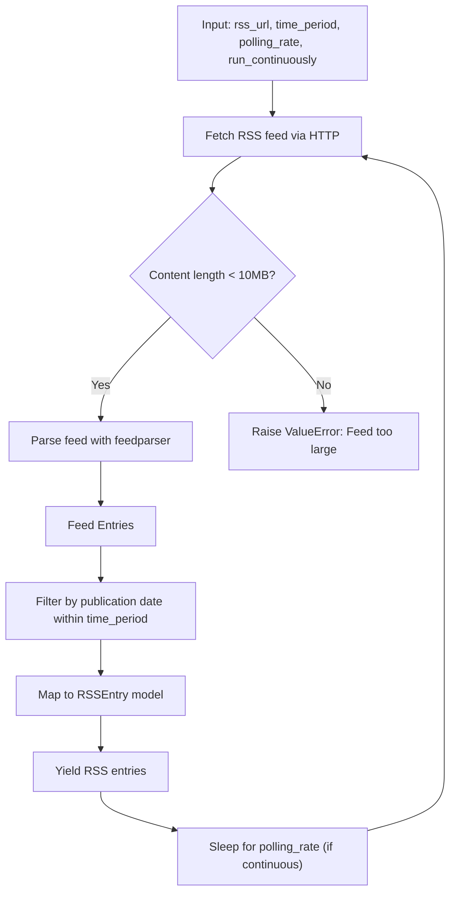

---

### Remark on Security

- The block enforces a hard limit on maximum allowed feed size (10MB) by checking HTTP Content-Length and actual data length before parsing with `feedparser` to prevent resource exhaustion.
- Continuous polling mode yields entries repeatedly with a sleep between iterations.

---

## GitHub Integration Blocks (Summary)

Multiple blocks interact with GitHub using OAuth2 credentials:

- `GithubListPullRequestsBlock`: Lists pull requests for a repo.
- `GithubMakePullRequestBlock`: Creates pull requests.
- `GithubCommentBlock`: Posts comments on issues or PRs.
- `GithubUpdateCommentBlock`: Updates existing comments.

Common implementation patterns:

- Input includes the target repository URL and credentials.
- Each block calls GitHub REST API endpoints using a shared `get_api(credentials)` client.
- Responses parse JSON and map to structured output schemas.
- Supports testing with mock credentials and dummy outputs.

These blocks provide comprehensive developer tooling integration.

---

## Google Integration Blocks

Google Sheets, Gmail, and Drive blocks share common OAuth2 credential infrastructure.

- Utilities exist to parse and format Google Sheets notation (e.g., `parse_a1_notation()`, `extract_spreadsheet_id()`).
- Credentials use refresh tokens, wrapped in `GoogleCredentials` models.
- Services are constructed with Google API Python client libraries (`googleapiclient.discovery.build`) and authenticated with refreshed tokens.
- Google Sheets blocks provide reading/writing sheet ranges, validating spreadsheet types.
- Gmail blocks handle sending, forwarding, reading emails including multipart MIME parsing and attachment handling.

---

## Credential Management for Integration Blocks

Integration blocks use a variety of credential types from the platform's credential models:

| Credential Type           | Example Usage               | Main Fields                                   |
|--------------------------|-----------------------------|-----------------------------------------------|
| `APIKeyCredentials`       | Medium, OpenWeatherMap       | `api_key: SecretStr`                           |
| `UserPasswordCredentials` | SMTP Email, Webshare Proxy   | `username: SecretStr`, `password: SecretStr` |
| `HostScopedCredentials`   | HTTP Authentication          | `host: str`, `headers: dict[str, SecretStr]` |

Blocks declare credentials using `CredentialsField` or `CredentialsMetaInput` with type and provider discriminators. During block execution, credentials are automatically injected, and headers or tokens retrieved as needed.

---

## Security Considerations for Integration Blocks

### SSRF and Network Security

- **URL validation**: Blocks employing outbound HTTP requests use `validate_url()` to ensure safe destinations.
- **Blocked IP ranges**: Private, loopback, link-local, multicast, and reserved IP ranges are disallowed.
- **Trusted origins**: Specific internal hosts can be whitelisted.
- **DNS rebinding defense**: Connections pinned to resolved IP with TLS SNI preserved.
- **Headers security**: Sensitive headers like `Authorization` removed on redirects to different hosts.

### Request and Response Limits

- Large HTTP request bodies are capped (e.g., JSON body limited to 10MB).
- Uploaded files handled with disk storage limits and asynchronous reading.
- RSS feeds limited to 10MB content to prevent memory exhaustion.
- SMTP connections utilize timeouts to prevent indefinite blocking.

---

## Integration Blocks Usage Example Diagrams

### HTTP Request Block Example

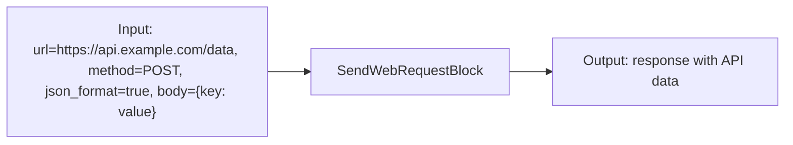

### Authenticated HTTP Call Example

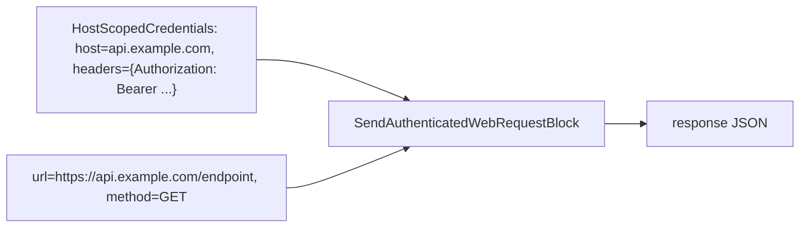

### YouTube Transcription Block Example

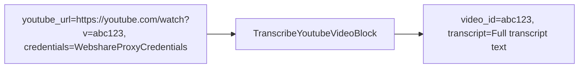

### Email Sending Block Example

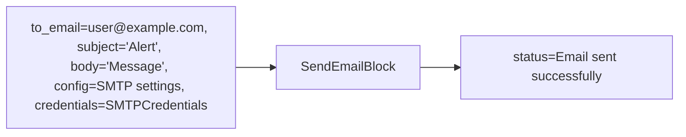

### RSS Feed Reader Block Example

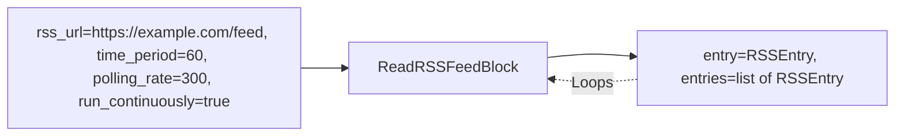

---

# Summary Diagram: System Map from Natural Language to Code Entities

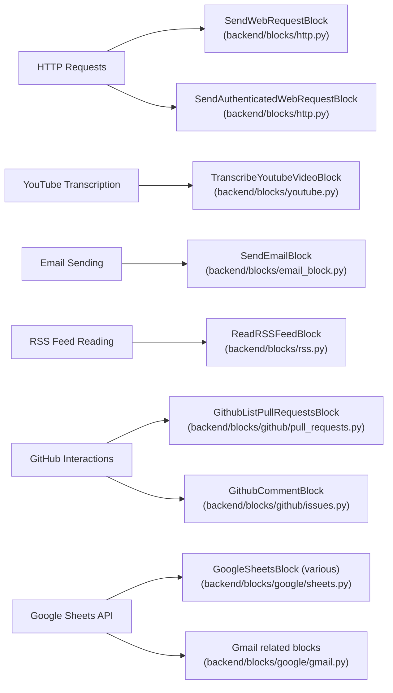

---

# Summary Diagram: Credential Injection Mapping

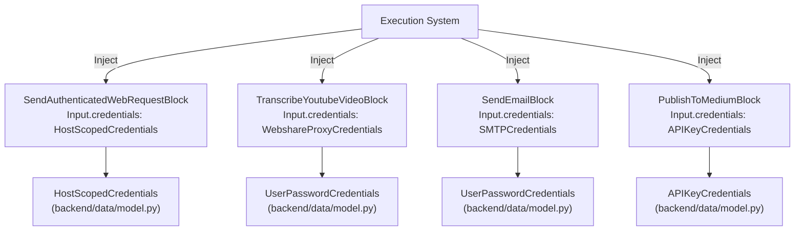

---

# References and Sources

- HTTP blocks and Requests machinery – [backend/blocks/http.py:1-277](), [backend/util/request.py:1-580]()
- YouTube transcription block – [backend/blocks/youtube.py:57-178]()
- Email sending block – [backend/blocks/email_block.py:39-186]()
- RSS feed block – [backend/blocks/rss.py:29-167]()
- GitHub integration blocks – [backend/blocks/github/pull_requests.py:1-197](), [backend/blocks/github/issues.py:31-117]()
- Google Sheets and Gmail blocks – [backend/blocks/google/sheets.py:1-198](), [backend/blocks/google/gmail.py:1-183]()
- Credential types and fields – [backend/data/model.py:1-70]()
- Credential injection patterns across blocks – [backend/blocks/http.py:219-277](), [backend/blocks/youtube.py:57-178](), [backend/blocks/email_block.py:39-186]()

---

